# 第01章：LangChain 1.2 概述

講師：尚硅谷-宋紅康

官網：[尚硅谷](http://www.atguigu.com/)

## 1、為什麼需要LangChain？

### 1.1 從傳統應用到智慧體時代

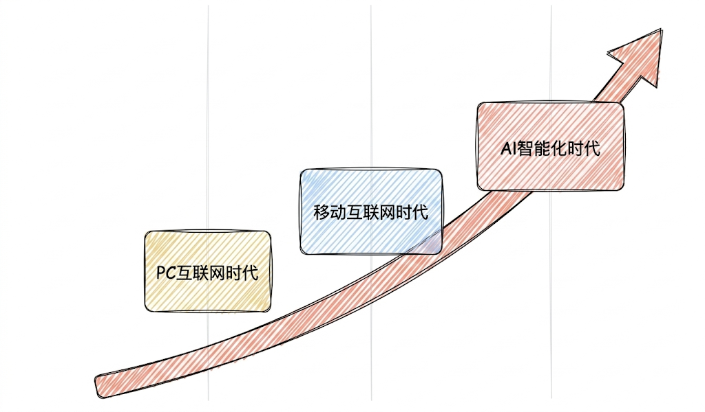

### 1.2 單一的大語言模型的侷限性

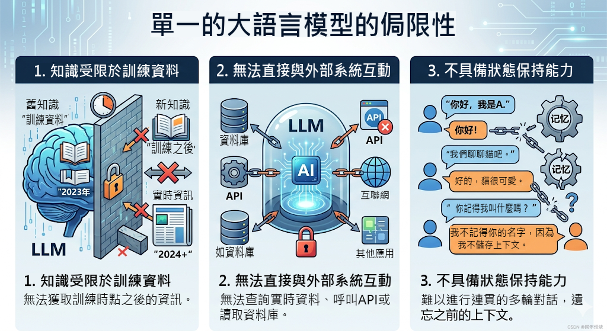

所以要構建真正實用的AI應用，必須將大語言模型與外部工具、資料來源和記憶機制有機結合，從而催生了LangChain框架的設計理念。

LangChain，是當前構建生產級 AI 智慧體系統的**首選**。

### 1.3 LangChain框架的定位

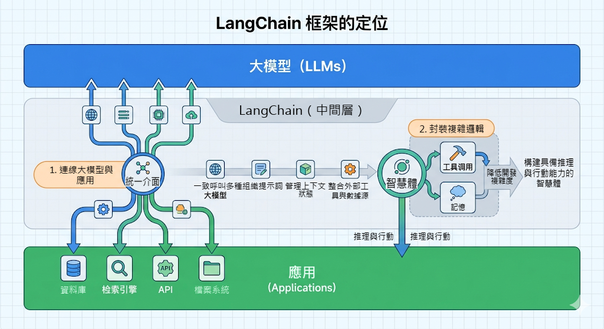

> LangChain 作為大模型與應用間的中間層，可統一呼叫各類大模型、管理提示詞與上下文，還能整合外部工具和資料來源，快速搭建具備推理、行動能力的智慧體。
>
> 核心定位三點：
>
> 1. **打通大模型與外部資源**：統一介面對接資料庫、檢索引擎、API、檔案系統等；2. **封裝底層複雜邏輯**：抽象工具呼叫、記憶等能力，降低智慧體開發難度；  
> 3. **支撐多智慧體協作**：依託 LangGraph 等生態，從單智慧體拓展至多智慧體協作，可構建工業級智慧體。

### 1.4 LangChain的應用場景

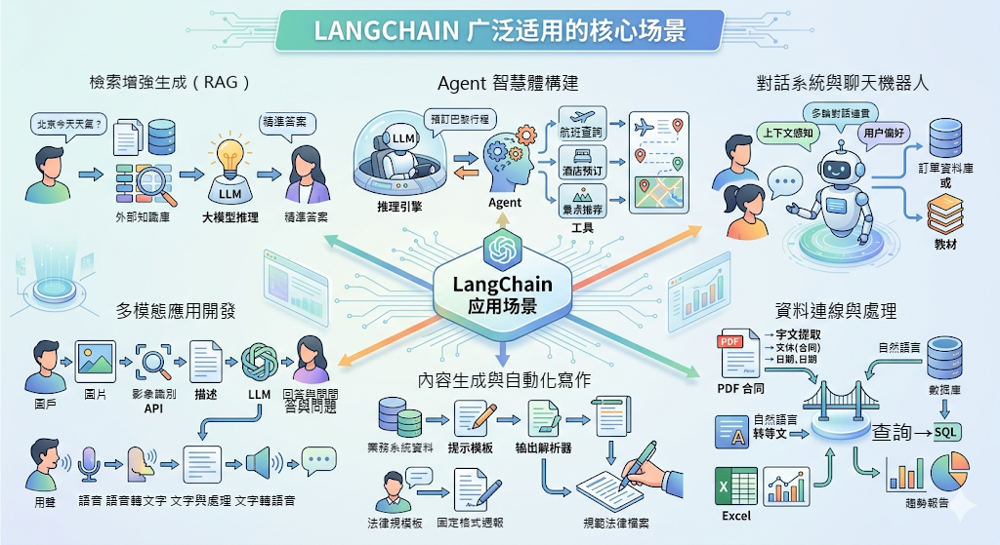

**1. 檢索增強生成 (RAG**)

- **痛點**： 解決大模型知識滯後（無實時資料）和幻覺問題。

- **功能**： 檢索外部知識庫（文件/資料庫）並向量化，讓模型基於最新、最相關的資料回答。

**2. Agent 智慧體構建**

- **痛點**： 解決 LLM 無法直接執行復雜任務的問題。

- **功能**： 將模型作為“推理引擎”，自主規劃路徑並動態呼叫外部工具（如訂票、查報告、寫 SQL），實現複雜任務。

**3. 對話系統與聊天機器人**

- **痛點**： 解決多輪對話中的“記憶”流失問題。

- **功能**： 整合記憶管理系統，記住使用者偏好和歷史互動，並結合私有資料（如教育教材、訂單庫）提供專業服務。

**4. 多模態應用開發**

- **痛點**： 跨越單一文字互動的限制。

- **功能**： 融合影象識別、語音轉文字等技術，讓模型具備處理音影片和圖片的綜合推理能力。

**5. 自動化寫作與格式化生成**

- **痛點**： 解決生成內容格式不標準、質量不穩定的問題。

- **功能**： 配合提示詞模板（Templates）與輸出解析器（Parsers），自動產出規範的報告、合同或郵件。

**6. 資料連線與結構化處理**

- **痛點**： 解決非結構化資料難以被模型直接利用的問題。

- **功能**： 強大的資料連線能力使大模型能夠與各種資料來源和結構化資料互動。比如，從 PDF、Excel 中提取關鍵資訊，或實現自然語言與 SQL 的自動轉換。

### 1.5 大模型相關崗位介紹

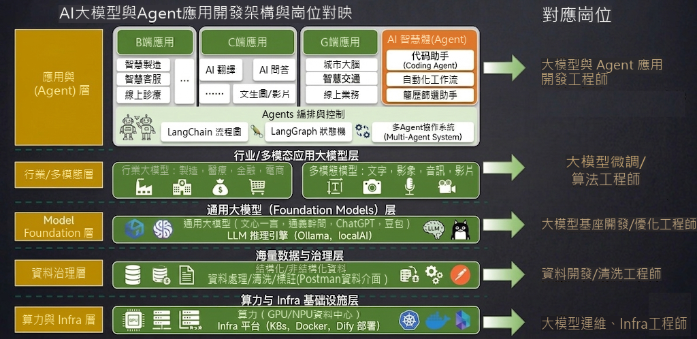

應用開發是大模型最值得關注的方向：**應用為王**！


學習LangChain框架，高效開發大模型應用。

## 2、LangChain是什麼？

### 2.1 LangChain的發展時間線

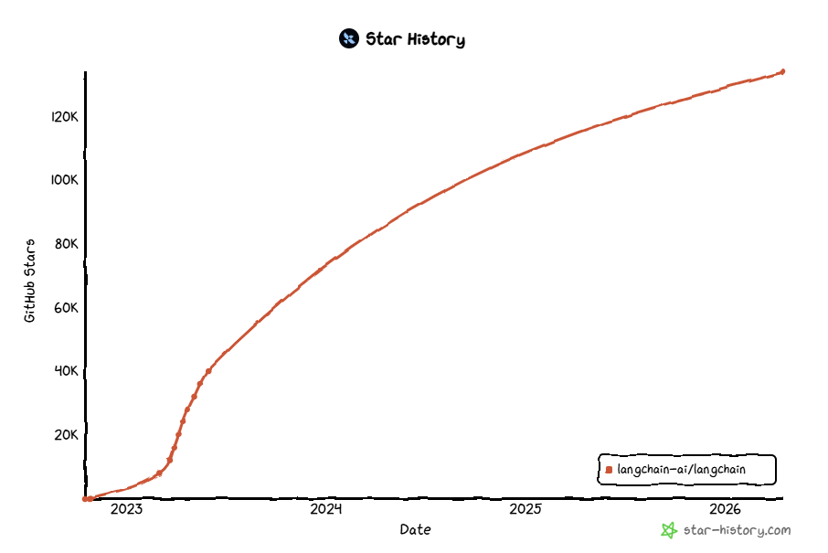

**第1階段：誕生（2022年10月**）

2022年10月，哈佛大學的機器學習專案工程師 `Harrison Chase（哈里森·蔡斯）` 建立了由大語言模型驅動的應用程式的開源框架：LangChain。其名稱來源於" `Language` "（語言模型）和" `Chain` "（鏈式連線）的組合。體現了其核心設計理念——**連結大語言模型與其他各種計算資源和資料，構建強大的AI應用**。

**第2階段：探索期（2022年Q4—2023年Q1**）

LangChain 初版釋出，主要聚焦於PromptTemplate、LLMChain 等基礎模組。其憑藉前瞻性設計，在開源社群迅速走紅，Gitlub Star 數快速破萬，成為早期最受關注的大模型應用框架。

**第3階段：體系化階段（2023年Q2—2023年Q4**）

引入 Tool、Agent、Retrieval 等概念，形成大模型+工具呼叫＋記憶的核心架構，支援構建完成更復雜任務的自動化智慧體。  
同期推出 `LangChain Hub` 與 `LangSmith` ，初步構建了從開發、除錯到部署的生態閉環。

**第4階段：平臺化階段（2024年一2025年上半年**）

`LangGraph` 與 `LangServe` 的釋出是這一階段的標誌。LangGraph 為工作流管理提供了有向圖基礎，而LangServe則解決了服務化部署的難題。至此，LangChain生態完成了從開發框架到智慧體平臺的躍升。

**第5階段：深層智慧體階段（2025年下半年至今**）

正式推出 `Deep Agent` ，官方定位為 `Agent Harness（智慧體執行框架）` ，在LangGraph 和LangChain 之上執行，標誌著LangChain 生態進入新階段，讓開發者可構建基於多智慧體的複雜化智慧體系統。

### 2.2 LangChain的兩個重要版本

**1、LangChain v0.3版本：既愛又恨**

> 長期以來，LangChain 因為 API 變動頻繁而被開發者戲稱為“版本碎鈔機”。

一方面，2024年是LangChain架構重大變革的一年，LangChain團隊推出了LangGraph作為底層智慧體編排框架，並 `將原有的鏈和智慧體標記為棄用` ，轉而採用基於LangGraph構建的統一智慧體抽象。

另一方面，GPT-4逐漸普及，包括呼叫外部工具（Function calling）、結構化輸出、系統提示詞等功能，都成了模型的基礎功能。而對於開發者而言，此時再 `使用LangChain再對這些功能進行封裝就顯得多此一舉` 。

此時，很多開發者的整體使用感受：

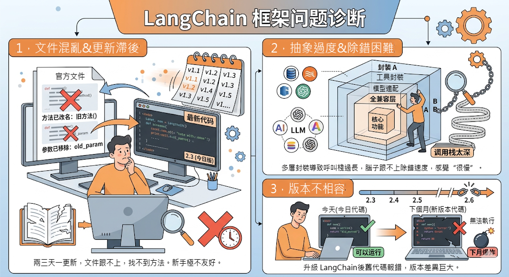

這個階段，LangChain的開發者大規模流失。

**2、LangChain v1.x版本：AI開發新正規化**

> 在經歷了短暫的陣痛後，LangChain進行了一次徹底的架構重構與瘦身。

`2025年10月20日` ，LangChain團隊正式釋出了第一個正式大版本：LangChain v1.0.0與LangGraph v1.0.0，這是 AI 智慧體（Agent）開發領域的 `里程碑事件` ，標誌著框架的成熟和標準化，為企業級AI應用提供了穩定基礎。

官方首次明確 API 穩定保證： `承諾在 2.0 版本前無破壞性變更` 。這種穩定性對於企業級應用，是至關重要的。

釋出同期完成 `1.2億美元融資` ，估值超 12 億美元，印證其作為 AI 基礎設施的戰略價值。

**小結：對比 LangChain v0.3  與 LangChain v1.2（瞭解**）

| **維度** | **LangChain v0.3** | **LangChain v1.2** |
|---|---|---|
| `核心架構與設計理念` | 過渡性版本，設計上以鏈（Chain）為核心。 | 生產級穩定版本，標誌著從“鏈式呼叫”到“智慧體框架”的正規化轉變。 |
| Agent構建方式 | 依賴 `initialize_agent` 等舊版API，基於 `AgentExecutor` 硬編碼。 | 官方推薦使用 `create_agent` 作為 Agent 的標準構建入口，底層基於 LangGraph。 |
| 工具定義 | 透過 `@tool` 裝飾器和 `Tool` 類定義，型別安全性和引數驗證能力較弱。 | 支援透過 Pydantic Schema 定義工具，型別安全，引數定義更清晰。 |
| 結構化輸出 | 主要依賴 JSON Parser 和正規表示式，穩定性較差。 | `Structured Output` 成為一等公民，直接繫結 Pydantic 類，由模型底層保證輸出格式穩定性。 |
| 輸出解析 | 輸出為純文字，需透過正則匹配等方式解析內容，較為繁瑣且易出錯。 | 引入標準化的 `content_blocks` ，將模型輸出（推理、文字、工具呼叫）統一為標準物件，無需再手動解析。 |
| 擴充套件機制 | 缺乏系統性的擴充套件方式，修改邏輯通常需要修改原始碼或提示詞。 | 引入功能強大的 `Middleware（中介軟體）` 系統，允許在模型呼叫、工具執行等各生命週期進行攔截和邏輯擴充套件。 |
| 多模態支援 | 支援不完善，無法無縫整合影象、音訊等多模態資料。 | 完善了多模態適配，可輕鬆實現多模態對話、多模態 RAG 等功能。 |
| 非同步執行效能 | 非同步執行效能一般。 | 非同步執行效能得到最佳化，據稱響應速度提升30% 以上。 |
| 包結構與依賴 | 包結構相對混亂，各模組耦合度較高。 `langchain` 包為直接依賴。內部從 Pydantic v1 升級到 v2，對依賴版本要求更嚴格。 | 包結構清晰，主 `langchain` 包保持輕量，舊功能（如 `Chains` ）被遷移至 `langchain-classic` 包。 `@langchain/core` 作為對等依賴，版本管理更靈活。 |
| Python版本要求 | 要求 Python >= 3.9（停止支援Python 3.8）。 | 要求 **Python >= 3.10**。 |
| 推薦用途 | 適用於維護依賴 v0.3 的老舊專案，不推薦用於新專案開發。 | 是 `所有新專案和學習 LangChain 的首選版本` 。官方承諾 1.x 版本系列不會引入破壞性變更，保證了長期穩定性。 |

### 2.3 LangChain v1.2的主要模組

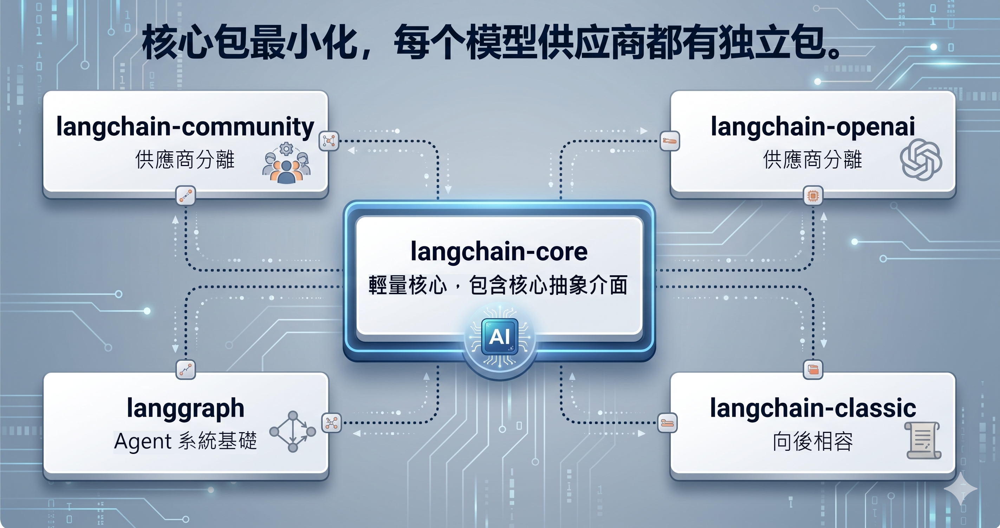

- `langchain-core` ：官方推薦的核心API。比如 Runnable, BaseMessage等

- `langchain-classic` ：冗餘程式碼移或不推薦使用的經典API移到此。比如0.x中常用而1.x移除的API都在這裡。

- `langchain-community` ：第三方整合，比如：合作伙伴包 langchain-openai，langchain-anthropic等，按需安裝、避免臃腫。

- `langgraph` ：深度整合 LangGraph 1.0，協調多個Chain，Agent，Tools完成更復雜的任務，並且還支援迴圈呼叫，是langchain圖形化的增強版

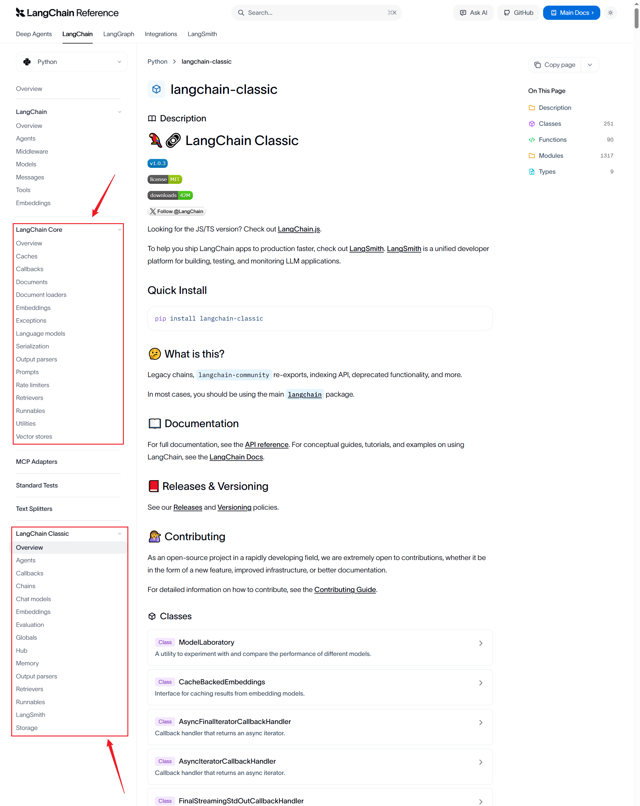

來自：[https://reference.langchain.com/python/langchain/overview](https://reference.langchain.com/python/langchain/overview)

> 不要試圖去學完LangChain的所有API，那是不可能的。
>
> 你只需要搞懂它的核心邏輯與核心模組，其它的用到什麼再去查什麼。把它當成一個工具箱，而不是一本教科書。

### 2.4 API文件

官網：[https://www.langchain.com/](https://www.langchain.com/)

Github地址：[https://github.com/langchain-ai](https://github.com/langchain-ai)

中文文件地址：[https://docs.langchain.org.cn/oss/python/langchain/overview](https://docs.langchain.org.cn/oss/python/langchain/overview)

英文文件地址：[https://docs.langchain.com/oss/python/langchain/overview](https://docs.langchain.com/oss/python/langchain/overview)

API文件查詢地址：[https://reference.langchain.com/python/langchain/](https://reference.langchain.com/python/langchain/)

## 3、LangChain家族四大支柱

截至2025年11月，LangChain 已從一個獨立的開發框架，成長為一個覆蓋智慧體系統全生命週期的技術生態。該生態由四大核心支柱構成： `LangChain` 、 `LangGraph` 、 `Deep Agent` 與 `LangSmith` 。

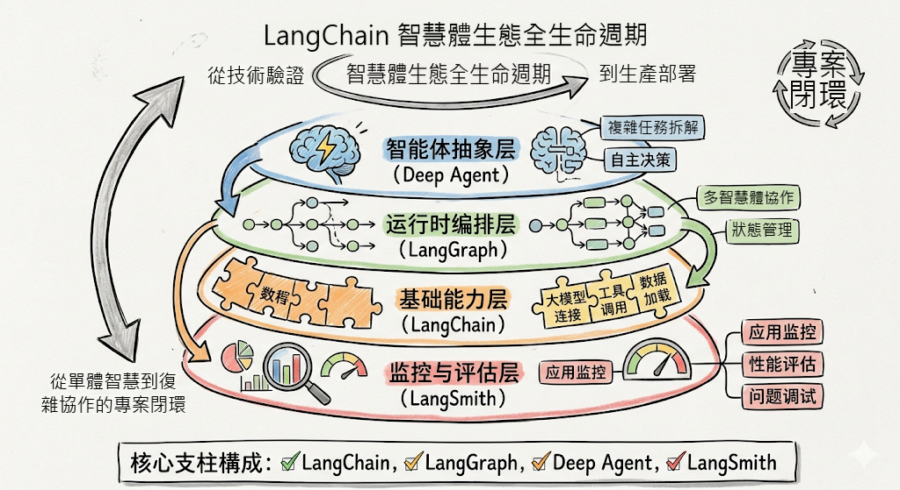

它們分別對應基礎能力層、執行時編排層、智慧體抽象層、監控與評估層，共同構建了一個從技術驗證到生產部署、從單體智慧到複雜協作的專案閉環。

官方文件的解釋：

[https://docs.LangChain.com/oss/python/concepts/products](https://docs.langchain.com/oss/python/concepts/products)

### 3.1 LangChain：智慧體開發的基石

LangChain 是整個生態的核心與起點，為開發者提供了模型呼叫、工具與中介軟體整合、智慧體構建等一整套基礎能力。

其核心價值如下：

- `統一的模型抽象層` ：遮蔽了不同模型服務提供商（如OpenAI、Anthropic、Ollama 等）的介面差異，提供一致的呼叫方式。

- `高度模組化的設計` ：使用 Message、Tool、Agent、Middleware 等元件實現靈活的組合與擴充套件。

- `豐富的整合生態` ：預置了豐富的資料來源、API、中介軟體等，構成了強大的AI能力樞紐。

在整體架構中，LangChain 如同智慧體的作業系統核心，是所有上層能力構建的基礎。

**結論：如果你需要構建簡單的智慧體應用，無需複雜的編排需求，那就選擇LangChain**。

### 3.2 LangGraph：複雜工作流的編排引擎

當智慧體的任務從單一指令執行擴充套件為多步驟、有狀態的複雜工作流時，LangGraph應運而生。

其核心思想是**將智慧體內部抽象為一張有向圖**。

- `節點（Node）` ：代表獨立的功能單元或決策點。

- `邊（Edge）` ：定義了節點之間的流轉條件與路徑。

- `狀態（State）` ：作為一個共享上下文，在節點間傳遞並持久化儲存任務資訊。

透過這種圖式結構，LangGraph 讓智慧體的工作流節點互動變得顯式、可控、可觀測。

> 官方也強調“快速起步用 LangChain，複雜控制用 LangGraph，二者並行協同”。

**通俗理解**：

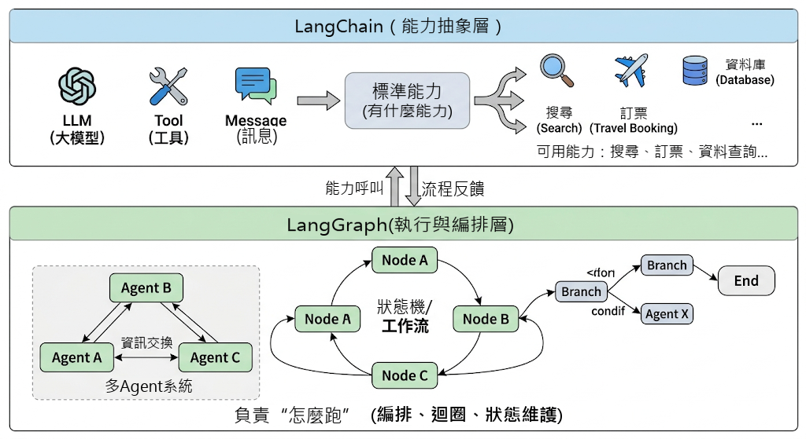

> LangChain = 能力抽象層（LLM / Tool / Message 標準化），負責“有什麼能力”
>
> LangGraph = 執行與編排層（狀態機 / 工作流 / 多Agent系統），負責“怎麼跑”

### 3.3 Deep Agent：智慧體的執行框架

Deep Agent 是新推出的全新元件，被定位為 Agent Harness（智慧體執行框架）。它**構建於LangChain 與LangGraph 之上**，增加了規劃能力、檔案系統、子 Agent 等高階功能。旨在讓開發者`無須從零構建` 複雜的控制邏輯，即可建立具備深度規劃、長期記憶與多專家協作能力的智慧體。

Deep Agent 的核心能力如下：

- `顯式規劃` ：自主生成、執行並動態調整多步任務計劃。

- `虛擬檔案系統` ：為智慧體提供結構化的中間結果與知識儲存。

- `子智慧體` ：支援任務在多個智慧體之間的分解與協作。

- `長期記憶` ：透過與 LangGraph 狀態儲存的結合，實現跨對話的經驗積累。

- `可擴充套件中介軟體` ：允許嵌入安全審計、效能監控或自定義業務邏輯。

### 3.4 三者的關係

官方文件（三者對比）：[https://docs.langchain.com/oss/python/langchain/overview](https://docs.langchain.com/oss/python/langchain/overview)

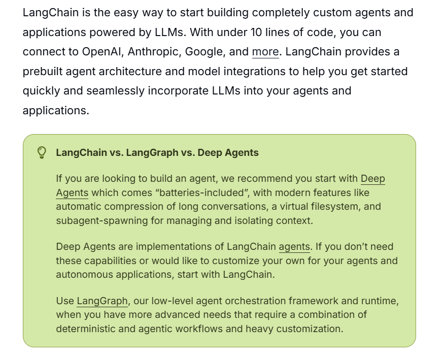

三個框架不是競爭關係，並非互斥，複雜專案完全可以同時用到這三層。

**基於LLM的應用開發體系圖**：

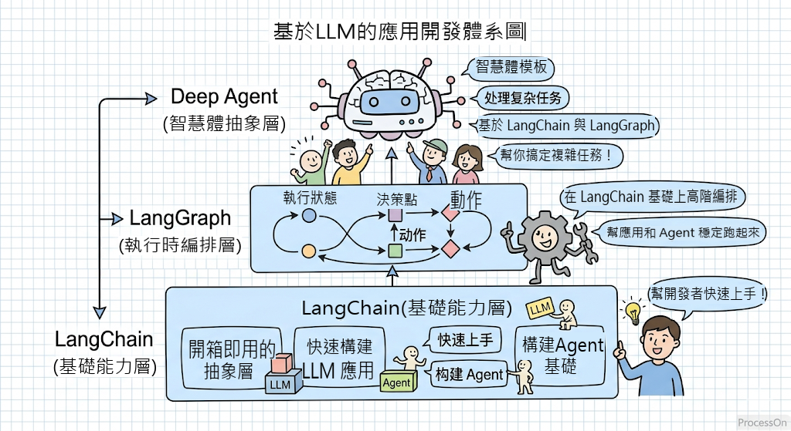

從 LangChain 快速搭建，用 LangGraph 打磨生產穩定性，再用 Deep Agents 賦予 Agent 更強的自主能力——這才是完整的 LangChain 生態玩法。

### 3.5 LangSmith：視覺化監控與測試平臺

當智慧體系統逐漸複雜時，單靠日誌與列印輸出（print）除錯已無法滿足除錯與質量管理的需求。

LangSmith 是 LangChain 官方推出的 `視覺化監控與測試平臺` ，**用於跟蹤、記錄和分析智慧體在執行過程中的完整呼叫鏈路**，讓智慧體的內部執行過程變得透明和可評估。

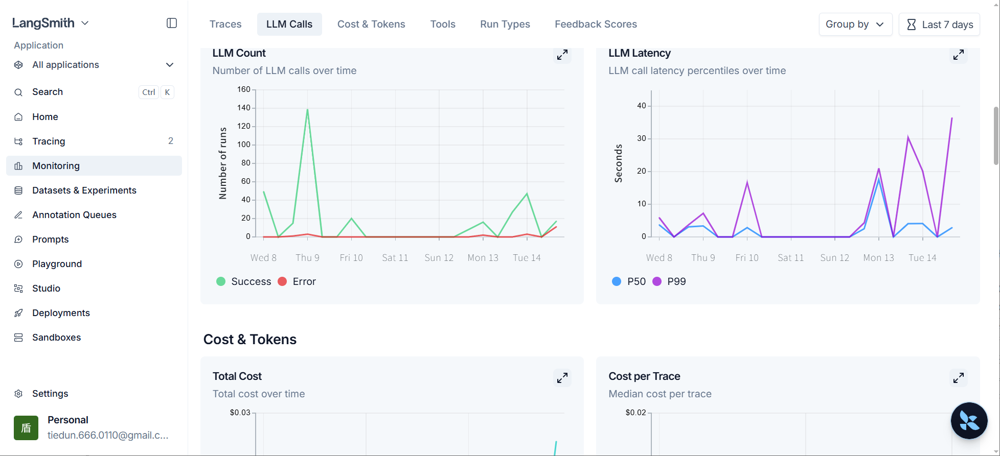

LangSmith 的核心目標如下：

- `全鏈路追蹤` ：視覺化追蹤模型呼叫、提示詞輸入、結果輸出、工具使用等行為。

- `除錯與最佳化` ：發現執行中智慧體的異常行為與效能瓶頸。

- `評測與質量控制` ：支援人工與自動化評測，量化智慧體表現。

- `團隊協作` ：支援多人共享測試集與呼叫記錄。

LangSmith官網：[https://www.langchain.com/langsmith](https://www.langchain.com/langsmith)

LangSmith 的引入使得智慧體的開發、除錯與運維形成了完整的質量閉環。

## 4、開發前的準備工作

### 4.1 前置知識

**1、Python 基礎語法**

- 變數、流程控制、函式與引數機制、類與物件、裝飾器

- 常用的容器（列表、元組、集合、字典）、JSON處理、異常處理

- 模組匯入、包管理（推薦用 `pip` 或 `conda` ） 、執行緒與協程

> LangChain 生態支援包括 Python 和 JavaScript 語言實現。其中，Python 版本仍是功能最完整、更新最及時、社群最活躍的核心實現。

**2、大語言模型基礎**

- 瞭解什麼是 LLM、Token、Prompt、Embedding

- OpenAI API 或其他模型提供商，如 Anthropic、阿里雲百鍊、DeepSeek等

- 透過瀏覽器或app使用過大模型（比如：豆包、千問、DeepSeek等）

### 4.2 相關環境安裝

#### 4.2.1 程式碼管理方案

相較於 `全域性環境（系統環境）` ，各個 `虛擬環境` 都有自己獨立的一套：Python 直譯器、pip 命令、第三方依賴包，不和其它專案產生干擾。

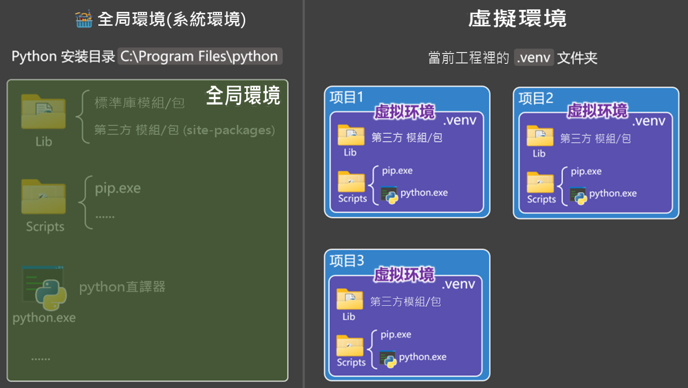

虛擬環境的設定方案：

**方案1-使用conda：適合“Python + 非 Python 依賴”的複雜環境**

conda 不只是 Python 包管理工具，它還可以管理 Python 直譯器、Python 包，以及很多非 Python 依賴，比如： `CUDA、編譯器、系統庫、資料庫驅動、科學計算底層庫` 等非 Python 依賴。

因此在資料科學、深度學習、AI 工程、科學計算等場景中，conda 更穩妥、優先推薦。

注意：**conda 環境中可以使用 pip，但建議先用 conda 裝底層依賴，再用 pip 補充 Python 包，不要隨意反覆交替使用**。

> 本套課程的選擇。

**方案2-使用uv：適合“純 Python 專案”的現代包管理**

uv 是一個現代 Python 包管理工具，主要 `管理 Python 生態依賴` ，不能像 conda 那樣管理 CUDA、系統級資料庫驅動、編譯器這類通用非 Python 依賴。

如果專案主要是普通 Python 開發，這類專案通常可以**優先考慮 uv**。例如：

```
FastAPI 專案
LangChain 專案
指令碼工具
Web 後端
普通 AI Agent 應用
RAG 應用層程式碼
```

**方案3-使用venv：Python 自帶的輕量級虛擬環境工具**

`venv` 是 Python 官方自帶的虛擬環境工具，不需要額外安裝。

它的特點是簡單、輕量：

```bash
python -m venv .venv
```

**注意**： venv 不負責安裝新的 Python 直譯器，只能基於當前已經安裝好的 Python 直譯器建立虛擬環境。同時，venv 也不負責管理 CUDA、系統庫等非 Python 依賴。

**三者對比**：

| **工具** | **管理 Python 直譯器** | **管理Python包** | **管理非Python 依賴** | **適合場景** |
|---|---|---|---|---|
| **conda** | ✅可以 | ✅可以 | ✅可以 | AI、深度學習、科學計算、複雜底層依賴(C/C++，CUDA) |
| **uv** | ✅可以 | ✅可以 | ❌不可以 | 純 Python 專案、Web、Agent、RAG 應用層 |
| **venv** | 不支援原生安裝，基於已有直譯器 | ✅可以 | ❌不可以 | 簡單專案、教學演示、輕量隔離 |

對於LangChain這樣的純Python環境，可以用uv，也可以用conda。本套課程選擇使用conda。

安裝conda環境，見 `《02資料\尚硅谷-conda使用指南.md》`

> 普通 Python 專案：可以用 uv，速度快，體驗好。

#### 4.2.2 安裝虛擬環境與Python直譯器

LangChain基於Python開發，因此需確保系統中安裝了Python直譯器，我們在建立虛擬環境過程中安裝Python直譯器。

LangChain 1.2版本要求Python版本為 `3.10+以上` ，這裡我們使用 `python3.13.12` 版本。

> 注意：如下包的安裝，必須顯式指明版本，否則可能會出現不相容情況。

**1、建立conda環境**：

```bash
#建立一個名為langchain1.2的環境，指定Python版本是3.13.12
conda create --name langchain1.2 python=3.13.12

#檢視anconda安裝好的python環境
conda env list

#初始化虛擬環境 (執行完此指令，重新啟動命令列視窗)
conda init

#在命令列視窗切換到某python環境
conda activate langchain1.2

#驗證python版本
(langchain1.2) C:\Users\shkstart>python -V
#或 呼叫：python --version
#輸出：Python 3.12.13
```

**2、退出/刪除conda環境**：

```bash
#在命令列退出當前python環境
(langchain1.2) C:\Users\shkst>conda deactivate

#刪除一個已有的anconda管理的python環境
conda remove --name langchain1.2 --all
```

#### 4.2.3 下載langchain安裝包

`方式1：使用conda指令` （推薦）

```bash
# 安裝指定版本。比如1.2.2
conda install langchain==1.2.12
# 或者安裝最新版（預設倉庫）
conda install langchain


# 指定頻道（如 conda-forge）
conda install -c conda-forge langchain==1.2.12

# 更新包
conda update langchain

# 解除安裝包
conda uninstall langchain

# 檢視已安裝包
conda list
```

> conda 包通常來自 defaults 或 conda-forge。
>
> `-c` ：是 `--channel` 的縮寫，conda用於指定包的安裝來源渠道。
>
> `conda-forge` ：該源比官方預設渠道更新更快、包更全

`方式2：使用pip指令`

```bash
# 安裝指定版本
pip install langchain==1.2.12
#安裝最新版（不推薦）：pip install langchain

# 使用指定源：國內映象加速 （解決下載慢）  -i：指定映象源
pip install langchain==1.2.12 -i https://pypi.tuna.tsinghua.edu.cn/simple

# 從舊版本升級到新版本
pip install --upgrade langchain
#或者 pip install -U langchain==1.2.12

# 解除安裝包
pip uninstall langchain

# 檢視已安裝包
pip list
```

**建議：優先 conda install，conda沒有，再用pip install**。

> 二者區別：
>
> conda依賴檢查嚴格，pip相對寬鬆；
>
> conda 管環境 + 依賴 + 穩定性，pip 只管Python 包；
>
> conda：支援Python 包 + 非 Python 包；pip：只支援 Python 包。

```bash
# 檢查包來源
conda list   # Conda 安裝的包顯示頻道，pip 安裝的顯示 `pypi`
```

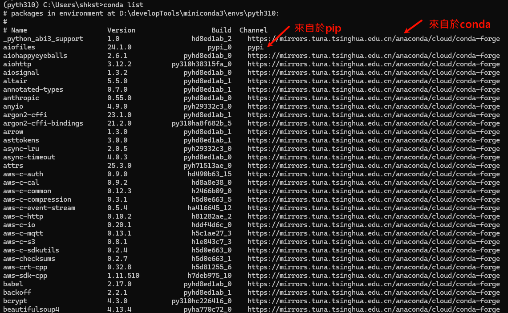

#### 4.2.4 PyCharm開發環境

PyCharm作為專業的Python IDE，具有強大的程式碼編輯、除錯和版本控制功能。

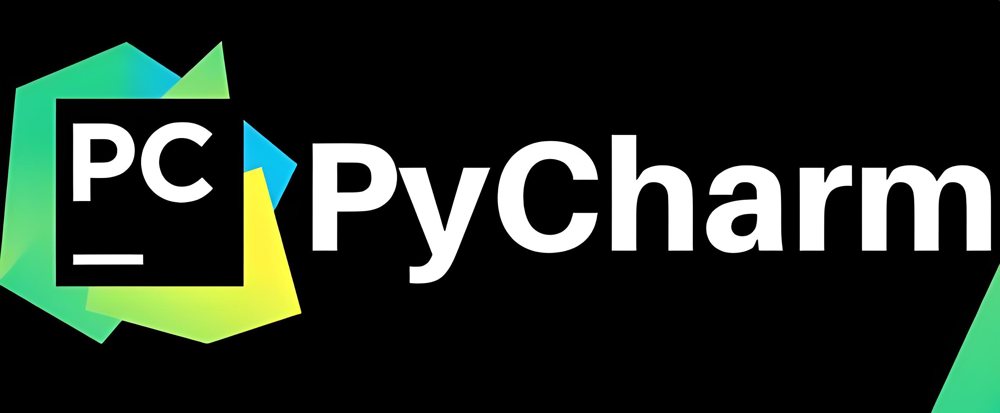

[https://www.jetbrains.com/pycharm/download/other/#releases-2025](https://www.jetbrains.com/pycharm/download/other/#releases-2025)

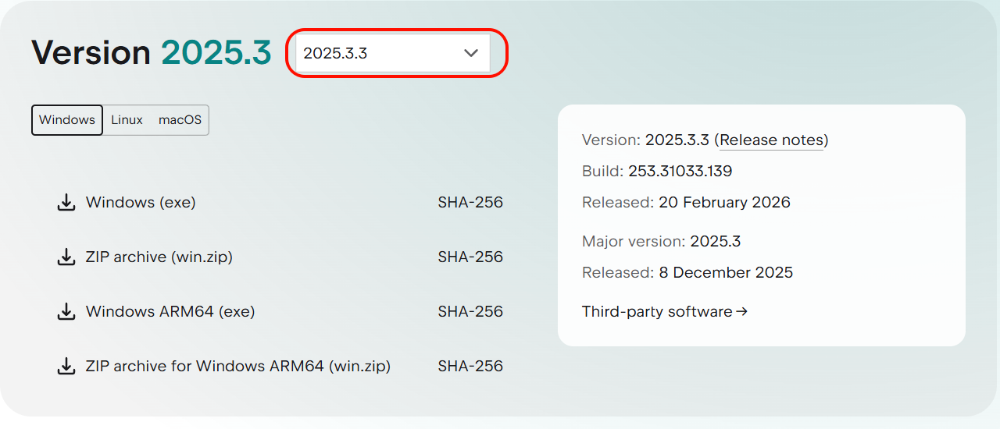

建立新的工程，並設定Python直譯器（選擇Anaconda環境）。

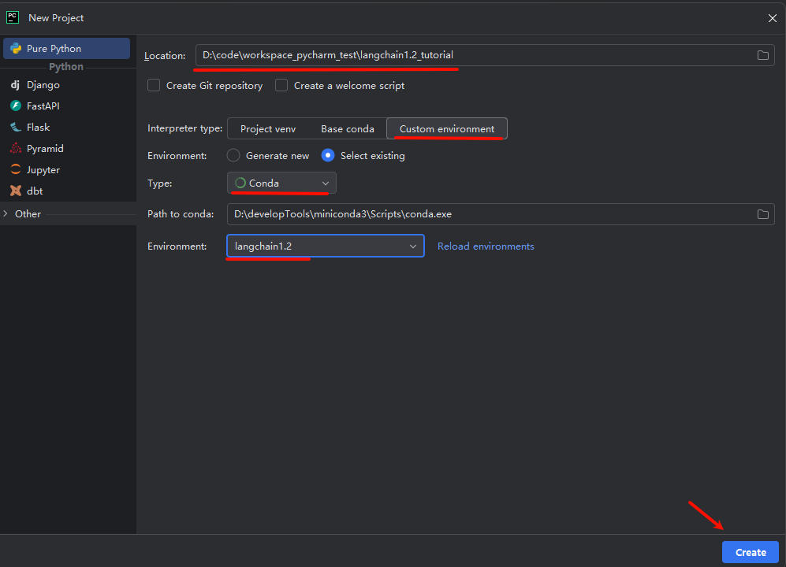

```python
import langchain

print(langchain.__version__)
```

## 5、大模型應用場景介紹

大模型應用技術特點：門檻低，天花板高。

### 5.1 RAG開發

**1）背景**

`大模型的知識凍結` ：隨著 LLM 規模擴大，訓練成本與週期相應增加，模型 `無法實時學習` 到最新的資訊或動態變化。導致 LLM 難以應對諸如“請推薦現在的熱門影片”等時間敏感的問題。

`大模型幻覺` ：涉及到大模型從未在訓練過程中學習過的資訊時，大模型無法給出準確的答覆，轉而開始臆想和編造答案。

**2）舉例**

LLM在考試的時候面對陌生的領域，答覆能力有限，然後就準備放飛自我了，而此時RAG給了一些提示和思路，讓LLM懂了開始往這個提示的方向做，最終考試的正確率從60%到了90%！

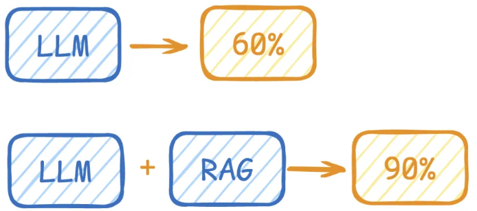

**3）何為RAG**？

Retrieval-Augmented Generation（檢索增強生成）

圖1：

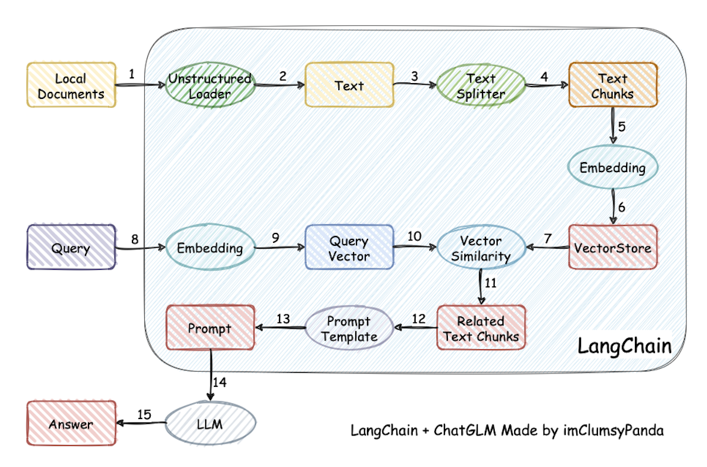

圖2：

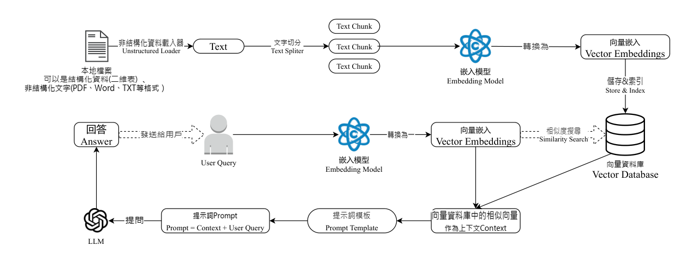

> 檢索-增強-生成過程：檢索可以理解為第10步，增強理解為第13步（這裡的提示詞包含檢索到的資料），生成理解為第15步。

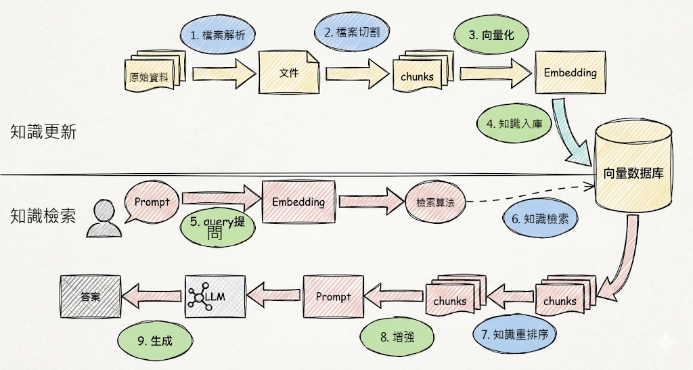

> 這些過程中的難點：1、檔案解析 2、檔案切割  3、知識檢索   4、知識重排序
>
> 1、檔案解析：如果是pdf，內部包含檔案、圖片、表格，圖片上還有文字，需要處理。
>
> 2、檔案切割：沒有固定的格式
>
> 3、在 RAG 應用中，隨著文件數量增加，召回準確率會下降，引入reranker（重排器）可對初步召回的較多 chunk（如 top 20 或 top 50）進行精排，提高召回準確率，防止LLM 處理無關資訊，減少時間和成本。
>
> 此外，與基於基本向量搜尋的 RAG 相比，reranker增強型 RAG 的成本更高，但與僅依靠LLM 生成答案相比，它的成本低些。

**Reranker的使用場景**：

- 適合：追求 `回答高精度` 和 `高相關性` 的場景中特別適合使用 Reranker，例如專業知識庫或者客服系統等應用。

- 不適合：引入reranker會增加召回時間，增加檢索延遲。服務對 `響應時間要求高` 時，使用reranker可能不合適。

### 5.2 Agent開發

充分利用 LLM 的推理決策能力，透過增加規劃、記憶和工具呼叫的能力，構造一個能夠獨立思考、逐步完成給定目標的 Agent（智慧體）。

類比舉例：

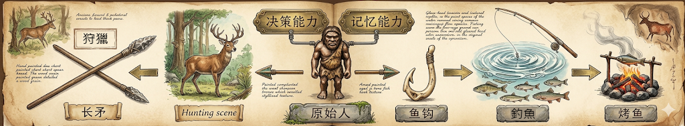

[OpenAI的元老翁麗蓮(Lilian Weng)於2023年6月在個人部落格（https://lilianweng.github.io/posts/2023-06-23-agent/）首次提出了現代AI Agent架構。](https://lilianweng.github.io/posts/2023-06-23-agent/)


一個數學公式來表示：

**Agent = LLM + Planning +  Tools + Memory + Action**

> 比如，打車到西藏玩。
>
> 大腦中樞：規劃行程的你
>
> 規劃：步驟1：規劃打車路線，步驟2：訂飯店、酒店，。。。
>
> 呼叫工具：呼叫MCP或FunctionCalling等API，滴滴打車、攜程、美團訂酒店飯店
>
> 記憶能力：溝通時，要知道上下文。比如訂酒店得知道是西藏路上的酒店，不能聊著聊著忘了最初的目的。
>
> 能夠執行上述操作。說走就走，不能紙上談兵。

智慧體核心要素被細化為以下模組：

**1、大模型（LLM）作為“大腦**”：提供推理、規劃和知識理解能力，是AI Agent的決策中樞。

> 大腦主要由一個大型語言模型 LLM 組成，承擔著資訊處理和決策等功能， 並可以呈現推理和規劃的過程，能很好地應對未知任務。

**2、規劃決策（Planning**）：透過任務分解、反思與自省框架實現複雜任務處理。例如，利用思維鏈（Chain of Thought）將目標拆解為子任務，並透過反饋最佳化策略。

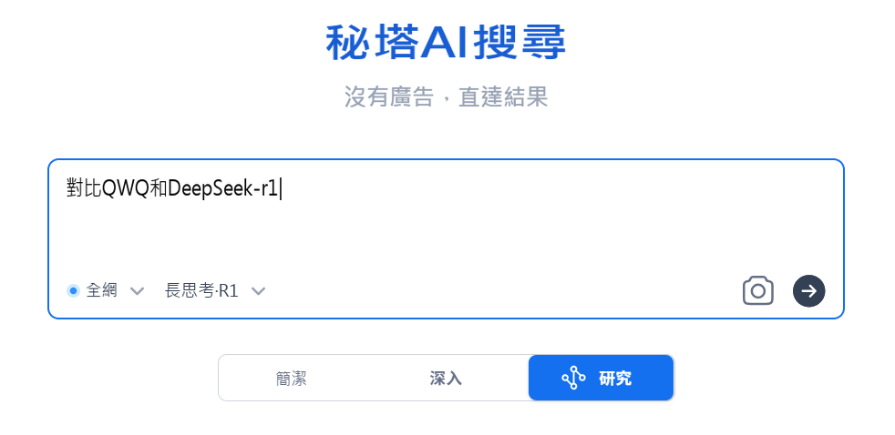

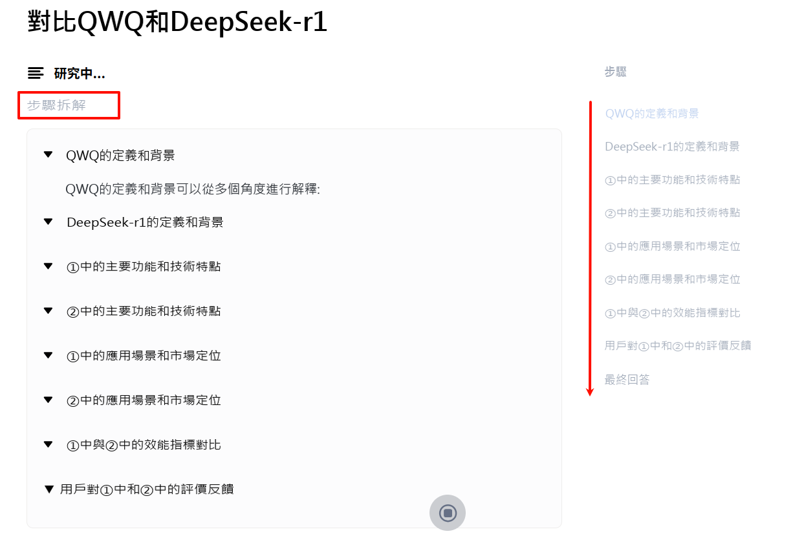

**3、工具使用（Tool Use**）：呼叫外部工具（如API、資料庫）擴充套件能力邊界。

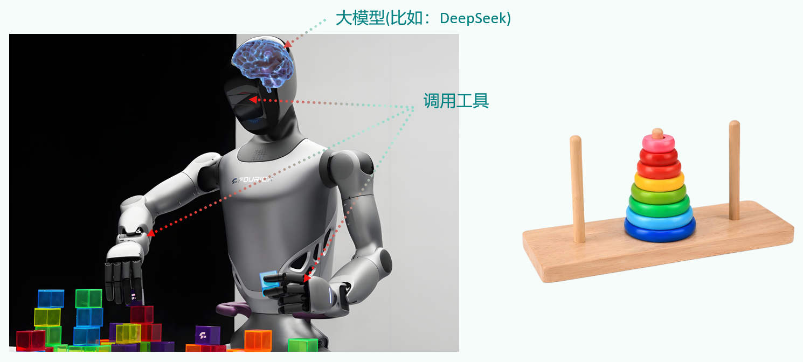

**4、記憶（Memory**）

> 智慧體像人類一樣，能留存學到的知識以及互動習慣等，這樣的機制能讓智慧體在處理重複工作時呼叫以前的經驗，從而避免使用者進行大量重複互動。

- **短期記憶**：儲存單次對話週期的上下文資訊，屬於臨時資訊儲存機制。受限於模型的上下文視窗長度。

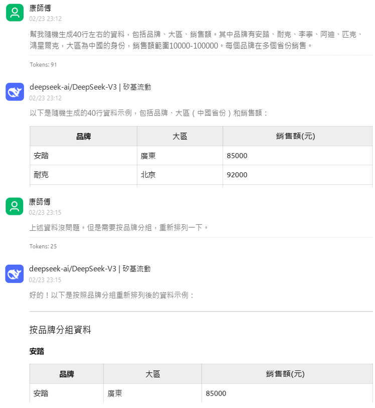

> ChatGPT：支援約8k token的上下文
>
> GPT4：支援約32k token的上下文
>
> 最新的很多大模型：OpenAI GPT‐5.5 / GPT‐5.4 Pro支援100 萬 Token（1M）、Anthropic Claude Opus 4.7支援200 萬 Token、DeepSeek‐V4‐Pro支援100 萬 Token、甚至有模型支援1000萬 token的上下文 （相當於2000萬字文字或20小時影片）

- **長期記憶**：可以 `橫跨多個會話或時間週期` ，可儲存並呼叫核心知識，非即時任務。

  - 比如，關於使用者的偏好，過去執行過的指令等。

  - 長期記憶，可以透過 `模型引數微調（固化知識）` 、 `知識圖譜（結構化語義網路）` 或 `向量資料庫（相似性檢索）` 方式實現。

**5、行動（Action**）：實際執行決策的模組，涵蓋軟體介面操作（如自動訂票）和物理互動（如機器人執行搬運）。比如：檢索、推理、程式設計等。

> 智慧體會形成完整的計劃流程。例如先讀取以前工作的經驗和記憶，之後規劃子目標並使用相應工具去處理問題，最後輸出給使用者並完成反思。

### 5.3 大模型應用開發的4個場景

#### 場景1：純 Prompt

- Prompt是操作大模型的唯一介面

- 當人看：你說一句，ta回一句，你再說一句，ta再回一句...

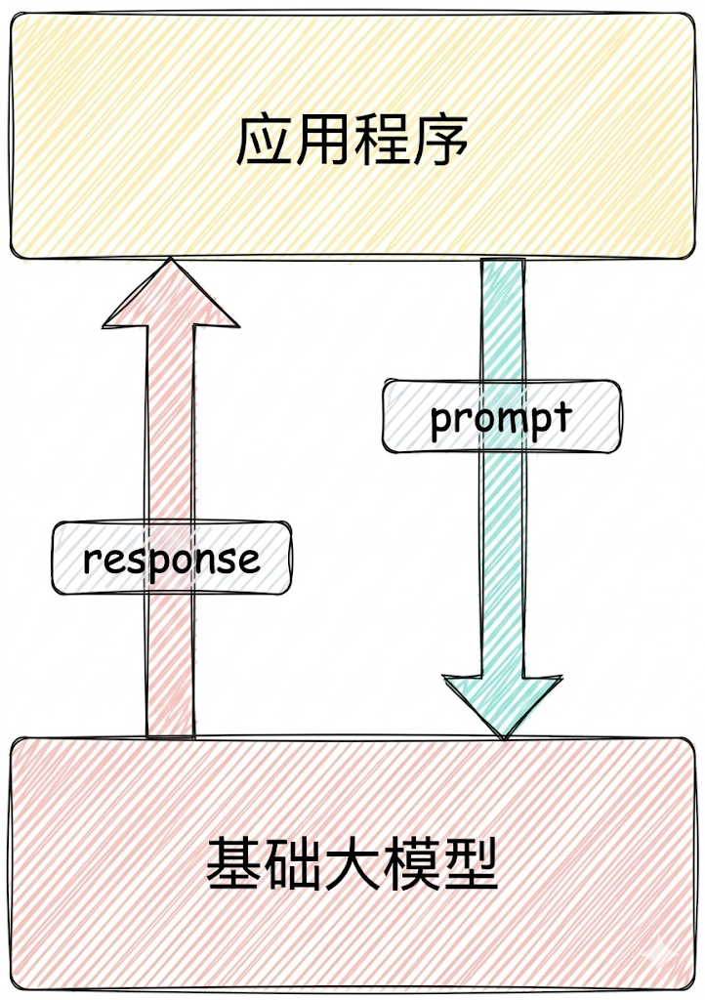

#### 場景2：Agent + Function Calling

- Agent：AI 主動提要求

- Function Calling：需要對接外部系統時，AI 要求執行某個函式

- 當人看：你問 ta「我明天去杭州出差，要帶傘嗎？」，ta 讓你先看天氣預報，你看了告訴ta，ta 再告訴你要不要帶傘

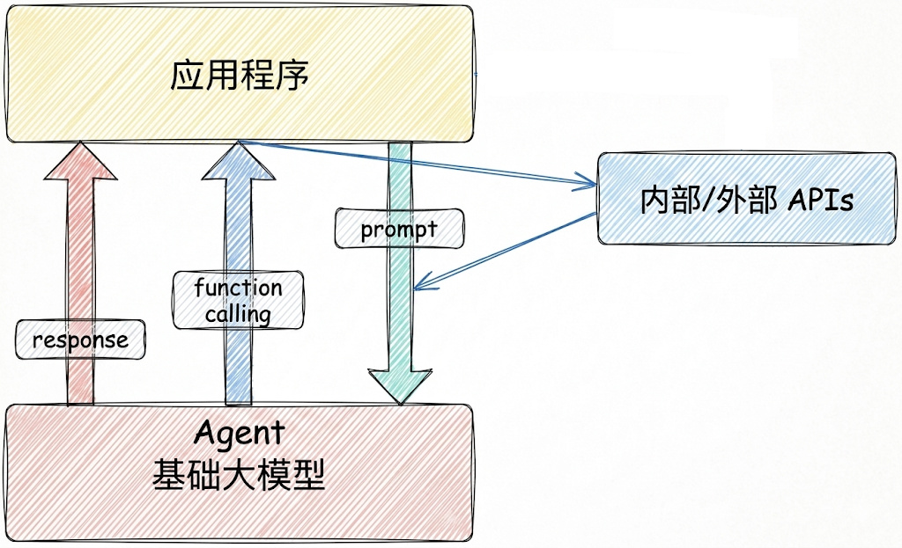

#### 場景3：RAG (Retrieval-Augmented Generation)

RAG：需要補充領域知識時使用

- Embeddings：把文字轉換為更易於相似度計算的編碼。這種編碼叫向量

- 向量資料庫：把向量存起來，方便查詢

- 向量搜尋：根據輸入向量，找到最相似的向量

舉例：考試答題時，到書上找相關內容，再結合題目組成答案

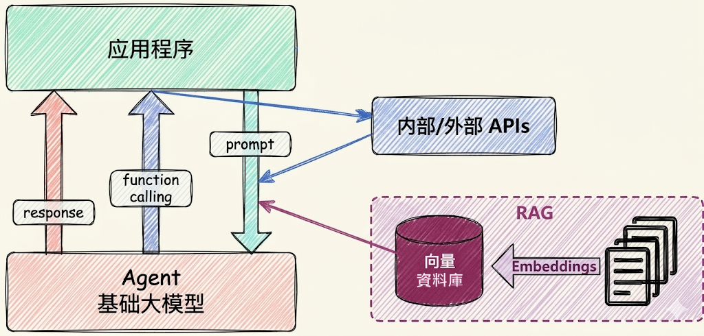

這個在智慧客服上用的最廣泛。

#### 場景4：Fine-tuning(精調/微調)

舉例：努力學習考試內容，長期記住，活學活用。

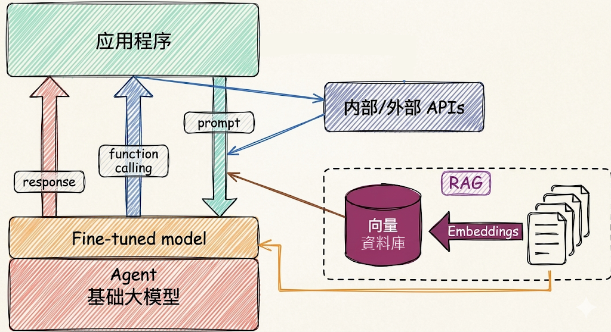

特點：成本最高；在前面的方式解決不了問題的情況下，再使用。

#### 如何選擇相關技術

面對一個需求，如何開始，如何選擇技術方案？下面是個常用思路：

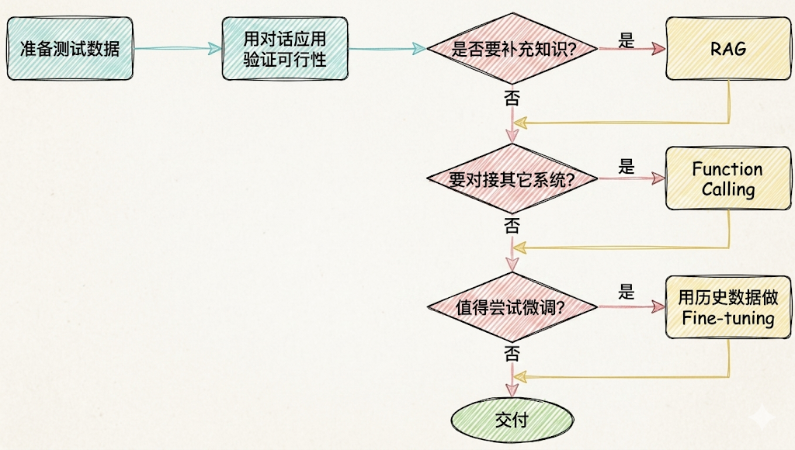
