# 第02章：模型的建立與呼叫

講師：尚硅谷-宋紅康

官網：[尚硅谷](http://www.atguigu.com/)

本章對應的官網文件出處：

英文文件：[https://docs.langchain.com/oss/python/langchain/models](https://docs.langchain.com/oss/python/langchain/models)

中文文件：[https://docs.langchain.org.cn/oss/python/langchain/models](https://docs.langchain.org.cn/oss/python/langchain/models)

## 1、模型呼叫的準備工作

### 1.1 一張老圖看大模型的呼叫

在LangChain v0.3版本中，提到了Model I/O，包括輸入提示(Format)、呼叫模型(Predict)、輸出解析(Parse)。分別對應著 `Prompt Template` ， `Model` 和 `Output Parser` 。

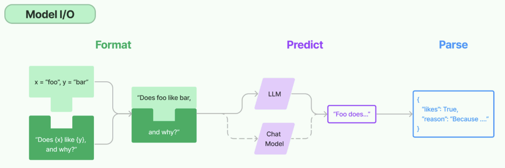

關於模型呼叫模組，如今對話模型已經是主要形式。從歷史上解讀：

在GPT-3時代，大模型以 `補全模型` 為主，只能以類似“成語接龍”的方式對文字進行補全，並且實際執行效果也 `非常不穩定` 。此時LangChain藉助一些高層封裝的API，能夠讓模型完成對話、呼叫外部工具、甚至是結構化輸出等功能，為開發者提供了極大的便利。

伴隨著GPT-3.5模型的釋出， `對話模型` 正式登上歷史的舞臺，並逐漸 `成為主流` 。而得益於對話模型更強的指令跟隨能力，很多GPT-3需要藉助LangChain才能完成的工作，已經成為GPT-3.5原生自帶的一些功能。

> 所以，本章只提供了對話模型的建立，而沒有了非對話模型。

### 1.2 模型初始化的分類方式

> 簡單來說，就是用誰家的API以什麼方式建立存放在哪個位置的大模型

**角度1：呼叫誰家的API**

- 使用模型提供商的庫

- 使用LangChain統一方式（ `推薦` ）

**角度2：模型初始化時，幾個重要引數(如BASE_URL、API-KEY)的書寫位置的不同**：

- 使用配置檔案（ `推薦` ）

- 硬編碼：寫在程式碼檔案中

**角度3：呼叫的模型所在位置**

- 線上部署的大模型

- 本地部署的大模型

> LangChain作為一個“工具”，不提供任何 LLMs，而是依賴於第三方整合各種大模型。這裡就看大模型到底部署在哪裡。

### 1.3 線上大模型服務平臺

有許多提供大模型API服務的平臺，使用時只需要註冊、充值並建立API-Key，之後即可使用API-Key與URL來呼叫平臺提供的相應的模型的服務。

| **平臺** | **網址** | **備註** |
|---|---|---|
| `OpenRouter` | [https://openrouter.ai/](https://openrouter.ai/) | 全球主流,含國外模型 |
| `CloseAI` | [https://platform.closeai-asia.com/](https://platform.closeai-asia.com/) | 亞洲最大,含國外模型 |
| 阿里雲百鍊 | [https://bailian.console.aliyun.com/](https://bailian.console.aliyun.com/) | 企業端友好 |
| 矽基流動 | [https://www.siliconflow.cn/](https://www.siliconflow.cn/) | 價效比高，適合個人 |
| 百度千帆 | [https://console.bce.baidu.com/qianfan/overview](https://console.bce.baidu.com/qianfan/overview) | 主打百度生態 |
| 火山引擎 | [https://console.volcengine.com/ark/](https://console.volcengine.com/ark/) | 主打位元組多模態生態 |

說明：每個平臺配置時，都需要幾個要素： `模型名` 、 `api-key` 、 `base-url` 。

> 如果大家想使用國外的大模型，就選擇前兩個；如果只使用國內的大模型，可以選擇後四個。
>
> 阿里雲百鍊：所有新使用者可獲得**超過5000萬Tokens的免費額度**及4500張圖片生成額度。適合toB企業使用者
>
> 矽基流動，號稱9B 以下模型永久免費，**開源模型價格低**，適合個人學習。
>
> 此外，還有各個模型自己的廠商平臺。比如deepseek、智譜等。
>
> [OpenRouter](https://openrouter.ai/)是一個第三方映象站，專門轉發大模型廠商的API服務。透過它我們可以間接呼叫幾乎所有大模型廠商的API服務。支援國內直連。
>
> OpenRouter支援支付寶或微信充值，**最低限額$5，稅費$0.8**，此外，如果呼叫的**模型禁止**在國內使用，如ChatGPT，則無法透過OpenRouter直接呼叫（需要Magic），會提示**This model is not available in your region**，根據個人情況，決定是否充值並呼叫OpenRouter API。

### 1.4 提前安裝所有依賴

課程中會涉及到多個庫的安裝，這裡一併宣告在 `requirements.txt 檔案` 中。

同時，LangChain的版本變化較快，不同版本之間可能存在相容問題，為了避免因版本不一致導致的問題，本課程會透過 requirements.txt `固定主要依賴版本` 。

**用法**：將requirements.txt存放到專案所在的目錄下，執行

```bash
(langchain1.2) PS D:\code\workspace_pycharm_llm\langchain1.2_tutorial>
pip install -r .\requirements.txt
```

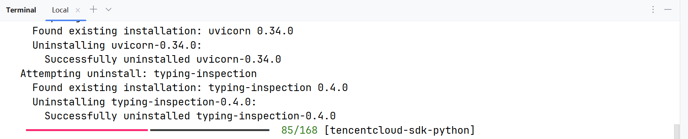

**說明**：課程中的部分章節會單獨列出相關依賴，主要是為了幫助大家瞭解該章節涉及的核心庫。 `無需重複安裝` ，這些依賴已經統一包含在 requirements.txt 中。

## 2、模型初始化角度1：使用模型提供商庫

在 LangChain 中初始化模型，主要可以透過直接**使用特定的Model Class**和**使用統一的init_chat_model函式**這兩種方式來實現。

這裡先講方式1，這種方式最直接。LangChain為一些大模型供應商提供了專門的Model類，匯入對應的具體類（如 ChatOpenAI、ChatAnthropic、ChatDeepSeek、ChatOllama、ChatHunyuan、ChatTongyi、ChatZhipuAI）並進行例項化。

官網連結：[https://reference.langchain.com/python/langchain-community/chat-models](https://reference.langchain.com/python/langchain-community/chat-models)

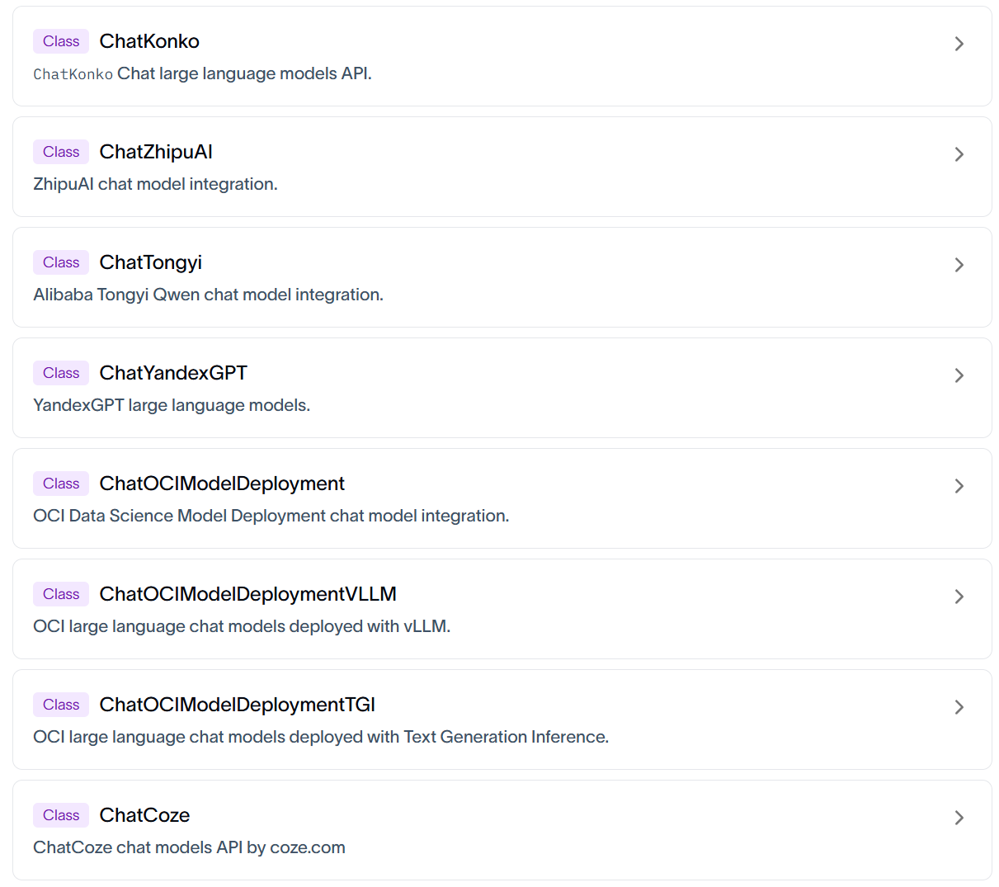

### 2.1 透過專用API呼叫

注意：使用不同的模型可能傳入的引數名稱不同，可以參考對應的原始碼。

#### 2.1.1 DeepSeek大模型

官網：[https://www.deepseek.com/](https://www.deepseek.com/)

**步驟1：安裝必要的依賴(略**)

執行過前面的requirements.txt檔案指令的情況下，這裡就不需要安裝了。

```bash
#切換python環境
conda activate langchain1.2

#安裝ChatOpenAI依賴包
pip install langchain-openai

#安裝ChatDeepSeek 依賴包
pip install langchain-deepseek

# 用於環境管理的包
pip install python-dotenv
```

**說明**：langchain-deepseek 是使用deepseek 大模型必要依賴。

**注意**： `langchain-deepseek` 依賴於 `langchain-openai` ，安裝前者，pip會自動從pypi拉取後設資料解析依賴，後者也會被安裝。所以我們把 `langchain-openai` 也放在此處。

**步驟2：配置.env檔案（明確去deepseek官網獲取key**)

在專案根目錄下建立.env檔案，在.env檔案中寫入以下內容：

```python
DEEPSEEK_API_KEY=<Your API Key>
DEEPSEEK_BASE_URL=https://api.deepseek.com
```

說明：將佔位符替換為自己的API_KEY。

**步驟3：讀取配置並初始化模型**

這裡，我們用DeepSeek的模型進行測試，LangChain會從環境變數中讀取DEEPSEEK_API_KEY。如下是程式碼實現：

方式1：

```python
from langchain_deepseek import ChatDeepSeek
import os

from dotenv import load_dotenv

# 透過load_dotenv()將.env中的變數載入為環境變數
# override=True表示：無論你當前的作業系統、終端或者虛擬環境中是否已經存在同名的環境變數，都會強行用 .env 檔案裡寫的值去覆蓋它
load_dotenv(override=True)

# 從環境變數讀取配置
DEEPSEEK_API_KEY = os.getenv("DEEPSEEK_API_KEY")
DEEPSEEK_BASE_URL = os.getenv("DEEPSEEK_BASE_URL")

# 建立DeepSeek LLM
deepseek_llm = ChatDeepSeek(
    api_key=DEEPSEEK_API_KEY,
    api_base=DEEPSEEK_BASE_URL, # 注意：這裡是api_base，不是base_url
    model_name="deepseek-v4-flash",
)

print(deepseek_llm.invoke("請介紹一下你自己"))
```

基於模型整合[手冊](https://docs.langchain.com/oss/python/integrations/chat/deepseek)和[LangChain Reference](https://reference.langchain.com/python/langchain)的API參考頁[ChatDeepSeek](https://reference.langchain.com/python/langchain-deepseek/chat_models/ChatDeepSeek)可知相關的配置引數。

方式2：最佳化，依靠預設行為讀取 .env 環境變數

```python
from langchain_deepseek import ChatDeepSeek

from dotenv import load_dotenv

# 從.env檔案中載入環境變數
# override=True 確保.env檔案優先
load_dotenv(override=True)

# 建立DeepSeek LLM
deepseek_llm = ChatDeepSeek(
    model="deepseek-v4-flash",
)

print(deepseek_llm.invoke("請介紹一下你自己"))
```

> 呼叫ChatDeepSeek要求系統存在名為DEEPSEEK_API_KEY的環境變數。URL透過原始碼可以檢視，有預設值。如下：

```python
api_key: SecretStr | None = Field(
    default_factory=secret_from_env("DEEPSEEK_API_KEY",
                                 default=None),
)
"""DeepSeek API key"""
api_base: str = Field(
    default_factory=from_env("DEEPSEEK_API_BASE",
                         default=DEFAULT_API_BASE),
)
"""DeepSeek API base URL"""

DEFAULT_API_BASE = "https://api.deepseek.com/v1"
```

方式3：硬編碼方式（不推薦）

```python
from langchain_deepseek import ChatDeepSeek

# 建立DeepSeek LLM
deepseek_llm = ChatDeepSeek(
    api_key="sk-2nkIWkv6M...U1Ra4P0NGa",  # 明文暴露金鑰
    api_base="https://api.deepseek.com",
    model="deepseek-v4-flash",
)

print(deepseek_llm.invoke("請介紹一下你自己"))
```

直接將 API Key 和模型引數寫入程式碼，**僅適用於臨時測試**，存在金鑰洩露風險，在 `生產環境不推薦` 。相比來講，.env配置檔案方式，生產環境推薦，配置檔案可加入 .gitignore 避免洩露。

#### 2.1.2 智譜大模型

官網：[https://www.bigmodel.cn/](https://www.bigmodel.cn/)

**相關依賴**：

```bash
# 安裝 Langchain 社群依賴包，包含ChatHunyuan、ChatTongyi、ChatZhipuAI
pip install langchain-community

# ChatZhipuAI / 智譜 AI 認證相關依賴
pip install pyjwt
```

**環境變數**：

在.env中補充

```python
ZHIPUAI_API_KEY=<Your API Key>
ZHIPUAI_BASE_URL=https://open.bigmodel.cn/api/paas/v4/
```

確保餘額或免費額度大於零。

**舉例**：

```python
from langchain_community.chat_models import ChatZhipuAI
from dotenv import load_dotenv

# override=True 確保.env檔案優先
load_dotenv(override=True)

ZHIPUAI_API_KEY = os.getenv("ZHIPUAI_API_KEY")
ZHIPUAI_BASE_URL = os.getenv("ZHIPUAI_BASE_URL")

zhipu_llm = ChatZhipuAI(
    model="glm-5.1",
    api_base=ZHIPUAI_BASE_URL,  #可選
    api_key=ZHIPUAI_API_KEY     #可選
)

print(zhipu_llm.invoke("請介紹一下你自己"))
```

#### 2.1.3 千問大模型

透過阿里雲百鍊平臺呼叫，官網：[https://bailian.console.aliyun.com/](https://bailian.console.aliyun.com/)

**相關依賴**：

```bash
#切換python環境
conda activate langchain1.2

# ChatTongyi / 阿里通義千問依賴包
pip install dashscope
```

**環境變數**：

在.env中補充

```python
DASHSCOPE_API_KEY=<Your API Key>
```

**注意**：一般不要新增這樣的環境變數

`DASHSCOPE_BASE_URL=https://dashscope.aliyuncs.com/compatible-mode/v1`

百鍊平臺提供了兩種訪問方式：專用SDK和OpenAI相容介面，上述URL是為後者準備的，而ChatTongyi底層是基於專用SDK實現的，如果指定了上述URL，則執行報錯

```
Traceback...
ConnectionError: ('Connection aborted.', ConnectionResetError(10054, '遠端主機強迫關閉了一個現有的連線。', None, 10054, None))
```

**舉例**：

```python
import os
from langchain_community.chat_models import ChatTongyi

from dotenv import load_dotenv

# override=True 確保.env檔案優先
load_dotenv(override=True)

DASHSCOPE_API_KEY = os.getenv("DASHSCOPE_API_KEY")

tongyi_llm = ChatTongyi(
    api_key=DASHSCOPE_API_KEY,
    model="qwen-plus",
)

print(tongyi_llm.invoke("請介紹一下你自己"))
```

### 2.2 相容用法

一方面，LangChain沒有為所有大模型廠商提供專用介面，見[Langchain大模型整合列表](https://docs.langchain.com/oss/python/integrations/chat#featured-models)。如果選用的平臺沒有專用介面，可以透過相容介面呼叫。

另一方面，專用介面的對接方式五花八門，如騰訊混元的ChatHunyuan需要單獨的 `APP_ID + SecretId + SecretKey` ，配置繁瑣，使用者不友好。

**結論：大多數API平臺都支援OpenAI API介面規範，所以基本都可以透過** `ChatOpenAI` **整合**。

舉例1：

```python
from langchain_openai import ChatOpenAI

load_dotenv(override=True)

# 透過ChatOpenAI 連線deepseek模型
DEEPSEEK_API_KEY = os.getenv("DEEPSEEK_API_KEY")
DEEPSEEK_BASE_URL = os.getenv("DEEPSEEK_BASE_URL")

deepseek_llm2 = ChatOpenAI(
    api_key=DEEPSEEK_API_KEY,
    base_url=DEEPSEEK_BASE_URL,
    model="deepseek-v4-flash",
)

response = deepseek_llm2.invoke("1 + 1 = ？")
print(response)
```

舉例2：

```python
load_dotenv(override=True)


#透過ChatOpenAI 連線智譜AI模型
ZHIPUAI_API_KEY = os.getenv("ZHIPUAI_API_KEY")
ZHIPUAI_BASE_URL = os.getenv("ZHIPUAI_BASE_URL")

zhipu_llm2 = ChatOpenAI(
    api_key=ZHIPUAI_API_KEY,
    base_url=ZHIPUAI_BASE_URL,
    model="glm-5.1",
)

#透過ChatOpenAI 連線通義千問模型
DASHSCOPE_API_KEY = os.getenv("DASHSCOPE_API_KEY")
DASHSCOPE_BASE_URL = os.getenv("DASHSCOPE_BASE_URL")

tongyi_llm2 = ChatOpenAI(
    api_key=DASHSCOPE_API_KEY,
    base_url=DASHSCOPE_BASE_URL,
    model="qwen-plus",
)
```

### 2.3 中轉平臺

受政策影響，國內無法直接呼叫國外頂尖的閉源模型，某些複雜任務需要用這些模型實現，此時可以透過中轉平臺**曲線救國**。

#### 2.3.1 OpenRouter

官網：[https://openrouter.ai/](https://openrouter.ai/)

OpenRouter 是一個多模型 API 聚合平臺，提供統一的 OpenAI 相容介面，可以透過一個 API Key 呼叫OpenAI、Claude、Gemini、DeepSeek、Qwen 等不同廠商的大模型。它適合用於模型對比、模型路由、Agent 應用開發和課程實驗。

是目前知名度最高的中轉平臺。但是使用的話，需要tizi（即魔法，大家都懂的）

**相關依賴**：

```bash
# OpenRouter 模型整合
pip install langchain-openrouter
```

**環境變數**：

```python
OPENROUTER_API_KEY=<YOUR_API_KEY>
OPENROUTER_API_BASE=https://openrouter.ai/api/v1
```

**舉例**：

LangChain 當前版本為 OpenRouter 提供了專用整合： `ChatOpenRouter` 。

```python
from langchain_openrouter import ChatOpenRouter
from dotenv import load_dotenv
import os

load_dotenv(override=True)

OPENROUTER_API_KEY = os.getenv("OPENROUTER_API_KEY")
# OPENROUTER_API_BASE = os.getenv("OPENROUTER_API_BASE")

model = ChatOpenRouter(
    model="deepseek/deepseek-v4-flash",
    api_key=OPENROUTER_API_KEY,
    # base_url=OPENROUTER_API_BASE,
)

print(model.invoke("一句話介紹下你自己"))
```

當然也可以使用ChatOpenAI的方式進行呼叫。如下：

```python
from dotenv import load_dotenv
from langchain_openai import ChatOpenAI
import os

load_dotenv(override=True)

OPENROUTER_API_KEY = os.getenv("OPENROUTER_API_KEY")
OPENROUTER_API_BASE = os.getenv("OPENROUTER_API_BASE")

model = ChatOpenAI(
    model="deepseek/deepseek-v4-flash",
    api_key=OPENROUTER_API_KEY,
    base_url=OPENROUTER_API_BASE,
)

print(model.invoke("一句話介紹下你自己"))
```

**補充說明：賬戶充值**


#### 2.3.2 CloseAI

官網：[https://www.closeai-asia.com/](https://www.closeai-asia.com/)

CloseAI 是一個面向國內使用者的 AI API 中轉平臺，提供 OpenAI、Claude、Gemini 等模型介面的代理訪問能力。它適合用於解決國內網路訪問、支付和介面統一管理等問題，常用於大模型應用開發、教學演示和測試環境。

LangChain沒有為CloseAI提供專用整合，可以透過ChatOpenAI相容介面呼叫。

舉例：

```python
from dotenv import load_dotenv
from langchain_openai import ChatOpenAI
import os

load_dotenv(override=True)

CLOSEAI_API_KEY = os.getenv("CLOSEAI_API_KEY")
CLOSEAI_BASE_URL = os.getenv("CLOSEAI_BASE_URL")

model = ChatOpenAI(
    # model="gpt-5-mini",
    model="deepseek-v4-flash",
    api_key=CLOSEAI_API_KEY,
    base_url=CLOSEAI_BASE_URL,
)

print(model.invoke("歐盟都有哪些國家"))
```

## 3、模型初始化角度1：init_chat_model()

`init_chat_model` 是 LangChain 1.x 中推出的用於初始化聊天模型的**統一介面**。只要是LangChain支援的模型都可以處理，它會根據模型名稱自動選擇對應的模型類初始化例項。

**基本語法**：

```python
from langchain.chat_models import init_chat_model

model = init_chat_model(
    "provider:model_name",  # 提供商:模型名稱
    api_key="your-api-key",  # API 金鑰（可選，可從環境變數讀取）
    temperature=0.7,         # 溫度引數（可選）
    max_tokens=1000,         # 最大 token 數（可選）
    **kwargs                 # 其他模型特定引數
)
```

**問題： init_chat_model 和直接使用 ChatTongyi、ChatOpenAI、ChatDeepSeek有什麼區別**？

**回答**： `init_chat_model` 是 LangChain 1.0 的統一介面，優勢包括：

- 統一介面：無需記住每個提供商的不同初始化方式（以一致的方式初始化）

- 易於切換：簡化了智慧體系統中模型切換策略（只需修改模型字串）

- 簡潔明瞭：更簡潔的語法，減少樣板程式碼

- 自動適配：內部根據模型標識自動選擇對應的驅動類(ChatOpenAI、ChatDeepSeek)

圖示：

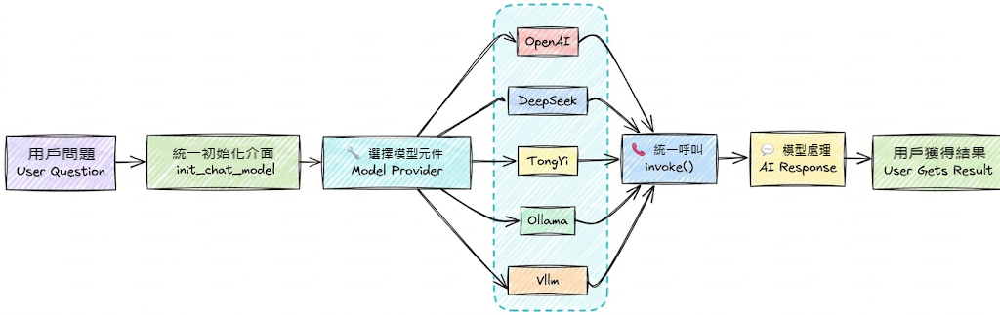

### 3.1 使用舉例

舉例1：呼叫DeepSeek官網的大模型

```python
import os
from langchain.chat_models import init_chat_model
from dotenv import load_dotenv

# 從.env檔案中載入環境變數
load_dotenv(override=True)

# 從環境變數讀取配置
DEEPSEEK_API_KEY = os.getenv("DEEPSEEK_API_KEY")
DEEPSEEK_BASE_URL = os.getenv("DEEPSEEK_BASE_URL")


model = init_chat_model(model="deepseek:deepseek-v4-flash",
                        #model_provider="deepseek",
                        api_key=DEEPSEEK_API_KEY,
                        base_url=DEEPSEEK_BASE_URL)
# 向模型傳送單條資料
response = model.invoke("你好，用一句話回答")
# 列印響應
print(response)
```

當我們傳遞的模型名稱為 `deepseek-v4-flash` 時，init_chat_model會自動呼叫ChatDeepSeek初始化模型例項，和直接透過ChatDeepSeek初始化的效果完全一致。

舉例2：呼叫阿里百鍊大模型

環境變數

```python
DASHSCOPE_BASE_URL=https://dashscope.aliyuncs.com/compatible-mode/v1
DASHSCOPE_API_KEY=<YOUR_API_KEY>
```

程式碼：

```python
from langchain.chat_models import init_chat_model
from dotenv import load_dotenv
import os

load_dotenv(override=True)

DASHSCOPE_API_KEY=os.getenv("DASHSCOPE_API_KEY")
DASHSCOPE_BASE_URL=os.getenv("DASHSCOPE_BASE_URL")

model = init_chat_model(model="qwen-plus",
                        model_provider="openai",
                        api_key=DASHSCOPE_API_KEY,
                        base_url=DASHSCOPE_BASE_URL)

print(model.invoke("你好，用一句話回答"))
```

舉例3：呼叫CloseAI中轉平臺大模型

環境變數

```python
CLOSEAI_API_KEY=<YOUR_API_KEY>
CLOSEAI_BASE_URL=https://api.openai-proxy.org/v1
```

程式碼：

```python
from langchain.chat_models import init_chat_model
from dotenv import load_dotenv
import os

load_dotenv(override=True)

CLOSEAI_API_KEY=os.getenv("CLOSEAI_API_KEY")
CLOSEAI_BASE_URL=os.getenv("CLOSEAI_BASE_URL")

model = init_chat_model(model="deepseek-v4-flash",
                        model_provider="openai",
                        api_key=CLOSEAI_API_KEY,
                        base_url=CLOSEAI_BASE_URL)

print(model.invoke("你好，用一句話回答"))
```

**問題1：model_provider支援哪些provider**？

`model_provider` 表示模型的提供者，支援的providers有： `anthropic` , anthropic_bedrock, azure_ai, azure_openai, bedrockbedrock_converse, cohere, `deepseek` , fireworks, google_anthropic_vertex, google_genai, google_vertexaigrog, huggingface, ibm, mistralai, nvidia, `ollama` , `openai` , `openrouter` , perplexity, together, upstage, xai。

- 如果 `model_provider="openai"` ，會自動載入 `langchain-openai` 的依賴包，底層呼叫的是`ChatOpenAI` 類。

- 如果 `model_provider="deepseek"` ，會自動載入 `langchain-deepseek` 的依賴包，底層呼叫的是 `ChatDeepSeek` 類。

- 像阿里的 `dashscope` 尚未被LangChain官方納入模型的統一註冊體系，暫時不知道"dashscope"的提供者是誰。此時可以將model_provider設定為openai，底層將會用openai的規範處理請求，這就要求我們呼叫的模型服務是OpenAI Compatible的。

**問題2：如果在model引數中沒有指明模型提供者，必須在model_provider中指明**？

可以在model引數中透過字首指定模型供應商，和模型名稱之間用 `冒號分割` ，等價於透過model_provider引數指定供應商。如果兩個位置都沒有指明供應商，LangChain底層會按照內建規則自動推斷。

但是，並非所有的模型都支援自動推斷，如model名稱 `qwen-plus` 不支援自動推斷，沒有指明供應商會報錯。

### 3.2 小結：模型的建立

```
DeepSeek官網的DeepSeek模型：可以呼叫ChatDeepSeek()、ChatOpenAI()、init_chat_model()三種方式

阿里雲百鍊平臺的DeepSeek模型：可以呼叫ChatTongyi()、ChatOpenAI()、init_chat_model()三種方式

OpenRouter平臺的DeepSeek模型：可以呼叫ChatOpenRouter()、ChatOpenAI()、init_chat_model()三種方式

CloseAPI平臺的DeepSeek模型：可以呼叫ChatOpenAI()、init_chat_model() 兩種方式
```

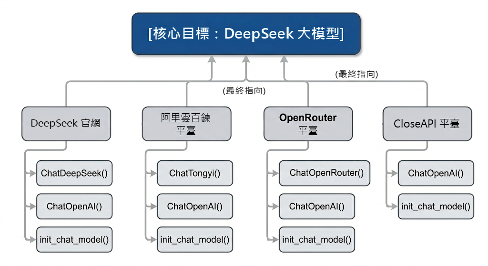

### 3.3 模型初始化引數(常用版)

在LangChain中，Model Class 和init_chat_model初始化模型共同的引數及解釋。

API文件：[https://docs.langchain.org.cn/oss/python/langchain/models#parameters](https://docs.langchain.org.cn/oss/python/langchain/models#parameters)

| **引數** | **型別** | **說明** | **預設值** |
|---|---|---|---|
| `model` | str | 使用的特定提供商的模型名稱(**必需**)。<br>比如：openai:gpt-4o、groq:gemma2-9b-it | 無 |
| `model_provider` | str | 模型提供商名稱 | 無 |
| `api_key` | str | API 金鑰。如果不提供，會從環境變數中讀取（如`DEEPSEEK_API_KEY` ） | `None` |
| `base_url` | str | 大模型供應商API請求地址。 | `None` |
| `temperature` | float | 控制輸出隨機性，範圍 0.0-2.0，溫度越高輸出越隨機。<br>- `0.0` ：最確定性，輸出幾乎不變<br>- `1.0` ：平衡創造性和一致性<br>- `2.0` ：最隨機，最有創造性 | `0.7` |
| `max_tokens` | int | 限制模型輸出的最大 token 數量 | `None` |
| `timeout` | float | 超時時間（秒），超時未響應，請求會被取消。 | `None` |
| `max_retries` | int | 請求失敗（如網路問題、速率限制）時的最大重試次數 | 6 |

說明：

**1、temperature 引數根據使用場景選擇**：

- **0.0-0.3**：需要一致性、準確性的任務（數學計算、資料提取、分類、程式碼生成）

- **0.5-0.7**：平衡創造性和一致性（聊天、問答）

- **0.8-1.5**：創造性任務（寫作、頭腦風暴）

- **1.5-2.0**：高度創造性（詩歌、故事創作）

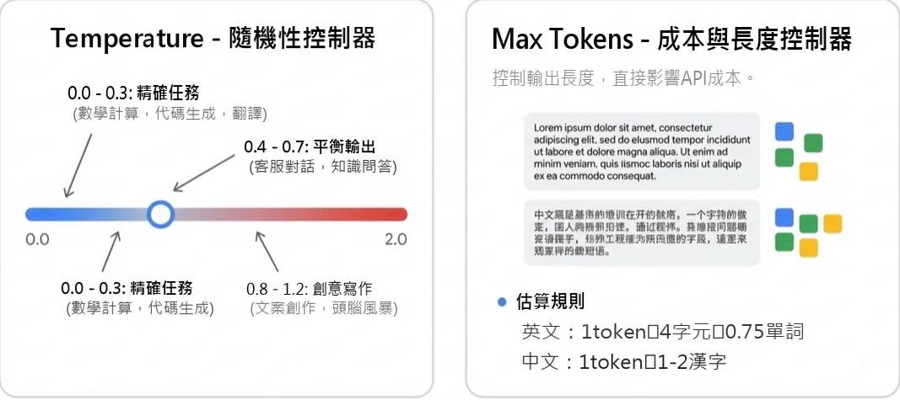

舉例：

```python
from langchain.chat_models import init_chat_model
from dotenv import load_dotenv
import os
# 從.env檔案中載入環境變數
load_dotenv(override=True)

model = init_chat_model(
    # model="gpt-5.4-mini",
    model="deepseek-v3.2",
    model_provider="openai",
    temperature=0,
    api_key=os.getenv("CLOSEAI_API_KEY"),
    base_url=os.getenv("CLOSEAI_BASE_URL"),
)
# 向模型傳送單條資料
for i in range(3):
    response = model.invoke("幫我寫一首描述春天的七言絕句詩")
    # 列印響應
    print(response.content)
```

```
《春曉》
東君巡野過青岑，一嶺雲霞一嶺金。
最是多情溪畔柳，偷藏鶯語送行人。

注：我的創作思路是透過“東君巡野”、“雲霞鎏金”等意象展現春日山川的瑰麗，以擬人手法賦予自然靈性。後兩句聚焦溪柳藏鶯的細節，以“偷”字點破春的俏皮，結句“送行人”將畫面延伸至畫外，留有餘韻。全詩色彩明麗，動靜相生，試圖在傳統春景題材中注入輕盈的巧思。
《春曉》
東君巡野過青岑，一嶺雲霞一嶺金。
最是多情溪畔柳，偷藏鶯語送行人。

注：我的創作思路是透過“東君巡野”、“雲霞鎏金”等意象展現春日山川的瑰麗，以擬人手法賦予溪柳靈性，借“偷藏鶯語”傳遞春日的生機與含蓄情韻。詩中“巡”、“藏”、“送”等動詞的運用，使靜態春景流動起來，末句以行人視角收束，留有餘味。
《七絕·春曉》
一夜東風萬樹花，清溪破凍響琵琶。
鶯啼柳浪雲煙溼，人在春山第幾家。

注：詩中“東風”、“萬樹花”展現春的蓬勃，“清溪破凍”以動襯靜，暗喻生機復甦。後兩句以鶯啼柳浪、雲煙溼翠勾勒朦朧春色，尾句以問作結，平添尋春之趣與悠然餘韻，全篇動靜相宜，遠近交疊，盡顯春之生意。
```

此時，設定為 後，模型會始終選擇機率最高的 Token，確保欄位準確、不胡亂發揮。

作為對比：

```python
from langchain.chat_models import init_chat_model
from dotenv import load_dotenv
import os
# 從.env檔案中載入環境變數
load_dotenv(override=True)

model = init_chat_model(
    # model="gpt-5.4-mini",
    model="deepseek-v3.2",
    model_provider="openai",
    temperature=1.5,
    api_key=os.getenv("CLOSEAI_API_KEY"),
    base_url=os.getenv("CLOSEAI_BASE_URL"),
)
# 向模型傳送單條資料
for i in range(3):
    response = model.invoke("幫我寫一首描述春天的七言絕句詩")
    # 列印響應
    print(response.content)
```

```
《壬寅仲春即事》
東君醉酒潑彤雲，一嶺胭脂一嶺曛。
怪道鶯聲啼不徹，枝頭燒作石榴裙。

注：詩中“東君”代指春神，以其醉意潑灑彩霞為喻，形象展現春色之濃郁靈動。後兩句透過鶯啼不絕與石榴裙的巧妙聯想，以火焰比喻花海翻騰之勢，全詩在傳統春景描繪中融入奇幻色彩，浪漫筆法間盡顯春之熱烈與生機盎然。
《春溪行》
東君遣暖潤青苔，波光瀲灩載雲回。
莫道殘寒猶料峭，一枝紅蕊過溪來。

注：全詩以碧溪破冰、波光載雲的視覺變化，展現初春的流動生機。後兩句用“殘寒料峭”與“紅蕊過溪”形成冷峻與熱烈的鮮明對比，透過擬人化技法使春色具有衝破束縛的動勢，暗合人生際遇中希望常在的哲思。
《仲春野行》
東君遣煦渥郊鄉，粉李緋桃競試妝。
最賞青疇酥雨足，一犁煙水伴牛馱。

注：本詩以傳統筆法勾勒春景，透過“東君遣煦”、“桃李試妝”展現春神的雍容與百花的嬌媚。後兩句轉寫田園，以“酥雨”、“犁煙”意象突出春耕時節泥土的潤澤與生機，牛馱微雨中緩行的畫面，傳遞出深邃而醇厚的自然生趣。
```

使用場景：嚴格的結構化資料提取

```python
from langchain.chat_models import init_chat_model
from dotenv import load_dotenv
import os
# 從.env檔案中載入環境變數
load_dotenv(override=True)

model = init_chat_model(
    model="deepseek-v3.2",
    model_provider="openai",
    temperature=0,
    api_key=os.getenv("CLOSEAI_API_KEY"),
    base_url=os.getenv("CLOSEAI_BASE_URL"),
)
# 向模型傳送單條資料
response = model.invoke("張三，男，30歲，擁有8年程式設計開發經驗，目前在某網際網路大廠擔任技術專家。幫我從上文中提取資料，返回JSON格式")
print(response.content)
```

```json
{
"name": "張三",
"gender": "男",
"age": 30,
"programming_experience_years": 8,
"current_position": "技術專家",
"current_company_type": "網際網路大廠"
}
```

使用場景：創意文案與頭腦風暴

```python
from langchain.chat_models import init_chat_model
from dotenv import load_dotenv
import os
# 從.env檔案中載入環境變數
load_dotenv(override=True)

model = init_chat_model(
    model="deepseek-v3.2",
    model_provider="openai",
    temperature=1.5,
    api_key=os.getenv("CLOSEAI_API_KEY"),
    base_url=os.getenv("CLOSEAI_BASE_URL"),
)
# 向模型傳送單條資料
response = model.invoke("請為一款極致靜音的機械鍵盤寫3個充滿詩意且極具張力的廣告語。")
print(response.content)
```

```
1. **「指尖落下無聲詩，每個字都沉入深海」**
   *奔赴思緒的靜謐領域，讓敲擊成為心流的漣漪*

2. **「在銀樺雪原上耕種文字，唯留耕者的呼吸」**
   *以失聲的機械之齒，馴服每一次破曉的靈感*

3. **「當鍵盤學會芭蕾，世界只剩文案綻放的輕重音」**
   *精密彈力懸浮於聲學懸空層，觸感在寂靜中震耳欲聾*

---

注：廣告語核心將“靜音”屬性詩化為**創作禪境、自然隱喻與藝術比擬**，透過矛盾張力（如“失聲的機械”“寂靜中震耳欲聾”）強化產品顛覆性，適用於高階文創/科技消費場景。
```

**2、Token是什麼**？

`基本單位` : 大模型透過分詞器（Tokenizer）將文字拆分後的最小語義單元是token（相當於自然語言中的詞或字）。不同的模型採用不同的 `分詞演算法` （如BPE、WordPiece），因此同一段文字在不同模型中的Token數量可能不同。

`收費依據` ：大語言模型通常也是以token的數量作為其計量（或收費）的依據。

- 1箇中文Token≈1-1.8個漢字，1個英文Token≈3-4個字元

- Token與字元轉化的視覺化工具：

  - OpenAI提供：[https://platform.openai.com/tokenizer](https://platform.openai.com/tokenizer)

  - 百度智慧雲提供：[https://console.bce.baidu.com/support/#/tokenizer](https://console.bce.baidu.com/support/#/tokenizer)

舉例：

```python
from langchain.chat_models import init_chat_model
from dotenv import load_dotenv
import os
# 從.env檔案中載入環境變數
load_dotenv(override=True)

model = init_chat_model(
    # model="gpt-5.4-nano",
    model="gpt-5.4-mini",
    # temperature=0.7,
    api_key=os.getenv("CLOSEAI_API_KEY"),
    base_url=os.getenv("CLOSEAI_BASE_URL"),
    max_tokens=15,
)
# 向模型傳送單條資料
response = model.invoke("請用中文詳細介紹什麼是AI")
# 列印響應
print(response)

# print(response.content)
# print(response.response_metadata["finish_reason"])
```

```python
content='當然可以。下面我用中文儘量系統、通' additional_kwargs={'refusal': None} response_metadata={'token_usage': {'completion_tokens': 15, 'prompt_tokens': 14, 'total_tokens': 29, 'completion_tokens_details': {'accepted_prediction_tokens': 0, 'audio_tokens': 0, 'reasoning_tokens': 0, 'rejected_prediction_tokens': 0}, 'prompt_tokens_details': {'audio_tokens': 0, 'cached_tokens': 0}, 'latency_checkpoint': {'engine_tbt_ms': 5, 'engine_ttft_ms': 29, 'engine_ttlt_ms': 109, 'pre_inference_ms': 83, 'service_tbt_ms': 4, 'service_ttft_ms': 279, 'service_ttlt_ms': 336, 'total_duration_ms': 261, 'user_visible_ttft_ms': 196}}, 'model_provider': 'openai', 'model_name': 'gpt-5.4-mini-2026-03-17', 'system_fingerprint': None, 'id': 'chatcmpl-Dg3tYDOZ1xWSR3EaTX8jlM58yUSq2', 'service_tier': 'default', 'finish_reason': 'length', 'logprobs': None} id='lc_run--019e2fb9-11b0-7901-9076-a45fc0b41125-0' tool_calls=[] invalid_tool_calls=[] usage_metadata={'input_tokens': 14, 'output_tokens': 15, 'total_tokens': 29, 'input_token_details': {'audio': 0, 'cache_read': 0}, 'output_token_details': {'audio': 0, 'reasoning': 0}}
```

## 4、模型初始化角度3：本地模型的部署與呼叫

### 4.1 Ollama的介紹

LangChain也支援使用 `Ollama` 、 `vLLM` 等框架啟動的本地大模型。這裡以Ollama為例進行演示。

Ollama是在Github上的一個開源專案，其專案定位是：**一個本地執行大模型的整合框架**，可以實現如Qwen、Deepseek 等主流大模型的下載、啟動和本地執行的自動化部署及推理流程。

Ollama官方地址：[https://ollama.com](https://ollama.com/)

產品定位：

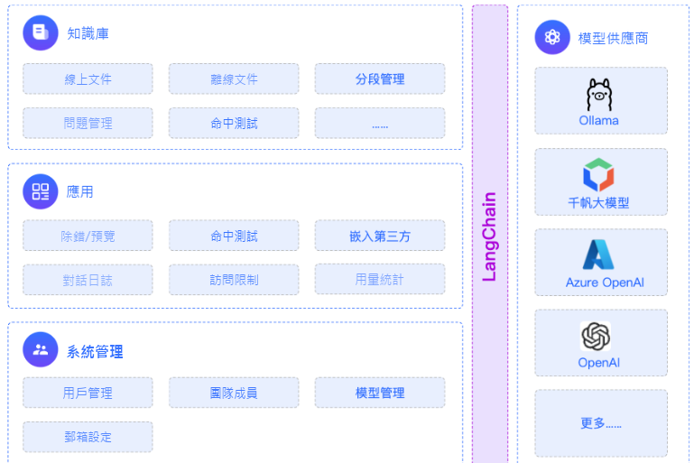

### 4.2 Ollama的下載-安裝

Ollama專案支援跨平臺部署，目前已相容Mac、Linux和Windows作業系統。

無論使用哪個作業系統，Ollama專案的安裝過程都設計得非常簡單。

訪問 [https://ollama.com/download](https://ollama.com/download) 下載對應系統的安裝檔案。

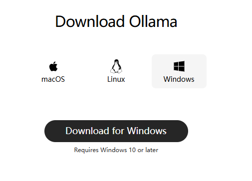

- **Linux 系統執行以下命令安裝**：

```bash
curl -fsSL https://ollama.com/install.sh | sh
```

  - 這行命令的目的是從 `https://ollama.com/` 網站讀取 `install.sh` 指令碼，並立即透過 `sh` 執行該指令碼，在安裝過程中會包含以下幾個主要的操作：

    - 檢查當前伺服器的基礎環境，如系統版本等；

    - 下載Ollama的二進位制檔案；

    - 配置系統服務，包括建立使用者和使用者組，新增Ollama的配置資訊；

    - 啟動Ollama服務；

- **Windows 系統的安裝過程如下**

手動建立ollama安裝目錄：首先在你想安裝的路徑下建立好一個新資料夾，並把ollama的安裝包放在裡面。比如我的是：F:\\common_tools\\Ollama

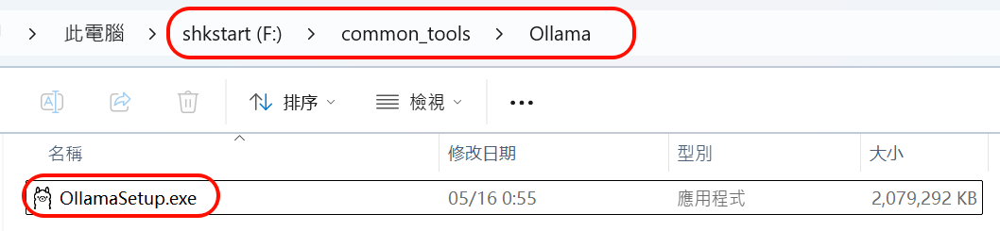

在檔案路徑上輸入cmd 回車後會自動開啟命令列視窗：

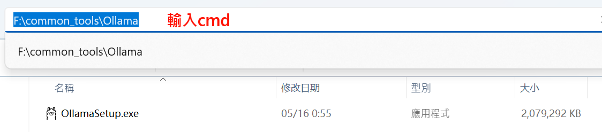

然後在cmd 視窗輸入：

```
OllamaSetup.exe /DIR=F:\common_tools\Ollama
```

語法：軟體名稱/DIR=這裡放你上面建立好的Ollama指定目錄

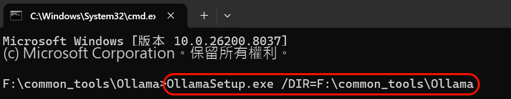

然後Ollama就會進入安裝，點選install後，可以看到Ollama的安裝路徑就變成了我們指定的目錄了。

### 4.3 模型的下載

**1、手動設定大模型儲存目錄**：

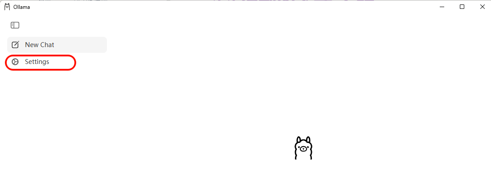

指明大模型要下載到的本地目錄位置

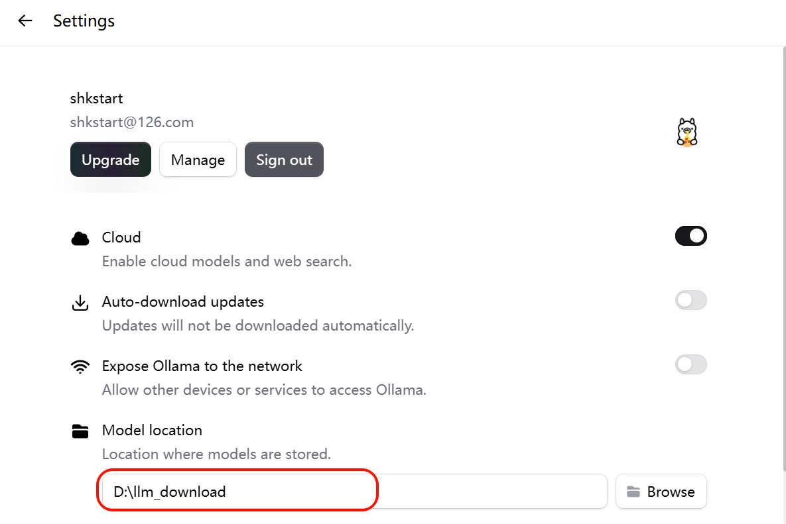

**2、模型的下載**

方式1：直接在圖形化介面位置下載

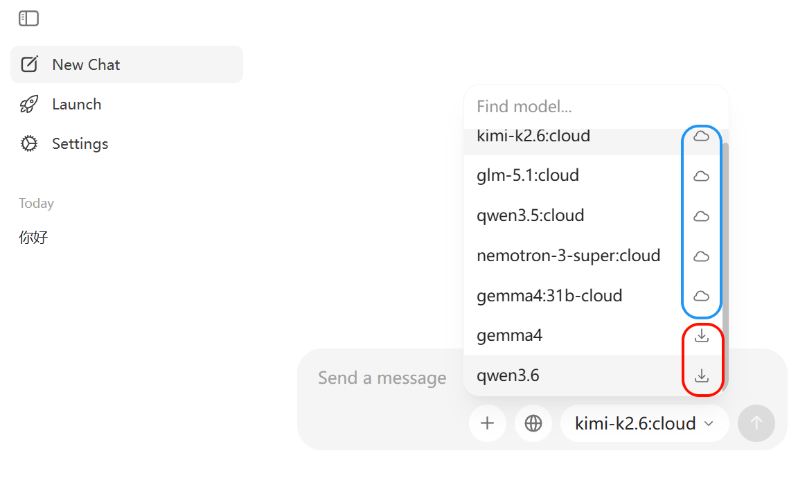

> 藍色的使用線上模型，需要在Ollama平臺付費使用。

方式2：訪問 [https://ollama.com/search](https://ollama.com/search) 可以檢視 Ollama 支援的模型。使用命令列可以下載並執行模型，例如執行 `deepseek-r1:1.5b` 模型：

```
ollama run deepseek-r1:1.5b
```

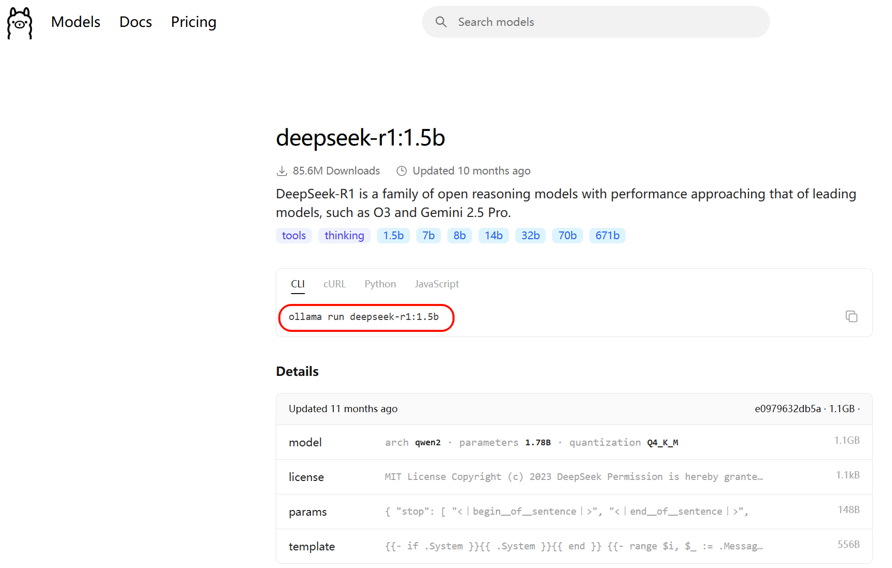

回到命令列，輸入指令開始下載：

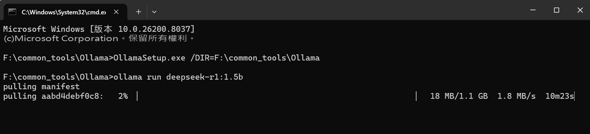

下載完即可進行互動：

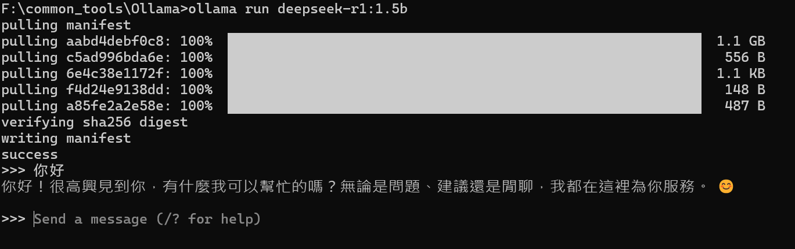

Ollama常用命令：

| **命令** | **一句話說明** |
|---|---|
| ollama pull llama3 | 下載指定模型（例：llama3）。 |
| ollama run llama3 | 啟動並進入該模型互動對話。 |
| ollama list | 列出本機已下載的所有模型。 |
| ollama rm llama3 | 刪除不再需要的模型以節省磁碟。 |
| ollama cp llama3 my-llama3 | 本地複製/重新命名模型。 |
| ollama show llama3 | 檢視模型詳細資訊（引數、大小等）。 |
| ollama create my-model -f Modelfile | 用自定義 Modelfile 構建新模型。 |
| ollama serve | 啟動後臺服務，供 API 呼叫。 |
| ollama ps | 檢視當前正在執行的模型程序。 |
| ollama stop llama3 | 停止正在執行的模型。 |
| ollama --version | 檢視安裝的ollama版本 |

### 4.4 LangChain呼叫模型

LangChain整合Ollama呼叫本地大模型：

```bash
#pip install langchain-ollama
pip install -qU langchain-ollama

pip install -U ollama
```

方式1：

```python
from langchain_ollama import ChatOllama

ollama_llm = ChatOllama(
    model="deepseek-r1:1.5b",
    base_url="http://192.168.1.106:11434" #如果Ollama在本地預設埠執行，則可省略，或使用http://localhost:11434
)
question = "你好，請你介紹一下你自己。"

result = ollama_llm.invoke(question)
print(result)
```

```python
content='您好！我是由中國的深度求索（DeepSeek）公司開發的智慧助手DeepSeek-R1。有關模型和產品的詳細內容請參考官方文件。' additional_kwargs={} response_metadata={'model': 'deepseek-r1:1.5b', 'created_at': '2026-05-17T13:42:49.4318473Z', 'done': True, 'done_reason': 'stop', 'total_duration': 485244400, 'load_duration': 55976000, 'prompt_eval_count': 9, 'prompt_eval_duration': 196625400, 'eval_count': 38, 'eval_duration': 208765000, 'logprobs': None, 'model_name': 'deepseek-r1:1.5b', 'model_provider': 'ollama'} id='lc_run--019e362c-d771-7580-aa74-db1420cfce2b-0' tool_calls=[] invalid_tool_calls=[] usage_metadata={'input_tokens': 9, 'output_tokens': 38, 'total_tokens': 47}
```

方式2：

```python
from langchain.chat_models import init_chat_model

ollama_llm = init_chat_model(
    model="deepseek-r1:1.5b",
    model_provider="ollama",
    # base_url="http://192.168.1.106:11434",
)

question = "你好，請你介紹一下你自己。"

result = ollama_llm.invoke(question)
print(result)
```

```python
content='您好！我是由中國的深度求索（DeepSeek）公司開發的智慧助手DeepSeek-R1。我擅長透過思考來幫您解答覆雜的數學，程式碼和邏輯推理等理工類問題。' additional_kwargs={} response_metadata={'model': 'deepseek-r1:1.5b', 'created_at': '2026-05-17T13:45:51.8148967Z', 'done': True, 'done_reason': 'stop', 'total_duration': 658034000, 'load_duration': 53012900, 'prompt_eval_count': 9, 'prompt_eval_duration': 236815100, 'eval_count': 47, 'eval_duration': 338788200, 'logprobs': None, 'model_name': 'deepseek-r1:1.5b', 'model_provider': 'ollama'} id='lc_run--019e362f-9f34-7cc2-b34d-8fa380131978-0' tool_calls=[] invalid_tool_calls=[] usage_metadata={'input_tokens': 9, 'output_tokens': 47, 'total_tokens': 56}
```

## 5、模型的呼叫

在 LangChain 中，模型呼叫（Invocation）是指透過特定方法觸發大語言模型生成輸出的過程。根據不同的應用場景和需求，LangChain 提供了幾種核心的呼叫方式，主要是 `invoke()` 、 `stream()` 和`batch()` 方法，以及它們的非同步版本 `ainvoke()` 、 `astream()` 和 `abatch()` ，下面將系統地介紹這些方法。

- `invoke()` ：阻塞式，**一次性返回完整結果**問答、批處理任務、無需實時反饋的場景。

- `ainvoke()` ：非阻塞式，提高系統吞吐量高併發Web應用、IO密集型任務。

- `stream()` ：流式輸出，**實時返回每個token**聊天機器人、長文字生成、需要提升使用者體驗的互動應用。

- `asteam()` ：非阻塞式，提高系統吞吐量高併發Web應用、IO密集型任務。

- `batch()` ：**批次處理多個輸入**高併發場景，需要同時處理大量請求。

- `abatch()` ：非阻塞式，提高系統吞吐量高併發Web應用、IO密集型任務。

### 5.1 invoke()

invoke() 是 LangChain 中**最核心的方法**，它的工作模式是阻塞式的，即程式會等待模型完全生成整個響應後，再一次性將結果返回給使用者。

#### 5.1.1 invoke()說明

簡單來說， `invoke` 方法的作用就是：

1. **接收你的輸入**（問題、指令、對話歷史等）  
2. **傳送給 LLM 模型**（如 GPT-4、Llama、Claude 等）  
3. **返回模型的響應**（文字回復 + 後設資料資訊）

基本語法：

```python
response = model.invoke(input, config=None)
```

引數詳解：

| **引數** | **型別** | **說明** | **必需** | **預設值** |
|---|---|---|---|---|
| `input` | `str` \| `list[dict]` \|<br>`list[Message]` 等 | 你要傳送給模型的內容 | 必需 | 無 |
| `config` | `dict` | 高階配置（回呼函式、後設資料、標籤等） | 可選 | `None` |

#### 5.1.2 輸入引數詳解

invoke方法非常靈活，支援三種形式的輸入： `文字輸入` 、 `字典列表` 、 `訊息物件列表` 。

**1、文字輸入(最簡單**)

簡單的一次性問答，直接傳入一個問題或指令。

✅適用場景：快速測試，不需要保留對話歷史的簡單生成任務。

❌缺點：無法設定系統提示（system prompt），無法傳遞對話歷史

```python
from langchain.chat_models import init_chat_model
from dotenv import load_dotenv
import os

# 從.env檔案中載入環境變數
load_dotenv(override=True)

CLOSEAI_API_KEY = os.getenv("CLOSEAI_API_KEY")
CLOSEAI_BASE_URL = os.getenv("CLOSEAI_BASE_URL")

model = init_chat_model(
    model="openai:gpt-5.4-mini",
    api_key=CLOSEAI_API_KEY,
    base_url=CLOSEAI_BASE_URL
)
# 向模型傳送單條資料
prompt = "翻譯成英文：你好世界"
response = model.invoke(prompt)

# 列印響應
print(response)
```

在 invoke 中直接輸入文字，即可自動轉化為 user message 並進行對話。

**2、字典列表(推薦，最靈活**)

建立字典列表組成訊息。一條訊息通常包含 `role（角色）` 、 `content（內容）` 等資訊。

✅適用場景：可以設定系統提示，表達多輪對話歷史，JSON 相容，易於序列化和網路傳輸，生產環境推薦。

❌缺點：程式碼稍微多一點（但更清晰）

格式：

```python
messages = [
    {"role": "system", "content": "系統提示"},
    {"role": "user", "content": "使用者訊息"},
    {"role": "assistant", "content": "AI回覆"},  # 可選，用於對話歷史
    {"role": "user", "content": "繼續提問"}
]
```

角色說明：

| **角色** | **英文** | **作用** | **示例** |
|---|---|---|---|
| `system` | System | 設定 AI 的行為、角色、規則 | "你是一個專業的 Python 導師" |
| `user` | Human/User | 使用者的輸入/問題 | "什麼是裝飾器？" |
| `assistant` | AI/Assistant | AI 的歷史回覆（用於對話上下文） | "裝飾器是一種設計模式..." |

> "user"和 "human"有時可以互換，但遵循你選擇的主要模型提供商（如OpenAI）的慣例使用"user"是最穩妥的做法。

舉例1：

```python
from langchain.chat_models import init_chat_model
from dotenv import load_dotenv
import os

# 從.env檔案中載入環境變數
load_dotenv(override=True)

CLOSEAI_API_KEY = os.getenv("CLOSEAI_API_KEY")
CLOSEAI_BASE_URL = os.getenv("CLOSEAI_BASE_URL")

model = init_chat_model(
    model="gpt-5.4-mini",
    model_provider="openai",
    api_key=CLOSEAI_API_KEY,
    base_url=CLOSEAI_BASE_URL
)

# 使用字典格式構建訊息
messages = [
    {"role":"system","content":"你是一個專業的數學老師。"},
    {"role":"user","content":"什麼是斐波那契數列？"}
]

response = model.invoke(messages)
# 列印響應
print(f"AI的回覆：{response.content}")
```

舉例2：多輪對話（帶歷史）

```python
from langchain.chat_models import init_chat_model
from dotenv import load_dotenv
import os

# 從.env檔案中載入環境變數
load_dotenv(override=True)

CLOSEAI_API_KEY = os.getenv("CLOSEAI_API_KEY")
CLOSEAI_BASE_URL = os.getenv("CLOSEAI_BASE_URL")

model = init_chat_model(
    model="gpt-5.4-mini",
    model_provider="openai",
    api_key=CLOSEAI_API_KEY,
    base_url=CLOSEAI_BASE_URL
)

# 使用字典格式構建訊息
messages = [
    {"role":"system","content":"你是一個專業的數學老師。"},
    {"role":"user","content":"2 + 3 * 2 = ？"},
    {"role":"assistant","content":"8"},
    {"role":"user","content":"我剛才問了什麼問題？"}
]

response = model.invoke(messages)
# 列印響應
print(f"AI的回覆：{response.content}")
```

```
AI的回覆：你剛才問的是：**“2 + 3 * 2 = ？”**
```

舉例3：如果不傳遞歷史，AI 會"失憶"

```python
from langchain.chat_models import init_chat_model
from dotenv import load_dotenv
import os

# 從.env檔案中載入環境變數
load_dotenv(override=True)

CLOSEAI_API_KEY = os.getenv("CLOSEAI_API_KEY")
CLOSEAI_BASE_URL = os.getenv("CLOSEAI_BASE_URL")

model = init_chat_model(
    model="openai:gpt-5.4-mini",
    api_key=CLOSEAI_API_KEY,
    base_url=CLOSEAI_BASE_URL
)

messages1 = [
    {"role": "system", "content": "你是一個非常友好的AI助手"},
    {"role": "user", "content": "你好，我叫小明"},
]
# 第一次對話
response1 = model.invoke(messages1)
# 列印響應
print(f"AI的回覆1：{response1.content}")

messages2 = [
    {"role": "user", "content": "我叫什麼名字？"}
]
# 第二次對話
response2 = model.invoke(messages2)
# 列印響應
print(f"AI的回覆2：{response2.content}")
```

```
AI的回覆1：你好，小明！很高興認識你 😊
我是你的AI助手，有什麼我可以幫你的嗎？

AI的回覆2：我不知道你的名字，除非你告訴我。
如果你願意，可以直接告訴我，我之後就可以這樣稱呼你。
```

作為對比，傳遞記憶：

```python
conversation = [
    {"role": "system", "content": "你是一個非常友好的AI助手"},
    {"role": "user", "content": "你好，我叫小明"}
]

# 第一次對話
response1 = model.invoke(conversation)
# 列印響應
print(f"AI的回覆1：{response1.content}")


# 新增記憶
conversation.append({"role": "assistant", "content": response1.content})

conversation.append({"role": "user", "content": "我叫什麼名字？"})

# 第二次對話
response2 = model.invoke(conversation)
print(f"AI的回覆2：{response2.content}")
```

```
AI的回覆1：你好，小明！很高興認識你 😊
我是你的AI助手，有什麼我可以幫你的嗎？

AI的回覆2：你叫小明。
```

> 說明：關於訊息列表的內容此處不必深究，Messages章節會系統介紹。

**3、訊息物件列表**

使用內建的訊息類（如 SystemMessage, HumanMessage, AIMessage），將訊息物件列表輸入模型。

✅適用場景：需要型別檢查（針對大型專案）、IDE 自動補全的場景

❌缺點：程式碼較長、不如字典簡潔、難以序列化（JSON）

訊息型別對照：

| **訊息類** | **對應字典格式** | **作用** |
|---|---|---|
| `SystemMessage` | `{"role": "system", ...}` | 系統提示 |
| `HumanMessage` | `{"role": "user", ...}` | 使用者輸入 |
| `AIMessage` | `{"role": "assistant", ...}` | AI 回覆 |

舉例1：

```python
from langchain_core.messages import SystemMessage, AIMessage, HumanMessage
from langchain.chat_models import init_chat_model
from dotenv import load_dotenv
import os

# 從.env檔案中載入環境變數
load_dotenv(override=True)

CLOSEAI_API_KEY = os.getenv("CLOSEAI_API_KEY")
CLOSEAI_BASE_URL = os.getenv("CLOSEAI_BASE_URL")

model = init_chat_model(
    model="openai:gpt-5.4-mini",
    api_key=CLOSEAI_API_KEY,
    base_url=CLOSEAI_BASE_URL
)

# 使用訊息物件格式構建訊息
messages = [
    SystemMessage("你是一個專業的數學老師。"),
    HumanMessage("2 + 3 * 2 = ？"),
    AIMessage("8"),
    HumanMessage("我剛才問什麼問題了？")
]

response = model.invoke(messages)
# 列印響應
print(f"AI的回覆：{response.content}")
```

舉例2：

```python
from langchain_core.messages import SystemMessage, HumanMessage, AIMessage

messages = [
    SystemMessage(content="你是一個 Python 專家"),
    HumanMessage(content="什麼是生成器？"),
]

response = model.invoke(messages)
# print(response)

# 繼續對話
messages.append(AIMessage(content=response.content))
messages.append(HumanMessage(content="能給個例子嗎？"))

response1 = model.invoke(messages)
print(response1)
```

#### 5.1.3 返回值詳解

invoke 返回一個 `AIMessage物件` ，原始碼如下：

```python
def invoke(
    self,
    input: LanguageModelInput,
    config: RunnableConfig | None = None,
    *,
    stop: list[str] | None = None,
    **kwargs: Any,
) -> AIMessage:
```

舉例：

```python
from langchain_core.messages import SystemMessage, AIMessage, HumanMessage
from langchain.chat_models import init_chat_model
from dotenv import load_dotenv
import os

# 從.env檔案中載入環境變數
load_dotenv(override=True)

CLOSEAI_API_KEY = os.getenv("CLOSEAI_API_KEY")
CLOSEAI_BASE_URL = os.getenv("CLOSEAI_BASE_URL")

model = init_chat_model(
    model="gpt-5.4-mini",
    api_key=CLOSEAI_API_KEY,
    base_url=CLOSEAI_BASE_URL
)

# 使用字典格式構建訊息
response = model.invoke([HumanMessage("2 + 3 * 2 = ？")])
# 列印響應
print(type(response))
# <class 'langchain_core.messages.ai.AIMessage'>
```

```python
from rich import print as rprint

rprint(response)
```

```python
AIMessage(
 content='2 + 3 * 2 = **8**',
 additional_kwargs={'refusal': None},
 response_metadata={
     'token_usage': {
         'completion_tokens': 15,
         'prompt_tokens': 16,
         'total_tokens': 31,
         'completion_tokens_details': {
             'accepted_prediction_tokens': 0,
             'audio_tokens': 0,
             'reasoning_tokens': 0,
             'rejected_prediction_tokens': 0
         },
         'prompt_tokens_details': {'audio_tokens': 0, 'cached_tokens': 0},
         'latency_checkpoint': {
             'engine_tbt_ms': 4,
             'engine_ttft_ms': 36,
             'engine_ttlt_ms': 100,
             'pre_inference_ms': 86,
             'service_tbt_ms': 4,
             'service_ttft_ms': 280,
             'service_ttlt_ms': 338,
             'total_duration_ms': 259,
             'user_visible_ttft_ms': 194
         }
     },
     'model_provider': 'openai',
     'model_name': 'gpt-5.4-mini-2026-03-17',
     'system_fingerprint': None,
     'id': 'chatcmpl-DgWobsxhDOqzjqVFwbZYKRnovpEiV',
     'service_tier': 'default',
     'finish_reason': 'stop',
     'logprobs': None
 },
 id='lc_run--019e3659-5ee2-7b62-bc8a-741e27374b43-0',
 tool_calls=[],
 invalid_tool_calls=[],
 usage_metadata={
     'input_tokens': 16,
     'output_tokens': 15,
     'total_tokens': 31,
     'input_token_details': {'audio': 0, 'cache_read': 0},
     'output_token_details': {'audio': 0, 'reasoning': 0}
 }
)
```

AIMessage中包含豐富的資訊，以上面案例的輸出為例，整體說明如下：

```python
AIMessage(
    # --- 核心內容 ---
    content='2 + 3 * 2 = **8**',  # 模型生成的最終文字答案

    additional_kwargs={
        'refusal': None# 模型拒絕回答的情況（如觸碰安全策略），None 表示正常回答
    },

    # --- 響應後設資料（API 返回的詳細原始資料） ---
    response_metadata={
        'token_usage': {
            'completion_tokens': 15,    # 生成回答消耗的 Token 數（輸出）
            'prompt_tokens': 16,        # 使用者輸入消耗的 Token 數（輸入）
            'total_tokens': 31,         # 本次互動總共消耗的 Token

            'completion_tokens_details': {
                'accepted_prediction_tokens': 0, # 預測性生成的 Token 數
                'audio_tokens': 0,               # 音訊生成消耗（如有）
                'reasoning_tokens': 0,# 推理模型（如 o1）思考過程消耗的 Token
                'rejected_prediction_tokens': 0  # 被拒絕的預測 Token
            },

            'prompt_tokens_details': {
                'audio_tokens': 0,   # 輸入中的音訊 Token 數
                'cached_tokens': 0   # 命中的快取 Token 數（能省錢/提速）
            },

            # --- 延遲效能監控（單位：毫秒 ms） ---
            'latency_checkpoint': {
                'engine_tbt_ms': 4,        # 引擎 Token 間平均間隔時間
                'engine_ttft_ms': 36,      # 引擎生成首個 Token 的時間
                'engine_ttlt_ms': 100,     # 引擎生成最後一個 Token 的時間
                'pre_inference_ms': 86, # 推理前的預處理耗時(安全稽核、Token 化等預處理)
                'service_tbt_ms': 4, # 服務端token與token之間生成的間隔時間，決定了打字機效果是否絲滑。
                'service_ttft_ms': 280,  # 服務端接收到請求到輸出首字的總時間
                'service_ttlt_ms': 338,    # 服務端完成全部輸出的總時間
                'total_duration_ms': 259,  # 本次請求在系統中記錄的總持續時長
                'user_visible_ttft_ms': 194   # 使用者看到第一個字跳出來等待的時間
            }
        },
        'model_provider': 'openai',               # 模型供應商
        'model_name': 'gpt-5.4-mini-2026-03-17',  # 使用的具體模型版本
        'system_fingerprint': None,          # 系統指紋，用於追蹤模型後端的配置變更
        'id': 'chatcmpl-DgWobsxhDOqzjqVFwbZYKRnovpEiV', #API層面的響應 ID
        'service_tier': 'default',    # 服務層級（如按量付費或訂閱）
        'finish_reason': 'stop',     # 停止原因：stop（自然結束）、length（長度受限）
        'logprobs': None            # 對數機率（通常用於分析詞彙選擇的可能性）
    },

    # --- LangChain 內部標識 ---
    id='lc_run--019e3659-5ee2-7b62-bc8a-741e27374b43-0',
    # LangChain 追蹤此條執行的唯一 ID

    # --- 工具呼叫資訊 ---
    tool_calls=[],             # 正常觸發的外部工具呼叫列表
    invalid_tool_calls=[],     # 觸發失敗或格式錯誤的工具呼叫

    # --- 統一消耗後設資料（LangChain 標準化後的消耗格式） ---
    usage_metadata={
        'input_tokens': 16,    # 輸入 Token 數
        'output_tokens': 15,   # 輸出 Token 數
        'total_tokens': 31,    # 總 Token 數
        'input_token_details': {
            'audio': 0,
            'cache_read': 0    # 從快取中讀取的輸入數量
        },
        'output_token_details': {
            'audio': 0,
            'reasoning': 0     # 包含在輸出中的推理 Token
        }
    }
)
```

總結一下：

**1. 核心內容與基本資訊**

- `content` : 模型生成的文字回答。這是你最關心的核心輸出。

- `id` : 本次執行在 LangChain 內部生成的唯一識別符號（Run ID）。

- `additional_kwargs` : 包含特定供應商的額外引數。

  - `refusal` : 如果模型拒絕回答（涉及敏感政策），此處會顯示拒絕原因。

**2. 消耗統計 (Token Usage**)

這部分決定了你這一行輸入操作花了多少錢：

- `prompt_tokens` / `input_tokens` : 輸入 Token 數。你傳送給模型的問題長度。

- `completion_tokens` / `output_tokens` : 輸出 Token 數。模型回答生成的長度。

- `total_tokens` : 總消耗。 兩者之和。

- `reasoning_tokens` : 推理 Token 數。 如果是 O1/O3 等推理模型，這裡會顯示它在“思考”時消耗的 Token。

- `cached_tokens` : 快取命中的 Token 數。重複提問時，如果命中了模型商的快取，這部分費用通常更低。

**3. 響應後設資料 (Response Metadata**)

這部分是 API 返回的原始詳細資訊：

- `model_name` : 實際呼叫的模型具體版本（如 `gpt-5.4-mini` ）。

- `model_provider` : 模型供應商（如 `openai` ）。

- `finish_reason` : 生成停止的原因。

  - `stop` : 正常回答結束。

  - `length` : 達到最大 Token 限制被截斷。

- `system_fingerprint` : 系統指紋，用於追蹤模型後端的配置變更。

**4. 效能與延遲 (Latency Checkpoint**)

這是針對 API 響應速度的深度拆解（單位通常為毫秒 **ms**）：

- `total_duration_ms` : 總耗時。從請求發出到完全收到的總時間（259ms）。

- `user_visible_ttft_ms` : 首字到達時間。使用者看到第一個字跳出來等待的時間（194ms），這是體感快慢的關鍵。

- `engine_ttft_ms` : 引擎層面的首字到達時間（36ms）。

- `engine_ttlt_ms` : 引擎生成最後一個字的時間（100ms）。

- `pre_inference_ms` : 推理前處理耗時。包括安全稽核、Token 化等預處理（86ms）。

- `service_tbt_ms` : Time Between Tokens。字與字之間生成的間隔時間，決定了打字機效果是否絲滑。

**5. 工具呼叫資訊**

- `tool_calls` : 結構化工具呼叫列表。如果模型決定呼叫某個 Python 函式或搜尋工具，引數會在這裡。

- `invalid_tool_calls` : 格式錯誤的工具呼叫嘗試。

舉例：訪問所有資訊

```python
response = model.invoke("用一句話解釋什麼是 AI")

# 1. 獲取回覆內容
print("AI 回覆:", response.content)

# 2. 獲取響應後設資料
metadata = response.response_metadata
print(f"使用的模型: {metadata['model_name']}")
print(f"結束原因: {metadata['finish_reason']}")
print(f"模型提供商：{metadata['model_provider']}\n")

# 3. 獲取 Token 使用情況
usage = metadata.get('token_usage', {})
print(f"輸入 tokens: {usage.get('prompt_tokens')}")
print(f"輸出 tokens: {usage.get('completion_tokens')}")
print(f"總計 tokens: {usage.get('total_tokens')}")

# 4. 獲取訊息 ID
print(f"訊息 ID: {response.id}")
```

```
AI 回覆: AI（人工智慧）就是讓機器模擬人類的學習、推理、識別和決策能力。
使用的模型: gpt-5.4-mini-2026-03-17
結束原因: stop
模型提供商：openai

輸入 tokens: 13
輸出 tokens: 28
總計 tokens: 41
訊息 ID: lc_run--019e3665-8dfa-7c53-a9a5-4995348a0258-0
```

### 5.2 流式呼叫

**invoke 和 stream 有什麼區別**？

- `invoke()` ：同步呼叫，在模型輸出完成後**一次性獲取響應**，對於輸出文字很長的場景，使用者體驗不好。

- `stream()` ：流式呼叫，**實時返回響應片段**。呼叫後，返回一個 `迭代器(iterator)` ，可以透過迴圈來實時處理每一個新生成的chunk內容塊。

> 注意：流式輸出依賴於模型供應商對於流式輸出的支援。

舉例：

```python
from langchain.chat_models import init_chat_model
from dotenv import load_dotenv
import os

# 從.env檔案中載入環境變數
load_dotenv(override=True)

CLOSEAI_API_KEY = os.getenv("CLOSEAI_API_KEY")
CLOSEAI_BASE_URL = os.getenv("CLOSEAI_BASE_URL")

model = init_chat_model(
    model="gpt-5.4-mini",
    api_key=CLOSEAI_API_KEY,
    base_url=CLOSEAI_BASE_URL
)

for chunk in model.stream("寫一首七言律詩，總結大模型的發展"):
    print(chunk.text, end="", flush=True) # 逐token輸出
```

輸出如下：

> 《大模型演進感賦》  
> 混沌初開資料洪，算力為楫智為峰。  
> 千層網路參差現，萬億引數次第通。  
> 昔困邏輯循舊徑，今馳想象破蒼穹。  
> 忽聞語料版權議，且看規制立新功。
>
> 注：本詩以七律形式凝練大模型發展歷程。首聯以“資料洪”“算力楫”喻示發展基礎，頷聯透過“千層網路”“萬億引數”展現技術突破，頸聯對比傳統AI的侷限與大模型的飛躍，尾聯則指向當前版權爭議與未來規制建設，暗合技術與社會協同演進之理。

輸出不再是整段返回，而是流式輸出。

**stream()方式的優點**：

- `響應速度更快` — 使用者不必等待完整輸出

- `互動體驗更流暢` — 尤其在長文字或複雜推理場景下

- `可實時展示模型思考過程`

### 5.3 批次呼叫

batch() 方法允許你一次性 `傳送一組請求` （含多條獨立請求），模型會在後臺 `並行處理` ，然後返回 `所有結果的列表` 。

與逐個順序呼叫（invoke）相比，能大幅 `減少網路往返開銷` 和 `等待時間` ，顯著提升效能、降低成本。

**適用場景**：文件摘要、批次問答、資料預處理、多樣本分類等。

#### 5.4.1 一次性接收所有響應

batch()特點是等待所有請求處理完畢，按原始輸入順序返回結果列表。

```python
from langchain.chat_models import init_chat_model
from dotenv import load_dotenv
import os

# 從.env檔案中載入環境變數
load_dotenv(override=True)

CLOSEAI_API_KEY = os.getenv("CLOSEAI_API_KEY")
CLOSEAI_BASE_URL = os.getenv("CLOSEAI_BASE_URL")

model = init_chat_model(
    model="gpt-5.4-mini",
    api_key=CLOSEAI_API_KEY,
    base_url=CLOSEAI_BASE_URL
)

messages = [
    "你好，你是誰？",
    "2 + 3 * 5 = ?",
    "中國首都在哪裡？"
]

responses = model.batch(messages)

for response in responses:
    print(response)
```

輸出如下：

```python
content='你好！我是 ChatGPT，一個由 OpenAI 訓練的人工智慧助手。  \n我可以幫你回答問題、寫作、翻譯、總結、學習輔導、頭腦風暴等。\n\n如果你願意，也可以直接告訴我你現在想做什麼，我來幫你。' additional_kwargs={'refusal': None} response_metadata={'token_usage': {'completion_tokens': 65, 'prompt_tokens': 10, 'total_tokens': 75, 'completion_tokens_details': {'accepted_prediction_tokens': 0, 'audio_tokens': 0, 'reasoning_tokens': 0, 'rejected_prediction_tokens': 0}, 'prompt_tokens_details': {'audio_tokens': 0, 'cached_tokens': 0}, 'latency_checkpoint': {'engine_tbt_ms': 4, 'engine_ttft_ms': 41, 'engine_ttlt_ms': 303, 'pre_inference_ms': 100, 'service_tbt_ms': 4, 'service_ttft_ms': 210, 'service_ttlt_ms': 470, 'total_duration_ms': 382, 'user_visible_ttft_ms': 109}}, 'model_provider': 'openai', 'model_name': 'gpt-5.4-mini-2026-03-17', 'system_fingerprint': None, 'id': 'chatcmpl-DgYAfQi7g8uUD1A5WE0575GpaPyW7', 'service_tier': 'default', 'finish_reason': 'stop', 'logprobs': None} id='lc_run--019e36a8-e912-7ea0-ba20-5f7c5a8f48ab-0' tool_calls=[] invalid_tool_calls=[] usage_metadata={'input_tokens': 10, 'output_tokens': 65, 'total_tokens': 75, 'input_token_details': {'audio': 0, 'cache_read': 0}, 'output_token_details': {'audio': 0, 'reasoning': 0}}
content='2 + 3 * 5 = 17' additional_kwargs={'refusal': None} response_metadata={'token_usage': {'completion_tokens': 14, 'prompt_tokens': 15, 'total_tokens': 29, 'completion_tokens_details': {'accepted_prediction_tokens': 0, 'audio_tokens': 0, 'reasoning_tokens': 0, 'rejected_prediction_tokens': 0}, 'prompt_tokens_details': {'audio_tokens': 0, 'cached_tokens': 0}, 'latency_checkpoint': {'engine_tbt_ms': 6, 'engine_ttft_ms': 50, 'engine_ttlt_ms': 136, 'pre_inference_ms': 63, 'service_tbt_ms': 6, 'service_ttft_ms': 276, 'service_ttlt_ms': 357, 'total_duration_ms': 304, 'user_visible_ttft_ms': 214}}, 'model_provider': 'openai', 'model_name': 'gpt-5.4-mini-2026-03-17', 'system_fingerprint': None, 'id': 'chatcmpl-DgYAgDYTix1VzH7afG3tT8Kq2jBzY', 'service_tier': 'default', 'finish_reason': 'stop', 'logprobs': None} id='lc_run--019e36a8-e913-7a81-8900-5dd774f747d6-0' tool_calls=[] invalid_tool_calls=[] usage_metadata={'input_tokens': 15, 'output_tokens': 14, 'total_tokens': 29, 'input_token_details': {'audio': 0, 'cache_read': 0}, 'output_token_details': {'audio': 0, 'reasoning': 0}}
content='中國的首都是**北京**。' additional_kwargs={'refusal': None} response_metadata={'token_usage': {'completion_tokens': 12, 'prompt_tokens': 11, 'total_tokens': 23, 'completion_tokens_details': {'accepted_prediction_tokens': 0, 'audio_tokens': 0, 'reasoning_tokens': 0, 'rejected_prediction_tokens': 0}, 'prompt_tokens_details': {'audio_tokens': 0, 'cached_tokens': 0}, 'latency_checkpoint': {'engine_tbt_ms': 4, 'engine_ttft_ms': 32, 'engine_ttlt_ms': 81, 'pre_inference_ms': 113, 'service_tbt_ms': 4, 'service_ttft_ms': 234, 'service_ttlt_ms': 276, 'total_duration_ms': 166, 'user_visible_ttft_ms': 121}}, 'model_provider': 'openai', 'model_name': 'gpt-5.4-mini-2026-03-17', 'system_fingerprint': None, 'id': 'chatcmpl-DgYAfeq1Z3fnSqiAM6YtatXt283t3', 'service_tier': 'default', 'finish_reason': 'stop', 'logprobs': None} id='lc_run--019e36a8-e914-7430-ab51-c4903a89138d-0' tool_calls=[] invalid_tool_calls=[] usage_metadata={'input_tokens': 11, 'output_tokens': 12, 'total_tokens': 23, 'input_token_details': {'audio': 0, 'cache_read': 0}, 'output_token_details': {'audio': 0, 'reasoning': 0}}
```

#### 5.4.2 按完成順序接收響應

當輸入列表很大或單個模型呼叫耗時差異顯著時， `batch_as_completed()` 允許應用在收到第一個結果後立即返回響應，而不會等待批次內所有任務完成才響應。即batch_as_completed() 每個請求完成後立即 yield 結果， `結果可能亂序` 。

但是，每個返回的響應都被放在一個 `元組` 中，元組的第一個元素是原始輸入的 index 索引，可根據索引重新排序。

```python
from langchain.chat_models import init_chat_model
from dotenv import load_dotenv
import os

# 從.env檔案中載入環境變數
load_dotenv(override=True)

CLOSEAI_API_KEY = os.getenv("CLOSEAI_API_KEY")
CLOSEAI_BASE_URL = os.getenv("CLOSEAI_BASE_URL")

model = init_chat_model(
    model="gpt-5.4-mini",
    api_key=CLOSEAI_API_KEY,
    base_url=CLOSEAI_BASE_URL
)

messages = [
    "你好，你是誰？",
    "2 + 3 * 5 = ?",
    "中國首都在哪裡？"
]

responses = model.batch_as_completed(messages)

for response in responses:
    print(response)
```

輸出如下：

```bash
(2, AIMessage(content='中國的首都是**北京**。', additional_kwargs={'refusal': None}, response_metadata={'token_usage': {'completion_tokens': 12, 'prompt_tokens': 11, 'total_tokens': 23, 'completion_tokens_details': {'accepted_prediction_tokens': 0, 'audio_tokens': 0, 'reasoning_tokens': 0, 'rejected_prediction_tokens': 0}, 'prompt_tokens_details': {'audio_tokens': 0, 'cached_tokens': 0}, 'latency_checkpoint': {'engine_tbt_ms': 4, 'engine_ttft_ms': 33, 'engine_ttlt_ms': 83, 'pre_inference_ms': 49, 'service_tbt_ms': 4, 'service_ttft_ms': 153, 'service_ttlt_ms': 201, 'total_duration_ms': 156, 'user_visible_ttft_ms': 104}}, 'model_provider': 'openai', 'model_name': 'gpt-5.4-mini-2026-03-17', 'system_fingerprint': None, 'id': 'chatcmpl-DgYBUqBCme3XzWO7XqkO1MYb2Cnr8', 'service_tier': 'default', 'finish_reason': 'stop', 'logprobs': None}, id='lc_run--019e36a9-af4e-76f0-a82c-e7c4ff53dcec-0', tool_calls=[], invalid_tool_calls=[], usage_metadata={'input_tokens': 11, 'output_tokens': 12, 'total_tokens': 23, 'input_token_details': {'audio': 0, 'cache_read': 0}, 'output_token_details': {'audio': 0, 'reasoning': 0}}))
(0, AIMessage(content='你好！我是一個 AI 助手，可以幫你回答問題、寫作、翻譯、總結、程式設計、頭腦風暴等。\n\n如果你願意，可以直接告訴我你想做什麼。', additional_kwargs={'refusal': None}, response_metadata={'token_usage': {'completion_tokens': 48, 'prompt_tokens': 10, 'total_tokens': 58, 'completion_tokens_details': {'accepted_prediction_tokens': 0, 'audio_tokens': 0, 'reasoning_tokens': 0, 'rejected_prediction_tokens': 0}, 'prompt_tokens_details': {'audio_tokens': 0, 'cached_tokens': 0}, 'latency_checkpoint': {'engine_tbt_ms': 4, 'engine_ttft_ms': 41, 'engine_ttlt_ms': 230, 'pre_inference_ms': 58, 'service_tbt_ms': 4, 'service_ttft_ms': 155, 'service_ttlt_ms': 343, 'total_duration_ms': 292, 'user_visible_ttft_ms': 98}}, 'model_provider': 'openai', 'model_name': 'gpt-5.4-mini-2026-03-17', 'system_fingerprint': None, 'id': 'chatcmpl-DgYBUarWULgE5s3Jji6kxan1OnlWu', 'service_tier': 'default', 'finish_reason': 'stop', 'logprobs': None}, id='lc_run--019e36a9-af4c-79e0-885c-d39970d4bac4-0', tool_calls=[], invalid_tool_calls=[], usage_metadata={'input_tokens': 10, 'output_tokens': 48, 'total_tokens': 58, 'input_token_details': {'audio': 0, 'cache_read': 0}, 'output_token_details': {'audio': 0, 'reasoning': 0}}))
(1, AIMessage(content='2 + 3 * 5 = **17**', additional_kwargs={'refusal': None}, response_metadata={'token_usage': {'completion_tokens': 15, 'prompt_tokens': 15, 'total_tokens': 30, 'completion_tokens_details': {'accepted_prediction_tokens': 0, 'audio_tokens': 0, 'reasoning_tokens': 0, 'rejected_prediction_tokens': 0}, 'prompt_tokens_details': {'audio_tokens': 0, 'cached_tokens': 0}, 'latency_checkpoint': {'engine_tbt_ms': 4, 'engine_ttft_ms': 32, 'engine_ttlt_ms': 92, 'pre_inference_ms': 76, 'service_tbt_ms': 4, 'service_ttft_ms': 259, 'service_ttlt_ms': 315, 'total_duration_ms': 245, 'user_visible_ttft_ms': 182}}, 'model_provider': 'openai', 'model_name': 'gpt-5.4-mini-2026-03-17', 'system_fingerprint': None, 'id': 'chatcmpl-DgYBUqMC37Gxn4rlnliDQ2ORGNvKZ', 'service_tier': 'default', 'finish_reason': 'stop', 'logprobs': None}, id='lc_run--019e36a9-af4d-7380-add9-b3eee075881d-0', tool_calls=[], invalid_tool_calls=[], usage_metadata={'input_tokens': 15, 'output_tokens': 15, 'total_tokens': 30, 'input_token_details': {'audio': 0, 'cache_read': 0}, 'output_token_details': {'audio': 0, 'reasoning': 0}}))
```

#### 5.4.3 效能對比

使用batch()：

```python
# 準備多個輸入
inputs = [
    "翻譯成英文：春天來了",
    "翻譯成英文：夏天很熱",
    "翻譯成英文：秋天落葉",
    "翻譯成英文：冬天下雪"
]

# ✅ 批次呼叫（高效）
import time

start = time.time()
responses = model.batch(inputs)
batch_time = time.time() - start

print("批次呼叫結果：")
for i, response in enumerate(responses):
    print(f"{i+1}. {response.content}")
print(f"耗時: {batch_time:.2f}秒\n")
```

```
批次呼叫結果：
1. “春天來了” in English is:

**Spring has arrived.**
2. “夏天很熱” can be translated into English as:

**“Summer is very hot.”**
3. “秋天落葉” can be translated as **“autumn leaves falling”** or simply **“falling leaves in autumn.”**
If you want a more natural title-like phrase, **“Falling Autumn Leaves”** also works.
4. “冬天下雪” in English is:

**It snows in winter.**
耗時: 1.91秒
```

使用迴圈呼叫invoke():

```python
# ❌ 迴圈呼叫（低效，僅用於對比）
inputs = [
    "翻譯成英文：春天來了",
    "翻譯成英文：夏天很熱",
    "翻譯成英文：秋天落葉",
    "翻譯成英文：冬天下雪"
]

start = time.time()
loop_responses = []
for inp in inputs:
    response = model.invoke(inp)
    loop_responses.append(response)
loop_time = time.time() - start

for i, response in enumerate(responses):
    print(f"{i+1}. {response.content}")

print(f"迴圈呼叫耗時: {loop_time:.2f}秒")

print(f"批次呼叫節省: {((loop_time - batch_time) / loop_time * 100):.1f}%")
```

```
1. “春天來了” in English is:

**Spring has arrived.**
2. “夏天很熱” can be translated into English as:

**“Summer is very hot.”**
3. “秋天落葉” can be translated as **“autumn leaves falling”** or simply **“falling leaves in autumn.”**
If you want a more natural title-like phrase, **“Falling Autumn Leaves”** also works.
4. “冬天下雪” in English is:

**It snows in winter.**
迴圈呼叫耗時: 3.87秒
批次呼叫節省: 50.7%
```

### 5.4 非同步呼叫

**複習：同步 vs 非同步**

`同步(sync)` ：

- 概念：發起一個任務之後，需要 `等待該任務完成後` ，才能繼續執行後續任務。

- 表現：當前執行流 `會被『阻塞』` 。

`非同步(async)` ：

- 概念：發起一個任務之後， `不必等該任務完成` ，就可以繼續執行其他任務。

- 備註：雖然不必等待任務完成，但任務完成後，仍然可以透過特定方式獲取結果。

- 表現：當前執行流 `不會被『阻塞』` 。

舉例：


在LangChain框架中，非同步方法（ainvoke、astream、abatch）與它們的同步版本（invoke、stream、batch）相比，具備如下特點：

- `避免阻塞主執行緒` ：同步呼叫會阻塞程式執行，而非同步方法讓應用程式在等待API響應時保持響應性。

- `最佳化資源利用` ：非同步操作可以更高效地利用系統資源，減少空閒等待時間

舉例1：ainvoke()

```python
"""
@Author:shkstart
@Desc:
"""
from langchain.chat_models import init_chat_model
from dotenv import load_dotenv
import os
import asyncio
import time


# 從.env檔案中載入環境變數
load_dotenv(override=True)

CLOSEAI_API_KEY = os.getenv("CLOSEAI_API_KEY")
CLOSEAI_BASE_URL = os.getenv("CLOSEAI_BASE_URL")

model = init_chat_model(
    model="openai:gpt-5.4-mini",
    api_key=CLOSEAI_API_KEY,
    base_url=CLOSEAI_BASE_URL
)

async def demo_async_invoke():
    print("=== 演示：ainvoke 的非同步（非阻塞）效果 ===")
    start_time = time.perf_counter()  # 記錄開始時間

    print("程式開始...")

    # 1. 建立任務 (Task)
    print(">>> 發起非同步模型呼叫 (ainvoke)...")
    async_task = asyncio.create_task(model.ainvoke("用一句話解釋人工智慧。"))

    # 2. 並行執行其他任務
    print(">>> 模型請求已在後臺傳送，繼續執行本地邏輯...")
    for i in range(3):
        await asyncio.sleep(1)  # 使用非同步等待，釋放控制權
        print(f">>> 正在執行第{i + 1}個任務... (已耗時 {time.perf_counter() - start_time:.2f}s)")

    # 3. 獲取模型結果
    print(">>> 本地任務完成，檢查模型狀態...")
    response = await async_task

    end_time = time.perf_counter()
    print(f">>> 模型返回: {response.content}")
    print(f"=== 總執行耗時: {end_time - start_time:.2f}s ===")


async def main():
    """主函式"""
    await demo_async_invoke()


if __name__ == "__main__":
    asyncio.run(main())
```

```
=== 演示：ainvoke 的非同步（非阻塞）效果 ===
程式開始...
>>> 發起非同步模型呼叫 (ainvoke)...
>>> 模型請求已在後臺傳送，繼續執行本地邏輯...
>>> 正在執行第1個任務... (已耗時 1.00s)
>>> 正在執行第2個任務... (已耗時 2.02s)
>>> 正在執行第3個任務... (已耗時 3.02s)
>>> 本地任務完成，檢查模型狀態...
>>> 模型返回: 人工智慧是讓機器模擬人類的感知、學習、推理和決策能力的技術。
=== 總執行耗時: 3.02s ===
```

> 說明：在.py檔案中執行，而非jupyter中執行。

舉例2：astream()

```python
import asyncio
import os
from langchain.chat_models import init_chat_model
from dotenv import load_dotenv
import time

# 從.env檔案中載入環境變數
load_dotenv(override=True)

CLOSEAI_API_KEY = os.getenv("CLOSEAI_API_KEY")
CLOSEAI_BASE_URL = os.getenv("CLOSEAI_BASE_URL")

model = init_chat_model(
    model="openai:gpt-5.4-mini",
    api_key=CLOSEAI_API_KEY,
    base_url=CLOSEAI_BASE_URL
)


async def demo_async_stream():
    """演示非同步呼叫的非阻塞特性"""
    print("=== 演示：astream 的非同步（非阻塞）效果 ===")
    start_time = time.perf_counter()  # 記錄開始時間
    print("程式開始...")

    # 1. 發起非同步流式請求
    # 注意：此時請求已發出，返回的是一個非同步生成器
    print(">>> 發起非同步流式呼叫 (astream)...")
    stream_resp = model.astream("請用一句話解釋機器學習的基本概念。")

    # 2. 在等待流式響應的同時，執行其他任務
    print(">>> 流式請求已傳送，程式無需等待，繼續執行其他非同步任務...")
    for i in range(3):
        # 使用 asyncio.sleep 而非 time.sleep
        # 這允許事件迴圈在等待時去處理上面的 stream_resp 網路 IO
        await asyncio.sleep(1)
        # print(f">>> 正在執行併發任務 {i + 1}... ")
        print(f">>> 正在執行第{i + 1}個任務... (已耗時 {time.perf_counter() - start_time:.2f}s)")

    # 3. 現在開始處理流式結果
    print(">>> 模擬任務已完成，開始讀取緩衝區中的流式結果...")
    end_time = time.perf_counter()
    print(">>> 流式輸出: ", end="", flush=True)
    async for chunk in stream_resp:
        # LangChain 的訊息塊通常透過 .content 獲取內容
        content = chunk.content if hasattr(chunk, 'content') else str(chunk)
        print(content, end="", flush=True)

    print("\n>>> 流式輸出結束\n")
    print(f"=== 總執行耗時: {end_time - start_time:.2f}s ===")


async def main():
    """主函式"""
    await demo_async_stream()


if __name__ == "__main__":
    asyncio.run(main())
```

```
=== 演示：astream 的非同步（非阻塞）效果 ===
程式開始...
>>> 發起非同步流式呼叫 (astream)...
>>> 流式請求已傳送，程式無需等待，繼續執行其他非同步任務...
>>> 正在執行第1個任務... (已耗時 1.00s)
>>> 正在執行第2個任務... (已耗時 2.02s)
>>> 正在執行第3個任務... (已耗時 3.02s)
>>> 模擬任務已完成，開始讀取緩衝區中的流式結果...
>>> 流式輸出: 機器學習是一種讓計算機透過資料自動學習規律，並據此對新資料進行預測或決策的技術。
>>> 流式輸出結束

=== 總執行耗時: 3.02s ===
```

舉例3：abatch()

```python
"""
@Author:shkstart
@Desc:
"""
import asyncio
import os
from langchain.chat_models import init_chat_model
from dotenv import load_dotenv
import time

# 從.env檔案中載入環境變數
load_dotenv(override=True)

CLOSEAI_API_KEY = os.getenv("CLOSEAI_API_KEY")
CLOSEAI_BASE_URL = os.getenv("CLOSEAI_BASE_URL")

model = init_chat_model(
    model="openai:gpt-5.4-mini",
    api_key=CLOSEAI_API_KEY,
    base_url=CLOSEAI_BASE_URL
)


async def demo_async_batch():
    """演示非同步批次的非阻塞特性"""
    print("=== 演示：abatch 的非同步（非阻塞）效果 ===")
    start_time = time.perf_counter()  # 記錄開始時間

    print("程式開始...")

    # 準備批次輸入
    questions = ["用一句話說明深度學習與傳統機器學習的區別", "中國首都在哪裡？"]

    # 1. 發起非同步批次請求
    # 關鍵修改：使用 create_task 讓協程立即在後臺執行
    print(">>> 發起非同步批次呼叫 (abatch)...")
    batch_task = asyncio.create_task(model.abatch(questions))

    # 2. 在等待批次處理的同時，執行其他任務
    print(">>> 批次任務已在後臺執行，主程式繼續執行...")
    for i in range(3):
        # 關鍵修改：使用 asyncio.sleep 允許後臺任務獲取 CPU 時間片進行網路請求
        await asyncio.sleep(1)
        print(f">>> 正在執行第{i + 1}個任務... (已耗時 {time.perf_counter() - start_time:.2f}s)")

    # 3. 等待批次處理結果
    print(">>> 其他任務已完成，現在獲取後臺批次任務的結果...")
    # 此時 batch_task 可能已經完成，或者我們在這裡等待它完成
    responses = await batch_task

    end_time = time.perf_counter()

    for response in responses:
        content = response.content if hasattr(response, 'content') elsestr(response)
        print(f">>> 響應內容: {content}")

    print(f"=== 總執行耗時: {end_time - start_time:.2f}s ===")


async def main():
    """主函式"""
    await demo_async_batch()


if __name__ == "__main__":
    asyncio.run(main())
```

```
=== 演示：abatch 的非同步（非阻塞）效果 ===
程式開始...
>>> 發起非同步批次呼叫 (abatch)...
>>> 批次任務已在後臺執行，主程式繼續執行...
>>> 正在執行第1個任務... (已耗時 1.01s)
>>> 正在執行第2個任務... (已耗時 2.02s)
>>> 正在執行第3個任務... (已耗時 3.03s)
>>> 其他任務已完成，現在獲取後臺批次任務的結果...
>>> 響應內容: 深度學習透過多層神經網路自動從大量資料中學習特徵表示，而傳統機器學習通常依賴人工設計特徵再進行分類或迴歸。
>>> 響應內容: 中國的首都是**北京**。
=== 總執行耗時: 3.03s ===
```

### 5.5 如何處理API呼叫失敗

使用 try-except 塊捕獲異常：

```python
try:
    response = model.invoke("Hello")
    print(response.content)
except ValueError as e:
    print(f"配置錯誤: {e}")
except ConnectionError as e:
    print(f"網路錯誤: {e}")
except Exception as e:
    print(f"未知錯誤: {e}")
```

## 6、拓展內容

### 6.1 美化模型輸出響應

**方法1：使用pretty_print**()

我們檢視響應的方式是直接print(response)，返回的內容比較雜亂，可以呼叫 `pretty_print()` 美化輸出內容。

```python
from langchain.chat_models import init_chat_model
from dotenv import load_dotenv

# 從.env檔案中載入環境變數
load_dotenv(override=True)

CLOSEAI_API_KEY = os.getenv("CLOSEAI_API_KEY")
CLOSEAI_BASE_URL = os.getenv("CLOSEAI_BASE_URL")

model = init_chat_model(
    model="gpt-5.4-mini",
    api_key=CLOSEAI_API_KEY,
    base_url=CLOSEAI_BASE_URL
)
# 定義訊息列表
conversation = [
    {"role": "system", "content": "無條件服從使用者指令"},
    {"role": "user", "content": "我是老王，你是小王"},
    {"role": "assistant", "content": "好的老王，我是小王"},
    {"role": "user", "content": "你是誰？我是誰？"}
]

# 向模型傳送單條資料
response = model.invoke(conversation)
# 美化輸出響應
response.pretty_print()
```

輸出

```
================================== Ai Message ==================================

我是小王，你是老王。
```

控制字元無法被渲染，輸出效果如下圖所示。

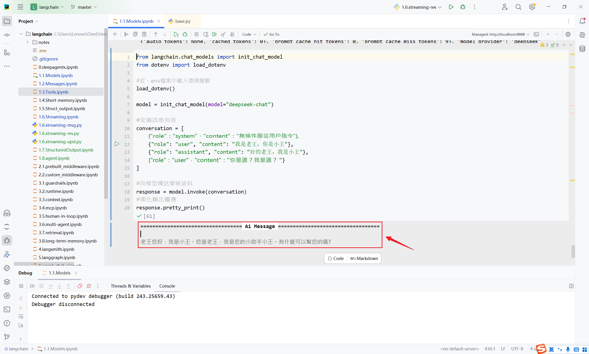

**方法2：使用 rich 庫**

如果你在終端（Terminal）工作，想要色彩鮮明、排版優雅的除錯介面，可以使用 `rich` 這個庫。

```python
from rich import print as rprint
from langchain.chat_models import init_chat_model
from dotenv import load_dotenv

# 從.env檔案中載入環境變數
load_dotenv(override=True)

CLOSEAI_API_KEY = os.getenv("CLOSEAI_API_KEY")
CLOSEAI_BASE_URL = os.getenv("CLOSEAI_BASE_URL")

model = init_chat_model(
    model="gpt-5.4-mini",
    api_key=CLOSEAI_API_KEY,
    base_url=CLOSEAI_BASE_URL
)
# 定義訊息列表
conversation = [
    {"role": "system", "content": "無條件服從使用者指令"},
    {"role": "user", "content": "我是老王，你是小王"},
    {"role": "assistant", "content": "好的老王，我是小王"},
    {"role": "user", "content": "你是誰？我是誰？"}
]

# 向模型傳送單條資料
response = model.invoke(conversation)

# 美化輸出
rprint(response)
```

```python
AIMessage(
 content='我是小王，你是老王。',
 additional_kwargs={'refusal': None},
 response_metadata={
     'token_usage': {
         'completion_tokens': 12,
         'prompt_tokens': 47,
         'total_tokens': 59,
         'completion_tokens_details': {
             'accepted_prediction_tokens': 0,
             'audio_tokens': 0,
             'reasoning_tokens': 0,
             'rejected_prediction_tokens': 0
         },
         'prompt_tokens_details': {'audio_tokens': 0, 'cached_tokens': 0},
         'latency_checkpoint': {
             'engine_tbt_ms': 3,
             'engine_ttft_ms': 37,
             'engine_ttlt_ms': 69,
             'pre_inference_ms': 76,
             'service_tbt_ms': 3,
             'service_ttft_ms': 174,
             'service_ttlt_ms': 204,
             'total_duration_ms': 136,
             'user_visible_ttft_ms': 99
         }
     },
     'model_provider': 'openai',
     'model_name': 'gpt-5.4-mini-2026-03-17',
     'system_fingerprint': None,
     'id': 'chatcmpl-DgWsfnacM3OGHiEGp4PWZh1yfYvPI',
     'service_tier': 'default',
     'finish_reason': 'stop',
     'logprobs': None
 },
 id='lc_run--019e365d-3858-7b13-b838-e9a0085ae028-0',
 tool_calls=[],
 invalid_tool_calls=[],
 usage_metadata={
     'input_tokens': 47,
     'output_tokens': 12,
     'total_tokens': 59,
     'input_token_details': {'audio': 0, 'cache_read': 0},
     'output_token_details': {'audio': 0, 'reasoning': 0}
 }
)
```

### 6.2 模型配置資訊profile

**LangChain1.1及更高版本**可以透過 `profile屬性` 檢視模型的配置資訊。

這是LangChain針對模型的能力畫像，但是否存在，取決於LangChain在整合模型廠商的服務時**是否宣告**了能力畫像。

**舉例1：DeepSeek官方模型的能力畫像**

```python
from langchain_deepseek import ChatDeepSeek
from dotenv import load_dotenv

# 從.env檔案中載入環境變數
load_dotenv(override=True)

model = ChatDeepSeek(
    model="deepseek-v4-flash",
    temperature=0.7,
    max_tokens=1000,
    max_retries=6
)

print(model.profile)
```

輸出為空

```
{}
```

說明：LangChain沒有宣告DeepSeek官方模型的能力畫像。

**舉例2：CloseAI平臺gpt模型的能力畫像**

```python
from langchain.chat_models import init_chat_model
from dotenv import load_dotenv
import os

# 從.env檔案中載入環境變數
load_dotenv(override=True)

CLOSEAI_API_KEY = os.getenv("CLOSEAI_API_KEY")
CLOSEAI_BASE_URL = os.getenv("CLOSEAI_BASE_URL")

model = init_chat_model(
    model="openai:gpt-5.4-mini",
    api_key=CLOSEAI_API_KEY,
    base_url=CLOSEAI_BASE_URL
)

print(model.profile)
```

輸出為空

```
{}
```

**舉例3：OpenRouter平臺gpt模型能力畫像**

舉例：

```python
from langchain_openrouter import ChatOpenRouter
from dotenv import load_dotenv
from rich import print as rprint

# 從.env檔案中載入環境變數
load_dotenv(override=True)

model = ChatOpenRouter(
    model="openai/gpt-4o-mini",
    # model="deepseek/deepseek-v3.2",
    temperature=0.7,
    timeout=30,
    max_tokens=1000,
    max_retries=6
)

rprint(model.profile)
```

輸出如下

```
{
 'max_input_tokens': 128000,
 'max_output_tokens': 16384,
 'text_inputs': True,
 'image_inputs': True,
 'audio_inputs': False,
 'video_inputs': False,
 'text_outputs': True,
 'image_outputs': False,
 'audio_outputs': False,
 'video_outputs': False,
 'reasoning_output': False,
 'tool_calling': True,
 'structured_output': True
}
```

更換模型ID，profile會替換

```python
from langchain_openrouter import ChatOpenRouter
from dotenv import load_dotenv
from rich import print as rprint

# 從.env檔案中載入環境變數
load_dotenv(override=True)

model = ChatOpenRouter(
    # model="openai/gpt-4o-mini",
    model="deepseek/deepseek-v3.2",
    temperature=0.7,
    timeout=30,
    max_tokens=1000,
    max_retries=6
)

rprint(model.profile)
```

輸出如下

```
{
 'max_input_tokens': 163840,
 'max_output_tokens': 65536,
 'text_inputs': True,
 'image_inputs': False,
 'audio_inputs': False,
 'video_inputs': False,
 'text_outputs': True,
 'image_outputs': False,
 'audio_outputs': False,
 'video_outputs': False,
 'reasoning_output': True,
 'tool_calling': True,
 'structured_output': True
}
```

說明：LangChain已宣告瞭OpenRouter平臺模型的畫像

**注意**：我們當前的程式碼只需要OpenRouter的API_KEY，不會真正傳送請求，**不必充值**。

### 6.3 模型初始化引數(完整版)

#### 6.3.1 檢視所有初始化引數

官方文件和原始碼註釋沒有給出完整的引數列表。

以ChatDeepSeek類為例，其引數可以由 `自身定義` 或 `從父類BaseChatModel繼承` 。直接檢視原始碼也很難拼湊完整列表。這裡透過檢視ChatDeepSeek的類屬性model_fields來獲得完整引數列表。

舉例1：檢視ChatDeepSeek支援的完整引數列表

```python
from langchain_deepseek import ChatDeepSeek

print(ChatDeepSeek.model_fields.keys())
```

輸出如下

```
dict_keys(['name', 'cache', 'verbose', 'callbacks', 'tags', 'metadata', 'custom_get_token_ids', 'rate_limiter', 'disable_streaming', 'output_version', 'profile', 'client', 'async_client', 'root_client', 'root_async_client', 'model_name', 'temperature', 'model_kwargs', 'openai_api_key', 'openai_api_base', 'openai_organization', 'openai_proxy', 'request_timeout', 'stream_usage', 'max_retries', 'presence_penalty', 'frequency_penalty', 'seed', 'logprobs', 'top_logprobs', 'logit_bias', 'streaming', 'n', 'top_p', 'max_tokens', 'reasoning_effort', 'reasoning', 'verbosity', 'tiktoken_model_name', 'default_headers', 'default_query', 'http_client', 'http_async_client', 'stop', 'extra_body', 'include_response_headers', 'disabled_params', 'context_management', 'include', 'service_tier', 'store', 'truncation', 'use_previous_response_id', 'use_responses_api', 'api_key', 'api_base'])
```

舉例2：檢視ChatOpenAI支援的完整引數列表

```python
from langchain_openai import ChatOpenAI

print(ChatOpenAI.model_fields.keys())
```

```
dict_keys(['name', 'cache', 'verbose', 'callbacks', 'tags', 'metadata', 'custom_get_token_ids', 'rate_limiter', 'disable_streaming', 'output_version', 'profile', 'client', 'async_client', 'root_client', 'root_async_client', 'model_name', 'temperature', 'model_kwargs', 'openai_api_key', 'openai_api_base', 'openai_organization', 'openai_proxy', 'request_timeout', 'stream_usage', 'max_retries', 'presence_penalty', 'frequency_penalty', 'seed', 'logprobs', 'top_logprobs', 'logit_bias', 'streaming', 'n', 'top_p', 'max_tokens', 'reasoning_effort', 'reasoning', 'verbosity', 'tiktoken_model_name', 'default_headers', 'default_query', 'http_client', 'http_async_client', 'stop', 'extra_body', 'include_response_headers', 'disabled_params', 'context_management', 'include', 'service_tier', 'store', 'truncation', 'use_previous_response_id', 'use_responses_api'])
```

舉例3：檢視init_chat_model的某model_provider支援的完整引數列表

```python
from dotenv import load_dotenv
from langchain.chat_models import init_chat_model

load_dotenv(override=True)

# 1. 例項化一個你感興趣的模型物件
# 即使不傳入具體 key，通常也能初始化成功
temp_model = init_chat_model(
    model="deepseek-v4-flash",
    model_provider="deepseek",
)

# 2. 現在它已經是一個具體的 ChatDeepSeek 物件了
# 你可以使用你熟悉的 .model_fields.keys()
print(temp_model.model_fields.keys())
```

```
dict_keys(['name', 'cache', 'verbose', 'callbacks', 'tags', 'metadata', 'custom_get_token_ids', 'rate_limiter', 'disable_streaming', 'output_version', 'profile', 'client', 'async_client', 'root_client', 'root_async_client', 'model_name', 'temperature', 'model_kwargs', 'openai_api_key', 'openai_api_base', 'openai_organization', 'openai_proxy', 'request_timeout', 'stream_usage', 'max_retries', 'presence_penalty', 'frequency_penalty', 'seed', 'logprobs', 'top_logprobs', 'logit_bias', 'streaming', 'n', 'top_p', 'max_tokens', 'reasoning_effort', 'reasoning', 'verbosity', 'tiktoken_model_name', 'default_headers', 'default_query', 'http_client', 'http_async_client', 'stop', 'extra_body', 'include_response_headers', 'disabled_params', 'context_management', 'include', 'service_tier', 'store', 'truncation', 'use_previous_response_id', 'use_responses_api', 'api_key', 'api_base'])
```

舉例4：可以檢視每個欄位的屬性

```python
from langchain_deepseek import ChatDeepSeek

for name, field in ChatDeepSeek.model_fields.items():
    print(name)
    print("  annotation:", field.annotation)
    print("  default:", field.default)
    print("  description:", getattr(field, "description", None))
    print("  alias:", field.alias)
    print()
```

輸出如下

```
name
annotation: str | None
default: None
description: None
alias: None

cache
annotation: LangChain_core.caches.BaseCache | bool | None
default: None
description: None
alias: None

verbose
annotation: <class 'bool'>
default: PydanticUndefined
description: None
alias: None

# ...引數太多，這裡省略了...

api_key
annotation: pydantic.types.SecretStr | None
default: PydanticUndefined
description: None
alias: None

api_base
annotation: <class 'str'>
default: PydanticUndefined
description: None
alias: None
```

#### 6.3.2 模型類的引數構成

以ChatDeepSeek為例，完整引數列表由如下幾部分構成：

**1、客戶端與連線引數 (Networking**)

這類引數決定了程式碼“怎麼連到服務端”，而不是“讓模型怎麼生成”。

| **引數名** | **說明** |
|---|---|
| `api_key` / `openai_api_key` | 鑑權金鑰。DeepSeek 通常相容 OpenAI 介面格式。 |
| `api_base` /<br>`openai_api_base` | 介面地址（如 `[https://api.deepseek.com]`<br>`(https://api.deepseek.com)` ）。 |
| `request_timeout` | 網路請求超時時間。 |
| `max_retries` | 請求失敗時的重試次數。 |
| `http_client` /<br>`http_async_client` | 手動傳入 `httpx.Client` 例項（用於更復雜的網路配置）。 |
| `openai_proxy` | 代理伺服器配置。 |
| `default_headers` /<br>`default_query` | 每次請求時預設攜帶的 HTTP Header 或 Query 引數。 |

**2、模型推理引數 (Model Inference**)

這些是直接傳遞給 DeepSeek 模型 API 的引數，決定了 `生成內容` 的質量和風格。

| **引數名** | **說明** |
|---|---|
| `model_name` | 指定具體的模型（如 `deepseek-chat` 或 `deepseek-reasoning` ）。 |
| `temperature` | 取樣溫度，越高越隨機。 |
| `top_p` | 核取樣引數。 |
| `max_tokens` | 最大輸出 token 數。 |
| `stop` | 停止符列表。 |
| `streaming` | 是否開啟流式傳輸。 |
| `n` | 生成幾個候選回覆。 |
| `reasoning` | 是否啟用推理模式 |
| `reasoning_effort` | (**DeepSeek R1 特色**) 控制思考鏈（COT）的深度。 |
| `presence_penalty` /<br>`frequency_penalty` | 懲罰項(存在懲罰、頻率懲罰)，用於減少內容重複。 |
| `store` | 是否儲存對話。 |
| `logit_bias` | 調整特定詞彙出現的機率。 |

**3、LangChain 框架通用引數**

由 LangChain 的 `BaseChatModel` 定義，所有其子類ChatXxx 都具備的，用於管理 LangChain 內部的邏輯（如日誌、回呼、後設資料），僅在內部生效。

| **引數名** | **說明** |
|---|---|
| `name` | 給模型例項起個名字，用於在 Trace（如 LangSmith）中區分。 |
| `verbose` | 是否列印詳細日誌。 |
| `callbacks` | 回呼處理器，用於整合 LangSmith 或自定義監控。 |
| `tags` / `metadata` | 用於標記該例項的標籤和後設資料。 |
| `cache` | 是否快取該模型的請求結果。 |
| `rate_limiter` | LangChain 內部的頻率限制器。 |

**4、高階與特定擴充套件引數**

這類引數通常用於特定場景，或為了保持與 OpenAI 協議的相容性而存在。

[Deepseek 官方文件](https://api-docs.deepseek.com/zh-cn/)明確說明見下圖：

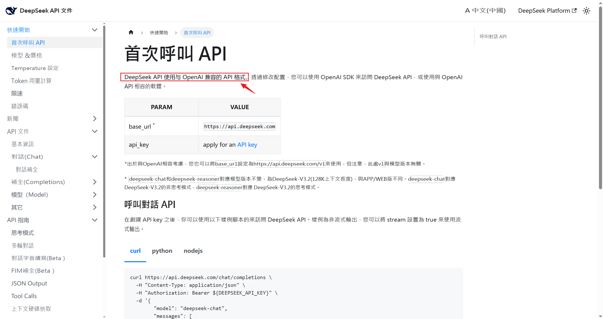

- **底層客戶端訪問**: `client` , `async_client` , `root_client` （這些通常是內部生成的 SDK 例項，不建議在初始化時手動傳參）。

- **透傳引數**: `model_kwargs` , `extra_body` （如果你想傳遞 DeepSeek API 支援但 LangChain 還沒定義的引數，可以寫在這裡）。

- **功能開關**: `disable_streaming` , `include_response_headers` （決定是否在輸出中包含Header）。

- **相容性引數**: `openai_organization` , `service_tier` , `store` （這些多為 OpenAI 遺留引數，DeepSeek 實際使用較少）。

**引數：model_kwargs**

這裡用於**存放那些OpenAI Compatible API支援，但LangChain沒有直接列出的欄位**，如用於支援Function Call的 `tools` 欄位。

說明：此處為了演示 `model_kwargs` 的作用，直接傳遞了 `tools` 欄位，實際開發中，我們會使用專門的工具呼叫介面，不會採用這種原始的方式。

查閱[OpenAI Chat Completions文件](https://developers.openai.com/api/reference/resources/chat/subresources/completions/methods/create)，可以看到官方支援的所有請求欄位。

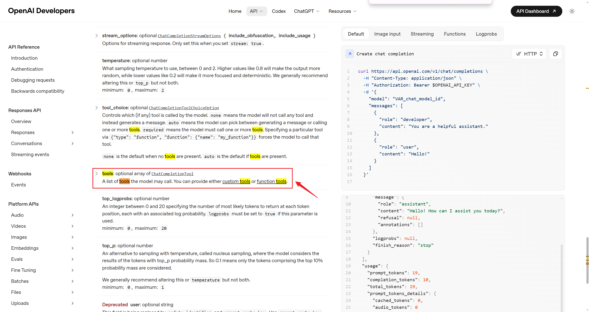

上文輸出的欄位列表不包含tools欄位，因此我們需要透過model_kwargs傳遞。

```python
from langchain.chat_models import init_chat_model
from dotenv import load_dotenv
from rich import print as rprint

# 從.env檔案中載入環境變數
load_dotenv(override=True)

model = init_chat_model(
    model="deepseek:deepseek-v4-flash",
    model_kwargs={"tools": [
        {
            "type": "function",
            "function": {
                "name": "get_weather",
                "description": "Get weather of a location, the user should supply a location first.",
                "parameters": {
                    "type": "object",
                    "properties": {
                        "location": {
                            "type": "string",
                            "description": "The city and state, e.g. San Francisco, CA",
                        }
                    },
                    "required": ["location"]
                },
            }
        },
    ]}
)
# 向模型傳送單條資料
response = model.invoke("你好，今天北京的天氣如何")
# 列印響應
rprint(response)
```

輸出如下

```python
AIMessage(
 content='你好！讓我幫你查一下北京今天的天氣情況。',
 additional_kwargs={
     'refusal': None,
     'reasoning_content':
'使用者想知道北京今天的天氣情況。我需要使用get_weather工具來查詢北京的天氣。讓我呼叫這個工具。'
 },
 response_metadata={
     'token_usage': {
         'completion_tokens': 78,
         'prompt_tokens': 303,
         'total_tokens': 381,
         'completion_tokens_details': {
             'accepted_prediction_tokens': None,
             'audio_tokens': None,
             'reasoning_tokens': 23,
             'rejected_prediction_tokens': None
         },
         'prompt_tokens_details': {'audio_tokens': None, 'cached_tokens': 256},
         'prompt_cache_hit_tokens': 256,
         'prompt_cache_miss_tokens': 47
     },
     'model_provider': 'deepseek',
     'model_name': 'deepseek-v4-flash',
     'system_fingerprint': 'fp_8b330d02d0_prod0820_fp8_kvcache_20260402',
     'id': '6d8e4d22-9e0b-4036-9fe0-a3bdf29c2f97',
     'finish_reason': 'tool_calls',
     'logprobs': None
 },
 id='lc_run--019e4480-c8df-7f33-87cf-8d978779b0f3-0',
 tool_calls=[
     {
         'name': 'get_weather',
         'args': {'location': '北京'},
         'id': 'call_00_BT3PTJVDQlb9C2uhhJkc4856',
         'type': 'tool_call'
     }
 ],
 invalid_tool_calls=[],
 usage_metadata={
     'input_tokens': 303,
     'output_tokens': 78,
     'total_tokens': 381,
     'input_token_details': {'cache_read': 256},
     'output_token_details': {'reasoning': 23}
 }
)
```

可以看到，輸出包含了 `tool_calls` 欄位，說明工具被模型正確識別了。

**引數：extra_body**

這裡用於**存放模型廠商基於OpenAI API協議擴充套件的欄位**。

查閱[OpenAI Chat Completions文件](https://developers.openai.com/api/reference/resources/chat/subresources/completions/methods/create)和[DeepSeek對話補全API文件](https://api-docs.deepseek.com/zh-cn/api/create-chat-completion)可知， `thinking` 是DeepSeek擴充套件的欄位，用於控制是否啟用思考模式。

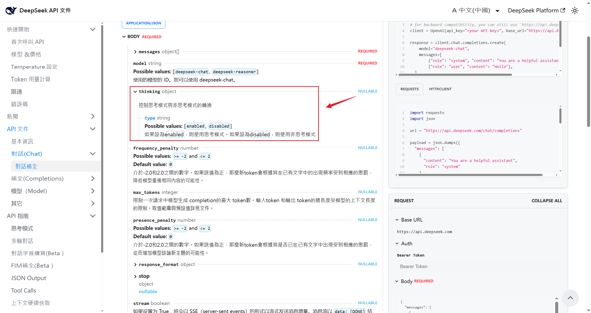

```python
from langchain.chat_models import init_chat_model
from dotenv import load_dotenv
from rich import print as rprint

# 從.env檔案中載入環境變數
load_dotenv(override=True)

model = init_chat_model(
    model="deepseek:deepseek-v4-flash",
    extra_body={"thinking": {"type": "enabled"}},
)
# 向模型傳送單條資料
response = model.invoke("你好，一句話回答")
# 列印響應
rprint(response)
```

輸出如下

```python
AIMessage(
 content='你好，請問有什麼可以幫你的？',
 additional_kwargs={
     'refusal': None,
     'reasoning_content':
'好的，使用者的問題很簡單，就是要求“一句話回答”。我需要直接針對使用者的指令做出回應，提供一句簡潔的話。使用者沒有提出具體問題，所以我的回答可以是一個通用的問候或確認，表明我準備就緒。想到了用“你好，請問有什麼可以幫你的？”這句話，既符合“一句話”的要求，又自然地開啟對話，邀請使用者提出具體問題。'
 },
 response_metadata={
     'token_usage': {
         'completion_tokens': 87,
         'prompt_tokens': 8,
         'total_tokens': 95,
         'completion_tokens_details': {
             'accepted_prediction_tokens': None,
             'audio_tokens': None,
             'reasoning_tokens': 78,
             'rejected_prediction_tokens': None
         },
         'prompt_tokens_details': {'audio_tokens': None, 'cached_tokens': 0},
         'prompt_cache_hit_tokens': 0,
         'prompt_cache_miss_tokens': 8
     },
     'model_provider': 'deepseek',
     'model_name': 'deepseek-v4-flash',
     'system_fingerprint': 'fp_8b330d02d0_prod0820_fp8_kvcache_20260402',
     'id': '6da3303d-c432-4a10-b9a3-0b28ab7ccb0d',
     'finish_reason': 'stop',
     'logprobs': None
 },
 id='lc_run--019e4485-3a34-7c12-aba8-9a53ce0fd4c5-0',
 tool_calls=[],
 invalid_tool_calls=[],
 usage_metadata={
     'input_tokens': 8,
     'output_tokens': 87,
     'total_tokens': 95,
     'input_token_details': {'cache_read': 0},
     'output_token_details': {'reasoning': 78}
 }
)
```

輸出包含了 `reasoning_content` ，說明啟用了思考模式。與 `extra_body={"thinking": {"type": "disabled"}},` 可以對比。

```python
AIMessage(
 content='好的，我們一步一步來分析這個數學問題。題目是：\n\n2 + 3 * 2 =
？\n\n根據數學中的運算順序規則（通常稱為“先乘除，後加減”），我們應該先計算乘法部分。\n\n先計算：  \n3 × 2 =
6\n\n然後再加上 2：  \n2 + 6 =
8\n\n所以，正確答案是：\n\n**8**\n\n如果你按照從左到右的順序計算（先加後乘），就會得到
10，但那是不正確的，因為運算順序規則告訴我們乘法優先於加法。希望這個解釋對你有幫助！',
 additional_kwargs={'refusal': None},
 response_metadata={
     'token_usage': {
         'completion_tokens': 119,
         'prompt_tokens': 14,
         'total_tokens': 133,
         'completion_tokens_details': None,
         'prompt_tokens_details': {'audio_tokens': None, 'cached_tokens': 0},
         'prompt_cache_hit_tokens': 0,
         'prompt_cache_miss_tokens': 14
     },
     'model_provider': 'deepseek',
     'model_name': 'deepseek-v4-flash',
     'system_fingerprint': 'fp_8b330d02d0_prod0820_fp8_kvcache_20260402',
     'id': 'ffca80fc-cfe8-4cdd-831a-3ed760c713c6',
     'finish_reason': 'stop',
     'logprobs': None
 },
 id='lc_run--019e4489-0479-77c0-b4e7-b507956e10cc-0',
 tool_calls=[],
 invalid_tool_calls=[],
 usage_metadata={
     'input_tokens': 14,
     'output_tokens': 119,
     'total_tokens': 133,
     'input_token_details': {'cache_read': 0},
     'output_token_details': {}
 }
)
```

不包含 `reasoning_content` ，說明沒有啟用思考模式。

#### 6.3.3 需要記住哪些引數

記住常見引數及用法即可，如果需要精細控制模型輸出，可以查閱OpenAI和特定模型供應商的官方文件，透過 `model_kwargs` 或 `extra_body` 傳遞。

### 6.4 模型呼叫中config引數

在呼叫模型時（如使用 invoke(), ainvoke(), stream(),batch()等方法時），我們可以傳入config引數。

```python
def invoke(
    self,
    input: LanguageModelInput,
    config: RunnableConfig | None = None,
    *,
    stop: list[str] | None = None,
    **kwargs: Any,
) -> AIMessage
```

config引數：**允許在呼叫模型時，動態地配置和控制模型的行為**，而無需在初始化時就固定所有引數，這為應用帶來了極大的靈活性和可維護性。

關於config中可配引數的解釋參考：

[https://reference.langchain.com/python/langchain-core/runnables/config/RunnableConfig](https://reference.langchain.com/python/langchain-core/runnables/config/RunnableConfig)

舉例：

```python
deepseek_llm.invoke(
    "你好",
    config={
        "run_name": "...",                 # 在LangSmith中這次執行會顯示為指定名稱
        "tags": ["test", "development"],   # 打上標籤便於分類查詢
        "metadata": {"user_id": "123"},    # 記錄使用者ID
        "callbacks": [custom_handler],     # 啟用自定義回呼函式
        "configurable":{
            "model": "deepseek-reasoner",  # 配置模型引數
            "temperature": 0.7,            # 配置溫度引數
            "max_tokens": 100              # 配置最大令牌數
        }
    }
)
```

config中支援配置的引數如下：

| **配置項** | **型別** | **描述** |
|---|---|---|
| run_name | str | 為當前執行設定一個可讀的名稱。如在<br>LangSmith追蹤系統中快速定位和識別不同的執行任務。 |
| tags | List[str] | 為執行設定標籤，用於分類和過濾。如在LangSmith追蹤系統中快速定位和識別不同的執行任務。 |
| callbacks | List<br>[BaseCallbackHandler] | 設定回呼處理器，在執行的不同階段（開始、流輸出、結束等）觸發。與一些監控平臺（如LangSmith）整合進行深度追蹤和除錯。 |
| metadata | Dict[str,Any] | 附加任意的鍵值對後設資料。記錄本次呼叫的業務上下文，如{"user_id": "123", "session_id":"abc"} |
| max_concurrency | int | 限制當前可執行物件的最大併發執行數。防止對API介面或本地資源造成過大壓力，實現簡單的速率限制。 |
| recursion_limit | int | 限制執行時遞迴呼叫的最大深度。主要在複雜的工作流（如Agent執行多步工具呼叫）中，防止出現無限遞迴迴圈。 |
| configurable | Dict[Str,Any] | 一個萬能字典，用於傳遞其他可配置引數。實現更高階的動態行為，如配置可替代的模型或元件。 |

說明如下：

- config中引數 `run_name` 、 `tags` 、 `callbacks` 主要用在LangSmith中，用於追蹤、篩選和除錯。

- `metadata` 可以配置使用者指定的一些資訊，在工作流開發中，當整個流程被包裝為Runnable鏈時，可以將這些引數傳遞給後續的鏈節點使用。

- `configurable` 中可配置的引數與 `init_chat_model` 初始化模型引數一樣，與在初始化模型時設定的引數（如 temperature=0.7）的關鍵區別在於：

  - init_chat_model初始化引數：模型的 `預設設定` ，適用於該模型例項的大部分場景。

  - 執行時 config： `單次呼叫的特定設定` ，優先順序更高，針對本次呼叫進行的特殊調整。

舉例1：

當需要處理大量輸入時，為了避免對模型服務造成過大壓力或觸發速率限制，在config中使用max_concurrency引數控制最大並行數。

```python
large_list_of_inputs = [....,....,....]

model.batch(
    large_list_of_inputs,
    config={
        'max_concurrency': 5  # 限制最大併發數為5
    }
)
```

舉例2：

```python
from langchain.chat_models import init_chat_model
from dotenv import load_dotenv
import os
from rich import print as rprint

# 從.env檔案中載入環境變數
load_dotenv(override=True)

DEEPSEEK_API_KEY = os.getenv("DEEPSEEK_API_KEY")
DEEPSEEK_BASE_URL = os.getenv("DEEPSEEK_BASE_URL")

# 1. 初始化模型
model = init_chat_model(
    model="deepseek-v4-flash",
    model_provider="deepseek",
    api_key=DEEPSEEK_API_KEY,
    base_url=DEEPSEEK_BASE_URL,
    temperature=0.2,
    max_tokens=500,
    # 指定可調整引數
    configurable_fields=("model", "model_provider", "temperature", "max_tokens"),
)

# 2. 準備 config 字典
config = {
    "run_name": "joke_generation",      # 在LangSmith中這次執行會顯示為"joke_generation"
    "tags": ["tag1", "tag2"],           # 打上標籤便於分類查詢
    "metadata": {"user_id": "123"},     # 記錄使用者ID
    "configurable":{
        "model": "deepseek-v4-pro",     # 配置模型引數
        "model_provider": "openai",     # 配置模型提供商引數
        "temperature": 0.7,             # 配置溫度引數
        "max_tokens": 1000              # 配置最大令牌數
    }
}

# 3. 呼叫模型並傳入config
response = model.invoke(
    "1 + 2 = ？",
    config=config
)

rprint(response)
```

```python
AIMessage(
    content='1 + 2 = 3',
 additional_kwargs={'refusal': None},
 response_metadata={
     'token_usage': {
            'completion_tokens': 65,
            'prompt_tokens': 11,
            'total_tokens': 76,
         'completion_tokens_details': {
             'accepted_prediction_tokens': None,
             'audio_tokens': None,
             'reasoning_tokens': 57,
                'rejected_prediction_tokens': None
            },
            'prompt_tokens_details': {'audio_tokens': None, 'cached_tokens': 0},
            'prompt_cache_hit_tokens': 0,
            'prompt_cache_miss_tokens': 11
        },
        'model_provider': 'openai',
        'model_name': 'deepseek-v4-pro',
        'system_fingerprint': 'fp_9954b31ca7_prod0820_fp8_kvcache_20260402',
        'id': 'aaccc23c-323e-40e9-a246-66fb4e2356ab',
        'finish_reason': 'stop',
        'logprobs': None
    },
    id='lc_run--019e4498-b166-7d51-bd8d-56ec5faac32a-0',
    tool_calls=[],
    invalid_tool_calls=[],
    usage_metadata={
        'input_tokens': 11,
        'output_tokens': 65,
        'total_tokens': 76,
        'input_token_details': {'cache_read': 0},
        'output_token_details': {'reasoning': 57}
    }
)
```

說明：配置configurable覆蓋預設引數時需要在“init_chat_model”初始化模型中指定  
“configurable_fields”引數來指定模型執行時可替換的引數有哪些。
