# 第03章：LangSmith基本使用

講師：尚硅谷-宋紅康

官網：[尚硅谷](http://www.atguigu.com/)

## 1、LangSmith概述

### 1.1 什麼是LangSmith?

LangSmith 是 LangChain 生態系統中專門用於 LLM（大語言模型）應用**除錯、監控、評估和管理** 的平臺。

- 🔍 **追蹤(tracing**)：記錄每次 LLM 呼叫的詳細資訊

- 📊 **監控(monitoring**)：實時檢視應用效能

- 🐛 **除錯(debug**)：排查問題和最佳化效能

- 📈 **評估(evaluate**)：系統化測試 LLM 應用

主介面：

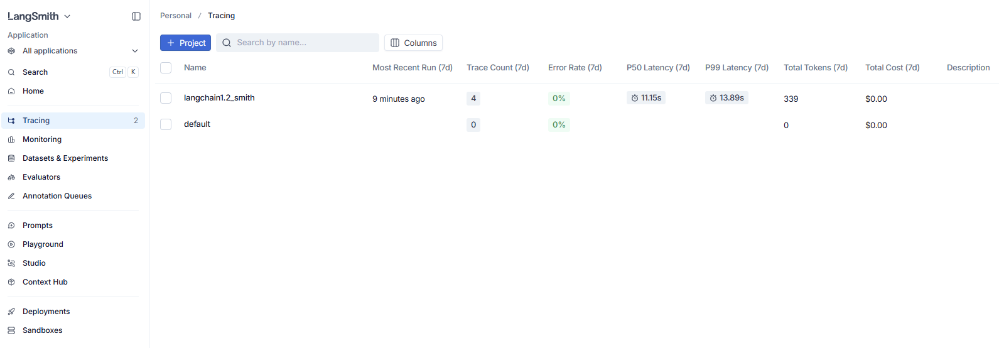

### 1.2 具體功能

#### 功能1：核心應用與開發

**1、Tracing（追蹤**）

- 功能：這是 LangSmith 最核心的功能。它會完整記錄你大模型應用的每一次呼叫鏈路（Trace）。

- 作用：當你的 Agent（智慧體）或 RAG 系統執行變慢或報錯時，點選進入對應的專案（如上圖中的 `langchain1.2_smith` ），你可以看到每一步具體的 Prompt 是什麼、模型返回了什麼、消耗了多少 Token，以及每一個鏈條節點的耗時，非常方便**排查 Bug 和最佳化效能**。

**2、Monitoring（監控**）

- 功能：提供生產環境的高階資料視覺化看板。

- 作用：幫你從宏觀角度監控應用在一段時間內的執行狀況。你可以看到 **Token 消耗趨勢、QPS（每秒請求數）、錯誤率、平均延遲（Latency）以及成本預估**。適合應用上線後觀察系統的穩定性和開銷。

**3、Datasets & Experiments（資料集與實驗**）

- 功能：用於管理測試資料集並執行對比實驗。

- 作用：你可以把使用者的真實輸入、特定的邊界情況（Edge Cases）存為資料集。當你修改了Prompt 或更換了底層大模型時，可以在這裡執行**自動化對比測試**，直觀看到新舊版本在同一批測試集上的表現差異。

**4、Evaluators（評估器**）

- 功能：配置和自動化評估任務。

- 作用：大模型的輸出往往難以用傳統的斷言（Assert）來測試。這裡允許你配置基於規則（如關鍵詞匹配）或基於模型（LLM-as-a-judge）的評估指標（如：答案相關性、是否包含幻覺等），對追蹤到的資料或實驗結果進行自動打分。

**5、Annotation Queues（標註佇列**）

- 功能：人工反饋與資料清洗工具。

- 作用：在應用開發或初上線階段，你可以把一部分痕跡（Traces）傳送到標註佇列中，讓團隊中的核心成員、業務專家或人工客服進行**手動打分、糾正回答或貼標籤**，這些高質量的人工標註資料後續可直接用於微調模型或充當測試集。

#### 功能2：提示詞與除錯工具

**1、Prompts（提示詞管理**）

- 功能：類似“提示詞版的 GitHub”。

- 作用：把 Prompt 從程式碼中解耦出來，統一在雲端管理。你可以在這裡對 Prompt 進行版本控制（如 `v1` 、 `v2` ），直接在程式碼中透過 API 動態拉取最新的提示詞。它還支援團隊協作和 Prompt 的分享。

**2、Playground（演練場**）

- 功能：一個網頁端的模型互動介面。

- 作用：無需寫任何程式碼，直接在這裡選擇不同的模型（如 OpenAI、Anthropic 或是本地模型），快速微調並測試你的 Prompt 效果，還可以一鍵將調整好的 Prompt 儲存到上方的 Prompts 倉庫中。

**3、Studio（工作室**）

- 功能：通常與 LangGraph 深度整合，提供視覺化的圖形互動介面。

- 作用：如果你的應用是基於圖結構（Graph-based）的複雜複雜 Agent 架構，Studio 可以讓你**視覺化地看到狀態機（State）在各個節點之間的流轉**，甚至支援在某個節點“暫停”，手動修改資料後再繼續向下執行，是除錯複雜智慧體互動的利器。

**4、Context Hub（上下文中心**）

- 功能：管理全域性上下文或通用元件配置。

- 作用：用於存放可在多個專案或 Prompt 中複用的公共上下文模板、全域性變數或系統預設提示。

#### 功能3：部署與沙盒

**1、Deployments（部署**）

- 功能：一鍵將你的 LangChain 應用或 LangGraph Agent 部署為線上可用的 API 服務（通常依託於LangGraph Cloud）。

- 作用：提供開箱即用的生產端點，幫你處理高併發、佇列管理和狀態持久化，讓你專注於編寫業務邏輯。

**2、Sandboxes（沙盒**）

- 功能：提供輕量級的線上執行和測試環境。

- 作用：在不汙染生產環境的前提下，供開發人員安全地試執行、測試新部署的 Agent 或執行自動化指令碼。

> 建議：現階段大家可以重點關注 **Tracing**（觀察你的專案裡的呼叫細節）和 **Playground**（快速調優提示詞）。當你的應用結構開始走向複雜（比如引入了複雜的 RAG 檢索或多 Agent 協同）時，再逐步引入 **Datasets** 進行量化評估，並利用 **Studio** 進行視覺化除錯。

## 2、準備賬號

### 2.1 註冊或登入

步驟1：訪問官網

訪問Langsmith官網：[https://smith.LangChain.com/](https://smith.langchain.com/)

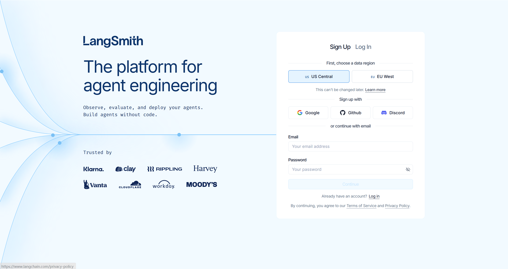

步驟2：自由選擇註冊或登入方式

步驟3：登入成功

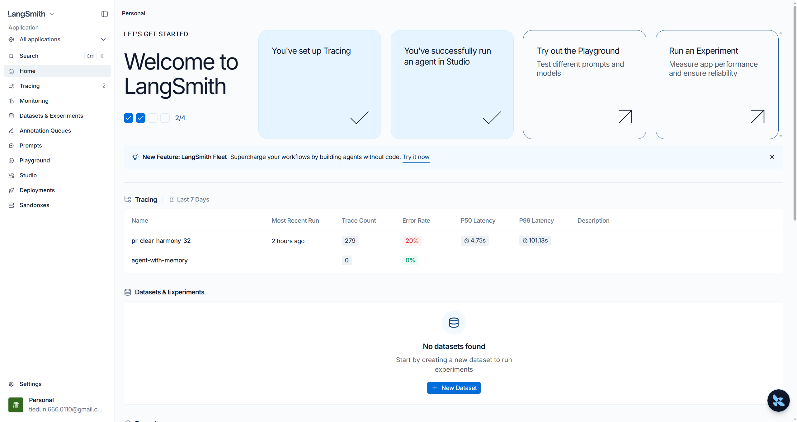

### 2.2 獲取API_KEY

**步驟1：開啟設定**

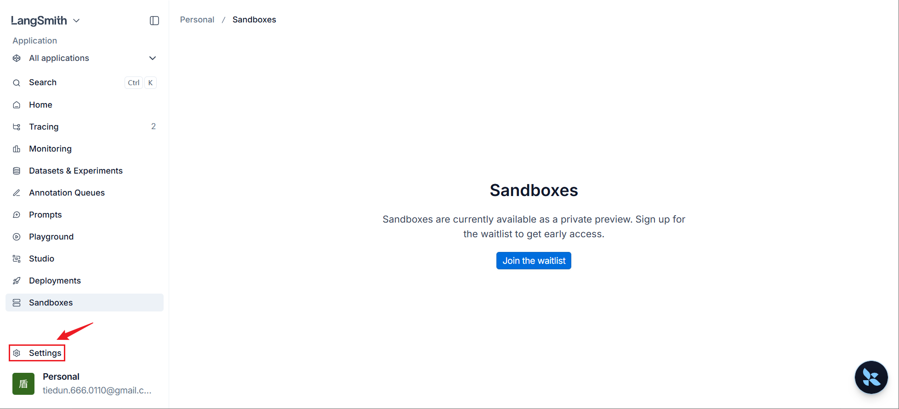

**步驟2：建立API_KEY**

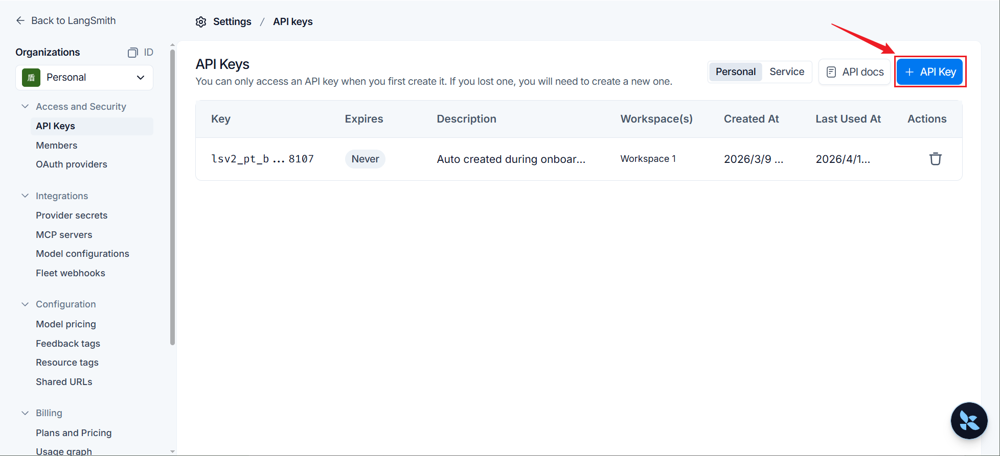

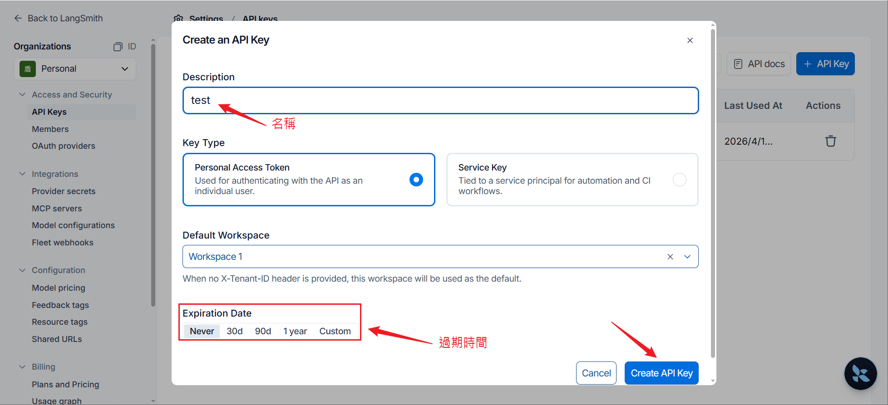

**步驟3：儲存KEY**

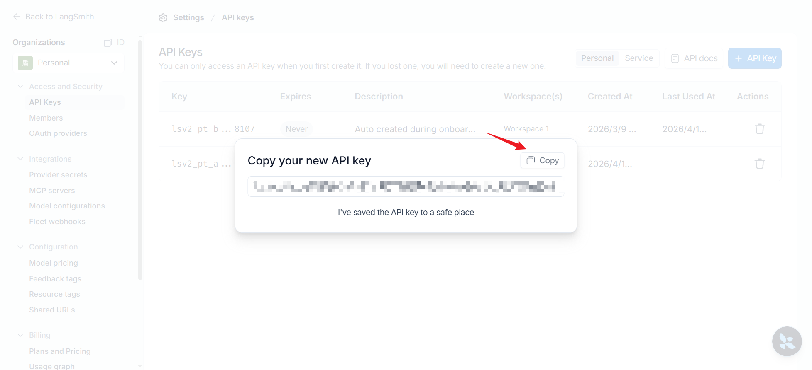

> 注意：點選 `copy` 將API_KEY儲存到剪貼簿並關閉彈窗，API_KEY只在上述視窗出現一次，關閉彈窗後回到設定頁面，此後就無法在官網檢視API_KEY的內容了，請妥善儲存。

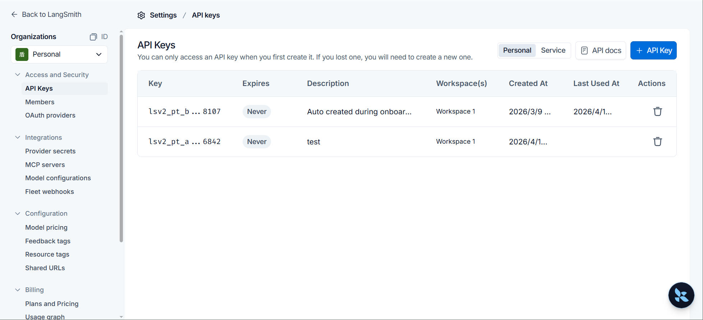

**步驟4（可選）：按需刪除**

如果需要刪除KEY，點選右側圖示即可。

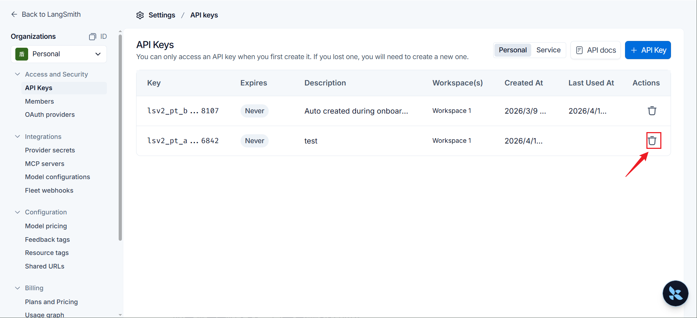

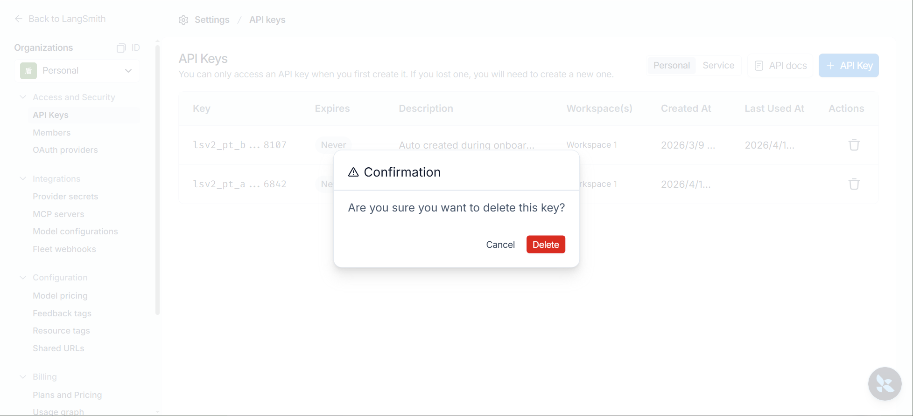

### 2.3 新增環境變數

在.env配置檔案中，新增四個環境變數：

```python
# 是否啟用Langsmith監控功能
LANGSMITH_TRACING=true

# Langsmith監控WebUI地址
LANGSMITH_ENDPOINT=https://api.smith.LangChain.com

# 建立的API_KEY
LANGSMITH_API_KEY=<YOUR_API_KEY>

# 自定義專案名稱，可以在Langsmith WebUI監控頁面根據名稱檢視對應的執行記錄
LANGSMITH_PROJECT="pr-clear-harmony-32"
```

## 3、檢視監控指標

新增上述環境變數後，在程式中透過load_dotenv()載入，而後執行LangChain程式碼，LangSmith會自動記錄執行指標，並同步至後臺服務，我們可以在LangSmith官網檢視執行記錄。

**步驟1：執行任意LangChain程式**

舉例1：

```python
import os

from dotenv import load_dotenv
from langchain_deepseek import ChatDeepSeek

# 將env檔案中的變數載入為環境變數
#override=True：表示.env優先
load_dotenv(override=True)

DEEPSEEK_API_KEY = os.getenv("DEEPSEEK_API_KEY")
DEEPSEEK_BASE_URL = os.getenv("DEEPSEEK_BASE_URL")

model = ChatDeepSeek(
    api_key=DEEPSEEK_API_KEY,
    api_base=DEEPSEEK_BASE_URL,
    model_name="deepseek-v4-flash"
)

print(model.invoke("你好"))
```

舉例2：

```python
from langchain.chat_models import init_chat_model
from dotenv import load_dotenv
import os

load_dotenv(override=True)

CLOSEAI_API_KEY=os.getenv("CLOSEAI_API_KEY")
CLOSEAI_BASE_URL=os.getenv("CLOSEAI_BASE_URL")

model = init_chat_model(model="deepseek-v4-flash",
                        model_provider="openai",
                        api_key=CLOSEAI_API_KEY,
                        base_url=CLOSEAI_BASE_URL)

print(model.invoke("你好，用一句話回答"))
```

舉例3：

```python
from langchain.chat_models import init_chat_model
from dotenv import load_dotenv
import os
from rich import print as rprint

# 從.env檔案中載入環境變數
load_dotenv(override=True)

DEEPSEEK_API_KEY = os.getenv("DEEPSEEK_API_KEY")
DEEPSEEK_BASE_URL = os.getenv("DEEPSEEK_BASE_URL")

# 1. 初始化模型
model = init_chat_model(
    model="deepseek-v4-flash",
    model_provider="deepseek",
    api_key=DEEPSEEK_API_KEY,
    base_url=DEEPSEEK_BASE_URL,
    temperature=0.2,
    max_tokens=500,
    # 指定可調整引數
    configurable_fields=("model", "model_provider", "temperature", "max_tokens"),
)

# 2. 準備 config 字典
config = {
    "run_name": "joke_generation",  # 在LangSmith中這次執行會顯示為"joke_generation"
    "tags": ["my_tag1", "my_tag2"],  # 打上標籤便於分類查詢
    "metadata": {
        "user_id": "shkstart",     # 記錄使用者ID
        "session_id": "sess_123"   # 記錄會話ID
    },
    "configurable": {
        "model": "deepseek-v4-pro",  # 配置模型引數
        "model_provider": "openai",  # 配置模型提供商引數
        "temperature": 0.7,  # 配置溫度引數
        "max_tokens": 1000  # 配置最大令牌數
    }
}

# 3. 呼叫模型並傳入config
response = model.invoke(
    "1 + 2 = ？",
    config=config
)

rprint(response)
```

**步驟2：開啟監控介面**

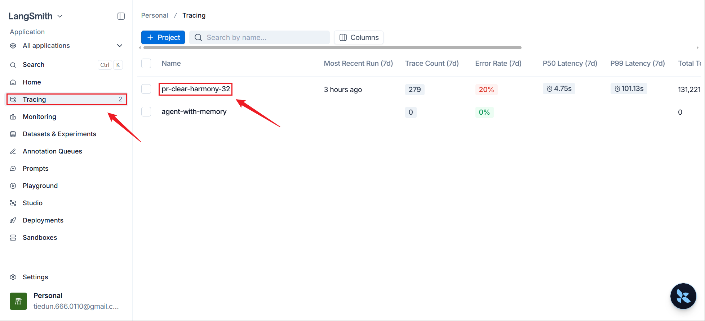

此時在LangSmith官方WebUI的Tracing介面下，可以看到按照 `LANGSMITH_PROJECT` 命名的專案。

**步驟3：檢視執行指標**

點選條目任意位置可以進入詳情頁面

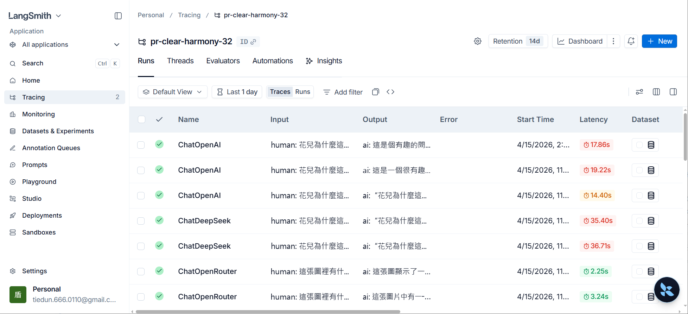

此處列出了詳細的執行指標，點選某次執行記錄，可以檢視更詳細的資訊，自行探索。

**步驟4：檢視執行報表**

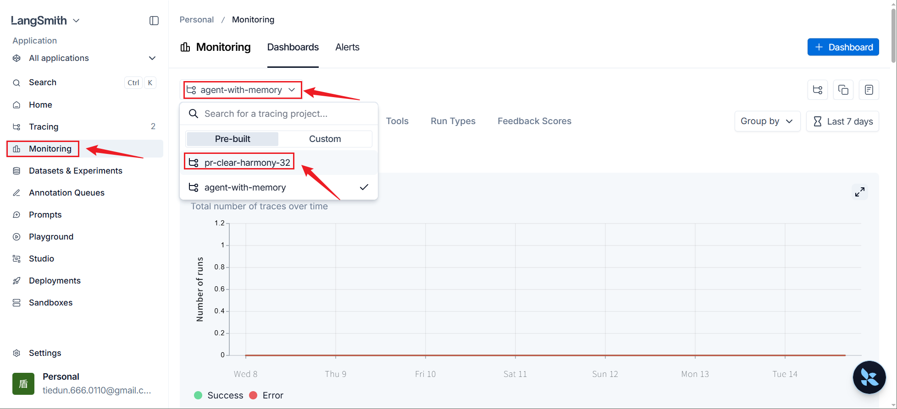

此處提供了大量指標的報表

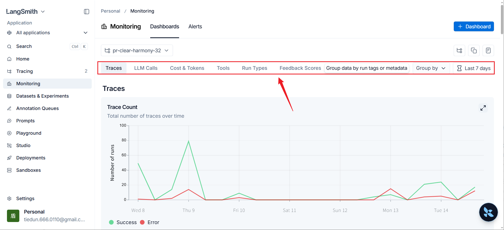

點選上述標籤或下滑頁面可以切換指標。


自行探索。
