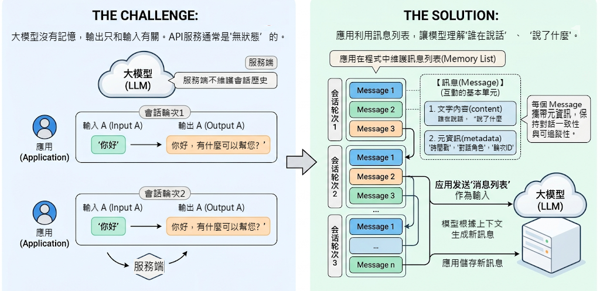
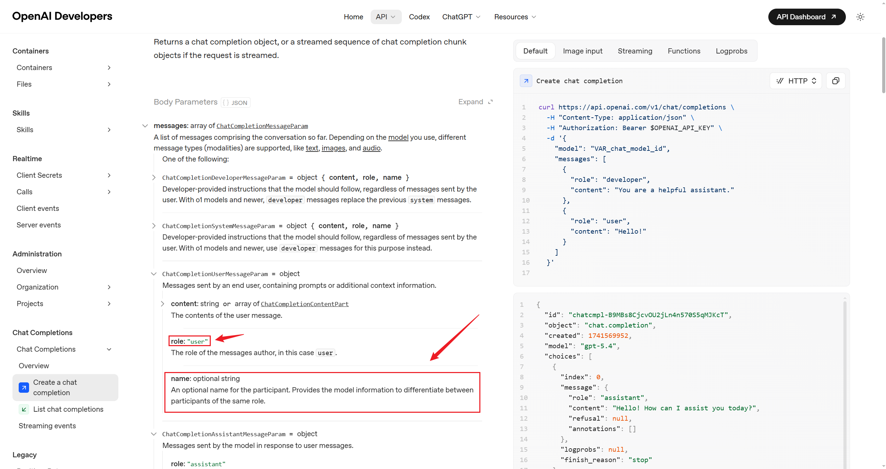
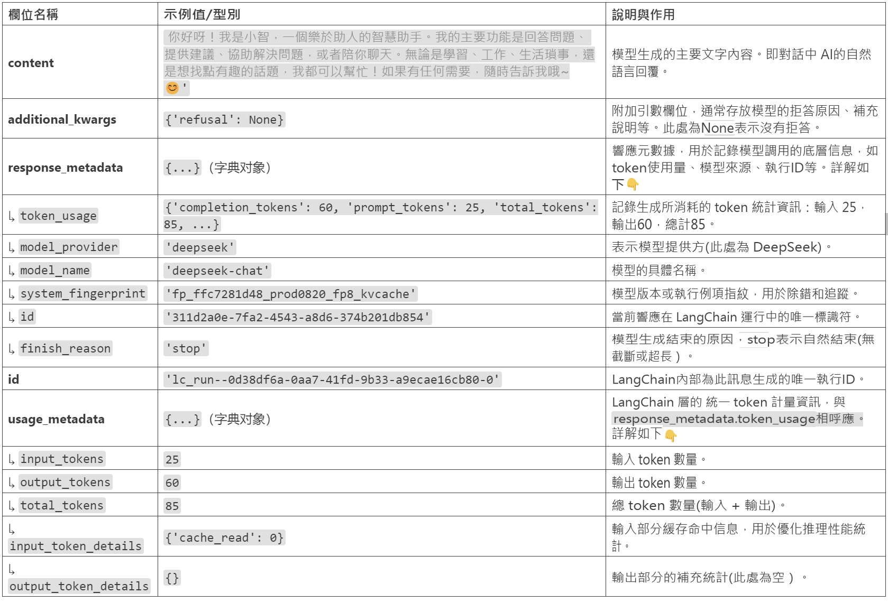
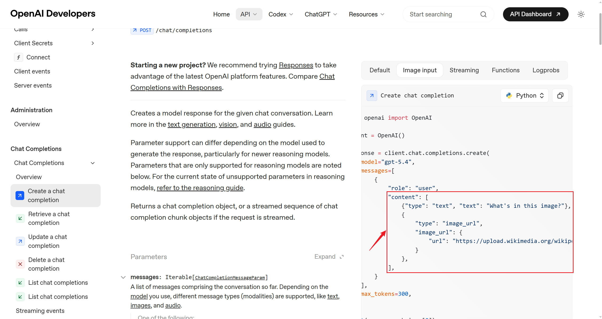
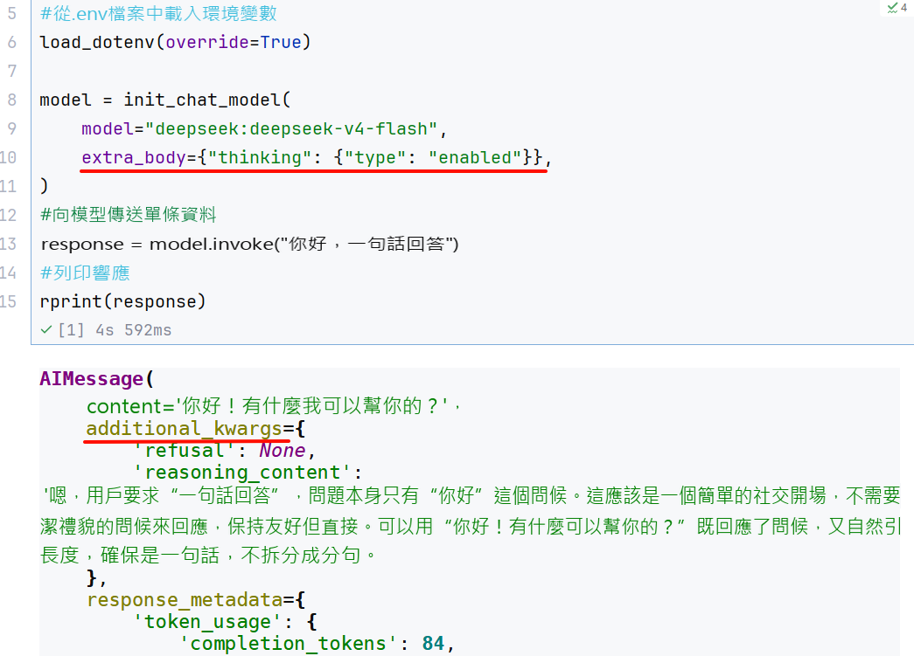

# 第04章：訊息與提示詞模板

講師：尚硅谷-宋紅康

官網：[尚硅谷](http://www.atguigu.com/)

## 1、認識訊息

大模型沒有記憶，它的輸出只和輸入模型的內容有關（上下文）。很多大模型API服務也沒有在服務端維護會話歷史，是“ `無狀態` ”的。因此，**如果應用需要“記住”對話歷史，需要在程式中維護訊息列表**。



**在 LangChain 中，Message（訊息）是模型互動的最基本單元**。它既代表模型接收到的 `輸入（Input）` ，也代表模型生成的 `輸出（Output）` 。

> 每一輪與大模型的對話，都由一條或多條 Message 構成。每個 Message 不僅包含 `文字內容` ，還攜帶描述上下文狀態的 `元資訊（metadata）` ，用於保持對話的一致性和可追蹤性。比如，模型在多輪互動中理解“誰在說話”、“說了什麼”、“這條資訊屬於哪一輪對話”。

LangChain 在 1.0 中提供了**跨模型統一的 Message 標準**。無論你使用的是 OpenAI、Anthropic、Gemini 還是本地模型，這一標準都能保持一致的行為。好處：

- `相容性強` ：不同模型的訊息格式自動對齊。

- `可擴充套件性高` ：方便新增多模態內容或自定義欄位。

- `可追蹤性好` ：為 LangSmith 等除錯工具提供一致的上下文資料結構。

### 1.1 訊息的內部結構

LangChain的訊息（Message）物件包含三種欄位

- **Role**：訊息所屬的角色或型別，如 `system` 、 `user` 、 `assistant` 。

- **Content**：訊息內容

- **Metadata**：（可選）後設資料，儲存額外資訊。如：訊息ID、響應時間、token消耗量、訊息標籤等

### 1.2 訊息的型別

LangChain定義了很多訊息型別，透過 `role` 區分。常用的有四種。

**1、系統訊息**

也稱為系統提示詞，用於在對話開始時為模型設定角色、行為準則和上下文背景。它像是給AI助手的一份工作說明書，決定了其回答問題的風格、領域和專業範圍。

```json
{"role": "system", "content": "你是個精通程式設計的軟體架構師"}
```

**2、使用者訊息**

也稱為使用者提示詞，在多輪對話中，它表示使用者的一次輸入。可以包含簡單的文字問題，也可以是複雜的多模態內容（如圖片、音訊、文件等）。

```json
{"role": "user", "content": "你好啊~"}
```

**3、助手(AI)訊息**

代表模型的回覆，包括生成的文字、工具呼叫、後設資料等。

```json
{"role": "assistant", "content": "我也很高興認識你"}
```

```json
{
    "role": "assistant",
    "content": "",
    "tool_calls": [{
        "name": "get_weather",
        "args": {"location": "北京"},
        "id": "call_00_nUD2NC9QRN5Cg1GaoIkBJQ4s"
    }]
}
```

**4、工具呼叫訊息**

工具呼叫結果匹配的訊息型別。將此訊息返回給模型，讓模型基於這個結果繼續生成回覆。在Tools一節詳細介紹。

```json
{"role": "tool", "content": "今天天氣很好", "tool_call_id": "call_00_nUD2NC9QRN5Cg1GaoIkBJQ4s"}
```

**問題：為什麼使用不同的訊息型別**？

- `明確角色` ：清晰區分系統提示、使用者輸入和 AI 回覆

- `控制行為` ：透過 SystemMessage 精確控制 AI 的行為

- `對話歷史` ：構建完整的多輪對話上下文

- `除錯友好` ：更容易追蹤和除錯對話流程

### 1.3 訊息格式

LangChain支援兩種訊息格式。

#### 格式1：JSON格式

**1、系統訊息**

```json
{"role": "system", "content": "你是個善解人意的助手"}
```

**2、使用者訊息**

```json
{"role": "user", "content": "你好啊~"}
```

**3、助手訊息**

```json
{"role": "assistant", "content": "我也很高興認識你"}
```

**4、工具呼叫訊息**

```json
{"role": "tool", "content": "<工具輸出>", "tool_call_id": "call_00_nUD2NC9QRN5Cg1GaoIkBJQ4s"}
```

#### 格式2：物件格式

**1、系統訊息**

```
SystemMessage(content="你是個善解人意的助手")
```

**2、使用者訊息**

```
HumanMessage(content="你好啊~")
```

**3、助手訊息**

```
AIMessage("我也很高興認識你")
```

**4、工具呼叫訊息**

```python
ToolMessage(
    content="<工具輸出>",
    tool_call_id="call_00_nUD2NC9QRN5Cg1GaoIkBJQ4s"  # 一定要和AI訊息中的呼叫ID匹配
)
```

舉例：

```python
from langchain_core.messages import (
    HumanMessage,    # 使用者訊息
    AIMessage,       # AI 訊息
    SystemMessage,   # 系統訊息
    ToolMessage      # 工具返回訊息
)

# 訊息列表示例
messages = [
    SystemMessage(content="你是一個助手"),
    HumanMessage(content="你好"),
    AIMessage(content="你好！有什麼可以幫你？"),
    HumanMessage(content="天氣怎麼樣？"),
    AIMessage(content="讓我查詢一下..."),
    ToolMessage(content="北京：晴天", tool_call_id="call_123"),
    AIMessage(content="北京今天是晴天")
]
```

小結：

| **角色** | **字典格式** | **物件格式** | **用途** | **示例** |
|---|---|---|---|---|
| System | `{"role":`<br>`"system", ...}` | `SystemMessage(...)` | 設定 AI 的行為、角色、規則 | "你是一個專業的數學老師" |
| User | `{"role":`<br>`"user", ...}` | `HumanMessage(...)` | 使用者輸入 | "什麼是微積分？" |
| Assistant | `{"role":`<br>`"assistant",...}` | `AIMessage(...)` | AI 的回覆 | "微積分是研究變化率的數學分支..." |
| Tool | `{"role": "tool",...}` | `ToolMessage(...)` | 工具執行的結果 | "今天北京天氣晴朗，萬里無雲" |

### 1.4 舉 例

**舉例1：JSON格式**

```python
from langchain.chat_models import init_chat_model
from dotenv import load_dotenv
import os

# 從.env檔案中載入環境變數
load_dotenv(override=True)

CLOSEAI_API_KEY = os.getenv("CLOSEAI_API_KEY")
CLOSEAI_BASE_URL = os.getenv("CLOSEAI_BASE_URL")

model = init_chat_model(
    model="gpt-5.4-mini",
    model_provider="openai",
    api_key=CLOSEAI_API_KEY,
    base_url=CLOSEAI_BASE_URL
)

# 透過JSON初始化
messages = [
    {"role": "system", "content": "你是一個善於給出通俗易懂解釋的AI助手"},
    {"role": "user", "content": "你好"},
    {"role": "assistant", "content": "你好！我能幫你什麼？"},
    {"role": "user", "content": "什麼是機器學習"}
]

response = model.invoke(messages)
print(response.content)
```

```
機器學習，簡單說，就是**讓計算機透過資料自己學規律**，而不是每一步都靠人手工寫死規則。

### 直觀理解
比如你想讓電腦識別“這是一張貓的圖片”：

- 傳統方法：程式設計師手寫很多規則，比如“有鬍鬚、三角耳朵、眼睛大機率是貓”。
- 機器學習：給電腦很多貓和非貓的圖片，讓它自己從資料裡總結出“貓長什麼樣”的規律。

### 核心特點
1. **資料驅動**：靠大量資料來學習。
2. **自動找規律**：模型自己從例子中總結模式。
3. **可以預測或判斷**：學完以後，能對新資料做出預測。

### 常見應用
- **垃圾郵件過濾**
- **人臉識別**
- **推薦系統**（比如短影片、商品推薦）
- **語音識別**
- **天氣、銷量預測**

### 一個簡單比喻
機器學習就像**學生做題**：
- 訓練資料 = 練習題和答案
- 學習過程 = 學生總結解題方法
- 新資料 = 考試新題
- 目標 = 做對沒見過的新題

### 它不是“自動變聰明”
機器學習的效果依賴：
- 資料質量
- 資料數量
- 模型設計
- 訓練方法

如果資料有問題，學出來的結果也可能不準。

如果你願意，我還可以繼續用**“最適合初學者的方式”**給你講：
1. 機器學習和人工智慧的區別
2. 監督學習、無監督學習是什麼
3. 一個具體例子帶你看懂訓練過程
```

**舉例2：物件格式**

```python
from langchain_core.messages import SystemMessage,HumanMessage,AIMessage
from langchain.chat_models import init_chat_model
from dotenv import load_dotenv
import os

# 從.env檔案中載入環境變數
load_dotenv(override=True)

CLOSEAI_API_KEY = os.getenv("CLOSEAI_API_KEY")
CLOSEAI_BASE_URL = os.getenv("CLOSEAI_BASE_URL")

model = init_chat_model(
    model="gpt-5.4-mini",
    model_provider="openai",
    api_key=CLOSEAI_API_KEY,
    base_url=CLOSEAI_BASE_URL
)

# 透過JSON初始化
messages = [
    SystemMessage("你是一個善於給出通俗易懂解釋的AI助手"),
    HumanMessage("你好"),
    AIMessage("你好！我能幫你什麼？"),
    HumanMessage("什麼是機器學習"),
]

response = model.invoke(messages)
print(response.content)
```

```
機器學習，簡單來說，就是**讓計算機透過資料自己找規律、學會做判斷**，而不是每一步都由人手工寫死規則。

### 直觀理解
比如你想讓電腦識別“垃圾郵件”：
- 傳統方法：人來寫規則，比如“標題裡有免費、中獎、優惠，可能是垃圾郵件”
- 機器學習：給電腦很多“郵件 + 是否垃圾”的樣本，讓它自己總結出特徵和判斷方法

### 它的核心特點
1. **輸入資料**
   機器學習需要大量資料作為“教材”。

2. **訓練模型**
   計算機會從資料中學習規律，得到一個“模型”。

3. **做預測/決策**
   學完後，模型可以對新資料做判斷，比如：
   - 這封郵件是不是垃圾郵件
   - 這張圖片裡是什麼物體
   - 明天的溫度大概多少

### 一個簡單例子
如果你給機器看很多房子的資料：
- 面積
- 地段
- 房齡
- 對應價格

它就可能學會：
**面積更大、地段更好，價格通常更高**。
以後看到新房子，它就能估算價格。

### 常見應用
- 人臉識別
- 語音助手
- 推薦系統（比如短影片、購物推薦）
- 自動翻譯
- 金融風控
- 醫療輔助診斷

### 一句話總結
**機器學習就是讓機器從資料中自動學習規律，並用這些規律去預測或決策。**

如果你願意，我還可以繼續用**“小學生能懂的方式”**或者**“結合人工智慧和深度學習的關係”**給你講。
```

### 1.5 訊息物件欄位說明

此處僅說明**常用**欄位，完整欄位列表查閱**官方手冊**或**閱讀原始碼**。

#### 1.5.1 SystemMessage引數列表

`content` ：訊息內容，欄位名可以省略

```
SystemMessage("你是個善解人意的助手")
```

相當於

```
SystemMessage(content = "你是個善解人意的助手")
```

#### 1.5.2 HumanMessage引數列表

`content` ：訊息內容，欄位名可以省略

```
HumanMessage("你好啊~")
```

相當於

```
HumanMessage(content = "你好啊~")
```

`metadata` ：後設資料欄位，可以有很多，自定義

舉例：帶有後設資料欄位

```python
HumanMessage(
    content="Hello!",
    name="alice",  # 可選，使用者名稱
    id="msg_123",  # 可選，message的ID
)
```

`name` 和 `id` 都屬於後設資料欄位，當訊息型別相同，對訊息進行區分。但不是所有模型都支援這一功能，是否支援取決於模型供應商，需要檢視官方手冊。比如：

- [OpenAI的API手冊](https://developers.openai.com/api/reference/resources/chat/subresources/completions/methods/create)告訴我們，HumanMessage支援 `name` 作為後設資料欄位，如下圖所示。而DeepSeek的API官方文件明確支援 `name` 作為後設資料，但實測發現模型無法識別。



**舉例**：

此處透過CloseAI平臺呼叫 `gpt-5.4-mini` 展示 `name` 的作用。

```python
from langchain_core.messages import SystemMessage,HumanMessage,AIMessage
from langchain.chat_models import init_chat_model
from dotenv import load_dotenv
import os

# 從.env檔案中載入環境變數
load_dotenv(override=True)

CLOSEAI_API_KEY = os.getenv("CLOSEAI_API_KEY")
CLOSEAI_BASE_URL = os.getenv("CLOSEAI_BASE_URL")

model = init_chat_model(
    model="gpt-5.4-mini",
    model_provider="openai",
    api_key=CLOSEAI_API_KEY,
    base_url=CLOSEAI_BASE_URL
)

messages = [
    SystemMessage("你是一個資訊抽取器。你會收到多條來自不同發言者的 user 訊息。每條訊息可能帶有 name 欄位。你的任務是：嚴格根據每條訊息的 name 提取發言者及其觀點，並輸出JSON。禁止使用“第一個人/第二個人”這種相對稱呼。若某條訊息沒有 name，則輸出 unknown。輸出格式：{\"speakers\":[{\"name\":\"...\",\"claim\":\"...\"}]}"),
    HumanMessage(
        content="我認為 1+1=2",
        name="Bob"
    ),
    HumanMessage(
        content="我認為 1+1>2",
        name="Tom"
    ),
    HumanMessage(
        content="請列出誰說了什麼，不要判斷對錯。",
        name="audience"
    )
]

response = model.invoke(messages)
print(response.content)
```

> {"speakers":[{"name":"Bob","claim":"我認為 1+1=2"},{"name":"Tom","claim":"我認為 1+1>2"},{"name":"audience","claim":"請列出誰說了什麼，不要判斷對錯。"}]}

說明：模型載入了 `name傳遞` 的資訊，這在 `多人對話場景` 很有用。

拓展：使用ChatOpenRouter呼叫 `沒有將name正確傳遞` 給模型服務。即：

```python
from langchain_openrouter import ChatOpenRouter
from dotenv import load_dotenv
import os

load_dotenv(override=True)

OPENROUTER_API_KEY = os.getenv("OPENROUTER_API_KEY")
OPENROUTER_API_BASE = os.getenv("OPENROUTER_API_BASE")

model = ChatOpenRouter(
    # model="openai/gpt-5.4-mini",
    model="openai/gpt-4o-mini",
    api_key=OPENROUTER_API_KEY,
    base_url=OPENROUTER_API_BASE,
)

messages = [
    SystemMessage("你是一個資訊抽取器。你會收到多條來自不同發言者的 user 訊息。每條訊息可能帶有 name 欄位。你的任務是：嚴格根據每條訊息的 name 提取發言者及其觀點，並輸出JSON。禁止使用“第一個人/第二個人”這種相對稱呼。若某條訊息沒有 name，則輸出 unknown。輸出格式：{\"speakers\":[{\"name\":\"...\",\"claim\":\"...\"}]}"),
    HumanMessage(
        content="我認為 1+1=2",
        name="Bob"
    ),
    HumanMessage(
        content="我認為 1+1>2",
        name="Tom"
    ),
    HumanMessage(
        content="請列出誰說了什麼，不要判斷對錯。",
        name="audience"
    )
]

response = model.invoke(messages)
print(response.content)
```

> {"speakers":[{"name":"unknown","claim":"我認為 1+1=2"},{"name":"unknown","claim":"我認為 1+1>2"}]}

#### 1.5.3 AIMessage引數列表

`content` ：模型輸出的原始內容，欄位名可以省略

```
AIMessage("你好~")
```

相當於

```
AIMessage(content="你好~")
```

`response_metadata` ：AIMessage特有屬性，LLM的響應中附加後設資料，根據不同模型會有不同，如可能會包含本次token使用量等資訊。

`tool_calls` ：AIMessage特有屬性，表示工具呼叫資訊。當LLM決定呼叫工具時，在AIMessage 中就會包含這個屬性，沒有工具呼叫則為空。結構如下：

```python
tool_calls=[
    {
        'name': 'get_weather',  // 應呼叫的工具名
        'args': {'city': '杭州'},  // 呼叫工具的引數
        'id': 'call_00_gIXYOD1Q1OkEXmdDBqXR1578', // 工具呼叫的唯一標識ID
        'type': 'tool_call'
    },
    {'name': 'get_news',
     'args': {},
     'id': 'call_01_jD3phD5PEaIZf0mVLhKt0861',
     'type': 'tool_call'
    }
]
```

> tool_calls屬性是一個ToolCall 列表，每個ToolCall 是一個字典，包含欄位見上。

`usage_metadata` ：用量資訊。

以上三個欄位，在 `《02-模型的建立與呼叫.md》中invoke()返回值說明` 中講過。

**舉例**：

舉例1：AIMessage給出最終答案

```
AIMessage(content="北京今天晴天，溫度 15°C")
```

舉例2：AIMessage呼叫工具

```python
AIMessage(
    content="",
    tool_calls=[{
        'name': 'get_weather',
        'args': {'city': '北京'},
        'id': 'call_xxx'
    }]
)
```

舉例3：更豐富的引數

```python
from langchain_core.messages import SystemMessage,HumanMessage
from langchain.chat_models import init_chat_model
from dotenv import load_dotenv
import os
from rich import print as rprint

# 從.env檔案中載入環境變數
load_dotenv(override=True)

CLOSEAI_API_KEY = os.getenv("CLOSEAI_API_KEY")
CLOSEAI_BASE_URL = os.getenv("CLOSEAI_BASE_URL")

model = init_chat_model(
    model="gpt-5.4-mini",
    model_provider="openai",
    api_key=CLOSEAI_API_KEY,
    base_url=CLOSEAI_BASE_URL
)

messages = [
    SystemMessage("你叫小智，是一名助人為樂的助手。"),
    HumanMessage("你好，好久不見，請介紹下你自己。")
]

response = model.invoke(messages)
rprint(response)
```

```python
AIMessage(
 content='你好，好久不見！我叫小智，是一名助人為樂的助手，很高興再次見到你。\n\n我可以幫你做很多事情，比如：\n- 回答問題、解釋知識\n- 寫作潤色、改寫內容\n- 翻譯中英文\n- 總結文章、提煉要點\n- 幫你頭腦風暴、整理思路\n- 寫程式碼、查錯、解釋技術概念\n\n如果你願意，也可以直接告訴我你現在想做什麼，我馬上幫你。',
 additional_kwargs={'refusal': None},
 response_metadata={
     'token_usage': {
         'completion_tokens': 118,
         'prompt_tokens': 34,
         'total_tokens': 152,
         'completion_tokens_details': {
             'accepted_prediction_tokens': 0,
             'audio_tokens': 0,
             'reasoning_tokens': 0,
             'rejected_prediction_tokens': 0
         },
         'prompt_tokens_details': {'audio_tokens': 0, 'cached_tokens': 0},
         'latency_checkpoint': {
             'engine_tbt_ms': 4,
             'engine_ttft_ms': 37,
             'engine_ttlt_ms': 541,
             'pre_inference_ms': 91,
             'service_tbt_ms': 4,
             'service_ttft_ms': 219,
             'service_ttlt_ms': 716,
             'total_duration_ms': 631,
             'user_visible_ttft_ms': 128
         }
     },
     'model_provider': 'openai',
     'model_name': 'gpt-5.4-mini-2026-03-17',
     'system_fingerprint': None,
     'id': 'chatcmpl-DhsxIyex0PozhJgKM4jNBKQhfYhlb',
     'service_tier': 'default',
     'finish_reason': 'stop',
     'logprobs': None
 },
 id='lc_run--019e49a0-928b-7712-8000-3c4ceba64cff-0',
 tool_calls=[],
 invalid_tool_calls=[],
 usage_metadata={
     'input_tokens': 34,
     'output_tokens': 118,
     'total_tokens': 152,
     'input_token_details': {'audio': 0, 'cache_read': 0},
     'output_token_details': {'audio': 0, 'reasoning': 0}
 }
)
```

```
rprint(response.usage_metadata)
```

```
{
 'input_tokens': 34,
 'output_tokens': 118,
 'total_tokens': 152,
 'input_token_details': {'audio': 0, 'cache_read': 0},
 'output_token_details': {'audio': 0, 'reasoning': 0}
}
```

返回的內容分析：



#### 1.5.4 ToolMessage引數列表(拓展)

`content` ：檔案內容

`name` ：工具名稱

`tool_call_id` ：工具呼叫唯一ID，ToolMessage必須緊鄰匹配的AIMessage，和前者tool_calls中的id一致。

```python
ToolMessage(
    content="<工具輸出>",
    name="get_weather"
    tool_call_id="call_00_nUD2NC9QRN5Cg1GaoIkBJQ4s"  # 一定要和AI訊息中的呼叫ID匹配
)
```

**舉例1：工具呼叫（json格式**）

> 不必深究，學過 `tools` 章節，再來看這個示例就會很簡單。

```python
from langchain.chat_models import init_chat_model
from dotenv import load_dotenv
import os

# 從.env檔案中載入環境變數
load_dotenv(override=True)

CLOSEAI_API_KEY = os.getenv("CLOSEAI_API_KEY")
CLOSEAI_BASE_URL = os.getenv("CLOSEAI_BASE_URL")

model = init_chat_model(
    model="gpt-5.4-mini",
    model_provider="openai",
    api_key=CLOSEAI_API_KEY,
    base_url=CLOSEAI_BASE_URL
)

def get_weather(city: str) -> str:
    return "不錯哦~"

# 模擬模型繫結工具
model_with_tools = model.bind_tools([get_weather])

ai_message = {
    "role": "assistant",
    "content": "",
    "tool_calls": [{
        "name": "get_weather",
        "args": {"location": "北京"},
        "id": "call_00_nUD2NC9QRN5Cg1GaoIkBJQ4s"
    }]
}

tool_message = {
    "role": "tool",
    "content": "今天北京天氣晴朗，萬里無雲~",
    "tool_call_id": "call_00_nUD2NC9QRN5Cg1GaoIkBJQ4s"
}

messages = [
    {"role": "user", "content": "北京天氣如何"},
    ai_message,
    tool_message
]

response = model.invoke(messages)

print(response)
```

輸出如下：

```python
content='今天北京天氣晴朗，萬里無雲。' additional_kwargs={'refusal': None} response_metadata={'token_usage': {'completion_tokens': 15, 'prompt_tokens': 48, 'total_tokens': 63, 'completion_tokens_details': {'accepted_prediction_tokens': 0, 'audio_tokens': 0, 'reasoning_tokens': 0, 'rejected_prediction_tokens': 0}, 'prompt_tokens_details': {'audio_tokens': 0, 'cached_tokens': 0}, 'latency_checkpoint': {'engine_tbt_ms': 3, 'engine_ttft_ms': 37, 'engine_ttlt_ms': 89, 'pre_inference_ms': 91, 'service_tbt_ms': 4, 'service_ttft_ms': 186, 'service_ttlt_ms': 236, 'total_duration_ms': 148, 'user_visible_ttft_ms': 96}}, 'model_provider': 'openai', 'model_name': 'gpt-5.4-mini-2026-03-17', 'system_fingerprint': None, 'id': 'chatcmpl-DhtAv37DHwCsZUl27PZwoJty2Nh3s', 'service_tier': 'default', 'finish_reason': 'stop', 'logprobs': None} id='lc_run--019e49ad-778f-71d3-b12e-36d1a3d5e0d6-0' tool_calls=[] invalid_tool_calls=[] usage_metadata={'input_tokens': 48, 'output_tokens': 15, 'total_tokens': 63, 'input_token_details': {'audio': 0, 'cache_read': 0}, 'output_token_details': {'audio': 0, 'reasoning': 0}}
```

**舉例2：工具呼叫（物件格式**）

```python
from langchain_core.messages import AIMessage, ToolMessage,HumanMessage
from langchain.chat_models import init_chat_model
from dotenv import load_dotenv
import os

# 從.env檔案中載入環境變數
load_dotenv(override=True)

CLOSEAI_API_KEY = os.getenv("CLOSEAI_API_KEY")
CLOSEAI_BASE_URL = os.getenv("CLOSEAI_BASE_URL")

model = init_chat_model(
    model="gpt-5.4-mini",
    model_provider="openai",
    api_key=CLOSEAI_API_KEY,
    base_url=CLOSEAI_BASE_URL
)

def get_weather(city: str) -> str:
    return "不錯哦~"

# 模擬模型繫結工具
model_with_tools = model.bind_tools([get_weather])

# ai_message = {
#     "role": "assistant",
#     "content": "",
#     "tool_calls": [{
#         "name": "get_weather",
#         "args": {"location": "北京"},
#         "id": "call_00_nUD2NC9QRN5Cg1GaoIkBJQ4s"
#     }]
# }
ai_message = AIMessage(
    content = [],
    tool_calls = [{
        "name": "get_weather",
        "args": {"location": "北京"},
        "id": "call_00_nUD2NC9QRN5Cg1GaoIkBJQ4s"
    }]
)


# tool_message = {
#     "role": "tool",
#     "content": "今天北京天氣晴朗，萬里無雲~",
#     "tool_call_id": "call_00_nUD2NC9QRN5Cg1GaoIkBJQ4s"
# }

tool_message = ToolMessage(
    content = "今天北京天氣晴朗，萬里無雲~",
    tool_call_id = "call_00_nUD2NC9QRN5Cg1GaoIkBJQ4s"
)

messages = [
    # {"role": "user", "content": "北京天氣如何"},
    HumanMessage(content="北京天氣如何"),
    ai_message,
    tool_message
]

# for message in messages:
#     print(message)

response = model.invoke(messages)

print(response)
```

輸出如下：

```python
content='今天北京天氣晴朗，萬里無雲。' additional_kwargs={'refusal': None} response_metadata={'token_usage': {'completion_tokens': 15, 'prompt_tokens': 48, 'total_tokens': 63, 'completion_tokens_details': {'accepted_prediction_tokens': 0, 'audio_tokens': 0, 'reasoning_tokens': 0, 'rejected_prediction_tokens': 0}, 'prompt_tokens_details': {'audio_tokens': 0, 'cached_tokens': 0}, 'latency_checkpoint': {'engine_tbt_ms': 4, 'engine_ttft_ms': 38, 'engine_ttlt_ms': 92, 'pre_inference_ms': 90, 'service_tbt_ms': 4, 'service_ttft_ms': 188, 'service_ttlt_ms': 242, 'total_duration_ms': 157, 'user_visible_ttft_ms': 98}}, 'model_provider': 'openai', 'model_name': 'gpt-5.4-mini-2026-03-17', 'system_fingerprint': None, 'id': 'chatcmpl-DhtEQalx1aPDajZGnY89e4ZV4RWnr', 'service_tier': 'default', 'finish_reason': 'stop', 'logprobs': None} id='lc_run--019e49b0-c891-7eb1-a5f3-94b228a97366-0' tool_calls=[] invalid_tool_calls=[] usage_metadata={'input_tokens': 48, 'output_tokens': 15, 'total_tokens': 63, 'input_token_details': {'audio': 0, 'cache_read': 0}, 'output_token_details': {'audio': 0, 'reasoning': 0}}
```

### 1.6 實戰

#### 1.6.1 對話歷史管理

關鍵規則：每次呼叫必須傳遞完整的對話歷史！

也就是說：

```
第 1 輪：
  [system, user] → AI回覆 → 儲存回覆

第 2 輪：
  [system, user, assistant, user] → AI回覆 → 儲存回覆

第 3 輪：
  [system, user, assistant, user, assistant, user] → AI回覆
```

> 注意：每次對話都要在原有的訊息列表中 `新增新訊息` ，不可重新建立新的列表。

錯誤舉例1❌：

```python
# 第一次
response1 = model.invoke("我叫張三")

# 第二次（沒傳歷史）
response2 = model.invoke("我叫什麼？")  # AI 不記得！
```

錯誤舉例2❌：

```python
conversation = [{"role": "user", "content": "問題1"}]
response1 = model.invoke(conversation)

conversation = [{"role": "user", "content": "問題2"}]  # 重新建立！
response2 = model.invoke(conversation)  # 丟失了歷史
```

錯誤舉例3❌：

```python
conversation = []
conversation.append({"role": "user", "content": "問題1"})
response1 = model.invoke(conversation)
# 忘記儲存 response1.content！

conversation.append({"role": "user", "content": "問題2"})
response2 = model.invoke(conversation)  # AI 不知道之前的回答
```

正確做法✅：

```python
conversation = []

# 第一次
conversation.append({"role": "user", "content": "我叫張三"})
response1 = model.invoke(conversation)

# 關鍵：儲存 AI 回覆
conversation.append({"role": "assistant", "content": response1.content})

# 第二次（傳遞完整歷史）
conversation.append({"role": "user", "content": "我叫什麼？"})
response2 = model.invoke(conversation)  # AI 記得！
```

#### 1.6.2 對話歷史最佳化

問題：對話歷史會越來越長，消耗大量 tokens 和成本。

解決方案：只保留最近 N 輪對話。具體的：

- 總是保留 system 訊息（定義角色）

- 只保留最近 N 輪對話，丟棄更早的歷史

舉例：

定義保留最近對話輪數的函式：

```python
def keep_recent_messages(messages, max_pairs=3):
    """
    保留最近的 N 輪對話

    max_pairs: 保留的對話輪數（每輪 = user + assistant）
    """
    # 分離 system 和對話
    system_msgs = [m for m in messages if m.get("role") == "system"]
    conversation_msgs = [m for m in messages if m.get("role") != "system"]

    # 只保留最近的
    recent_msgs = conversation_msgs[-(max_pairs * 2):]

    # 返回：system + 最近對話
    return system_msgs + recent_msgs
```

測試：

```python
# 初始化
long_conversation = [
    {"role": "system", "content": "你是 Python 導師"}
]

# 第 1 輪
long_conversation.append({"role": "user", "content": "什麼是列表？用一句解釋"})
r1 = model.invoke(long_conversation)
long_conversation.append({"role": "assistant", "content": r1.content})

# 第 2 輪
long_conversation.append({"role": "user", "content": "列表和元組有什麼區別？用一句解釋"})
r2 = model.invoke(long_conversation)
long_conversation.append({"role": "assistant", "content": r2.content})

# 第 3 輪
long_conversation.append({"role": "user", "content": "什麼是字典呢？用一句解釋"})
r3 = model.invoke(long_conversation)
long_conversation.append({"role": "assistant", "content": r3.content})

print(f"原始訊息數: {len(long_conversation)}")

# 最佳化：只保留最近 2 輪
optimized = keep_recent_messages(long_conversation, max_pairs=2)

print(f"最佳化後訊息數: {len(optimized)}")
print(f"保留的內容: system + 最近2輪對話")

# 新增新的使用者問題
optimized.append({"role": "user", "content": "我第一個問題問的是什麼？"})
# 使用最佳化後的歷史
response = model.invoke(optimized)
print(f"\nAI 回覆: {response.content}")
```

```
原始訊息數: 7
最佳化後訊息數: 5
保留的內容: system + 最近2輪對話

AI 回覆: 你第一個問題問的是：**“列表和元組有什麼區別？用一句解釋”**
```

#### 1.6.3 多輪對話聊天機器人

基於模型初始化、流式響應以及訊息列表的拼接來建立多輪聊天機器人。

```python
from langchain.chat_models import init_chat_model
import os
from dotenv import load_dotenv
load_dotenv(override=True)

# 1. 基礎配置
MODEL_NAME = "gpt-5.4-mini"
MAX_PAIRS_HISTORY = 10
EXIT_WORD = "quit"

# 2. 初始化模型
model = init_chat_model(
    model=MODEL_NAME,
    model_provider="openai",
    api_key=os.getenv("CLOSEAI_API_KEY"),
    base_url=os.getenv("CLOSEAI_BASE_URL")
)

# 3. 初始化訊息列表
messages = [
    {
        "role":"system",
        "content":"你是小谷姐姐，尚硅谷教育的數字員工，也是一名耐心、友好的智慧助手。我會用自然、清晰的方式回答使用者問題。"
    }
]

# 4. 啟動提示
print(f"✨ 請輸入問題，輸入 {EXIT_WORD} 結束對話\n")

# 5. 多輪對話主迴圈
# 輪次記錄
i = 1
while True:
    print("\n", "=" * 10, f'-> 第 {i} 輪對話開始 <-', "=" * 10, "\n")
    user_input = input("🙋 請輸入：")

    # 退出判斷
    if user_input.lower() == EXIT_WORD:
        print("🌙 對話已結束，歡迎下次再來！")
        break

    # 追加使用者訊息
    messages.append({"role":"user","content":user_input})

    # 流式輸出模型回覆
    print("🧚 小谷姐姐：", end="", flush=True)

    reply_content = ""

    # 最佳化歷史記憶
    memory_messages = keep_recent_messages(messages,max_pairs = MAX_PAIRS_HISTORY)
    # 控制傳送給模型的訊息長度
    for chunk in model.stream(memory_messages):
        if chunk.content:
            print(chunk.content, end="", flush=True)
            reply_content += chunk.content

    print("\n", "=" * 10, f'-> 第 {i} 輪對話結束 <-', "=" * 10, "\n")
    i += 1

    # 追加 AI 回覆
    messages.append({"role":"assistant","content":reply_content})
```

其中，keep_recent_messages()定義，見1.6.2小節。

### 1.7 拓展-訊息屬性：content、content_blocks

#### 1.7.1 content

訊息的 `content` 可以理解為資料內容，它是弱型別的，支援字串和列表（列表元素通常為字典）。

**舉例1：儲存字串**

如果只是純文字內容，直接傳遞字串就好。

```python
from LangChain.messages import HumanMessage

msg1 = HumanMessage(content = "你好啊")
msg2 = HumanMessage("你好啊")

print(msg1)
print(msg2)
```

說明：當content內容只有字串時，可以省略引數名稱。

**舉例2：儲存字典列表**

如果需要傳送的不只是文字，如多模態內容，則需要content的 `字典列表` 形式。

字典內容遵循模型供應商的API規範，以 `openai: gpt-4.1` 為例。

[參考官方文件：https://developers.openai.com/api/reference/python/resources/chat/subresource s/completions/methods/create](https://developers.openai.com/api/reference/python/resources/chat/subresources/completions/methods/create)



將下圖置於程式碼所在的目錄下（比如chapter04_message_prompt），命名為 `image_test.png`


測試程式碼如下

```python
import base64
from langchain.chat_models import init_chat_model
from langchain.messages import HumanMessage
from dotenv import load_dotenv
import os

load_dotenv(override=True)

model = init_chat_model(
    model="gpt-5.4-mini",
    model_provider="openai",
    api_key=os.getenv("CLOSEAI_API_KEY"),
    base_url=os.getenv("CLOSEAI_BASE_URL")
)

def encode_image(img_path, img_type='jpeg'):
    """將一張本地圖片轉換成 Base64 編碼的 Data URI 字串,方便在文字中嵌入圖片資料"""
    with open(img_path, "rb") as img_file:
        return f"data:image/{img_type};base64,{base64.b64encode(img_file.read()).decode("utf-8")}"

# 影象路徑
img_path = "image_test.png"

# 獲取影象base64編碼字串
base64_image = encode_image(img_path)

response = model.invoke(
    [
        HumanMessage(
            content=[
                {'type': 'text', 'text': '這張圖裡有什麼？'},
                {
                    'type': 'image_url',
                    "image_url": base64_image,
                }
            ]
        )
    ]
)
print(response.content)
```

輸出如下

```
圖裡是一瓶香水，放在淺米色/暖黃色背景上，整體風格很簡潔高階。
這瓶香水是透明玻璃瓶身，金色瓶蓋和裝飾，瓶身裡能看到淡金色液體。光線從側面照過來，在桌面上投下了長長的陰影，營造出一種溫暖、柔和的氛圍。
```

#### 1.7.2 content_blocks

在 LangChain 1.x 中， `content_blocks` 是訊息物件（BaseMessage）的一項重大升級。它的核心目標是提供一種**跨模型供應商、標準化的多模態資料結構**。

過去，處理圖片、音訊、甚至是模型生成的“思維鏈（Reasoning）”內容時，不同供應商（OpenAI, Anthropic, Google 等）的 API 格式各異，導致開發者需要寫大量的適配程式碼。 `content_blocks` 的出現終結了這種混亂。

在 LangChain 1.2 版本中，訊息物件的 `content` 屬性依然存在（為了向前相容），但新增了`content_blocks` 屬性，可以將 `content` 解析為標準、型別安全的表示。

- **資料結構**：它是一個 `list[TypedDict]` 。

- **統一格式**：每個 block 都有一個 `type` 欄位，用於區分內容型別。

- **支援型別**：包括 `text` （文字）、 `image` （圖片）、 `audio` （音訊）、 `video` （影片）、`tool_call` （工具呼叫）以及 `reasoning` （推理/思維鏈）。

支援的欄位型別詳見[https://docs.langchain.com/oss/python/langchain/messages#openai](https://docs.langchain.com/oss/python/langchain/messages#openai)

**① 輸入格式化**

對於複雜的對話（帶圖片或工具結果），建議使用 `content_blocks` 列表形式構建 `HumanMessage`或 `AIMessage` 。

藉助 `content_blocks` ，我們可以用一套標準程式碼，無縫地在不同廠商的模型之間切換。

**舉例1：OpenAI模型**

```python
from langchain.messages import HumanMessage
import os
from dotenv import load_dotenv

load_dotenv(override=True)

model = init_chat_model(
    model="gpt-5.4-mini",
    model_provider="openai",
    api_key=os.getenv("CLOSEAI_API_KEY"),
    base_url=os.getenv("CLOSEAI_BASE_URL")
)

def encode_image(img_path):
    """將一張本地圖片轉換成 Base64 編碼的 Data URI 字串,方便在文字中嵌入圖片資料"""
    with open(img_path, "rb") as img_file:
        return base64.b64encode(img_file.read()).decode("utf-8")

# 影象路徑
img_path = "image_test.png"

# 獲取影象base64編碼字串
base64_image = encode_image(img_path)

response = model.invoke(
    [
        # 此種格式可用
        # HumanMessage(
        #     content=[
        #         {'type': 'text', 'text': '這張圖裡有什麼？'},
        #         {
        #             'type': 'image_url',
        #             "image_url": base64_image,
        #         }
        #     ]
        # )
        # 推薦的統一寫法
        HumanMessage(
            content_blocks=[
                {'type': 'text', 'text': '這張圖裡有什麼？'},
                {
                    'type': 'image',
                    'base64': base64_image,
                    'mime_type': 'image/png',
                }
            ]
        )

    ]
)
print(response.content)
```

輸出

```
圖裡是一瓶香水。
它是透明玻璃瓶身、金色瓶蓋和金色裝飾，看起來很精緻，放在暖色背景上，帶有柔和的光影效果。
```

**舉例2：Anthropic模型**

```python
import base64
from langchain.messages import HumanMessage

from dotenv import load_dotenv
load_dotenv(override=True)

model = init_chat_model(
    model="claude-haiku-4-5",
    model_provider="openai",
    api_key=os.getenv("CLOSEAI_API_KEY"),
    base_url=os.getenv("CLOSEAI_BASE_URL")
)

def encode_image(img_path):
    """將一張本地圖片轉換成 Base64 編碼的 Data URI 字串,方便在文字中嵌入圖片資料"""
    with open(img_path, "rb") as img_file:
        return base64.b64encode(img_file.read()).decode("utf-8")

# 影象路徑
img_path = "image_test.png"

# 獲取影象base64編碼字串
base64_image = encode_image(img_path)

response = model.invoke(
    [
        # 推薦的統一寫法
        HumanMessage(
            content_blocks=[
                {'type': 'text', 'text': '這張圖裡有什麼？'},
                {
                    'type': 'image',
                    'base64': base64_image,
                    'mime_type': 'image/png',
                }
            ]
        )
    ]
)
print(response.content)
```

輸出

```
這張圖裡展示的是一瓶**化妝品或香水**，具體特徵如下：

- **瓶子設計**：透明或半透明的玻璃瓶，裡面裝有淺色液體（可能是粉色、米色或淡金色）
- **瓶蓋**：金色或香檳色的金屬蓋子，設計精緻優雅
- **背景**：米色或米黃色的簡潔背景
- **光影效果**：側光照射，產生清晰的影子，凸顯產品的質感和高階感
- **風格**：整體呈現出高階護膚品、粉底液、或香水的專業產品形象

這類產品通常屬於**化妝品或美妝護膚品類**，包裝設計顯得簡約而奢華。
```

**② 輸出格式化**

`content_blocks` 還可用於輸出格式化，以deepseek官網的 `deepseek-v4-flash` 為例，其輸出包含思考內容，後者位於 `additional_kwargs` 的 `reasoning_content` 欄位下。比如：



不同的模型其輸出格式可能不同，僅為提取思考內容，切換模型都可能需要更改程式碼，非常不方便。

content_blocks提供了 `統一的輸出格式` ，可以將不同格式的響應統一為標準格式。

**注意**：content_blocks是 `懶載入` 的，即呼叫時才會解析。

```python
from langchain.chat_models import init_chat_model
from dotenv import load_dotenv
load_dotenv()

load_dotenv(override=True)

model = init_chat_model(
    model="deepseek:deepseek-v4-flash",
    extra_body={"thinking": {"type": "enabled"}},
)

response = model.invoke("你好，一句話回答")
print('=' * 20, '-> response <-', '=' * 20)
print(response)
print('=' * 20, '-> response.content <-', '=' * 20)
print(response.content)
print('=' * 20, '-> response.content_blocks <-', '=' * 20)
print(response.content_blocks)
```

輸出

```python
==================== -> response <- ====================
content='你好，請說出您的問題，我會用一句話回答。' additional_kwargs={'refusal': None, 'reasoning_content': '好的，使用者說“一句話回答”，那說明他希望我回答得簡潔直接。沒有具體問題，可能是測試或者玩笑。我需要確保回應既符合“一句話”的要求，又有禮貌。可以用“你好”開頭，確認收到指令，然後表明已經準備好回答任何問題。這樣既簡潔又完整。'} response_metadata={'token_usage': {'completion_tokens': 76, 'prompt_tokens': 8, 'total_tokens': 84, 'completion_tokens_details': {'accepted_prediction_tokens': None, 'audio_tokens': None, 'reasoning_tokens': 63, 'rejected_prediction_tokens': None}, 'prompt_tokens_details': {'audio_tokens': None, 'cached_tokens': 0}, 'prompt_cache_hit_tokens': 0, 'prompt_cache_miss_tokens': 8}, 'model_provider': 'deepseek', 'model_name': 'deepseek-v4-flash', 'system_fingerprint': 'fp_8b330d02d0_prod0820_fp8_kvcache_20260402', 'id': 'a678ed24-3aff-429f-b95d-6877eeb21efd', 'finish_reason': 'stop', 'logprobs': None} id='lc_run--019e4b28-6b9b-7f11-bfe6-84aca4ecc4dc-0' tool_calls=[] invalid_tool_calls=[] usage_metadata={'input_tokens': 8, 'output_tokens': 76, 'total_tokens': 84, 'input_token_details': {'cache_read': 0}, 'output_token_details': {'reasoning': 63}}
==================== -> response.content <- ====================
你好，請說出您的問題，我會用一句話回答。
==================== -> response.content_blocks <- ====================
[{'type': 'reasoning', 'reasoning': '好的，使用者說“一句話回答”，那說明他希望我回答得簡潔直接。沒有具體問題，可能是測試或者玩笑。我需要確保回應既符合“一句話”的要求，又有禮貌。可以用“你好”開頭，確認收到指令，然後表明已經準備好回答任何問題。這樣既簡潔又完整。'}, {'type': 'text', 'text': '你好，請說出您的問題，我會用一句話回答。'}]
```

說明：優先檢查 `response.content_blocks` 而不是 `response.content` ，特別是當你需要獲取“思維鏈”或者“引用（Citations）”資訊時。

## 2、提示詞模板(Prompt Templates)

### 2.1 為什麼推薦提示詞模板？

在 LangChain 開發中，構造提示詞既可以直接使用 Python 字串拼接（如 f-string、format() 或+），也可以使用 LangChain 提供的 `PromptTemplate` 或 `ChatPromptTemplate` 。

**舉例1：字串拼接方式**

```python
# 字串拼接
topic = "Python"
difficulty = "初學者"

# 難以維護，容易出錯
prompt_str = f"你是一個{difficulty}級別的程式設計導師。請用簡單易懂的語言解釋{topic}。"

response = model.invoke(prompt_str)
print(f"AI 回覆：{response.content}...\n")
```

**優點**✅**：**

- 簡單直接，上手快

- 適合臨時 demo

- 無額外學習成本

**缺點**❌**：**

- 可讀性差（變數多時混亂）

- 不易維護（修改容易出錯）

- 無變數校驗（容易漏/拼錯）

- 難以支援複雜場景（多輪對話 / RAG / Few-shot）

**舉例2：提示詞模板**

```python
from langchain.prompts import PromptTemplate

topic = "Python"
difficulty = "初學者"

template = PromptTemplate.from_template(
"你是一個{difficulty}級別的程式設計導師。請用簡單易懂的語言解釋{topic}。"
)

# 使用模板生成提示詞
prompt = template.format(difficulty=difficulty, topic=topic)

response = model.invoke(prompt)
print(f"AI 回覆：{response.content}...\n")
```

```python
from langchain_core.prompts import ChatPromptTemplate

prompt_template = ChatPromptTemplate([
    ("system", "你是一個AI開發工程師. 你的名字是 {name}."),
    ("human", "{user_input}")
])

#呼叫format()方法，返回字串
prompt = prompt_template.invoke({"name":"小谷AI", "user_input":"你能幫我做什麼?"})
print(prompt)
```

**優點**✅**：**

- 結構清晰（變數佔位）

- 易維護、可複用

- 自動變數校驗（更安全）

- 支援複雜場景（對話 / RAG / Agent）

- 可與 LangChain 生態無縫整合

- 便於除錯與日誌追蹤

**缺點**❌**：**

- 有一定學習成本

- 初期寫法略複雜

- 對極簡單場景略“重”

**開發建議**：

- 小專案 / 臨時用 → `字串拼接`

- 正式開發 / AI應用 → `提示詞模板（必選）`

### 2.2 提示詞機制演進

LangChain 1.0的架構變革中，核心的演進之一體現在 Prompt 機制上：**一個結構化的、富含後設資料的訊息列表已經取代單一字串，成為與模型互動的標準資料格式**。

**1、舊時代：LLM + PromptTemplate（輸入與輸出均為字串**）

**① 模型介面**：對應於 LangChain 中的LLM類，主要面向早期的 `文字補全模型` 。

**② 工作方式**：模型接受一個 `單一的字串` 作為輸人，基於此預測並生成後續的文  
本內容（文字補全）。

**③ Prompt 工具**：核心工具是 `PromptTemplate` 。它的職責是接收一組變數，並透過模板渲染，最終輸出一個完整的字串。

```python
from langchain.prompts import PromptTemplate

prompt_template = PromptTemplate.from_template(
    "請給我一個關於{topic}的{type}解釋。"
)

#傳入模板中的變數名
prompt = prompt_template.format(type="詳細", topic="量子力學")

print(prompt)
```

**④ 侷限性**：當我們需要用這種方式模擬多輪聊天時，開發者必須在字串中手動  
拼接和偽造對話角色，例如：

```
"Human：你好\nAI：你好！有什麼我能幫忙的嗎？\nHuman：..."
```

這種方式不僅導致Prompt 的結構混亂、難以維護，也極易讓模型混淆對話的邊界與上下文，影響生成質量。

**2、新時代：ChatModel+ChatPromptTemplate（輸入與輸出均為訊息列表**）

**① 模型介面**：對應 LangChain 1.0 的主流介面 ChatModel。

**② 工作方式**：現代聊天模型 API 已原生 `支援角色概念` 。它們不再接受單一字串，  
而是要求輸入 `一個結構化的訊息列表` 。為構建複雜、可靠的多輪對話智慧體系統奠定了堅實的基礎。**③ Prompt 工具**： `ChatPromptTemplate` 因此成為LangChain 1.0 中最核心的 Prompt工具。它的職責是接收變數，並輸出一個 List「BaseMessage］（訊息列表），該列表可直接傳遞給聊天模型。

**二者對比**：

| **特性** | **PromptTemplate** | **ChatPromptTemplate** |
|---|---|---|
| 輸出格式 | 純文字字串 | 訊息列表 |
| 角色支援 | ❌ 無 | ✅ system/user/assistant |
| 對話歷史 | ❌ 不支援 | ✅ 支援 |
| 適用場景 | 簡單提示 | 聊天、對話、多輪互動 |

因此，用於生成訊息列表的 ChatPromptTemplate，也自然取代了生成字串的 PromptTemplate，成為構建現代LangChain 應用的首選工具。

### 2.3 ChatPromptTemplate的使用

在LangChain 1.0中，ChatPromptTemplate 是用於生成訊息列表的核心元件。

ChatPromptTemplate是建立 `聊天訊息列表` 的提示模板。它比普通 PromptTemplate 更適合處理多角色、多輪次的對話場景。支援 `System` / `Human` / `AI` 等不同角色的訊息模板。

訊息型別：

| **角色字串** | **含義** | **用途** |
|---|---|---|
| `"system"` | 系統訊息 | 設定 AI 的行為、角色、規則 |
| `"user"` / `"human"` | 使用者訊息 | 使用者的輸入/問題 |
| `"assistant"` / `"ai"` | AI 訊息 | AI 的回覆（用於對話歷史） |

#### 2.3.1 兩種例項化方式

ChatPromptTemplate 可以透過 `初始化方法` 或 `from_messages` 方法來例項化提示詞模板。例項化時需要傳入 `messages引數` 。常見型別是：tuple構成的列表，引數型別（role : str，content : str ）**方式1(推薦)：呼叫from_messages**()

該方法允許傳入一個由元組（Tuple）構成的列表，列表中的每一個元組都代表一條具有特定角色的訊息。

舉例1：

```python
# 匯入相關依賴
from langchain_core.prompts import ChatPromptTemplate

# 定義聊天提示詞模版
chat_template = ChatPromptTemplate.from_messages(
    [
        ("system", "你是一個有幫助的AI機器人，你的名字是{name}。"),
        ("human", "你好，最近怎麼樣？"),
        ("ai", "我很好，謝謝！"),
        ("human", "{user_input}"),
    ]
)

# 格式化聊天提示詞模版中的變數
prompt = chat_template.invoke({"name":"小明", "user_input":"你叫什麼名字？"})

# 列印格式化後的聊天提示詞模版內容
print(prompt)
```

```python
messages=[SystemMessage(content='你是一個有幫助的AI機器人，你的名字是小明。', additional_kwargs={}, response_metadata={}), HumanMessage(content='你好，最近怎麼樣？', additional_kwargs={}, response_metadata={}), AIMessage(content='我很好，謝謝！', additional_kwargs={}, response_metadata={}, tool_calls=[], invalid_tool_calls=[]), HumanMessage(content='你叫什麼名字？', additional_kwargs={}, response_metadata={})]
```

**方式2：使用例項初始化方法**

舉例：

```python
from langchain_core.prompts import ChatPromptTemplate

#引數型別這裡使用的是tuple構成的list
prompt_template = ChatPromptTemplate([
    # 字串 role + 字串 content
    ("system", "你是一個AI開發工程師. 你的名字是 {name}."),
    ("human", "你能開發哪些AI應用?"),
    ("ai", "我能開發很多AI應用, 比如聊天機器人, 影象識別, 自然語言處理等."),
    ("human", "{user_input}")
])

#呼叫invoke()方法，返回ChatPromptValue
prompt = prompt_template.invoke({"name":"小谷AI", "user_input":"你能幫我做什麼?"})
print(prompt)
```

```python
messages=[SystemMessage(content='你是一個AI開發工程師. 你的名字是 小谷AI.', additional_kwargs={}, response_metadata={}), HumanMessage(content='你能開發哪些AI應用?', additional_kwargs={}, response_metadata={}), AIMessage(content='我能開發很多AI應用, 比如聊天機器人, 影象識別, 自然語言處理等.', additional_kwargs={}, response_metadata={}, tool_calls=[], invalid_tool_calls=[]), HumanMessage(content='你能幫我做什麼?', additional_kwargs={}, response_metadata={})]
```

> 說明：from_messages()的底層，也是呼叫的類的 `__init()__方法`

#### 2.3.2 模板呼叫的3種方式

對比： `invoke()` 、 `format()` 、 `format_messages()`

**方式1：使用 invoke**()

返回ChatPromptValue

```python
from langchain_core.prompts import ChatPromptTemplate

#引數型別這裡使用的是tuple構成的list
prompt_template = ChatPromptTemplate([
    # 字串 role + 字串 content
    ("system", "你是一個AI開發工程師. 你的名字是 {name}."),
    ("human", "你能開發哪些AI應用?"),
    ("ai", "我能開發很多AI應用, 比如聊天機器人, 影象識別, 自然語言處理等."),
    ("human", "{user_input}")
])

prompt = prompt_template.invoke({"name":"小谷AI", "user_input":"你能幫我做什麼?"})
print(type(prompt))
print(prompt)
print(len(prompt.messages))
```

> &lt;class 'langchain_core.prompt_values.ChatPromptValue'>  
> messages=[SystemMessage(content='你是一個AI開發工程師. 你的名字是 小谷AI.', additional_kwargs={}, response_metadata={}), HumanMessage(content='你能開發哪些AI應用?', additional_kwargs={}, response_metadata={}), AIMessage(content='我能開發很多AI應用, 比如聊天機器人, 影象識別, 自然語言處理等.', additional_kwargs={}, response_metadata={}), HumanMessage(content='你能幫我做什麼?', additional_kwargs={}, response_metadata={})]4

**方式2：使用format**()

返回字串

```python
from langchain_core.prompts import ChatPromptTemplate

#引數型別這裡使用的是tuple構成的list
prompt_template = ChatPromptTemplate([
    # 字串 role + 字串 content
    ("system", "你是一個AI開發工程師. 你的名字是 {name}."),
    ("human", "你能開發哪些AI應用?"),
    ("ai", "我能開發很多AI應用, 比如聊天機器人, 影象識別, 自然語言處理等."),
    ("human", "{user_input}")
])

#方式1：呼叫format()方法，返回字串
prompt = prompt_template.format(name="小谷AI", user_input="你能幫我做什麼?")
print(type(prompt))
print(prompt)
```

```
<class 'str'>

System: 你是一個AI開發工程師. 你的名字是 小谷AI.
Human: 你能開發哪些AI應用?
AI: 我能開發很多AI應用, 比如聊天機器人, 影象識別, 自然語言處理等.
Human: 你能幫我做什麼?
```

**方式3：使用format_messages**()

返回訊息列表

```python
from langchain_core.prompts import ChatPromptTemplate

prompt_template = ChatPromptTemplate([
    ("system", "你是一個AI開發工程師. 你的名字是 {name}."),
    ("human", "你能開發哪些AI應用?"),
    ("ai", "我能開發很多AI應用, 比如聊天機器人, 影象識別, 自然語言處理等."),
    ("human", "{user_input}")
])

#呼叫format_messages()方法，返回訊息列表
prompt = prompt_template.format_messages(name="小谷AI", user_input="你能幫我做什麼?")
print(type(prompt))
print(prompt)
```

```
<class 'list'>
[SystemMessage(content='你是一個AI開發工程師. 你的名字是 小谷AI.', additional_kwargs={}, response_metadata={}), HumanMessage(content='你能開發哪些AI應用?', additional_kwargs={}, response_metadata={}), AIMessage(content='我能開發很多AI應用, 比如聊天機器人, 影象識別, 自然語言處理等.', additional_kwargs={}, response_metadata={}, tool_calls=[], invalid_tool_calls=[]), HumanMessage(content='你能幫我做什麼?', additional_kwargs={}, response_metadata={})]
```

#### 2.3.3 結合LLM呼叫

舉例：

```python
from dotenv import load_dotenv
from langchain_core.prompts import ChatPromptTemplate
import os
from langchain.chat_models import init_chat_model

######1、提供大模型#########
load_dotenv(override=True)

CLOSEAI_API_KEY = os.getenv("CLOSEAI_API_KEY")
CLOSEAI_BASE_URL = os.getenv("CLOSEAI_BASE_URL")

model = init_chat_model(
    model="gpt-5.4-mini",
    model_provider="openai",
    api_key=CLOSEAI_API_KEY,
    base_url=CLOSEAI_BASE_URL
)

######2、提供提示詞#########
chat_prompt = ChatPromptTemplate.from_messages([
    ("system", "你是一個數學家，你可以計算任何算式"),
    ("human", "{text}"),
])


# 輸入提示
prompt_value = chat_prompt.invoke({
    "text":"我今年18歲，我的舅舅今年38歲，我的爺爺今年72歲，我和舅舅一共多少歲了？"
})


######3、結合提示詞，呼叫大模型#########
# 得到模型的輸出
output = model.invoke(prompt_value)
# 列印輸出內容
print(output.content)
```

```
你今年 18 歲，舅舅今年 38 歲。
一共是：

18 + 38 = **56 歲**

所以，你和舅舅一共 **56 歲**。
```

#### 2.3.4 更豐富的初始化引數型別

前面講了ChatPromptTemplate的兩種建立方式。我們看到不管使用例項初始化方法，還是使用from_messages()，引數型別都是 `列表型別` 。列表中的元素可以是多種型別，前面我們主要測試了元組型別。

原始碼：

```python
def __init__(self,
             messages: Sequence[BaseMessagePromptTemplate | BaseMessage |BaseChatPromptTemplate | tuple[str | type, str | list[dict] | list[object]] |str | dict[str, Any]],
             *,
             template_format: Literal["f-string", "mustache", "jinja2"] = "f-string",
             **kwargs: Any) -> None
```

原始碼：

```python
@classmethod def from_messages(cls,
                  messages: Sequence[BaseMessagePromptTemplate | BaseMessage| BaseChatPromptTemplate | tuple[str | type, str | list[dict] | list[object]] | str | dict[str, Any]],
                  template_format: Literal["f-string", "mustache", "jinja2"] = "f-string")
  -> ChatPromptTemplate
```

結論：引數是列表型別，列表的元素可以是字串、字典、字串構成的元組、訊息型別、提示詞模板型別、訊息提示詞模板型別等

**型別1：str列表型別**

列表引數格式是str型別（不推薦），**因為預設角色都是human**

```python
#1.匯入相關依賴
from langchain_core.prompts import ChatPromptTemplate

# 2.定義聊天提示詞模版
chat_template = ChatPromptTemplate.from_messages(
  [
    "Hello, {name}!"  # 等價於 ("human", "Hello, {name}!")
    ]
)

# 3. 使用invoke執行
messages = chat_template.invoke({"name":"小谷AI"})

# 4.列印格式化後的聊天提示詞模版內容
print(messages)
```

```python
messages=[HumanMessage(content='Hello, 小谷AI!', additional_kwargs={}, response_metadata={})]
```

**型別2：tuple列表型別**

列表引數格式是元組型別

```python
# 示例: 元組形式的訊息
prompt = ChatPromptTemplate.from_messages([
    ("system", "你的名字是{role}."),
    ("human", "很高興認識你"),
])

print(prompt.invoke({"role":"小智"}))
```

```python
messages=[SystemMessage(content='你的名字是小智.', additional_kwargs={}, response_metadata={}), HumanMessage(content='很高興認識你', additional_kwargs={}, response_metadata={})]
```

**型別3：dict列表型別**

列表引數格式是dict型別

```python
# 示例: 字典形式的訊息
prompt = ChatPromptTemplate.from_messages([
    {"role": "system", "content": "你的名字是{role}."},
    {"role": "human", "content":"很高興認識你"},
])

print(prompt.invoke({"role":"小智"}))
```

```python
messages=[SystemMessage(content='你的名字是小智.', additional_kwargs={}, response_metadata={}), HumanMessage(content='很高興認識你', additional_kwargs={}, response_metadata={})]
```

**型別4：Message列表型別**

```python
from langchain_core.messages import SystemMessage,HumanMessage

chat_prompt_template = ChatPromptTemplate.from_messages([
    SystemMessage(content="我是一個貼心的智慧助手"),
    HumanMessage(content="我的問題是:人工智慧英文怎麼說？")

])

messages = chat_prompt_template.invoke({})
print(messages)
print(type(messages))
```

> messages=[SystemMessage(content='我是一個貼心的智慧助手', additional_kwargs={}, response_metadata={}), HumanMessage(content='我的問題是:人工智慧英文怎麼說？', additional_kwargs={}, response_metadata={})]  
> &lt;class 'langchain_core.prompt_values.ChatPromptValue'>

注意：在XxxMessage中不能有佔位符。即：

```python
from langchain_core.messages import SystemMessage,HumanMessage

chat_prompt_template = ChatPromptTemplate.from_messages([
    SystemMessage(content="我是一個貼心的智慧助手"),
    HumanMessage(content="我的問題是:{word}英文怎麼說？")

])

messages = chat_prompt_template.invoke({"word":"人工智慧"})
print(messages)
print(type(messages))
```

```python
messages=[SystemMessage(content='我是一個貼心的智慧助手', additional_kwargs={}, response_metadata={}), HumanMessage(content='我的問題是:{word}英文怎麼說？', additional_kwargs={}, response_metadata={})]
<class 'langchain_core.prompt_values.ChatPromptValue'>
```

**型別5：MessagePromptTemplate列表型別**

LangChain提供不同型別的MessagePromptTemplate。最常用的是  
`SystemMessagePromptTemplate` 、 `HumanMessagePromptTemplate` 和  
`AIMessagePromptTemplate` ，分別建立系統訊息、人工訊息和AI訊息。

**基本概念**：

HumanMessagePromptTemplate，專用於生成 `使用者訊息（HumanMessage）` 的模板類

- `模板化` ：支援使用變數佔位符，可以在執行時填充具體值

- `格式化` ：能夠將模板與輸入變數結合生成最終的聊天訊息

- `輸出型別` ：生成 `HumanMessage` 物件（ `content` + `role="human"` ）

- `設計目的` ：簡化使用者輸入訊息的模板化構造，避免重複定義角色

**SystemMessagePromptTemplate、AIMessagePromptTemplate**：類似於上面，不再贅述

舉例1：

```python
# 匯入聊天訊息類别範本
from langchain_core.prompts import ChatPromptTemplate, HumanMessagePromptTemplate, SystemMessagePromptTemplate

# 建立訊息模板
system_message_prompt = SystemMessagePromptTemplate.from_template("你是一個{role}")

human_message_prompt = HumanMessagePromptTemplate.from_template("給我解釋{concept}，用淺顯易懂的語言")

# 組合成聊天提示模板
chat_prompt = ChatPromptTemplate.from_messages([
    system_message_prompt,
    human_message_prompt
])

# 格式化提示
formatted_messages = chat_prompt.invoke({"role":"物理學家","concept":"相對論"})
print(formatted_messages)
```

```python
messages=[SystemMessage(content='你是一個物理學家', additional_kwargs={}, response_metadata={}), HumanMessage(content='給我解釋相對論，用淺顯易懂的語言', additional_kwargs={}, response_metadata={})]
```

**型別6：BaseChatPromptTemplate列表型別**

使用 BaseChatPromptTemplate，可以理解為ChatPromptTemplate裡巢狀了  
ChatPromptTemplate。

舉例1：帶引數

```python
from langchain_core.prompts import ChatPromptTemplate

# 使用 BaseChatPromptTemplate（巢狀的 ChatPromptTemplate）
nested_prompt_template1 = ChatPromptTemplate.from_messages([
    ("system", "我是一個人工智慧助手，我的名字叫{name}")
])
nested_prompt_template2 = ChatPromptTemplate.from_messages([
    ("human", "很高興認識你,我的問題是{question}")
])

prompt_template = ChatPromptTemplate.from_messages([
    nested_prompt_template1,nested_prompt_template2
])

prompt_template.invoke({"name":"小智","question":"你為什麼這麼帥？"})
```

```
ChatPromptValue(messages=[SystemMessage(content='我是一個人工智慧助手，我的名字叫小智', additional_kwargs={}, response_metadata={}), HumanMessage(content='很高興認識你,我的問題是你為什麼這麼帥？', additional_kwargs={}, response_metadata={})])
```

舉例2：不帶引數

```python
from langchain_core.prompts import ChatPromptTemplate

# 使用 BaseChatPromptTemplate（巢狀的 ChatPromptTemplate）
nested_prompt_template1 = ChatPromptTemplate.from_messages([("system", "我是一個人工智慧助手")])
nested_prompt_template2 = ChatPromptTemplate.from_messages([("human", "很高興認識你")])

prompt_template = ChatPromptTemplate.from_messages([
    nested_prompt_template1,nested_prompt_template2
])

prompt_template.invoke({})
```

```
ChatPromptValue(messages=[SystemMessage(content='我是一個人工智慧助手', additional_kwargs={}, response_metadata={}), HumanMessage(content='很高興認識你', additional_kwargs={}, response_metadata={})])
```

舉例3：綜合使用

```python
from langchain_core.prompts import (
    ChatPromptTemplate,
    SystemMessagePromptTemplate,
    HumanMessagePromptTemplate,
)
from langchain_core.messages import SystemMessage, HumanMessage

# 示例 1: 使用 BaseMessage（已例項化的訊息）
system_msg = SystemMessage(content="你是一個AI工程師。")
human_msg = HumanMessage(content="你好！")

# 示例 2: 使用 BaseMessagePromptTemplate
system_prompt = SystemMessagePromptTemplate.from_template("你是一個{role}.")
human_prompt = HumanMessagePromptTemplate.from_template("{user_input}")

# 示例 3: 使用 BaseChatPromptTemplate（巢狀的 ChatPromptTemplate）
nested_prompt = ChatPromptTemplate.from_messages([("system", "巢狀提示詞")])

prompt = ChatPromptTemplate.from_messages([
    system_msg,     # MessageLike (BaseMessage)
    human_msg,      # MessageLike (BaseMessage)
    system_prompt,  # MessageLike (BaseMessagePromptTemplate)
    human_prompt,   # MessageLike (BaseMessagePromptTemplate)
    nested_prompt,  # MessageLike (BaseChatPromptTemplate)
])

prompt.invoke({"role":"人工智慧專家","user_input":"介紹一下大模型的應用場景"})
```

```
ChatPromptValue(messages=[SystemMessage(content='你是一個AI工程師。', additional_kwargs={}, response_metadata={}), HumanMessage(content='你好！', additional_kwargs={}, response_metadata={}), SystemMessage(content='你是一個人工智慧專家.', additional_kwargs={}, response_metadata={}), HumanMessage(content='介紹一下大模型的應用場景', additional_kwargs={}, response_metadata={}), SystemMessage(content='巢狀提示詞', additional_kwargs={}, response_metadata={})])
```

### 2.4 高階特性

#### 2.4.1 部分變數預填充：partial()

預填充某些固定不變的變數，建立模板的變體。

**使用場景**：

- 某些變數在所有呼叫中都相同

- 需要為不同使用者/場景建立定製模板

舉例1：

```python
from langchain_core.prompts import ChatPromptTemplate

# 原始模板
template = ChatPromptTemplate.from_messages([
    ("system", "你是{role}，目標使用者是{audience}"),
    ("user", "{task}")
])

# 部分填充
customer_support_template = template.partial(
    role="客服專員",
    audience="普通使用者"
)

# 現在只需要提供 task
messages = customer_support_template.invoke({"task":"解釋退款政策"})
print(messages)
```

```python
messages=[SystemMessage(content='你是客服專員，目標使用者是普通使用者', additional_kwargs={}, response_metadata={}), HumanMessage(content='解釋退款政策', additional_kwargs={}, response_metadata={})]
```

舉例2：

```python
# 場景：為不同部門建立專用模板
base_template = ChatPromptTemplate.from_messages([
    ("system", "你是{department}的{role}"),
    ("user", "{task}")
])

# IT 部門
it_template = base_template.partial(
    department="IT 部門",
    role="技術支援"
)

# 銷售部門
sales_template = base_template.partial(
    department="銷售部門",
    role="銷售顧問"
)

sales_template.invoke({"task":"為什麼每年年底汽車會促銷"})
```

```
ChatPromptValue(messages=[SystemMessage(content='你是銷售部門的銷售顧問', additional_kwargs={}, response_metadata={}), HumanMessage(content='為什麼每年年底汽車會促銷', additional_kwargs={}, response_metadata={})])
```

#### 2.4.2 訊息佔位符

當你不確定訊息提示模板使用什麼角色，或者希望在格式化過程中 `插入訊息列表` 時，該怎麼辦？ 這就需要使用訊息佔位符，負責在特定位置新增訊息列表。

**使用場景**：多輪對話系統儲存歷史訊息以及Agent的中間步驟處理此功能非常有用。

**方式1：JSON形式**

舉例1：

```python
from langchain_core.prompts import ChatPromptTemplate

template = ChatPromptTemplate.from_messages(
    [
        ("system", "你是一個有用的AI助手"),
        ("placeholder", "{conversation}"),
    ]
)

prompt_value = template.invoke(
    {
        "conversation": [
            ("human", "你好!"),
            ("ai", "今天我能幫你做什麼？"),
            ("human", "你能給我做一個冰激凌嗎？"),
            ("ai", "抱歉，我沒有這樣的能力"),
        ]
    }
)

print(prompt_value)
```

輸出

```python
messages=[SystemMessage(content='你是一個有用的AI助手', additional_kwargs={}, response_metadata={}), HumanMessage(content='你好!', additional_kwargs={}, response_metadata={}), AIMessage(content='今天我能幫你做什麼？', additional_kwargs={}, response_metadata={}, tool_calls=[], invalid_tool_calls=[]), HumanMessage(content='你能給我做一個冰激凌嗎？', additional_kwargs={}, response_metadata={}), AIMessage(content='抱歉，我沒有這樣的能力', additional_kwargs={}, response_metadata={}, tool_calls=[], invalid_tool_calls=[])]
```

**方式2：MessagesPlaceholder例項**

舉例1：

```python
from langchain_core.prompts import ChatPromptTemplate, MessagesPlaceholder
from langchain_core.messages import HumanMessage

prompt_template = ChatPromptTemplate.from_messages([
    ("system", "You are a helpful assistant"),
    MessagesPlaceholder("msgs")
])
prompt_template.invoke({"msgs": [HumanMessage(content="hi!")]})

# prompt_template.format_messages(msgs=[HumanMessage(content="hi!")])
```

```
ChatPromptValue(messages=[SystemMessage(content='You are a helpful assistant', additional_kwargs={}, response_metadata={}), HumanMessage(content='hi!', additional_kwargs={}, response_metadata={})])
```

這將生成兩條訊息，第一條是系統訊息，第二條是我們傳入的 HumanMessage。 如果我們傳入了 5 條訊息，那麼總共會生成 6 條訊息（系統訊息加上傳入的 5 條訊息）。 這對於將一系列訊息插入到特定位置非常有用。

舉例2：儲存對話歷史內容

```python
from langchain_core.prompts import ChatPromptTemplate, MessagesPlaceholder

prompt_template = ChatPromptTemplate.from_messages(
    [
        ("system", "你是一個非常友好的AI助手"),
        MessagesPlaceholder(variable_name="history"),
        ("human", "{question}")
    ]
)

prompt_template.invoke(
    {
        "history": [
            ("human", "5 + 2 = ?"),
            ("ai", "5 + 2 = 7")
        ],
        "question": "結果再乘以4呢？"
    }
)
```

```
ChatPromptValue(messages=[SystemMessage(content='你是一個非常友好的AI助手', additional_kwargs={}, response_metadata={}), HumanMessage(content='5 + 2 = ?', additional_kwargs={}, response_metadata={}), AIMessage(content='5 + 2 = 7', additional_kwargs={}, response_metadata={}, tool_calls=[], invalid_tool_calls=[]), HumanMessage(content='結果再乘以4呢？', additional_kwargs={}, response_metadata={})])
```

#### 2.4.3 可複用模板庫

在實際專案中，建議建立模板庫。

舉例1：

templates.py檔案宣告如下

```python
from langchain_core.prompts import ChatPromptTemplate

class PromptLibrary:
    """可複用的提示詞模板庫"""

    TRANSLATOR = ChatPromptTemplate.from_messages([
        ("system", "你是專業翻譯，精通{source_lang}和{target_lang}"),
        ("user", "翻譯以下文字：\n{text}")
    ])

    CODE_REVIEWER = ChatPromptTemplate.from_messages([
        ("system", "你是{language}程式碼審查專家，重點關注{focus}"),
        ("user", "審查程式碼：\n```{language}\n{code}\n```")
    ])

    SUMMARIZER = ChatPromptTemplate.from_messages([
        ("system", "你是內容摘要專家"),
        ("user", "將以下內容總結為{num}個要點：\n{content}")
    ])

    TUTOR = ChatPromptTemplate.from_messages([
        ("system", "你是{subject}導師，學生水平：{level}"),
        ("user", "{question}")
    ])
```

其它檔案中使用：

```python
from templates import PromptLibrary

messages = PromptLibrary.TRANSLATOR.format_messages(
    source_lang="英語",
    target_lang="中文",
    text="Hello World"
)
```

舉例2：

```python
# templates/
# ├── __init__.py
# ├── common.py        # 通用模板
# ├── translation.py   # 翻譯相關
# └── coding.py        # 程式設計相關

# common.py
from langchain_core.prompts import ChatPromptTemplate

FRIENDLY_ASSISTANT = ChatPromptTemplate.from_messages([
    ("system", "你是一個友好的助手"),
    ("user", "{input}")
])
```

#### 2.4.4 模板組合

將多個模板片段組合成複雜的提示詞。

**方法 1：字串組合**

```python
# 定義可複用的部分
role_part = "你是一個{domain}專家。"
style_part = "回答風格：{style}。"
constraint_part = "限制：{constraint}。"

# 組合
full_system = role_part + style_part + constraint_part

template = ChatPromptTemplate.from_messages([
    ("system", full_system),
    ("user", "{question}")
])
```

**方法 2：使用 + 運算子**

```python
template1 = ChatPromptTemplate.from_messages([
    ("system", "你是助手")
])

template2 = ChatPromptTemplate.from_messages([
    ("user", "{input}")
])

# 組合（LangChain 1.0 支援）
combined = template1 + template2
```
