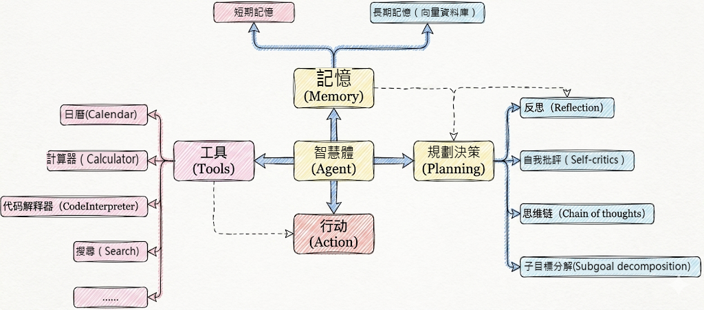
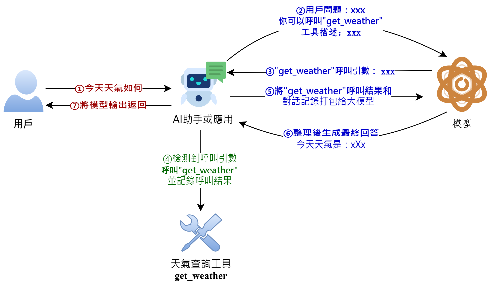
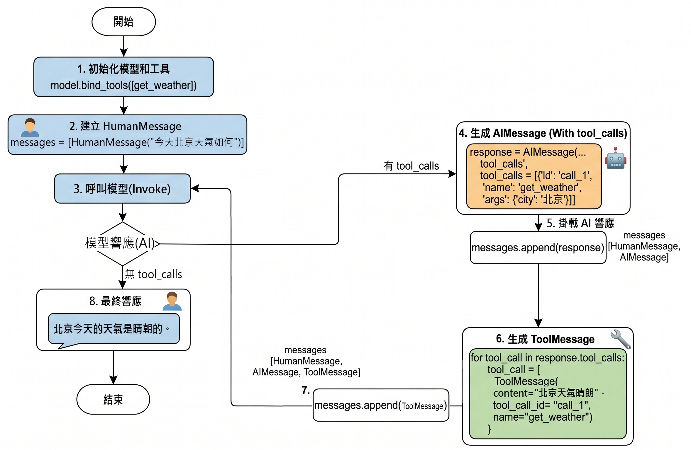
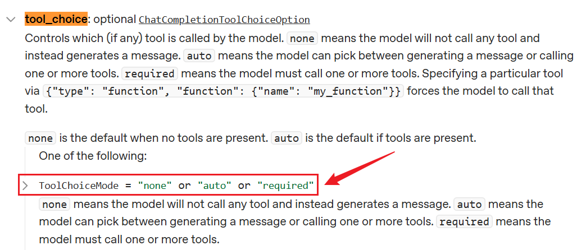
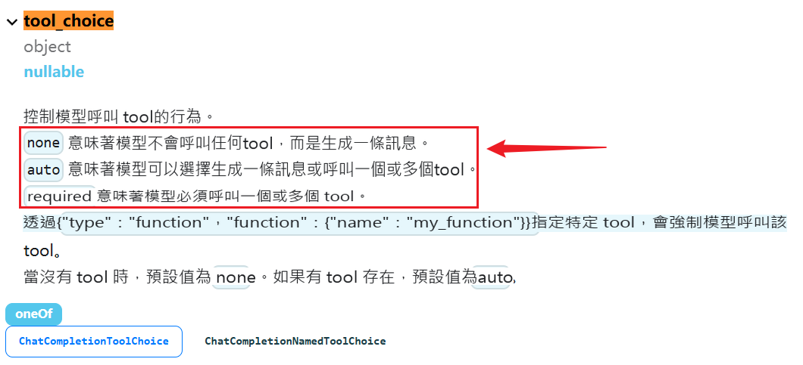

# 第05章：Tools

講師：尚硅谷-宋紅康

官網：[尚硅谷](http://www.atguigu.com/)

## 1、Tools概述

### 1.1 工具的重要性

要構建更強大的AI工程應用，只有生成文字這樣的“ `紙上談兵` ”能力自然是不夠的。

工具是賦予大語言模型 `與外部世界互動能力` 的關鍵元件，從而能讓智慧體執行搜尋、計算、資料庫查詢、郵件傳送或呼叫第三方API等，進而構建功能強大的AI應用。藉助工具，大模型才能從“ `認識世界` ”走向“ `改變世界` ”。

舉例：


工具是構建智慧體的核心要素之一！



### 1.2 工具呼叫的方式

在LangChain中，工具（Tools）實際上是指明確定義了輸入和輸出的 `可呼叫函式` 。因此， `工具呼叫(Tool Calling)` 也被稱為 `函式呼叫(Function Calling)` 。

具體有兩種呼叫方式：

**方式1：直接呼叫**

這種方式，適合測試時使用。

```python
from langchain_core.tools import tool

@tool
def get_weather(city: str) -> str:
    """
    獲取指定城市的天氣資訊

    引數:
        city: 城市名稱，如"北京"、"上海"

    返回:
        天氣資訊字串
    """
    # 你的實現
    return city + "晴天，溫度 15°C"
```

```python
# 使用 .invoke() 方法
result = get_weather.invoke({"city": "北京"})
print(result)
```

```
北京晴天，溫度 15°C
```

**方式2：繫結到模型（主流**）

這種方式，讓AI來呼叫，開發中使用。

```python
from langchain.chat_models import init_chat_model
from dotenv import load_dotenv
import os


# 從.env檔案中載入環境變數
load_dotenv(override=True)

CLOSEAI_API_KEY = os.getenv("CLOSEAI_API_KEY")
CLOSEAI_BASE_URL = os.getenv("CLOSEAI_BASE_URL")

model = init_chat_model(
    model="gpt-5.4-mini",
    model_provider="openai",
    api_key=CLOSEAI_API_KEY,
    base_url=CLOSEAI_BASE_URL
)
```

```python
from langchain_core.tools import tool

# 定義工具
@tool
def get_weather(city: str) -> str:
    """獲取指定城市的天氣"""
    # 你的實現
    return "晴天，溫度 15°C"


# 繫結工具
model_with_tools = model.bind_tools([get_weather])

# AI 可以決定是否呼叫工具
response = model_with_tools.invoke("北京天氣如何？")
# response = model_with_tools.invoke("2 + 3 = ？")

# 檢查 AI 是否要呼叫工具
if response.tool_calls:
    print("AI 想呼叫工具：", response.tool_calls)
else:
    print("AI 直接回答：", response.content)
```

```
AI 想呼叫工具： [{'name': 'get_weather', 'args': {'city': '北京'}, 'id': 'call_fR3LE8Wjqh9lnDosQ61Y892E', 'type': 'tool_call'}]
```

### 1.3 工具呼叫的整體流程

大模型能根據對話上下文決定何時呼叫工具以及傳遞哪些引數。

經典流程如下：



我們現在編寫的LangChain應用對應上圖中的**AI助手或應用**。

### 1.4 從Message流轉看工具的呼叫

前提：模型的初始化

```python
from langchain.chat_models import init_chat_model
from dotenv import load_dotenv
import os

# 從.env檔案中載入環境變數
load_dotenv(override=True)

CLOSEAI_API_KEY = os.getenv("CLOSEAI_API_KEY")
CLOSEAI_BASE_URL = os.getenv("CLOSEAI_BASE_URL")

model = init_chat_model(
    model="gpt-5.4-mini",
    model_provider="openai",
    api_key=CLOSEAI_API_KEY,
    base_url=CLOSEAI_BASE_URL
)
```

參考1：不使用@tool修飾

```python
from langchain.messages import HumanMessage, ToolMessage


def get_weather(city: str):
    """獲取天氣的工具"""
    return f"{city}天氣晴朗"


# 將模型和工具繫結
model_with_tools = model.bind_tools([get_weather])

messages = [
    HumanMessage("今天北京天氣如何")
]

# 模型生成呼叫工具請求
response = model_with_tools.invoke(messages)

# 新增AIMessage
messages.append(response)

tool_calls = response.tool_calls

for tool_call in tool_calls:
    if tool_call["name"] == "get_weather":
        # 拼接出ToolMessage例項
        tool_response = ToolMessage(
            content=get_weather(**tool_call["args"]),
            tool_call_id=tool_call["id"],
            name=tool_call["name"]
        )
        messages.append(tool_response)

print("=====================> messages <=====================")
for msg in messages:
    msg.pretty_print()
print("=====================> messages <=====================")
final_response = model_with_tools.invoke(messages)
print(f"final_response: \n{final_response}")
```

參考2：使用@tool修飾

```python
from langchain.messages import HumanMessage, ToolMessage

@tool
def get_weather(city: str):
    """獲取天氣的工具"""
    return f"{city}天氣晴朗~"


# 將模型和工具繫結
model_with_tools = model.bind_tools([get_weather])

messages = [
    HumanMessage("今天北京天氣如何")
]

# 模型生成呼叫工具請求
response = model_with_tools.invoke(messages)

# 新增AIMessage
messages.append(response)

tool_calls = response.tool_calls

for tool_call in tool_calls:
    if tool_call["name"] == "get_weather":
        # 返回的是ToolMessage型別訊息
        tool_response = get_weather.invoke(tool_call)
        print(type(tool_response))
        messages.append(tool_response)

print("=====================> messages <=====================")
for msg in messages:
    msg.pretty_print()
print("=====================> messages <=====================")
final_response = model_with_tools.invoke(messages)
print(f"final_response: \n{final_response}")
```

說明：被 `@tool` 修飾的函式可以呼叫 `invoke` 接收模型返回的入參資訊執行函式，並返回`ToolMessage` 例項，我們不再需要手動拼接 `ToolMessage` 。

```python
<class 'langchain_core.messages.tool.ToolMessage'>
=====================> messages <=====================
================================ Human Message =================================

今天北京天氣如何
================================== Ai Message ==================================

好的，我來幫你查一下今天北京的天氣情況。
Tool Calls:
get_weather (call_00_f65kV4JKjBPK0HhURzO99449)
Call ID: call_00_f65kV4JKjBPK0HhURzO99449
Args:
 city: 北京
================================= Tool Message =================================
Name: get_weather

北京天氣晴朗~
=====================> messages <=====================
final_response:
content='今天北京天氣**晴朗** ☀，是個好天氣！如果你要出門的話，可以放心出行哦～' additional_kwargs={'refusal': None} response_metadata={'token_usage': {'completion_tokens': 24, 'prompt_tokens': 343, 'total_tokens': 367, 'completion_tokens_details': None, 'prompt_tokens_details': {'audio_tokens': None, 'cached_tokens': 256}, 'prompt_cache_hit_tokens': 256, 'prompt_cache_miss_tokens': 87}, 'model_provider': 'deepseek', 'model_name': 'deepseek-v4-flash', 'system_fingerprint': 'fp_8b330d02d0_prod0820_fp8_kvcache_20260402', 'id': 'fabbebd6-498e-40f0-b1f6-e9fb43a36297', 'finish_reason': 'stop', 'logprobs': None} id='lc_run--019e5a90-f0ca-7d43-a4e5-3d34379e8208-0' tool_calls=[] invalid_tool_calls=[] usage_metadata={'input_tokens': 343, 'output_tokens': 24, 'total_tokens': 367, 'input_token_details': {'cache_read': 256}, 'output_token_details': {}}
```

對應圖示（以參考1為例）：



**工具呼叫流程總結**：

所以如果真正要大模型根據工具呼叫結果進行回覆，完整的呼叫流程包括如下四個步驟：`步驟1：模型繫結工具` ：透過model.bind_tools([...])繫結一個或者多個工具。

`步驟2：模型生成工具呼叫請求` ：使用者輸入問題，呼叫模型（比如invoke()）。如果需要呼叫工具，模型返回包含工具呼叫資訊（如工具名稱和引數）的AIMessage。

`步驟3：開發者手動執行工具` ：使用者從響應中提取工具呼叫資訊並手動呼叫對應的工具（比如工具.invoke()）。

`步驟4：將工具執行結果ToolMessage傳遞給模型生成最終結果` ：將之前使用者提問內容和手動執行工具結果ToolMessage返回模型，模型最終生成回覆。

> 特別注意：大模型呼叫工具是單次推理，直接響應，**需要開發者手動執行工具**並管理迴圈，適合簡單、確定的任務。

## 2、工具的定義方式1：不使用@tool

### 2.1 模型繫結工具併傳送請求

```python
from langchain.chat_models import init_chat_model
from dotenv import load_dotenv
import os

# 從.env檔案中載入環境變數
load_dotenv(override=True)

CLOSEAI_API_KEY = os.getenv("CLOSEAI_API_KEY")
CLOSEAI_BASE_URL = os.getenv("CLOSEAI_BASE_URL")

model = init_chat_model(
    model="gpt-5.4-mini",
    model_provider="openai",
    api_key=CLOSEAI_API_KEY,
    base_url=CLOSEAI_BASE_URL
)
```

```python
from rich import print as rprint

# 定義工具
def get_weather(city: str):
    return f"{city}天氣晴朗"

# 將模型和工具繫結
model_with_tools = model.bind_tools([get_weather])

response = model_with_tools.invoke(
    "今天北京天氣如何"
)

rprint(response)
# print(response.tool_calls)
```

輸出如下

```python
AIMessage(
 content='',
 additional_kwargs={'refusal': None},
 response_metadata={
     'token_usage': {
         'completion_tokens': 18,
         'prompt_tokens': 121,
         'total_tokens': 139,
         'completion_tokens_details': {
             'accepted_prediction_tokens': 0,
             'audio_tokens': 0,
             'reasoning_tokens': 0,
             'rejected_prediction_tokens': 0
         },
         'prompt_tokens_details': {'audio_tokens': 0, 'cached_tokens': 0},
         'latency_checkpoint': {
             'engine_tbt_ms': 3,
             'engine_ttft_ms': 41,
             'engine_ttlt_ms': 100,
             'pre_inference_ms': 99,
             'service_tbt_ms': 3,
             'service_ttft_ms': 207,
             'service_ttlt_ms': 260,
             'total_duration_ms': 168,
             'user_visible_ttft_ms': 108
         }
     },
     'model_provider': 'openai',
     'model_name': 'gpt-5.4-mini-2026-03-17',
     'system_fingerprint': None,
     'id': 'chatcmpl-Dif1tWr37cPmJRNpJuCLJNU9Yrxlk',
     'service_tier': 'default',
     'finish_reason': 'tool_calls',
     'logprobs': None
 },
 id='lc_run--019e54a4-6989-71b1-8c7e-6efcfa08d4bb-0',
 tool_calls=[
     {
         'name': 'get_weather',
         'args': {'city': '北京'},
         'id': 'call_ECvZNV7RLTWpKQSjhvdGzKBd',
         'type': 'tool_call'
     }
 ],
 invalid_tool_calls=[],
 usage_metadata={
     'input_tokens': 121,
     'output_tokens': 18,
     'total_tokens': 139,
     'input_token_details': {'audio': 0, 'cache_read': 0},
     'output_token_details': {'audio': 0, 'reasoning': 0}
 }
)
```

### 2.2 工具描述的各部分詳解

#### 2.2.1 瞭解：convert_to_openai_tool

執行 `model.bind_tools([get_weather])` ，底層最終會呼叫 `convert_to_openai_tool` 生成工具描述。所以我們可以直接呼叫後者檢視解析後的工具描述。

```python
from langchain_core.utils.function_calling import convert_to_openai_tool

from rich import print as rprint

def get_weather(city: str):
    return f"{city}天氣晴朗"

rprint(convert_to_openai_tool(get_weather))
```

輸出如下

```
{
'type': 'function',
'function': {
  'name': 'get_weather',
  'description': '',
  'parameters': {
      'properties': {
          'city': {
              'type': 'string'
          }
      },
      'required': ['city'],
      'type': 'object'
  }
}
}
```

**結果欄位說明**：

- (1) type：定義當前資料節點必須是什麼資料型別。常見型別有 string, number, integer, boolean, object, array, null。object即是json物件。

- (2) properties：用於定義JSON 物件（Object）中可以包含哪些屬性（鍵），以及每個屬性對應的值型別和說明。

- (3) required：當 type為 "object"時使用，是一個陣列，列出了物件中必須存在的屬性名。

**問題：為什麼不使用@tool裝飾器修飾的函式，也可以理解為工具呢**？

檢視 `convert_to_openai_tool` 底層原始碼：

```python
elif isinstance(function, langchain_core.tools.base.BaseTool):
    oai_function = cast("dict", _format_tool_to_openai_function(function))
elif callable(function):
    oai_function = cast(
        "dict", _convert_python_function_to_openai_function(function)
    )
```

相當於加了@tool修飾的函式走上面的分支，沒有加@tool修飾的函式走下面的分支，後者會基於函式定義和docstring生成pydantic模式的描述，然後轉換為規範的tool_schema。

#### 2.2.2 description說明

`convert_to_openai_tool` 會從 `docstring(文件字串)` 載入工具的描述資訊，上面的案例中，`docstring` 為空，所以抽取的 `description` 為空。

> docstring，文件字串，使用三個雙引號表示開始和結束。

```python
from langchain_core.utils.function_calling import convert_to_openai_tool
from rich import print as rprint

def get_weather(city: str):
    """
    天氣查詢工具
    """
   return f"{city}天氣晴朗"

rprint(convert_to_openai_tool(get_weather))
```

輸出

```
{
 'type': 'function',
 'function': {
     'name': 'get_weather',
     'description': '天氣查詢工具',
     'parameters': {
         'properties': {
             'city': {
                 'type': 'string'
             }
         },
         'required': ['city'],
         'type': 'object'
     }
 }
}
```

#### 2.2.3 引數說明

`convert_to_openai_tool` 會從 `docstring` 載入引數說明，這裡的 `docstring` 必須遵循 `Google 風格` 。

- `Google` 風格 `docstring` 說明：[https://google.github.io/styleguide/pyguide.html](https://google.github.io/styleguide/pyguide.html)

- [`Google`](https://www.sphinx-doc.org/en/master/usage/extensions/example_google.html) [風格](https://www.sphinx-doc.org/en/master/usage/extensions/example_google.html) [`docstring`](https://www.sphinx-doc.org/en/master/usage/extensions/example_google.html) [示例：https://www.sphinx-doc.org/en/master/usage/extensions/exa mple_google.html](https://www.sphinx-doc.org/en/master/usage/extensions/example_google.html)

- Python docstring 通用約定：[https://peps.python.org/pep-0257/](https://peps.python.org/pep-0257/)

基礎用法不必完整閱讀規範，只需要按照下面的示例仿寫即可。

```python
from langchain_core.utils.function_calling import convert_to_openai_tool
from rich import print as rprint

def get_weather(city: str):
    """
    天氣查詢工具

    Args:
        city: 城市名稱
    """
    return f"{city}天氣晴朗"

rprint(convert_to_openai_tool(get_weather))
```

使用 `Args:` 、 `Returns:` 、 `Raises:` 等關鍵字，這種方式可讀性強。Agent透過工具的這些註釋來理解工具的用途和呼叫時機，因此清晰、準確的文件字串是工具能被正確呼叫的前提。

輸出如下：

```
{
 'type': 'function',
 'function': {
     'name': 'get_weather',
     'description': '天氣查詢工具',
     'parameters': {
         'properties': {
             'city': {
                 'description': '城市名稱',
                 'type': 'string'
             }
         },
         'required': ['city'],
         'type': 'object'
     }
 }
}
```

AI 依賴 docstring 來理解工具。

```python
# ❌ 不好：太模糊
@tool
def tool1(x: str) -> str:
    """做一些事情"""
    ...
```

```python
# ✅ 好：清晰明確
@tool
def search_products(query: str) -> str:
    """
    在產品資料庫中搜尋產品

    Args:
        query: 搜尋關鍵詞，如"膝上型電腦"、"手機"

    Returns:
        產品列表的 JSON 字串
    """
    ...
```

#### 2.2.4 引數型別說明

引數型別來源於函式的型別註解。

```python
from langchain_core.utils.function_calling import convert_to_openai_tool
from rich import print as rprint

def get_weather(city):
    """
    天氣查詢工具
    """
    return f"{city}天氣晴朗"

rprint(convert_to_openai_tool(get_weather))
```

輸出如下

```
{
 'type': 'function',
 'function': {
     'name': 'get_weather',
     'description': '天氣查詢工具',
     'parameters': {
         'properties': {
             'city': {}
      },
         'required': ['city'],
         'type': 'object'
     }
 }
}
```

刪除了引數型別註解，則工具描述中不包含引數型別說明

**注意**：如果docstring中包含引數說明，則對應的引數必須有型別註解，否則報錯

```python
from langchain_core.utils.function_calling import convert_to_openai_tool
from rich import print as rprint

def get_weather(city):
    """
    天氣查詢工具

    Args:
        city: 城市名稱
    """
    print("天氣晴朗")

rprint(convert_to_openai_tool(get_weather))
```

報錯如下：

```
Traceback...
ValueError: Arg city in docstring not found in function signature.
```

#### 2.2.5 引數預設值說明

如果引數沒有預設值，則會包含 `在required對應的列表` 中。

反之，則引數的描述資訊會包含 `default` 欄位，並且 `不會出現在required列表` 中。

```python
from langchain_core.utils.function_calling import convert_to_openai_tool
from rich import print as rprint

def get_weather(city: str="北京"):
    """
    天氣查詢工具

    Args:
        city: 城市名稱
    """
    return f"{city}天氣晴朗"

rprint(convert_to_openai_tool(get_weather))
```

輸出如下

```
{
 'type': 'function',
 'function': {
     'name': 'get_weather',
     'description': '天氣查詢工具',
     'parameters': {
         'properties': {
             'city': {
                 'default': '北京',
                 'description': '城市名稱',
                 'type': 'string'
             }
         },
         'type': 'object'
     }
 }
}
```

目前只有一個引數，並且有預設值，所以required欄位被移除了。

舉例2：

```python
from langchain_core.utils.function_calling import convert_to_openai_tool
from rich import print as rprint

def get_weather(dt: str, city: str="北京"):
    """
    天氣查詢工具

    Args:
        dt: 日期
        city: 城市名稱
    """
    return f"{city}天氣晴朗"

rprint(convert_to_openai_tool(get_weather))
```

輸出

```
{
 'type': 'function',
 'function': {
     'name': 'get_weather',
     'description': '天氣查詢工具',
     'parameters': {
         'properties': {
             'dt': {
                 'description': '日期',
                 'type': 'string'
             },
             'city': {
                 'default': '北京',
                 'description': '城市名稱',
                 'type': 'string'
             }
         },
         'required': [
             'dt'
         ],
         'type': 'object'
     }
 }
}
```

## 3、工具的定義方式2：使用@tool裝飾器(推薦)

使用 `@tool` 裝飾器修飾，可以自動將普通 Python 函式轉化為智慧體可呼叫的工具。

此方式 `最直接` ，程式碼量極少，非常適合快速驗證想法或建立引數簡單的工具。

### 3.1 自定義工具描述：description

#### 情況1：僅提供docstring資訊

在bind_tools()呼叫時，先將函式封裝為 `BaseTool` 型別的物件，再傳遞給 `convert_to_openai_tool` 函式，生成工具的描述。

```python
from langchain_core.utils.function_calling import convert_to_openai_tool
from langchain.tools import tool

@tool
def get_weather(city: str):
    return f"{city}天氣晴朗"

print(convert_to_openai_tool(get_weather))
```

`@tool` 會從 `docstring` 生成描述資訊，同樣要求遵循 `Google docstring 規範` 。如果沒有 `docstring`則報錯，如下。

```
Traceback...
ValueError: Function must have a docstring if description not provided.
```

補充 `docstring`

```python
from langchain_core.utils.function_calling import convert_to_openai_tool
from langchain.tools import tool

@tool
def get_weather(city: str):
    """
    天氣查詢工具
    """
    return f"{city}天氣晴朗"

print(convert_to_openai_tool(get_weather))
```

輸出如下

```
{
 'type': 'function',
 'function': {
     'name': 'get_weather',
     'description': '天氣查詢工具',
     'parameters': {
         'properties': {
             'city': {
                 'type': 'string'
             }
         },
         'required': [
             'city'
         ],
         'type': 'object'
     }
 }
}
```

#### 情況2：新增工具描述：description

`@tool` 的引數 `description` 可以更改工具描述，優先順序高於 `docstring` 的函式說明

```python
from langchain_core.utils.function_calling import convert_to_openai_tool
from langchain.tools import tool
from rich import print as rprint

@tool(description="根據城市名稱查詢當日天氣的工具")
def get_weather(city: str):
    """
    天氣查詢工具
    """
    return f"{city}天氣晴朗"

rprint(convert_to_openai_tool(get_weather))
```

輸出

```
{
 'type': 'function',
 'function': {
     'name': 'get_weather',
     'description': '根據城市名稱查詢當日天氣的工具',
     'parameters': {
         'properties': {
             'city': {
                 'type': 'string'
             }
         },
         'required': [
             'city'
         ],
         'type': 'object'
     }
 }
}
```

#### 情況3：解析docstring：parse_docstring

當我們沒有向 `@tool` 傳遞 `description` 引數時，預設情況下， `tool` 會將 `docstring` 整體視為`description` ，如下

```python
from langchain_core.utils.function_calling import convert_to_openai_tool
from rich import print as rprint

@tool
def get_weather(city: str, units: str = "celsius", include_forecast: bool = False) -> str:
    """
    獲取當日天氣，可選擇是否同時查詢未來五日天氣預報

    Args:
        city: 城市
        units: 氣溫單位，可選：celsius-攝氏度，fahrenheit-華氏度
        include_forecast: 是否包含未來五日的天氣預報
    """
    temp = 22 if units == "celsius" else 72
    result = f'{city}當天氣溫: {temp} {"攝氏度" if units == "celsius" else "華氏度"}'
    if include_forecast:
        result += "\n未來五天都是晴天"
    return result

rprint(convert_to_openai_tool(get_weather))
```

輸出如下

```
{
 'type': 'function',
 'function': {
     'name': 'get_weather',
     'description': '獲取當日天氣，可選擇是否同時查詢未來五日天氣預報\n\nArgs:\n    city: 城市\n    units: 氣溫單位，可選：celsius-攝氏度，fahrenheit-華氏度\n    include_forecast: 是否包含未來五日的天氣預報',
     'parameters': {
         'properties': {
             'city': {
                 'type': 'string'
             },
             'units': {
                 'default': 'celsius',
                 'type': 'string'
             },
             'include_forecast': {
                 'default': False,
                 'type': 'boolean'
             }
         },
         'required': [
             'city'
         ],
         'type': 'object'
     }
 }
}
```

透過將 `parse_docstring` 設定為True，docstring會被解析，填充到相應的欄位描述中。

```python
from langchain_core.utils.function_calling import convert_to_openai_tool
from rich import print as rprint

@tool(parse_docstring=True)
def get_weather(city: str, units: str = "celsius", include_forecast: bool = False) -> str:
    """
    獲取當日天氣，可選擇是否同時查詢未來五日天氣預報

    Args:
        city: 城市
        units: 氣溫單位，可選：celsius-攝氏度，fahrenheit-華氏度
        include_forecast: 是否包含未來五日的天氣預報
    """
    temp = 22 if units == "celsius" else 72
    result = f'{city}當天氣溫: {temp} {"攝氏度" if units == "celsius" else "華氏度"}'
    if include_forecast:
        result += "\n未來五天都是晴天"
    return result

rprint(convert_to_openai_tool(get_weather))
```

輸出

```
{
 'type': 'function',
 'function': {
     'name': 'get_weather',
     'description': '獲取當日天氣，可選擇是否同時查詢未來五日天氣預報',
     'parameters': {
         'properties': {
             'city': {
                 'description': '城市',
                 'type': 'string'
             },
             'units': {
                 'default': 'celsius',
                 'description': '氣溫單位，可選：celsius-攝氏度，fahrenheit-華氏度',
                 'type': 'string'
             },
             'include_forecast': {
                 'default': 'False',
                 'description': '是否包含未來五日的天氣預報',
                 'type': 'boolean'
             }
         },
         'required': [
             'city'
         ],
         'type': 'object'
     }
 }
}
```

**要注意**：不使用 `@tool` 裝飾器時，docstring不合法會被視為普通文字，作為 `description` ，但如果使用了 `@tool` 時 `docstring` 不合法，將會丟擲異常

```python
from langchain_core.utils.function_calling import convert_to_openai_tool

@tool(parse_docstring=True)
def get_weather(city: str, units: str = "celsius", include_forecast: bool = False) -> str:
    """
    獲取當日天氣，可選擇是否同時查詢未來五日天氣預報
    Args:
        city: 城市
        units: 氣溫單位，可選：celsius-攝氏度，fahrenheit-華氏度
        include_forecast: 是否包含未來五日的天氣預報
    """
    temp = 22 if units == "celsius" else 72
    result = f'{city}當天氣溫: {temp} {"攝氏度" if units == "celsius" else "華氏度"}'
    if include_forecast:
        result += "\n未來五天都是晴天"
    return result

convert_to_openai_tool(get_weather)
```

報錯如下

```
Traceback...
ValueError: Found invalid Google-Style docstring.
```

### 3.2 更改工具名稱：name_or_callable

預設情況，使用函式名作為工具名稱，但可以向@tool 傳參 `name_or_callable` ，以更改工具名稱。

```python
from langchain_core.utils.function_calling import convert_to_openai_tool
from langchain.tools import tool

@tool(name_or_callable="getWeather")
def get_weather(city: str):
    """
    天氣查詢工具
    """
    return f"{city}天氣晴朗"

print(convert_to_openai_tool(get_weather))
```

輸出如下

```
{
 'type': 'function',
 'function': {
     'name': 'getWeather',
     'description': '天氣查詢工具',
     'parameters': {
         'properties': {
             'city': {
                 'type': 'string'
             }
         },
         'required': [
             'city'
         ],
         'type': 'object'
     }
 }
}
```

說明：@tool中引數name_or_callable名稱可以省略

```python
from langchain_core.utils.function_calling import convert_to_openai_tool
from langchain.tools import tool

@tool("getWeather")
def get_weather(city: str):
    """
    天氣查詢工具
    """
    print("天氣晴朗")

print(convert_to_openai_tool(get_weather))
```

輸出如下

```
{
 'type': 'function',
 'function': {
     'name': 'getWeather',
     'description': '天氣查詢工具',
     'parameters': {
         'properties': {
             'city': {
                 'type': 'string'
             }
         },
         'required': [
             'city'
         ],
         'type': 'object'
     }
 }
}
```

說明：不要使用config或runtime作為引數名，這些是LangChain內部保留的。

> 開發中，習慣使用函式名作為工具名稱，不推薦自定義工具名稱。

### 3.3 自定義args_schema

#### 3.3.1 方式1：使用Pydantic模型定義

當工具的引數變得複雜，需要 `列舉值` 、 `範圍限制` 或 `更復雜的業務邏輯驗證` 時，Pydantic 模型是理想的選擇，提供強大的型別檢查和資料驗證。

使用Pydantic 的主要優勢在於能夠**精確控制工具引數的格式和驗證規則**，讓大模型更準確地理解如何呼叫工具。

**3.3.1.1 pydantic型別的定義**

**① BaseModel基類**

透過繼承核心基類 `BaseModel` 定義資料模型，從而宣告欄位結構、型別約束、預設值以0及校驗規則。

```python
from pydantic import BaseModel

class WeatherInput(BaseModel):
    city: str

print(WeatherInput(city="北京"))
```

輸出如下

```python
city='北京'
```

> 注意：BaseModel子類初始化時，不接收位置引數，欄位值必須以關鍵字引數的形式傳入，否則報錯。

```python
from pydantic import BaseModel

class WeatherInput(BaseModel):
    city: str

print(WeatherInput("北京"))
```

報錯如下

```
TypeError
......
TypeError: BaseModel.__init__() takes 1 positional argument but 2 were given
```

這是因為BaseModel的初始化函式簽名如下

```python
def __init__(self, /, **data: Any) -> None:
```

由此可知，所有關鍵字引數都會被收集到字典 `data` 中，然後 `data` 會按照引數型別註解進行校驗，失敗時丟擲異常。

**② Field**

`Field()` ：用來“ `定製欄位` ”的函式，可用於設定預設值、描述等。

舉例1：設定預設值

```python
from pydantic import BaseModel, Field

class WeatherInput(BaseModel):
    city: str = Field(
        default= "北京"
    )

print(WeatherInput())
```

輸出

```python
city='北京'
```

舉例2：設定引數的描述資訊

每個欄位的 description 引數至關重要，它直接影響大模型理解引數含義的能力。

```python
from pydantic import BaseModel, Field

class WeatherInput(BaseModel):
    city: str = Field(
        default= "北京",
        description="城市"
    )
    include_forecast: bool = Field(
        default=False,
        description="是否包含未來五日天氣預報"
    )

print(WeatherInput())
```

輸出

```python
city='北京' include_forecast=False
```

**③ Literal**

可以使用 Literal型別限定引數為固定選項。

`Literal` ：表示欄位不能是任意某種型別的值，而只能是幾個固定字面量之一。

舉例1：

```python
from pydantic import BaseModel
from typing import Literal

class WeatherInput(BaseModel):
    city: str
    unit: Literal["celsius", "fahrenheit"]

print("===============> 合法 <===============")
print(WeatherInput(city="北京", unit="celsius"))

print("===============> 非法 <===============")
try:
    print(WeatherInput(city="北京", unit="kelvin"))
except Exception as e:
    print("報錯型別：", type(e).__name__)
    print(e)
```

輸出

```python
===============> 合法 <===============
city='北京' unit='celsius'
===============> 非法 <===============
報錯型別： ValidationError
1 validation error for WeatherInput
unit
Input should be 'celsius' or 'fahrenheit' [type=literal_error, input_value='kelvin', input_type=str]
 For further information visit https://errors.pydantic.dev/2.12/v/literal_error
```

舉例2：

```python
from pydantic import BaseModel, Field

class WeatherInput(BaseModel):
    city: str = Field(
        default= "北京",
        description="城市"
    )
    unit: Literal["celsius", "fahrenheit"] = Field(
        default="celsius",
        description="氣溫單位"
    )
    include_forecast: bool = Field(
        default=False,
        description="是否包含未來五日天氣預報"
    )

print(WeatherInput())
```

輸出

```python
city='北京' unit='celsius' include_forecast=False
```

**3.3.1.2 使用Pydantic定義args_schema**

透過 `@tool(args_schema=PydanticModelCls)` 將這個 Pydantic 模型與工具函式關聯。

利用 Pydantic 的型別系統進行引數驗證，當大模型需要呼叫工具前，Pydantic 會自動驗證引數的型別和有效性。

舉例：

```python
from pydantic import BaseModel, Field
from langchain.tools import tool
from langchain_core.utils.function_calling import convert_to_openai_tool

class WeatherInput(BaseModel):
    city: str = Field(
        default= "北京",
        description="城市"
    )
    unit: Literal["celsius", "fahrenheit"] = Field(
        default="celsius",
        description="氣溫單位"
    )
    include_forecast: bool = Field(
        default=False,
        description="是否包含未來五日天氣預報"
    )

@tool(args_schema=WeatherInput)
def get_weather(city: str, unit: str = "celsius", include_forecast: bool = False) -> str:
    """獲取當日天氣，可選未來五日天氣預報"""
    temp = 22 if unit == "celsius" else 72
    result = f'{city}當天氣溫: {temp} {"攝氏度" if unit == "celsius" else "華氏度"}'
    if include_forecast:
        result += "\n未來五天都是晴天"
    return result

convert_to_openai_tool(get_weather)
```

輸出

```
{
 'type': 'function',
 'function': {
     'name': 'get_weather',
     'description': '獲取當日天氣，可選未來五日天氣預報',
     'parameters': {
         'properties': {
             'city': {
                 'default': '北京',
                 'description': '城市',
                 'type': 'string'
             },
             'unit': {
                 'default': 'celsius',
                 'description': '氣溫單位',
                 'enum': [
                     'celsius',
                     'fahrenheit'
                 ],
                 'type': 'string'
             },
             'include_forecast': {
                 'default': False,
                 'description': '是否包含未來五日天氣預報',
                 'type': 'boolean'
             }
         },
         'type': 'object'
     }
 }
}
```

#### 3.3.2 方式2：使用Json Schema定義

在 LangChain 中，還可以直接使用 `JSON Schema 字典` 來定義工具的引數模式。這種方式提供了極大的靈活性。

因為工具引數模式可以基於資料庫配置或使用者輸入在 `執行時動態生成` ，所以這種方式特別適合引數結構需要動態生成的場景。

舉例：

```json
{
    "type": "function",
    "function": {
        "name": "get_weather",
        "description": "獲取當日天氣，可選未來五日天氣預報",
        "parameters": {
            "type": "object",
            "properties": {
                "location": {"type": "string"},
                "units": {"type": "string"},
                "include_forecast": {"type": "boolean"}
            },
            "required": ["location", "units", "include_forecast"]
        },
    }
}
```

應該傳遞給args_schema的只有 `parameters` 對應的JSON字串，即

```json
{
    "type": "object",
    "properties": {
        "location": {"type": "string"},
        "units": {"type": "string"},
        "include_forecast": {"type": "boolean"}
    },
    "required": ["location", "units", "include_forecast"]
}
```

舉例：

透過 `@tool(args_schema=json_schema_dict)` 將一個符合 JSON Schema 標準的字典與工具函式關聯。

```python
from langchain.tools import tool
from langchain_core.utils.function_calling import convert_to_openai_tool

weather_schema = {
    "type": "object",
    "properties": {
        "location": {"type": "string"},
        "units": {"type": "string"},
        "include_forecast": {"type": "boolean"}
    },
    "required": ["location", "units", "include_forecast"]
}

@tool(args_schema=weather_schema)
def get_weather(city: str, unit: str = "celsius", include_forecast: bool = False) -> str:
    """獲取當日天氣，可選未來五日天氣預報"""
    temp = 22 if unit == "celsius" else 72
    result = f'{city}當天氣溫: {temp} {"攝氏度" if unit == "celsius" else "華氏度"}'
    if include_forecast:
        result += "\n未來五天都是晴天"
    return result

print(convert_to_openai_tool(get_weather))
```

輸出

```
{
 'type': 'function',
 'function': {
     'name': 'get_weather',
     'description': '獲取當日天氣，可選未來五日天氣預報',
     'parameters': {
         'type': 'object',
         'properties': {
             'location': {
                 'type': 'string'
             },
             'units': {
                 'type': 'string'
             },
             'include_forecast': {
                 'type': 'boolean'
             }
         },
         'required': [
             'location',
             'units',
             'include_forecast'
         ]
     }
 }
}
```

## 4、工具的應用案例

### 4.1 案例1：使用args_schema

arg_schema給出明確的引數資訊

模型初始化：

```python
from langchain.chat_models import init_chat_model
from dotenv import load_dotenv
import os


# 從.env檔案中載入環境變數
load_dotenv(override=True)

CLOSEAI_API_KEY = os.getenv("CLOSEAI_API_KEY")
CLOSEAI_BASE_URL = os.getenv("CLOSEAI_BASE_URL")

model = init_chat_model(
    model="gpt-5.4-mini",
    model_provider="openai",
    api_key=CLOSEAI_API_KEY,
    base_url=CLOSEAI_BASE_URL
)
```

工具的定義與模擬呼叫：

```python
from pydantic import BaseModel, Field

from langchain.tools import tool
from langchain.messages import HumanMessage
from langchain_core.utils.function_calling import convert_to_openai_tool

class WeatherSchema(BaseModel):
    city: str = Field(default="北京", description="城市名稱")
    if_forecast: bool = Field(default=False, description="是否包含明日天氣預報")

@tool("get_weather_and_forecast", description="查詢當日天氣，可以包含明日天氣預報", args_schema=WeatherSchema)
def get_weather(city: str, if_forecast: bool):
    res = f"{city} 今天天氣不錯"
    if if_forecast:
        res += "\n明天也不錯"
    return res

print(convert_to_openai_tool(get_weather))


model_with_tools = model.bind_tools([get_weather])

messages = [HumanMessage("今天杭州天氣如何？明天呢？")]
response = model_with_tools.invoke(messages)
messages.append(response)
tool_calls = response.tool_calls

for tool_call in tool_calls:
    if tool_call["name"] == "get_weather_and_forecast":
        tool_msg = get_weather.invoke(tool_call)
        messages.append(tool_msg)

final_response = model_with_tools.invoke(messages)
messages.append(final_response)
for msg in messages:
    msg.pretty_print()
```

輸出

```python
{'type': 'function', 'function': {'name': 'get_weather_and_forecast', 'description': '查詢當日天氣，可以包含明日天氣預報', 'parameters': {'properties': {'city': {'default': '北京', 'description': '城市名稱', 'type': 'string'}, 'if_forecast': {'default': False, 'description': '是否包含明日天氣預報', 'type': 'boolean'}}, 'type': 'object'}}}
================================ Human Message =================================

今天杭州天氣如何？,明天呢？
================================== Ai Message ==================================
Tool Calls:
get_weather_and_forecast (call_c82UrCpAdVAqiHfl4OkZocbg)
Call ID: call_c82UrCpAdVAqiHfl4OkZocbg
Args:
 city: 杭州
 if_forecast: True
================================= Tool Message =================================
Name: get_weather_and_forecast

杭州 今天天氣不錯
明天也不錯
================================== Ai Message ==================================

杭州今天：天氣不錯。
杭州明天：也不錯。
```

### 4.2 案例2：撰寫docstring

可以在docstring中撰寫引數的描述資訊，此時引數預設值和型別都要透過函式簽名傳遞。

模型初始化：

```python
from langchain.chat_models import init_chat_model
from dotenv import load_dotenv
import os


# 從.env檔案中載入環境變數
load_dotenv(override=True)

CLOSEAI_API_KEY = os.getenv("CLOSEAI_API_KEY")
CLOSEAI_BASE_URL = os.getenv("CLOSEAI_BASE_URL")

model = init_chat_model(
    model="gpt-5.4-mini",
    model_provider="openai",
    api_key=CLOSEAI_API_KEY,
    base_url=CLOSEAI_BASE_URL
)
```

工具的定義與模擬呼叫：

```python
from langchain.tools import tool
from langchain.messages import HumanMessage
from langchain_core.utils.function_calling import convert_to_openai_tool


@tool("get_weather_and_forecast", parse_docstring=True)
def get_weather(city: str="北京", if_forecast: bool=False):
    """
    查詢當日天氣，可以包含明日天氣預報

    Args:
         city: 城市名稱
         if_forecast: 是否包含明日天氣預報
    """
    res = f"{city} 今天天氣不錯"
    if if_forecast:
        res += "\n明天要下雨"
    return res

print(convert_to_openai_tool(get_weather))

model_with_tools = model.bind_tools([get_weather])

messages = [HumanMessage("今天杭州天氣如何？明天呢？")]
response = model_with_tools.invoke(messages)
messages.append(response)
tool_calls = response.tool_calls

# 將工具呼叫的結果新增到訊息列表中
for tool_call in tool_calls:
    if tool_call["name"] == "get_weather_and_forecast":
        # 返回值tool_msg型別是ToolMessage
        tool_msg = get_weather.invoke(tool_call)
        messages.append(tool_msg)

final_response = model_with_tools.invoke(messages)

messages.append(final_response)

for msg in messages:
    msg.pretty_print()
```

**注意**：要正確解析docstring，必須在@tool中將 `parse_docstring` 設定為 `True` 。

輸出

```python
{'type': 'function', 'function': {'name': 'get_weather_and_forecast', 'description': '查詢當日天氣，可以包含明日天氣預報', 'parameters': {'properties': {'city': {'default': '北京', 'description': '城市名稱', 'type': 'string'}, 'if_forecast': {'default': False, 'description': '是否包含明日天氣預報', 'type': 'boolean'}}, 'type': 'object'}}}
================================ Human Message =================================

今天杭州天氣如何？明天呢？
================================== Ai Message ==================================
Tool Calls:
get_weather_and_forecast (call_y5vpFccj2DfWSAF6ng5dZOYH)
Call ID: call_y5vpFccj2DfWSAF6ng5dZOYH
 Args:
  city: 杭州
   if_forecast: True
================================= Tool Message =================================
Name: get_weather_and_forecast

杭州 今天天氣不錯
明天要下雨
================================== Ai Message ==================================

杭州今天“天氣不錯”，明天“要下雨”。
如果你願意，我也可以幫你繼續看一下適合出行/穿衣的建議。
```

### 4.3 案例3：多工具呼叫

大模型呼叫工具是單次推理，即每次執行呼叫一個工具，當呼叫多個工具時，需要使用者自己管理多次呼叫迴圈。

```python

from langchain_core.tools import tool
from langchain_core.messages import HumanMessage, AIMessage, ToolMessage

# 1.定義工具
# 定義股票查詢工具
@tool(parse_docstring=True)
def get_stock_price(company: str, timeframe: str = "today") -> str:
    """獲取指定公司的股票價格資訊

    Args:
        company: 公司名稱（如：蘋果公司, 微軟公司, 谷歌公司）
        timeframe: 時間範圍（today-今日, week-本週, month-本月）
    """
    # 模擬股票資料
    mock_data = {
        "蘋果公司": {"today": 185.20, "week": 183.50, "month": 180.75},
        "微軟公司": {"today": 415.86, "week": 412.30, "month": 405.42},
        "谷歌公司": {"today": 15.42, "week": 15.20, "month": 14.85}
    }

    if company in mock_data:
        price = mock_data[company].get(timeframe, "未知時間範圍")
        return f"{company} {timeframe}價格: {price}美元"
    else:
        return f"未找到股票程式碼 {company} 的資料"


# 定義新聞搜尋工具
@tool(parse_docstring=True)
def search_news(company: str) -> str:
    """搜尋指定公司的財經新聞

    Args:
        company: 公司名稱

    Returns:
        公司的財經新聞，每個新聞佔一行
    """
    # 模擬新聞資料
    mock_news = {
        "蘋果公司": [
            "蘋果釋出新款iPhone，股價上漲3%",
            "蘋果與歐盟達成反壟斷和解協議",
            "蘋果將在印度擴大生產規模"
        ],
        "微軟公司": [
            "微軟Azure雲業務季度增長超預期",
            "微軟完成對Nuance的收購",
            "微軟推出新一代AI助手Copilot"
        ],
        "谷歌公司": [
            "谷歌釋出新AI模型，效能提升20%",
            "谷歌與OpenAI合作，開發新的AI助手",
            "谷歌在歐洲展開AI研究專案"
        ]
    }

    news_list = mock_news.get(company, [f"未找到{company}的相關新聞"])
    return "\n".join(news_list)


# rprint(convert_to_openai_tool(search_news))

# 2.初始化模型並繫結工具
tools = [get_stock_price, search_news]
model_with_tools = model.bind_tools(tools)

message_list = []
human_message = HumanMessage(content="蘋果公司今天的股價是多少？最近有什麼新聞？")
# human_message = HumanMessage(content="比較一下微軟和蘋果的股價")
# human_message = HumanMessage(content="騰訊最近有什麼重大新聞？")
# human_message = HumanMessage(content="海水為什麼是鹹的？")
message_list.append(human_message)

# 3.工具呼叫
while True:
    response = model_with_tools.invoke(message_list)

    message_list.append(response)

    # 如果模型不需要呼叫工具，直接退出迴圈
    if not response.tool_calls:
        print("沒有工具呼叫，直接返回答案")
        break

    # 如果有呼叫工具，處理工具呼叫響應
    # 4.開發者根據模型的響應，呼叫工具並獲取結果
    for tool_call in response.tool_calls:
        if tool_call["name"] == "get_stock_price":
            stock_result = get_stock_price.invoke(tool_call)
            print("stock_result", stock_result)
            message_list.append(stock_result)
        if tool_call["name"] == "search_news":
            news_result = search_news.invoke(tool_call)
            print("news_result", news_result)
            message_list.append(news_result)


# print("response", response)
# print(response.content)

for msg in message_list:
    msg.pretty_print()
```

輸出：

```python
stock_result content='蘋果公司 today價格: 185.2美元' name='get_stock_price' tool_call_id='call_cpGOhWce8rlIFSZ2G9w7ouON'
news_result content='蘋果釋出新款iPhone，股價上漲3%\n蘋果與歐盟達成反壟斷和解協議\n蘋果將在印度擴大生產規模' name='search_news' tool_call_id='call_W9zjkAO8TNCmUbed2ld9tsxl'
沒有工具呼叫，直接返回答案
================================ Human Message =================================

蘋果公司今天的股價是多少？最近有什麼新聞？
================================== Ai Message ==================================
Tool Calls:
get_stock_price (call_cpGOhWce8rlIFSZ2G9w7ouON)
Call ID: call_cpGOhWce8rlIFSZ2G9w7ouON
Args:
 company: 蘋果公司
 timeframe: today
search_news (call_W9zjkAO8TNCmUbed2ld9tsxl)
Call ID: call_W9zjkAO8TNCmUbed2ld9tsxl
Args:
 company: 蘋果公司
================================= Tool Message =================================
Name: get_stock_price

蘋果公司 today價格: 185.2美元
================================= Tool Message =================================
Name: search_news

蘋果釋出新款iPhone，股價上漲3%
蘋果與歐盟達成反壟斷和解協議
蘋果將在印度擴大生產規模
================================== Ai Message ==================================

蘋果公司今天股價是 **185.2 美元**。

最近新聞包括：
- 蘋果釋出了**新款 iPhone**，帶動股價上漲約 **3%**
- 蘋果與歐盟達成了**反壟斷和解協議**
- 蘋果計劃在**印度擴大生產規模**

如果你願意，我也可以幫你繼續整理這些新聞對蘋果股價的可能影響。
```

### 4.4 案例4：多工具呼叫

```python
from langchain.tools import tool
from langchain.messages import HumanMessage


@tool(parse_docstring=True)
def get_weather(city: str) -> str:
    """
    獲取當日天氣

    Args:
        city: 城市名稱
    """
    return f'{city}當天晴朗'

@tool(parse_docstring=True)
def get_news() -> str:
    """
    獲取當日新聞
    """
    return "近期，受全球儲蓄晶片短缺等多重因素影響，多地回收商稱廢舊手機回收市場迎來“火熱潮”，回收價格普遍上漲，舊手機成“香餑餑”。"

model_with_tools = model.bind_tools([get_weather, get_news])

messages = [
    HumanMessage("今天杭州天氣如何？今天新聞是什麼？別瞎編")
]

response = model_with_tools.invoke(messages)
response.pretty_print()
```

輸出

```
==================================•[1m Ai Message •[0m==================================

我來幫您查詢杭州的天氣和今日新聞。
Tool Calls:
get_weather (call_00_uspkbqR7N7wIewhr8hHZAXoM)
Call ID: call_00_uspkbqR7N7wIewhr8hHZAXoM
Args:
city: 杭州
get_news (call_01_ksyZoO2kXFBXXp1dH4dnxZAN)
Call ID: call_01_ksyZoO2kXFBXXp1dH4dnxZAN
Args:
```

此時可以遍歷tool_calls列表，挨個呼叫工具。

```python

messages.append(response)

for tool_call in response.tool_calls:
    if tool_call["name"] == "get_weather":
        tool_msg = get_weather.invoke(tool_call)
        print(tool_msg)
        messages.append(tool_msg)
    elif tool_call["name"] == "get_news":
        tool_msg = get_news.invoke(tool_call)
        print(tool_msg)
        messages.append(tool_msg)
    else:
        raise Exception("不存在的工具")

final_response = model.invoke(messages)
messages.append(final_response)

for msg in messages:
    msg.pretty_print()
```

輸出

```python
content='杭州當天晴朗' name='get_weather' tool_call_id='call_00_PhpRzVvHYLkqOgQMj4keeAso'
content='近期，受全球儲蓄晶片短缺等多重因素影響，多地回收商稱廢舊手機回收市場迎來“火熱潮”，回收價格普遍上漲，舊手機成“香餑餑”。' name='get_news' tool_call_id='call_01_ALWxzasKCDJzm7fgwiXVBorg'
================================•[1m Human Message •[0m=================================

今天杭州天氣如何？今天新聞是什麼？別瞎編
==================================•[1m Ai Message •[0m==================================

我來幫您查詢杭州的天氣和今天的新聞。
Tool Calls:
get_weather (call_00_PhpRzVvHYLkqOgQMj4keeAso)
Call ID: call_00_PhpRzVvHYLkqOgQMj4keeAso
Args:
city: 杭州
get_news (call_01_ALWxzasKCDJzm7fgwiXVBorg)
Call ID: call_01_ALWxzasKCDJzm7fgwiXVBorg
Args:
=================================•[1m Tool Message •[0m=================================
Name: get_weather

杭州當天晴朗
=================================•[1m Tool Message •[0m=================================
Name: get_news

近期，受全球儲蓄晶片短缺等多重因素影響，多地回收商稱廢舊手機回收市場迎來“火熱潮”，回收價格普遍上漲，舊手機成“香餑餑”。
==================================•[1m Ai Message •[0m==================================

根據查詢結果：

**杭州天氣**：今天杭州天氣晴朗。

**今日新聞**：近期，受全球晶片短缺等多重因素影響，多地回收商稱廢舊手機回收市場迎來“火熱潮”，回收價格普遍上漲，舊手機成“香餑餑”。

以上資訊基於實時查詢，供您參考。
```

## 5、拓展：強制使用工具

### 5.1 tool_choice引數說明

`bind_tools` 可以傳遞引數 `tool_choice` ，用於控制是否強制使用工具。

該欄位最終會作為 `payload` 的 `tool_choice` 欄位傳遞給模型，OpenAI和Deepseek的官方API服務對於`tool_choice` 的取值做了相同的規定。

OpenAI官方文件



Deepseek官方文件



`none` ：模型不會呼叫任何工具。

`auto` ： `預設值` ，模型可以自主決定不呼叫或呼叫任意數量的工具。

`required` ：模型必須呼叫工具，數量不限。

此外， `tool_choice` 還支援傳遞 `any` ，等價於 `required` 。

### 5.2 none值舉例

模型初始化：

```python
from langchain.chat_models import init_chat_model
from dotenv import load_dotenv
import os

# 從.env檔案中載入環境變數
load_dotenv(override=True)

CLOSEAI_API_KEY = os.getenv("CLOSEAI_API_KEY")
CLOSEAI_BASE_URL = os.getenv("CLOSEAI_BASE_URL")

model = init_chat_model(
    model="gpt-5.4-mini",
    model_provider="openai",
    api_key=CLOSEAI_API_KEY,
    base_url=CLOSEAI_BASE_URL
)
```

舉例：

```python
from langchain.tools import tool
from langchain.messages import HumanMessage


@tool(parse_docstring=True)
def get_weather(city: str) -> str:
    """
    獲取當日天氣

    Args:
        city: 城市名稱
    """
    return f'{city}當天晴朗'

model_with_tools = model.bind_tools([get_weather], tool_choice="none")

messages = [
    HumanMessage("今天北京天氣如何？別瞎編")
]

response = model_with_tools.invoke(messages)
response.pretty_print()
```

使用者要求查詢天氣，並提供了天氣查詢工具，但模型不會呼叫。

輸出

```
==================================•[1m Ai Message •[0m==================================

我無法直接獲取實時天氣資料。
如果您需要查詢今天北京的準確天氣情況，建議您：
1. 開啟手機天氣應用（如蘋果天氣、墨跡天氣等）。
2. 在搜尋引擎（如百度、谷歌）搜尋“北京天氣”。
3. 檢視中國氣象局官網（http://www.weather.com.cn）或權威天氣平臺。

這樣可以確保您獲得最準確的實時資訊。
```

### 5.3 auto值舉例

`tool_choice` 的預設值就是 `auto` 。

**舉例1：需要呼叫工具的場景**

```python
from langchain.tools import tool
from langchain.messages import HumanMessage


@tool(parse_docstring=True)
def get_weather(city: str) -> str:
    """
    獲取當日天氣

    Args:
        city: 城市名稱
    """
    return f'{city}當天晴朗'

model_with_tools = model.bind_tools([get_weather], tool_choice="auto")

messages = [
    HumanMessage("今天杭州天氣如何？別瞎編")
]

response = model_with_tools.invoke(messages)
response.pretty_print()
```

輸出

```
==================================•[1m Ai Message •[0m==================================

我來幫您查詢杭州今天的天氣情況。
Tool Calls:
get_weather (call_00_yMeVRVUhjsGETejnWXdW4Hhp)
Call ID: call_00_yMeVRVUhjsGETejnWXdW4Hhp
Args:
 city: 杭州
```

**舉例2：不需要呼叫工具的場景**

```python
from langchain.tools import tool
from langchain.messages import HumanMessage


@tool(parse_docstring=True)
def get_weather(city: str) -> str:
    """
    獲取當日天氣

    Args:
        city: 城市名稱
    """
    return f'{city}當天晴朗'

model_with_tools = model.bind_tools([get_weather], tool_choice="auto")

messages = [
    HumanMessage("你好啊")
]

response = model_with_tools.invoke(messages)
response.pretty_print()
```

輸出

```
==================================•[1m Ai Message •[0m==================================

你好！很高興見到你！有什麼我可以幫助你的嗎？
```

### 5.4 required值舉例

**舉例1：需要呼叫工具的場景**

```python
from langchain.tools import tool
from langchain.messages import HumanMessage

@tool(parse_docstring=True)
def get_weather(city: str) -> str:
    """
    獲取當日天氣

    Args:
        city: 城市名稱
    """
    return f'{city}當天晴朗'

model_with_tools = model.bind_tools([get_weather], tool_choice="required")

messages = [
    HumanMessage("今天杭州天氣如何？別瞎編")
]

response = model_with_tools.invoke(messages)
response.pretty_print()
```

輸出

```
==================================•[1m Ai Message •[0m==================================
Tool Calls:
get_weather (call_00_7JaeJXjd5Dc4GT9YIDV0ayJU)
Call ID: call_00_7JaeJXjd5Dc4GT9YIDV0ayJU
Args:
 city: 杭州
```

**舉例2：不需要呼叫工具的場景**

```python
from langchain.tools import tool
from langchain.messages import HumanMessage


@tool(parse_docstring=True)
def get_weather(city: str) -> str:
    """
    獲取當日天氣

    Args:
        city: 城市名稱
    """
    return f'{city}當天晴朗'

model_with_tools = model.bind_tools([get_weather], tool_choice="required")

messages = [
    HumanMessage("你好啊")
]

response = model_with_tools.invoke(messages)
response.pretty_print()
```

即便此時不需要，模型依然會呼叫工具

輸出

```
==================================•[1m Ai Message •[0m==================================
Tool Calls:
get_weather (call_00_4bLIBRda88ZcvFL70f7XOEmg)
Call ID: call_00_4bLIBRda88ZcvFL70f7XOEmg
Args:
 city: 北京
```

此外， `any` 行為和 `required` 一致。舉例：略

### 5.5 強制呼叫特定的工具

某些場景下我們希望呼叫特定的工具，仍然可以用 `tool_choice` 解決。

```python
from langchain.tools import tool
from langchain.messages import HumanMessage


@tool(parse_docstring=True)
def get_weather1(city: str) -> str:
    """
    獲取當日天氣

    Args:
        city: 城市名稱
    """
    return f'{city}當天晴朗'

@tool(parse_docstring=True)
def get_weather2(city: str) -> str:
    """
    獲取當日天氣

    Args:
        city: 城市名稱
    """
    return f'{city}當天晴朗'

model_with_tools = model.bind_tools([get_weather1, get_weather2], tool_choice="get_weather2")

messages = [
    HumanMessage("杭州今天天氣如何？")
]

response = model_with_tools.invoke(messages)
response.pretty_print()
```

輸出

```
==================================•[1m Ai Message •[0m==================================
Tool Calls:
get_weather2 (call_00_mO5sCOWWnE3bWfNXtNhOjPNq)
Call ID: call_00_mO5sCOWWnE3bWfNXtNhOjPNq
Args:
 city: 杭州
```

反過來指定 `get_weather1`

```python
from langchain.tools import tool
from langchain.messages import HumanMessage


@tool(parse_docstring=True)
def get_weather1(city: str) -> str:
    """
    獲取當日天氣

    Args:
        city: 城市名稱
    """
    return f'{city}當天晴朗'

@tool(parse_docstring=True)
def get_weather2(city: str) -> str:
    """
    獲取當日天氣

    Args:
        city: 城市名稱
    """
    return f'{city}當天晴朗'

model_with_tools = model.bind_tools([get_weather1, get_weather2], tool_choice="get_weather1")

messages = [
    HumanMessage("杭州今天天氣如何？")
]

response = model_with_tools.invoke(messages)
response.pretty_print()
```

輸出

```
==================================•[1m Ai Message •[0m==================================
Tool Calls:
get_weather1 (call_00_NK8ukyIAIzFL9FK1G3W4sK0s)
Call ID: call_00_NK8ukyIAIzFL9FK1G3W4sK0s
Args:
 city: 杭州
```

## 6、實踐經驗總結

**1. 清晰的描述**

```python
# ✅ 好
@tool(parse_docstring=True)
def search_flights(origin: str, destination: str, date: str) -> str:
    """
    搜尋航班資訊

    Args:
        origin: 出發城市，如"北京"
        destination: 目的地城市，如"上海"
        date: 出發日期，格式 YYYY-MM-DD

    Returns:
        可用航班的 JSON 列表
    """
```

**2. 功能單一**

```python
# ❌ 不好：一個工具做太多事
@tool
def do_everything(action: str, data: str) -> str:
    """做各種事情"""
    if action == "weather": ...
    elif action == "calculate": ...
    elif action == "search": ...

# ✅ 好：每個工具做一件事
@tool
def get_weather(city: str) -> str:
    """獲取天氣"""
    ...

@tool
def calculator(operation: str, a: float, b: float) -> str:
    """計算"""
    ...
```

**3. 如何處理工具失敗**？

三層防護：

第1層：工具內部處理

```python
@tool
def divide(a: float, b: float) -> str:
    """
    除法計算

    Args:
        a: 被除數
        b: 除數
    """
    try:
        if b == 0:
            return "錯誤：除數不能為零"
        result = a / b
        return f"{a} / {b} = {result}"
    except Exception as e:
        return f"計算錯誤：{e}"
```

第2層：Agent 級重試（使用 prompt）

```python
agent = create_agent(
    model=model,
    tools=[...],
    prompt="如果工具失敗，嘗試使用其他方法解決問題。"
)
```

第3層：呼叫級重試

在大模型應用（如 LangChain）中，網路請求和外部工具呼叫是最容易掉鏈子的地方。 `@retry` 就像是一個 `容錯保險` 。

```python
from tenacity import retry, stop_after_attempt

# 1. 配置重試規則：如果失敗，最多嘗試 3 次（即第 1 次正常呼叫 + 2 次重試）
@retry(stop=stop_after_attempt(3))
def call_agent(question):
    # 2. 核心業務邏輯：呼叫 LangChain 的 Agent
    return agent.invoke({"messages": [{"role": "user", "content": question}]})
```

它的工作流程：

① 你呼叫 `call_agent("你好")` 。

② 程式進入函式，執行 `agent.invoke(...)` 。

③ 如果執行成功：正常返回結果， `@retry` 什麼都不做。

④ 如果執行失敗（報錯）： `@retry` 會攔截這個錯誤，不讓程式直接崩潰。它會默默地幫你再次觸發`agent.invoke(...)` 。

⑤ 如果連續 3 次都報錯：它終於放棄了，把第 3 次的報錯真正丟擲來，程式此時才會報錯中止。

**4. 返回字串**

```python
# ✅ 好：返回字串
@tool
def get_user_info(user_id: str) -> str:
    """獲取使用者資訊"""
    user = {"id": user_id, "name": "張三"}
    return json.dumps(user, ensure_ascii=False)  # 轉成 JSON 字串


# ❌ 不好：返回字典（某些情況可能有問題）
@tool
def get_user_info(user_id: str) -> dict:
    """獲取使用者資訊"""
    return {"id": user_id, "name": "張三"}
```

在編寫傳統的 Python 程式碼時，返回字典（ `dict` ）顯然更方便後續程式碼處理。但在 LangChain 的工具（Tools）生態中，**強烈建議工具返回字串（str**）。因為：

1）大模型（LLM）的本質只吃“文字”

2）避免大模型“胡思亂想”（亂碼與格式問題）

如果你返回一個包含中文的字典 `{"name": "張三"}` ，LangChain 在強制將其轉換為字串時，預設可能會採用 Unicode 編碼，變成 `{"name": "\u5f20\u4e09"}` 。

大模型雖然能理解 Unicode，但極易受到干擾。直接看到中文 `張三` 的大模型，和看到`\u5f20\u4e09` 的大模型，其輸出的穩定性和準確率是有差距的。透過手動 `json.dumps(..., ensure_ascii=False)` ，你確保了餵給大模型的是最乾淨、最直觀的純文字。

> json.dumps()是 Python 標準庫 json模組中的函式，用於將 Python 物件（如字典、列表）序列化成一個 JSON 格式的字串。
>
> `ensure_ascii=False` : 這個引數預設值為 True，表示所有非 ASCII 字元（如中文）會被轉換成\\uXXXX形式的轉義序列。設定為 False後，中文、表情符號等字元就能在 JSON 字串中正常顯示，而不是一堆亂碼。

**5. 選擇同步 vs 非同步**

- `同步工具` ：簡單場景，CPU 密集型任務

- `非同步工具` ：IO 密集型（API 呼叫、資料庫、檔案操作）

```python
# 同步
@tool
def sync_tool(x: str) -> str:
    return process(x)

# 非同步
@tool
async def async_tool(x: str) -> str:
    return await async_process(x)
```
