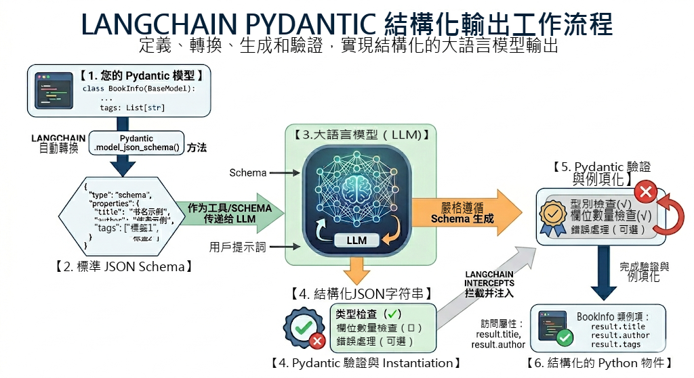
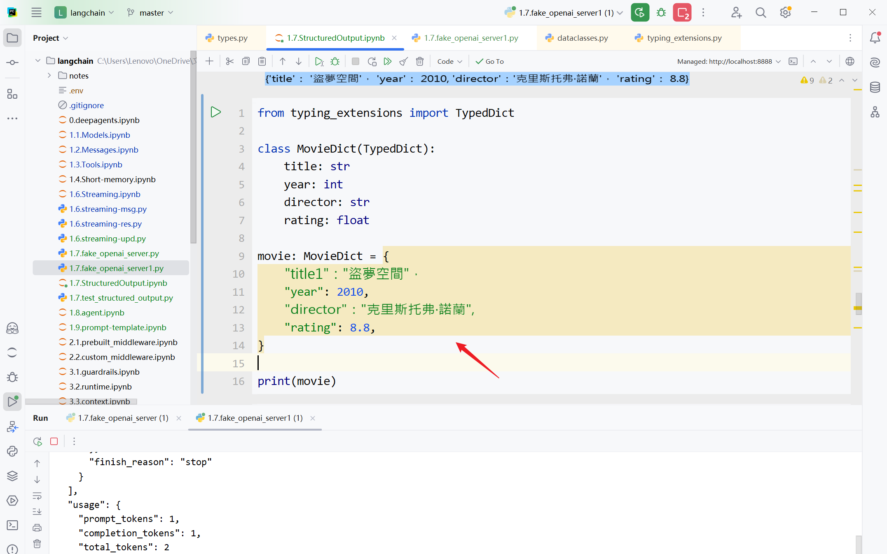

# 第06章：結構化輸出(Structured Output)

講師：尚硅谷-宋紅康

官網：[尚硅谷](http://www.atguigu.com/)

## 1、結構化輸出概述

### 1.1 什麼是結構化輸出

LangChain的結構化輸出（Structured Output） 指的是：

> 要求模型最終返回一個符合預定義結構的資料物件，例如固定欄位的JSON、Pydantic 模型、TypedDict，而不再是無格式的自然語言文字。

它的核心目標是把“ `自然語言回答` ”變成“ `程式可以穩定消費的資料` ”。

例如，不是讓模型輸出：

> 盜夢空間在2010年上映，導演是克里斯托弗·諾蘭，評分9.3。

而是讓它輸出成類似這樣的結構：

```json
{
    "title": "盜夢空間",
    "year": 2010,
    "director": "克里斯托弗·諾蘭",
    "rating": 9.3
}
```

這樣做的價值主要有三點：

- **更容易被程式碼處理**：下游系統可以直接讀欄位，而不是再從自然語言裡做解析。

- **結果更穩定**：減少“模型說法變了但意思差不多”導致的解析失敗。

- **更適合工程化**：適用於表單抽取、分類、路由、呼叫工具引數生成、工作流狀態傳遞等場景。

### 1.2 傳統方式 vs 結構化輸出

**1、傳統的幾種方式（繁瑣、不推薦**）

```python
# 1. 提示詞要求JSON
prompt = "以JSON格式返回：{name, age, occupation}"
response = model.invoke(prompt)
```

```python
# 2. 手動解析
import json
data = json.loads(response.content)
```

```
# 3. 手動驗證型別
if not isinstance(data['age'], int):
    raise ValueError("age must be int")
```

```python
# 4. 手動建立物件
person = Person(**data)
```

**2、結構化輸出（簡潔**）

```python
# 一步到位
structured_llm = model.with_structured_output(Person)
person = structured_llm.invoke("張三是一名 30 歲的軟體工程師")
# ✅ 自動解析、驗證、建立物件
```

**為什麼第2種結構化輸出機制這麼受歡迎**？

在沒有 Pydantic 等結構化方案之前，開發者需要寫大量的 Prompt 苦口婆心地求大模型“請返回 JSON，不要帶任何解釋”，然後自己寫繁瑣的 `json.loads()` 和 `try...except` 。

而有了 Pydantic 等結構化方案結合 `.with_structured_output()` 之後：

- **Prompt 變乾淨了**： 欄位的 `description` 直接充當了 Prompt 的一部分。

- **型別安全**： 編輯器能自動補全，程式碼執行前就能做型別檢查。

- **極其穩定**： 依託大模型廠商底層的 JSON 模式，輸出錯誤率降到了極低。

### 1.3 結構化輸出模式

目前LangChain 1.x 支援多種Schema與結構化輸出方式：

- **Pydantic**（欄位校驗、描述、巢狀結構，功能最豐富）

- **TypedDict**（輕量型別約束）

- **JSON Schema**（與前後端/跨語言介面最通用）

- **dataclass**

模型物件可以呼叫 `with_structured_output()` 繫結**輸出模式**（schema）。

只有 `Pydantic` 返回的是Schema類例項，其餘三種方式返回的都是 `字典` ；也只有 `Pydantic` 在型別不匹配時會丟擲異常。

**問題：現在所有模型都支援“本章要講解的結構化輸出方式”嗎**？

大部分現代模型支援（透過函式呼叫）：

- ✅ OpenAI (gpt-4, gpt-3.5-turbo)

- ✅ Anthropic (claude-3)

- ✅ Groq (llama-3)

- ❌ 某些舊模型不支援

如果不支援，LangChain 會回退到提示詞 + JSON 解析。

## 2、四種模式的使用

### 2.1 模式1：Pydantic

它透過在執行時強制執行型別提示，確保資料的正確性和一致性，是 `生產場景首選` 。

#### 2.1.1 基本使用

需要滿足的幾個要素：

- 所有結構化輸出的資料模型都必須繼承 `BaseModel`

- 使用 `型別提示` 。Pydantic 支援豐富的欄位型別：str 、int、float、List[xxx]、Optional[xxx]等

- 使用 `Field()` 新增欄位預設值和描述，幫助 LLM 理解欄位含義

舉例1：

1）大模型的初始化

```python
from langchain.chat_models import init_chat_model
from dotenv import load_dotenv
import os

# 從.env檔案中載入環境變數
load_dotenv(override=True)

CLOSEAI_API_KEY = os.getenv("CLOSEAI_API_KEY")
CLOSEAI_BASE_URL = os.getenv("CLOSEAI_BASE_URL")

model = init_chat_model(
    model="gpt-5.4-mini",
    model_provider="openai",
    api_key=CLOSEAI_API_KEY,
    base_url=CLOSEAI_BASE_URL
)
```

2）定義 Pydantic 模型

使用清晰的欄位描述；沒有描述，LLM 可能格式錯誤

```python
from pydantic import BaseModel, Field

class Person(BaseModel):
    """人物資訊"""
    name: str = Field(description="姓名")
    age: int = Field(description="年齡")
    occupation: str = Field(description="職業")
```

LangChain 會要求 LLM 的輸出必須能填充這些欄位。

3）使用 `with_structured_output` 即可引導模型進行結構化輸出：

```python
# 建立結構化輸出的 LLM
structured_llm = model.with_structured_output(Person)

# 呼叫
result = structured_llm.invoke("張三是一名 30 歲的軟體工程師")

print(result)
print(type(result))

# result 是 Person 例項
print(result.name)       # "張三"
print(result.age)        # 30
print(result.occupation) # "軟體工程師"
```

```python
name='張三' age=30 occupation='軟體工程師'
<class '__main__.Person'>
張三
30
軟體工程師
```

> 說明：沒有描述，LLM 可能格式錯誤。

舉例2：

```python
from pydantic import BaseModel, Field, SecretStr

class MovieModel(BaseModel):
    """
    電影的詳細資訊
    """
    title: str = Field(description="電影標題")
    year: int = Field(description="電影上映年份")
    director: str = Field(description="導演")
    rating: float = Field(description="電影評分，滿分十分")

model_with_structure = model.with_structured_output(MovieModel)
response = model_with_structure.invoke("給出盜夢空間的資訊")
print(response)
print(type(response))
```

輸出

```python
title='盜夢空間' year=2010 director='克里斯托弗·諾蘭' rating=9.3

<class '__main__.MovieModel'>
```

舉例3：

```python
from pydantic import BaseModel, Field
# 定義輸出結構
class SentimentAnalysis(BaseModel):
    """情感分析結果"""
    sentiment: str = Field(description="情感傾向：positive/negative/neutral")
    confidence: float = Field(description="置信度，0-1之間")
    keywords: list[str] = Field(description="關鍵詞列表")


# ✅ v1.x：使用 with_structured_output
structured_model = model.with_structured_output(SentimentAnalysis)

# 呼叫
text = "這個課程內容很實用，學到了很多知識，強烈推薦！"
result = structured_model.invoke(
    f"分析以下文字的情感：\n{text}"
)

print(f"型別: {type(result)}")  # <class 'SentimentAnalysis'>
print(f"情感: {result.sentiment}")
print(f"置信度: {result.confidence}")
print(f"關鍵詞: {result.keywords}")
```

```
型別: <class '__main__.SentimentAnalysis'>
情感: positive
置信度: 0.99
關鍵詞: ['實用', '學到了很多知識', '強烈推薦']
```

#### 2.1.2 高階特性

使用CloseAI平臺的gpt模型：

```python
from langchain.chat_models import init_chat_model
from dotenv import load_dotenv
import os

# 從.env檔案中載入環境變數
load_dotenv(override=True)

CLOSEAI_API_KEY = os.getenv("CLOSEAI_API_KEY")
CLOSEAI_BASE_URL = os.getenv("CLOSEAI_BASE_URL")

model_with_closeai = init_chat_model(
    model="gpt-5.4-mini",
    model_provider="openai",
    api_key=CLOSEAI_API_KEY,
    base_url=CLOSEAI_BASE_URL
)
```

使用OpenRouter平臺的gpt模型：

```python
from langchain_openrouter import ChatOpenRouter
from dotenv import load_dotenv
import os

load_dotenv(override=True)

OPENROUTER_API_KEY = os.getenv("OPENROUTER_API_KEY")
OPENROUTER_API_BASE = os.getenv("OPENROUTER_API_BASE")

model_with_openrouter = ChatOpenRouter(
    model="openai/gpt-5.4-mini",
    api_key=OPENROUTER_API_KEY,
    base_url=OPENROUTER_API_BASE,
)
```

**情況1：可選欄位**

**問題：LLM 未填充某些欄位怎麼辦**？

使用 `Optional` 指定欄位為可選的。

舉例：

```python
from pydantic import BaseModel, Field
from typing import Optional

class Person(BaseModel):
    """人物資訊"""
    name: str = Field(description="姓名")
    age: int = Field(description="年齡")
    occupation: str = Field(description="職業")

structured_llm = model_with_closeai.with_structured_output(Person)

structured_llm.invoke("張三是一名醫生")
```

```
Person(name='張三', age=0, occupation='醫生')
```

作為對比：

```python
from typing import Optional
from pydantic import BaseModel, Field

class Person(BaseModel):
    """人物資訊"""
    name: str = Field(description="姓名")
    age: Optional[int] = Field(description="年齡")
    occupation: str = Field(description="職業")

structured_llm = model_with_closeai.with_structured_output(Person)

structured_llm.invoke("張三是一名醫生")
```

```
Person(name='張三', age=None, occupation='醫生')
```

**情況2：預設值**

LLM 未提供的資訊會使用預設值。格式如下：

- `Field(default="預設值", description="描述")`

> 注意：不同模型提供商對default欄位的支援是不同的。

舉例1：

使用CloseAI平臺的gpt模型：

```python
from typing import Optional
from pydantic import BaseModel, Field

class Person(BaseModel):
    """人物資訊"""
    name: str = Field(description="姓名")
    age: int = Field(1,description="年齡")
    occupation: str = Field(description="職業")

structured_llm = model_with_closeai.with_structured_output(Person)

structured_llm.invoke("張三是一名醫生")
```

```
Person(name='張三', age=0, occupation='醫生')
```

作為對比：

```python
from typing import Optional
from pydantic import BaseModel, Field

class Person(BaseModel):
    """人物資訊"""
    name: str = Field(description="姓名")
    age: int = Field(1,description="年齡")
    occupation: str = Field(description="職業")

structured_llm = model_with_openrouter.with_structured_output(Person)

structured_llm.invoke("張三是一名醫生")
```

```
Person(name='張三', age=1, occupation='醫生')
```

舉例2：

```python
class Config(BaseModel):
    timeout: Optional[int] = Field(30,description="超時時間(單位秒)")
    retry: bool = Field(False,description="是否支援重試")
    max_attempts: int = Field(6,description="最大重試次數")

# 測試
structured_llm = model_with_closeai.with_structured_output(Config)
structured_llm.invoke("配置要求：支援重試,最多重試5次")
```

```
Config(timeout=None, retry=True, max_attempts=5)
```

作為對比：

```python
class Config(BaseModel):
    timeout: Optional[int] = Field(30,description="超時時間(單位秒)")
    retry: bool = Field(False,description="是否支援重試")
    max_attempts: int = Field(6,description="最大重試次數")

# 測試
structured_llm = model_with_openrouter.with_structured_output(Config)
structured_llm.invoke("配置要求：支援重試,最多重試5次")
```

```
Config(timeout=None, retry=True, max_attempts=5)
```

舉例3：

```python
from typing import Optional
from pydantic import BaseModel, Field

class Product(BaseModel):
    """產品資訊"""
    name: str = Field(description="產品名稱")
    price: float = Field(description="價格")
    description: Optional[str] = Field(description="產品描述")
    stock: int = Field(default=100, description="庫存")


# 測試
structured_llm = model_with_openrouter.with_structured_output(Product)
print("\n場景1：完整資訊")
result1 = structured_llm.invoke("iPhone 15 售價 5999 元，最新款智慧手機，庫存 50 臺")
print(result1)

print("\n場景2：缺少描述和庫存")
result2 = structured_llm.invoke("MacBook Pro 售價 12999 元")
print(result2)
```

```python
場景1：完整資訊
name='iPhone 15' price=5999.0 description='最新款智慧手機' stock=50

場景2：缺少描述和庫存
name='MacBook Pro' price=12999.0 description=None stock=100
```

**情況3：列舉型別**

問題：如何限制欄位的可選值？

回答：使用列舉。

舉例1：

```python
from enum import Enum

class Priority(str, Enum):
    LOW = "低"
    MEDIUM = "中"
    HIGH = "高"

class Task(BaseModel):
    title: str
    priority: Priority  # 只能是 LOW/MEDIUM/HIGH
```

舉例2：

```python
from enum import Enum

class Status(str, Enum):
    ACTIVE = "啟用"
    INACTIVE = "未啟用"

class User(BaseModel):
    status: Status  # 只能是 ACTIVE 或 INACTIVE
```

舉例3：

```python
from enum import Enum
from typing import Optional
from pydantic import BaseModel, Field


# 定義你的優先順序列舉類
class Priority(str, Enum):
    LOW = "低"
    MEDIUM = "中"
    HIGH = "高"

class CustomerInfo(BaseModel):
    """客戶資訊"""
    name: str = Field(description="客戶姓名")
    phone: str = Field(description="電話號碼")
    email: Optional[str] = Field(description="郵箱")
    issue: str = Field(description="問題描述")
    urgency: Priority = Field(description="緊急程度")


# 測試
structured_llm = model_with_openrouter.with_structured_output(CustomerInfo)

conversation = """
客服: 您好，請問有什麼可以幫助您？
客戶: 我是王小明，電話 138-1234-5678，我的訂單一直沒發貨，很著急！
客服: 好的，我幫您查一下
"""

result = structured_llm.invoke(f"從以下客服對話中提取客戶資訊：\n{conversation}")

print(result)

print("\n提取結果：")
print(f"  客戶: {result.name}")
print(f"  電話: {result.phone}")
print(f"  郵箱: {result.email or '未提供'}")
print(f"  問題: {result.issue}")
print(f"  緊急程度: {result.urgency.value}")
```

```python
name='王小明' phone='138-1234-5678' email=None issue='訂單一直沒發貨，很著急' urgency=<Priority.HIGH: '高'>

提取結果：
 客戶: 王小明
 電話: 138-1234-5678
 郵箱: 未提供
 問題: 訂單一直沒發貨，很著急
 緊急程度: 高
```

如果嫌單獨定義一個 `Enum` 類太麻煩，也可以直接匯入 `typing` 中的 `Literal` ，直接在欄位裡把允許的值寫死。

```python
from typing import Optional, Literal
from pydantic import BaseModel, Field


class CustomerInfo(BaseModel):
    """客戶資訊"""
    name: str = Field(description="客戶姓名")
    phone: str = Field(description="電話號碼")
    email: Optional[str] = Field("未提供", description="郵箱")
    issue: str = Field(description="問題描述")
    # 使用 Literal 直接限定字面量值
    urgency: Literal["低","中","高"] = Field(description="緊急程度")


# 測試
structured_llm = model_with_openrouter.with_structured_output(CustomerInfo)

conversation = """
客服: 您好，請問有什麼可以幫助您？
客戶: 我是王小明，電話 138-1234-5678，我的訂單一直沒發貨，很著急！
客服: 好的，我幫您查一下
"""

result = structured_llm.invoke(f"從以下客服對話中提取客戶資訊：\n{conversation}")

print(result)

print("\n提取結果：")
print(f"  客戶: {result.name}")
print(f"  電話: {result.phone}")
print(f"  郵箱: {result.email}")
print(f"  問題: {result.issue}")
print(f"  緊急程度: {result.urgency}")
```

```python
name='王小明' phone='138-1234-5678' email='未提供' issue='訂單一直沒發貨，很著急' urgency='高'

提取結果：
 客戶: 王小明
 電話: 138-1234-5678
 郵箱: 未提供
 問題: 訂單一直沒發貨，很著急
 緊急程度: 高
```

應用場景：

- 自動填充 CRM 系統

- 工單自動分類

- 客服輔助

**情況4：列表提取**

舉例1：

```python
from typing import List

class Person(BaseModel):
    """人物資訊"""
    name: str
    age: int

class PersonList(BaseModel):
    """人物列表資訊"""
    people: List[Person]  # 多個 Person 物件

structured_llm = model.with_structured_output(PersonList)
result = structured_llm.invoke("張三 30歲，李四 25歲")

print(result)
```

```python
people=[Person(name='張三', age=30), Person(name='李四', age=25)]
```

舉例2：產品評論分析

```python
class Review(BaseModel):
    """產品評論"""
    product: str
    rating: int = Field(description="評分 1-5")
    pros: List[str] = Field(description="優點列表")
    cons: List[str] = Field(description="缺點列表")

structured_llm = model.with_structured_output(Review)

review = structured_llm.invoke("""
iPhone 17 很棒！攝像頭強大，手感好。但是價格貴，沒有充電器。4分。
""")

print(review)
```

```python
product='iPhone 17' rating=4 pros=['攝像頭強大', '手感好'] cons=['價格貴', '沒有充電器']
```

應用場景：

- 批次處理使用者評論

- 自動生成分析報告

- 發現產品改進點

舉例3：文件資訊提取

```python
class Invoice(BaseModel):
    """發票資訊"""
    invoice_number: str = Field(description="發票號")
    date: str = Field(description="日期")
    total_amount: float = Field(description="總金額")
    items: List[str] = Field(description="商品")

# 測試
structured_llm = model.with_structured_output(Invoice)

invoice_text = """
發票號: INV-2024-001
日期: 2024-01-15
總金額: 1299.00
商品: MacBook Pro, AppleCare+
"""

invoice = structured_llm.invoke(f"提取發票資訊：{invoice_text}")
print(invoice)
```

```python
invoice_number='INV-2024-001' date='2024-01-15' total_amount=1299.0 items=['MacBook Pro', 'AppleCare+']
```

應用場景：

- 自動化財務處理

- OCR 後結構化

- 資料錄入

**情況5：巢狀結構**

舉例1：

```python
from pydantic import BaseModel

class Address(BaseModel):
    """地點描述"""
    city: str
    district: str

class Company(BaseModel):
    """公司資訊"""
    name: str
    address: Address  # 巢狀模型

structured_llm = model.with_structured_output(Company)
result = structured_llm.invoke("阿里巴巴在杭州濱江區")

print(result)
```

```python
name='阿里巴巴' address=Address(city='杭州', district='濱江區')
```

舉例2：

```python
from pydantic import BaseModel, Field
from typing import List

# 1. 定義巢狀的 Pydantic 模型
class Actor(BaseModel):
    """演員資訊"""
    name: str = Field(description="演員姓名")
    role: str = Field(description="飾演的角色")

class Movie(BaseModel):
    """電影資訊"""
    title: str = Field(description="電影標題")
    year: int = Field(description="上映年份")
    director: str = Field(description="導演")
    cast: List[Actor] = Field(description="演員列表")  # 定義列表欄位
    rating: float = Field(description="評分")

# 2. 初始化模型並繫結輸出結構
structured_model = model.with_structured_output(Movie)

# 3. 呼叫模型，直接獲取 Movie 例項
response = structured_model.invoke("請介紹電影《盜夢空間》")

# 4. 訪問巢狀資料
print(f"電影名: {response.title}")
print(f"上映年份: {response.year}")
print(f"導演: {response.director}")
print(f"演員列表: {response.cast}")
print(f"評分: {response.rating}")
```

以上程式碼輸出結果如下：

```
電影名: 盜夢空間
上映年份: 2010
導演: 克里斯托弗·諾蘭
演員列表: [Actor(name='萊昂納多·迪卡普里奧', role='柯布'), Actor(name='約瑟夫·高登-萊維特', role='亞瑟'), Actor(name='艾倫·佩吉', role='阿里阿德涅'), Actor(name='湯姆·哈迪', role='艾姆斯'), Actor(name='渡邊謙', role='齋藤'), Actor(name='瑪麗昂·歌迪亞', role='梅爾')]
評分: 8.8
```

說明：LLM 能力有限，複雜巢狀結構可能會出錯。所以建議：

- 巢狀層級 ≤ 3 層

```python
class Bad(BaseModel):
    user: User
        company: Company
            address: Address
                country: Country  # 4 層巢狀，容易出錯
```

- 使用清晰的 description

- 必要時拆分成多個呼叫

舉例3：

```python
from pydantic import BaseModel
from typing import List

class Aspect(BaseModel):
    """評論維度"""
    name: str = Field(description="維度名稱，如：質量、價格、服務")
    score: int = Field(description="評分，1-5")
    comment: str = Field(description="具體評價")

class ProductReview(BaseModel):
    """產品評論分析"""
    overall_sentiment: str = Field(description="整體情感：positive/negative/neutral")
    overall_score: int = Field(description="綜合評分，1-5")
    aspects: List[Aspect] = Field(description="各維度評價")
    summary: str = Field(description="一句話總結")

# 建立結構化模型
structured_model = model.with_structured_output(ProductReview)
# 測試
review_text = """
這款膝上型電腦效能非常強大，執行大型軟體毫無壓力。
螢幕色彩鮮豔，看影片很舒服。
不過價格有點貴，而且風扇噪音較大。
客服態度很好，物流也快。
總體來說還是值得購買的。
"""

result = structured_model.invoke(
    f"分析以下產品評論：\n{review_text}"
)

print(f"整體情感: {result.overall_sentiment}")
print(f"綜合評分: {result.overall_score}/5")
print(f"\n各維度評價:")
for aspect in result.aspects:
    print(f"  - {aspect.name}: {aspect.score}/5 - {aspect.comment}")
print(f"\n總結: {result.summary}")
```

```
整體情感: positive
綜合評分: 4/5

各維度評價:
  - 效能: 5/5 - 效能非常強大，執行大型軟體毫無壓力。
  - 螢幕: 5/5 - 螢幕色彩鮮豔，看影片很舒服。
  - 價格: 2/5 - 價格有點貴，價效比略受影響。
  - 噪音: 2/5 - 風扇噪音較大，影響使用體驗。
  - 服務: 5/5 - 客服態度很好，物流也快。

總結: 整體表現優秀，效能和螢幕突出，服務也好，但價格偏高且風扇噪音較大。
```

**情況6：限制條件**

舉例1：

```python
from pydantic import ValidationError


class User(BaseModel):
    name: str = Field(min_length=2, max_length=20)
    age: int = Field(ge=0, le=150)
    email: str

print("\n有效資料:")
try:
    user = User(name="張三", age=30, email="zhang@example.com")
    print(f"[OK] {user.name}, {user.age}, {user.email}")
except ValidationError as e:
    print(f"[FAIL] {e}")

print("\n無效資料（年齡超出範圍）:")
try:
    user = User(name="李四", age=200, email="li@example.com")
    print(f"[OK] {user}")
except ValidationError as e:
    print(f"[FAIL] 驗證失敗（符合預期）: {e.errors()[0]['msg']}")
```

```
有效資料:
[OK] 張三, 30, zhang@example.com

無效資料（年齡超出範圍）:
[FAIL] 驗證失敗（符合預期）: Input should be less than or equal to 150
```

舉例2：

使用CloseAI平臺模型

```python
class Product(BaseModel):
    """產品資訊（嚴格驗證）"""
    name: str = Field(description="產品名稱（字串型別）", min_length=2)
    price: float = Field(description="價格，數字型別", gt=0)
    stock: int = Field(description="庫存，整數型別", ge=0)


# 測試
structured_llm = model_with_closeai.with_structured_output(Product)

# response = structured_llm.invoke("華為mate 80 promax 價格是7999，當前庫存100")
response = structured_llm.invoke("華為mate 80 promax 價格是-7999，當前庫存-100")
print(response)
```

```python
name='華為mate 80 promax' price=7999.0 stock=100
```

使用OpenRouter平臺模型

```python
class Product(BaseModel):
    """產品資訊（嚴格驗證）"""
    name: str = Field(description="產品名稱（字串型別）", min_length=2)
    price: float = Field(description="價格，數字型別", gt=0)
    stock: int = Field(description="庫存，整數型別", ge=0)


# 測試
structured_llm = model_with_openrouter.with_structured_output(Product)

# response = structured_llm.invoke("華為mate 80 promax 價格是7999，當前庫存100")
response = structured_llm.invoke("華為mate 80 promax 價格是-7999，當前庫存-100")
print(response)
```

```python
name='華為mate 80 promax' price=1.0 stock=0
```

#### 2.1.3 工作流程圖解



**第1步：定義結構**

比如：

```python
from pydantic import BaseModel, Field

class BookInfo(BaseModel):
    title: str = Field(description="書名")
    author: str = Field(description="作者名字")
    tags: list[str] = Field(description="書籍的標籤或分類")
```

**第2步：協議轉換**

LangChain 內部會呼叫 Pydantic 的底層方法（如 `model_json_schema()` ），將你寫的 Python 程式碼**自動轉換成標準的 JSON Schema**。

這個 JSON Schema 是一段嚴格的 JSON 文字，詳細描述了有哪些欄位、欄位型別是什麼（ `string` , `array` 等）以及欄位的描述（ `description` ）。

**第3步：模型互動與強約束**

LangChain 會將這個 JSON Schema 包裝進給大模型的 API 請求中。

- 現代方法（ `.with_structured_output` ）： 現代大模型（如 OpenAI、Anthropic、Gemini 等）普遍支援“函式呼叫/工具呼叫（Function/Tool Calling）”或“JSON Mode”。LangChain 會把 JSON Schema 作為 Tools 傳入。

- 大模型側的約束： 像 OpenAI 的 `strict=True` 引數，會啟動模型的**語法取樣約束（Grammar-based sampling**）。大模型在解碼生成 token 時，不是瞎猜，而是嚴格按照 JSON Schema 的語法樹進行選擇，從而在**模型底層級**保證了輸出格式絕不走樣。

**第4步：自動解析與驗證**

當大模型返回符合 JSON 規範的字串後，LangChain 的 `PydanticStructuredOutputParser` （解析器）會接管工作：

1. **解析（Parsing**）： 將字串解析為 Python 字典。  
2. **驗證（Validation**）： 將字典餵給你的 Pydantic 模型。Pydantic 會自動檢查資料型別是否正確。如果模型漏掉了必填欄位，或者型別錯誤，這裡會直接丟擲驗證錯誤（或者觸發 LangChain 的重試機制）。

3. **返回（Return**）： 如果透過驗證，你拿到的不再是冷冰冰的字串，而是一個**直接可以點出屬性的 Python Pydantic 物件**（例如 `result.title` ）。

### 2.2 模式2：TypedDict

#### 2.2.1 什麼是 TypedDict

TypedDict 是 Python 3.8+ 引入的一種型別提示工具，**即帶有型別宣告的字典結構**。適合需要快速定義字典結構且無需 Pydantic 重量級功能的場景。

1、 `普通 dict` 沒有型別資訊：

```json
{
    "title": "盜夢空間",
    "year": 2010,
    "director": "克里斯托弗·諾蘭",
    "rating": 9.3
}
```

2、 `TypedDict` 可以進一步說明：

- 這個字典應該有哪些欄位

- 每個欄位的型別是什麼

- `TypedDict` 主要是**型別宣告**，不是執行時強校驗器。

舉例：

```python
from typing_extensions import TypedDict

class MovieDict(TypedDict):
    title: str
    year: int
    director: str
    rating: float

movie: MovieDict = {
    "title1": "盜夢空間",
    "year": 2010,
    "director": "克里斯托弗·諾蘭",
    "rating": 8.8,
}

print(movie)
```

例項化字典時給出的欄位名稱和TypedDict不完全一致，此時IDE的靜態型別檢查會標記。



但不會導致執行時異常，輸出如下所示

```
{
 'title1': '盜夢空間',
 'year': 2010,
 'director': '克里斯托弗·諾蘭',
 'rating': 8.8
}
```

#### 2.2.2 基本使用

**Annotated的使用**

`Annotated` 用來在“型別”之外，再附加一些額外資訊，即**後設資料**。類似於 `Pydantic` 的 `Field` 。

**基本形式**：

```
Annotated[型別, 附加資訊1, 附加資訊2, ...]
```

**舉例的前提**：

使用CloseAI平臺的gpt模型：

```python
from langchain.chat_models import init_chat_model
from dotenv import load_dotenv
import os

# 從.env檔案中載入環境變數
load_dotenv(override=True)

CLOSEAI_API_KEY = os.getenv("CLOSEAI_API_KEY")
CLOSEAI_BASE_URL = os.getenv("CLOSEAI_BASE_URL")

model_with_closeai = init_chat_model(
    model="gpt-5.4-mini",
    model_provider="openai",
    api_key=CLOSEAI_API_KEY,
    base_url=CLOSEAI_BASE_URL
)
```

使用OpenRouter平臺的gpt模型：

```python
from langchain_openrouter import ChatOpenRouter
from dotenv import load_dotenv
import os

load_dotenv(override=True)

OPENROUTER_API_KEY = os.getenv("OPENROUTER_API_KEY")
OPENROUTER_API_BASE = os.getenv("OPENROUTER_API_BASE")

model_with_openrouter = ChatOpenRouter(
    model="openai/gpt-5.4-mini",
    api_key=OPENROUTER_API_KEY,
    base_url=OPENROUTER_API_BASE,
)
```

**舉例1：返回簡單結構**

```python
"""
使用 TypedDict 模型定義結構化輸出
"""
from typing_extensions import TypedDict, Annotated


class MovieTypedDict(TypedDict):
    """
    電影的詳細資訊
    """
    title: Annotated[str, "電影的正式名稱，例如《盜夢空間》"]
    year: Annotated[int, "電影的公映年份，使用四位數字表示"]
    director: Annotated[str, "電影導演的全名"]
    rating: Annotated[float, "電影在10分制下的評分，可包含一位小數"]

# 設定模型結構化輸出
structured_llm  = model_with_closeai.with_structured_output(MovieTypedDict)

# 呼叫模型並獲取結構化輸出
response = structured_llm.invoke("給我介紹下電影《星際穿越》")

print(type(response))
print(response)
```

輸出如下：

```
<class 'dict'>
{'title': '星際穿越', 'year': 2014, 'director': '克里斯托弗·諾蘭', 'rating': 8.6}
```

**舉例2：返回巢狀結構**

```python
from typing import TypedDict, List, Annotated

# 使用TypedDict定義巢狀結構
class Actor(TypedDict):
    """演員情況"""
    name: Annotated[str, "演員姓名"]
    role: Annotated[str, "飾演的角色"]

class Movie(TypedDict):
    """電影情況"""
    title: Annotated[str, "電影標題"]
    year: Annotated[int, "上映年份"]
    director: Annotated[str, "導演"]
    cast: Annotated[List[Actor], "演員列表"]  # 巢狀列表定義
    rating: Annotated[float, "評分"]

# 設定模型結構化輸出
structured_llm  = model_with_closeai.with_structured_output(Movie)

# 呼叫模型並獲取結構化輸出
resp = structured_llm.invoke("給我介紹下電影《盜夢空間》")

# 訪問巢狀資料
print(f"電影名: {resp['title']}")
print(f"上映年份: {resp['year']}")
print(f"導演: {resp['director']}")
print(f"演員列表:{resp['cast']}")
print(f"評分: {resp['rating']}")
```

輸出如下：

```
電影名: 盜夢空間
上映年份: 2010
導演: 克里斯托弗·諾蘭
演員列表:[{'name': '萊昂納多·迪卡普里奧', 'role': '多姆·柯布'}, {'name': '約瑟夫·高登-萊維特', 'role': '亞瑟'}, {'name': '艾倫·佩吉', 'role': '阿里阿德涅'}, {'name': '湯姆·哈迪', 'role': '伊姆斯'}, {'name': '渡邊謙', 'role': '齋藤'}]
評分: 8.8
```

**舉例3：...的使用**

說明：與模型提供商有關係

使用CloseAI平臺gpt模型：

```python
from typing_extensions import TypedDict, Annotated

class MovieDict(TypedDict):
    """
    電影的詳細資訊
    """
    title: Annotated[str, ..., "電影標題"]
    year: Annotated[int, ..., "電影上映年份"]
    director: Annotated[str, ..., "導演"]
    rating: Annotated[float, ..., "電影評分，滿分十分"]


model_with_structure = model_with_closeai.with_structured_output(MovieDict)
response = model_with_structure.invoke("根據這段話抽取盜夢空間的資訊，不包含的資訊可以留空：盜夢空間在2010年上映，導演是克里斯托弗·諾蘭。")
print(response)
print(type(response))
```

輸出

```
{'title': '盜夢空間', 'year': 2010, 'director': '克里斯托弗·諾蘭'}
<class 'dict'>
```

使用OpenRouter平臺gpt模型：

```python
from typing_extensions import TypedDict, Annotated

class MovieDict(TypedDict):
    """
    電影的詳細資訊
    """
    title: Annotated[str, ..., "電影標題"]
    year: Annotated[int, ..., "電影上映年份"]
    director: Annotated[str, ..., "導演"]
    rating: Annotated[float, ..., "電影評分，滿分十分"]


model_with_structure = model_with_openrouter.with_structured_output(MovieDict)
response = model_with_structure.invoke("根據這段話抽取盜夢空間的資訊，不包含的資訊可以留空：盜夢空間在2010年上映，導演是克里斯托弗·諾蘭。")
print(response)
print(type(response))
```

輸出

```
{'title': '盜夢空間', 'year': 2010, 'director': '克里斯托弗·諾蘭', 'rating': 0}
<class 'dict'>
```

說明：上述程式碼的 `...` 是Python的字面量，等價於 `Ellipsis` ，可以理解為佔位符。下游框架（如LangChain）可以對 `...` 作定製化處理，如LangChain中Annotated的 `...` 表示當前欄位是必須存在的，不可省略，用來指示模型的輸出。

再比如：

```python
from typing_extensions import TypedDict, Annotated


class MovieDict(TypedDict):
    """
    電影的詳細資訊
    """
    title: Annotated[str, ..., "電影標題"]
    year: Annotated[int, ..., "電影上映年份"]
    director: Annotated[str, Ellipsis, "導演"]
    rating: Annotated[float, "電影評分，滿分十分"]


model_with_structure = model.with_structured_output(MovieDict)
response = model_with_structure.invoke("根據這段話抽取盜夢空間的資訊，不包含的資訊必須留空：盜夢空間上映於2010年，我們並不知道它的導演是誰。")
print(response)
print(type(response))
```

輸出

```
{'title': '盜夢空間', 'year': 2010, 'director': ''}
<class 'dict'>
```

`director` 和 `rating` 的資訊都是缺失的，但是前者被標記為**必填**，因此輸出的字典包含該欄位但是值為空字串，而 `rating` 欄位被省略了。

### 2.3 模式3：JSON Schema

這種方式需要按照[JSON Schema規範](https://json-schema.org/understanding-json-schema/about)拼接JSON字串，比較繁瑣，並且缺少校驗機制。不推薦。

**舉例1：返回簡單結構**

模型初始化：

```python
from langchain.chat_models import init_chat_model
from dotenv import load_dotenv
import os

# 從.env檔案中載入環境變數
load_dotenv(override=True)

CLOSEAI_API_KEY = os.getenv("CLOSEAI_API_KEY")
CLOSEAI_BASE_URL = os.getenv("CLOSEAI_BASE_URL")

model = init_chat_model(
    model="gpt-5.4-mini",
    model_provider="openai",
    api_key=CLOSEAI_API_KEY,
    base_url=CLOSEAI_BASE_URL
)
```

```python

json_schema = {
    "title": "Movie",
    "description": "A movie with details",
    "type": "object",
    "properties": {
        "title": {
            "type": "string",
            "description": "The title of the movie"
        },
        "year": {
            "type": "integer",
            "description": "The year the movie was released"
        },
        "director": {
            "type": "string",
            "description": "The director of the movie"
        },
        "rating": {
            "type": "number",
            "description": "The movie's rating out of 10"
        }
    },
    "required": ["title", "year", "director", "rating"]
}

structured_model = model.with_structured_output(
    json_schema,
    method="json_schema"
)

response = structured_model.invoke("給出盜夢空間的資訊")
print(response)
print(type(response))
```

輸出如下：

```
{'title': '盜夢空間', 'year': 2010, 'director': '克里斯托弗·諾蘭', 'rating': 8.8}
<class 'dict'>
```

說明：

1、**method**：結構化輸出的方式，但是否可用，依賴於模型供應商及Langchain介面卡的具體實現。比如，DeepSeek模型服務不支援json_shema模式。

- **json_schema**：使用模型供應商提供的專用結構化輸出功能。

2、以上程式碼中定義json_schema的時候指定的title、description、type、properties、required是遵循JSON Schema 規範的標準關鍵字，是固定寫法。幾個關鍵字的解釋如下：

- `title` ：為整個 Schema 或特定屬性提供一個人類可讀的標題，不能是中文，用於提高可讀性。

- `description` ：提供更詳細的文字描述，說明 Schema 或屬性的用途等，和 title一樣，旨在幫助理解。

- `type` ：定義當前資料節點必須是什麼資料型別。常見型別有 string, number, integer, boolean, object, array, null。object即是json物件。

- `properties` ：用於定義JSON 物件（Object）中可以包含哪些屬性（鍵），以及每個屬性對應的值型別和說明。

- `required` ：當 type為 "object"時使用，是一個陣列，列出了物件中必須存在的屬性名。

**舉例2：返回巢狀結構**

```python
"""
使用 JSON Schema 定義巢狀結構
"""
# 1. 定義巢狀的 JSON Schema
project_schema = {
    "title": "MovieInfo",
    "description": "包含電影標題、上映年份、導演、演員和評分的電影物件",
    "type": "object",
    "properties": {
        "title": {"type": "string", "description": "電影標題"},
        "year": {"type": "integer", "description": "上映年份"},
        "director": {"type": "string", "description": "導演"},
        "cast": {  # 定義巢狀陣列
            "type": "array",
            "description": "演員列表",
            "items": {
                "type": "object",
                "properties": {
                    "name": {"type": "string", "description": "演員姓名"},
                    "role": {"type": "string", "description": "演員角色"}
                },
                "required": ["name", "role"]
            }
        },
        "rating": {"type": "number", "description": "評分（10分制）"}
    },
    "required": ["title", "year", "director", "cast", "rating"]
}

# 繫結 JSON Schema 到模型
structured_model = model.with_structured_output(project_schema)

# 呼叫模型
response = structured_model.invoke("生成一個關於《星際穿越》的電影資訊，包含導演、演員、評分")
print(response)
```

輸出如下：

```
{
    'title': '星際穿越',
    'year': 2014,
    'director': '克里斯托弗·諾蘭',
    'rating': 8.6,
    'cast': [{
        'name': '馬修·麥康納',
        'role': '庫珀'
    }, {
        'name': '安妮·海瑟薇',
        'role': '艾米莉亞·布蘭德'
    }, {
        'name': '傑西卡·查斯坦',
        'role': '墨菲·庫珀（成年）'
    }, {
        'name': '邁克爾·凱恩',
        'role': '布蘭德教授'
    }, {
        'name': '馬特·達蒙',
        'role': '曼恩博士'
    }, {
        'name': '麥肯吉·弗依',
        'role': '墨菲·庫珀（10歲）'
    }, {
        'name': '蒂莫西·柴勒梅德',
        'role': '湯姆·庫珀（15歲）'
    }, {
        'name': '卡西·阿弗萊克',
        'role': '湯姆·庫珀（成年）'
    }]
}
```

### 2.4 模式4：@dataclass

@dataclass是 Python 標準庫 `dataclasses` 提供的類裝飾器，用於簡化“以欄位為核心”的資料類定義。

給類加上 `@dataclass` 後，Python 會根據欄位宣告自動生成常用方法，例如：

- `__init__`

- `__repr__`

- `__eq__`

因此，從**物件行為**上看， `@dataclass` 建立的類，常常 `近似於` 手寫這些方法的普通類。

```python
from dataclasses import dataclass

@dataclass
class Movie:
    title: str
    year: int
    director: str
    rating: float
```

這類寫法的主要價值是：讓“資料結構定義”更簡潔、更清晰。

**注意**：

雖然 `@dataclass` 在行為上接近於手寫 `__init__` 、 `__repr__` 、 `__eq__` 的普通類，但二者**並不完全等價**。 `@dataclass` 修飾後的類仍然是普通的python類，但它會被標準庫標記為**資料類**，並攜帶dataclass的欄位元資訊，手寫 `__init__` 等方法的普通類不能替代@dataclass修飾的類。

前者可以作為Langchain的Schema，而後者不行。

舉例：

模型的初始化：

```python
from langchain.chat_models import init_chat_model
from dotenv import load_dotenv
import os

# 從.env檔案中載入環境變數
load_dotenv(override=True)

CLOSEAI_API_KEY = os.getenv("CLOSEAI_API_KEY")
CLOSEAI_BASE_URL = os.getenv("CLOSEAI_BASE_URL")

model = init_chat_model(
    model="gpt-5.4-mini",
    model_provider="openai",
    api_key=CLOSEAI_API_KEY,
    base_url=CLOSEAI_BASE_URL
)
```

```python
from dataclasses import dataclass
from pydantic import Field

@dataclass
class Movie():
    """
    電影的詳細資訊
    """
    title: str = Field(description="電影標題")
    year: int = Field(description="電影上映年份")
    director: str = Field(description="導演")
    rating: float = Field(description="電影評分，滿分十分")

structured_model = model.with_structured_output(Movie)

response = structured_model.invoke("給出盜夢空間的資訊")
print(response)
print(type(response))
```

輸出

```
{'title': '盜夢空間', 'year': 2010, 'director': '克里斯托弗·諾蘭', 'rating': 8.8}
<class 'dict'>
```

@dataclass作為schema，返回的是**未經校驗的字典**。

## 3、關於型別校驗

驗證不同schema定義方式在資料格式不匹配時的處理方式。

### 3.1 fake server

我們構造一個虛擬的DeepSeek服務端，客戶端接收到的響應是 `人為構造` 的，主要目的是為了觀察不同模式下LangChain會從響應中的哪些欄位中抽取資訊。

伺服器端如下：

```python
import json
import time
from http.server import BaseHTTPRequestHandler, HTTPServer


class FakeDeepSeekHandler(BaseHTTPRequestHandler):
    def do_POST(self):
        content_length = int(self.headers.get("Content-Length", 0))
        raw_body = self.rfile.read(content_length).decode("utf-8")

        print("\n" + "=" * 100)

        json_body = None
        try:
            json_body = json.loads(raw_body)
            print("[JSON BODY]")
            print(json.dumps(json_body, ensure_ascii=False, indent=2))
        except Exception as e:
            print("[JSON PARSE ERROR]")
            print(repr(e))

        # 固定返回一個普通 JSON 字串
        response = {
            "id": "chatcmpl-test",
            "object": "chat.completion",
            "created": int(time.time()),
            "model": "any",
            "choices": [
                {
                    "index": 0,
                    "message": {
                        "role": "assistant",
                        "content": "",
                        "tool_calls": [
                            {
                                "id": "call_1",
                                "type": "function",
                                "function": {
                                    "name": json_body["tools"][0]["function"]["name"],
                                    "arguments": json.dumps(
                                        {'title1': '盜夢空間', 'year2': 2010, 'director': '克里斯托弗·諾蘭',
                                         'rating': 9.3},
                                        ensure_ascii=False
                                    )
                                }
                            }

                        ]
                    },
                    "finish_reason": "stop"
                }
            ],
            "usage": {
                "prompt_tokens": 1,
                "completion_tokens": 1,
                "total_tokens": 2
            }
        }

        print("\n" + "=" * 100)
        print("[RESPONSE]")
        print(json.dumps(response, ensure_ascii=False, indent=2))

        body = json.dumps(response, ensure_ascii=False).encode("utf-8")

        self.send_response(200)
        self.send_header("Content-Type", "application/json; charset=utf-8")
        self.send_header("Content-Length", str(len(body)))
        self.end_headers()
        self.wfile.write(body)

    def log_message(self, format, *args):
        pass


def main():
    server = HTTPServer(("127.0.0.1", 8889), FakeDeepSeekHandler)
    print("Fake DeepSeek server running at http://127.0.0.1:8889")
    server.serve_forever()


if __name__ == "__main__":
    main()
```

不必關注程式碼實現，只需要知道我們返回的核心內容是

```
{
 'title1': '盜夢空間',
 'year2': 2010,
 'director': '克里斯托弗·諾蘭',
 'rating': 9.3
}
```

LangChain客戶端希望模型返回的是

```
{
    'title': 'xxx',
    'year': xxxx,
    'director': 'xxx',
    'rating': xxx
}
```

這裡的前兩個欄位不匹配。

啟動服務端，然後執行四種定義方式的客戶端程式碼

### 3.2 四種模式的校驗

#### 3.2.1 Pydantic

```python
from pydantic import BaseModel, Field, SecretStr

from langchain_deepseek import ChatDeepSeek

model = ChatDeepSeek(
    model="deepseek-v4-flash",
    api_base="http://localhost:8889",
    api_key=SecretStr("<KEY>")
)

class MovieModel(BaseModel):
    """
    電影的詳細資訊
    """
    title: str = Field(description="電影標題")
    year: int = Field(description="電影上映年份")
    director: str = Field(description="導演")
    rating: float = Field(description="電影評分，滿分十分")


model_with_structure = model.with_structured_output(MovieModel)
response = model_with_structure.invoke("給出盜夢空間的資訊")
print(response)
print(type(response))
```

輸出

```
Traceback...
ValidationError: 2 validation errors for MovieModel
title
Field required [type=missing, input_value={'title1': '盜夢空間'...諾蘭', 'rating': 9.3}, input_type=dict]
For further information visit https://errors.pydantic.dev/2.12/v/missing
year
Field required [type=missing, input_value={'title1': '盜夢空間'...諾蘭', 'rating': 9.3}, input_type=dict]
For further information visit https://errors.pydantic.dev/2.12/v/missing
```

因為 `title` 和 `year` 欄位不匹配丟擲異常。

#### 3.2.2 TypedDict

```python
from typing_extensions import TypedDict, Annotated

from langchain_deepseek import ChatDeepSeek

model = ChatDeepSeek(
    model="deepseek-v4-flash",
    api_base="http://localhost:8889",
    api_key=SecretStr("<KEY>")
)

class MovieDict(TypedDict):
    """
    電影的詳細資訊
    """
    title: Annotated[str,"電影標題"]
    year: Annotated[int,"電影上映年份"]
    director: Annotated[str,"導演"]
    rating: Annotated[float,"電影評分，滿分十分"]


structured_model = model.with_structured_output(MovieDict)
response = structured_model.invoke("給出盜夢空間的資訊")
print(response)
print(type(response))
```

輸出

```
{'title1': '盜夢空間', 'year2': 2010, 'director': '克里斯托弗·諾蘭', 'rating': 9.3}
<class 'dict'>
```

按照字典形式輸出，不報錯。

#### 3.2.3 JSON schema

```python
from langchain_deepseek import ChatDeepSeek

model = ChatDeepSeek(
    model="deepseek-v4-flash",
    api_base="http://localhost:8889",
    api_key=SecretStr("<KEY>")
)

json_schema = {
    "title": "Movie",
    "description": "A movie with details",
    "type": "object",
    "properties": {
        "title": {
            "type": "string",
            "description": "The title of the movie"
        },
        "year": {
            "type": "integer",
            "description": "The year the movie was released"
        },
        "director": {
            "type": "string",
            "description": "The director of the movie"
        },
        "rating": {
            "type": "number",
            "description": "The movie's rating out of 10"
        }
    },
    "required": ["title", "year", "director", "rating"]
}

structured_model = model.with_structured_output(
    json_schema,
    method="json_schema"
)

response = structured_model.invoke("給出盜夢空間的資訊")
print(response)
print(type(response))
```

輸出如下

```
{'title1': '盜夢空間', 'year2': 2010, 'director': '克里斯托弗·諾蘭', 'rating': 9.3}
<class 'dict'>
```

按照字典形式輸出，不報錯。

#### 3.3.4 @dataclass

```python
from dataclasses import dataclass

from langchain_deepseek import ChatDeepSeek

model = ChatDeepSeek(
    model="deepseek-v4-flash",
    api_base="http://localhost:8889",
    api_key=SecretStr("<KEY>")
)

@dataclass
class Movie():
    """
    電影的詳細資訊
    """
    title: str = Field(description="電影標題")
    year: int = Field(description="電影上映年份")
    director: str = Field(description="導演")
    rating: float = Field(description="電影評分，滿分十分")


structured_model = model.with_structured_output(Movie)

response = structured_model.invoke("給出盜夢空間的資訊")
print(response)
print(type(response))
```

輸出如下

```
{'title1': '盜夢空間', 'year2': 2010, 'director': '克里斯托弗·諾蘭', 'rating': 9.3}
<class 'dict'>
```

按照字典形式輸出，不報錯。

#### 3.2.5 小 結

用Pydantic定義schema，在接收到響應後會進行校驗，欄位不匹配則丟擲異常，其餘三種方式不校驗。

## 4、獲取結構化結果方式

以上定義輸出結構的四種模式中，我們都是透過呼叫“with_structured_output”來獲取結構化輸出結果，除了這種方式外，還可以透過使用輸出直譯器來獲取結構化輸出結果。下面介紹這兩種獲取結構化結果的方式。

### 4.1 使用with_structured_output

這種方式是 `最新` 、 `最簡潔` 的API，直接讓模型“理解”你需要的資料結構，並返回解析好的物件。

此外，我們可以在with_structured_output方法中傳入 `include_raw=True` 引數，表示返回解析前的 `原始AIMessage` ，從而訪問令牌用量等後設資料。

舉例：

```python
from langchain.chat_models import init_chat_model
from dotenv import load_dotenv
import os

# 從.env檔案中載入環境變數
load_dotenv(override=True)

CLOSEAI_API_KEY = os.getenv("CLOSEAI_API_KEY")
CLOSEAI_BASE_URL = os.getenv("CLOSEAI_BASE_URL")

model = init_chat_model(
    model="gpt-5.4-mini",
    model_provider="openai",
    api_key=CLOSEAI_API_KEY,
    base_url=CLOSEAI_BASE_URL
)
```

```python
from pydantic import BaseModel, Field
from rich import print as rprint

class Movie(BaseModel):
    """電影資訊"""
    title: str = Field(description="電影標題")
    year: int = Field(description="上映年份")
    director: str = Field(description="導演")
    rating: float = Field(description="評分（10分制）")

# 設定模型結構化輸出
model_with_structure  = model.with_structured_output(Movie,include_raw=True)

# 呼叫模型並獲取結構化輸出
resp = model_with_structure.invoke("給我介紹下電影《星際穿越》")

print(type(resp))
rprint(resp)
```

以上程式碼執行結果如下：

```
<class 'dict'>
{
    'raw': AIMessage(content = '', additional_kwargs = {
        'refusal': None
    }, response_metadata = {
        'token_usage': {
            'completion_tokens': 93,
            'prompt_tokens': 373,
            'total_tokens': 466,
            'completion_tokens_details': None,
            'prompt_tokens_details': {
                'audio_tokens': None,
                'cached_tokens': 320
            },
            'prompt_cache_hit_tokens': 320,
            'prompt_cache_miss_tokens': 53
        },
        'model_provider': 'deepseek',
        'model_name': 'deepseek-chat',
        'system_fingerprint': 'fp_eaab8d114b_prod0820_fp8_kvcache',
        'id': '679228cd-956f-49bf-85b5-38ec684baca3',
        'finish_reason': 'tool_calls',
        'logprobs': None
    }, id = 'lc_run--019bbc7f-2c63-7611-a2e6-c413c2d11e52-0', tool_calls = [{
        'name': 'Movie',
        'args': {
            'title': '星際穿越',
            'year': 2014,
            'director': '克里斯托弗·諾蘭',
            'rating': 9.3
        },
        'id': 'call_00_WCnHeO1OYKS1gjuJfvmB1QHz',
        'type': 'tool_call'
    }], invalid_tool_calls = [], usage_metadata = {
        'input_tokens': 373,
        'output_tokens': 93,
        'total_tokens': 466,
        'input_token_details': {
            'cache_read': 320
        },
        'output_token_details': {}
    }),
    'parsed': Movie(title = '星際穿越', year = 2014, director = '克里斯托弗·諾蘭', rating = 9.3),
    'parsing_error': None
}
```

輸出包含了完整的輸出響應，包含三個欄位

- **raw**：返回的原始**AIMessage**。

- **parsed**：解析後的輸出

- **parsing_error**：解析錯誤，當前用的是**Pydantic**，校驗，格式不符合schema會導致報錯。其它三種方式不符合schema不會導致報錯。

### 4.2 使用輸出解析器(不推薦)

這種方法更傳統，依賴於在提示詞中明確指示模型輸出特定格式的文字，然後使用解析器進行轉換。

其流程是： `提示詞指導 (引導生成指定型別）` → `模型生成文字` → `解析器轉換` 。

舉例：

```python

from langchain_core.output_parsers import JsonOutputParser
from langchain_core.prompts import ChatPromptTemplate
from pydantic import BaseModel, Field
from langchain.chat_models import init_chat_model
from dotenv import load_dotenv
import os

# 1. 建立提示詞模板
prompt_template = ChatPromptTemplate.from_messages([
    ("system","回答使用者問題,必須始終輸出一個包含title(電影標題)和year(上映年份)的JSON 物件"),
    ("human","問題：{question}")
])

# 2. 模型初始化
# 從.env檔案中載入環境變數
load_dotenv(override=True)

model = init_chat_model(
    model="gpt-5.4-mini",
    model_provider="openai",
    api_key=os.getenv("CLOSEAI_API_KEY"),
    base_url=os.getenv("CLOSEAI_BASE_URL")
)

# 3. 定義結構
class Movie(BaseModel):
    """電影資訊"""
    title: str = Field(description="電影標題")
    year: int = Field(description="上映年份")

# 4. 建立輸出解析器
parser = JsonOutputParser(pydantic_object=Movie)

# 5. 建立鏈
chain = prompt_template | model | parser

# 6. 呼叫（返回字典）
response = chain.invoke({"question": "介紹電影《盜夢空間》"})
#
# response = parser.invoke(model.invoke(prompt_template.invoke({"question":"介紹電影《盜夢空間》"})))


print(response)
```

```
{'title': '盜夢空間', 'year': 2010}
```
