# 第07章：智慧體

講師：尚硅谷-宋紅康

官網：[尚硅谷](http://www.atguigu.com/)

## 1、理解Agents

通用人工智慧（AGI）將是 `AI的終極形態` ，幾乎已成為業界共識。同樣，構建智慧體（Agent）則是AI工程應用 `當下的“終極形態”` ，即Agent是大模型應用開發的核心。

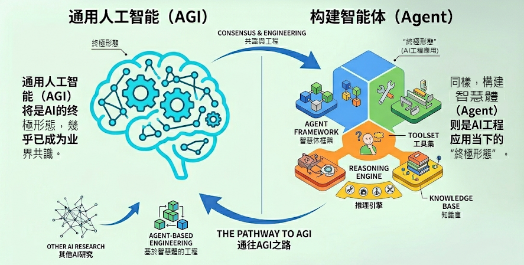

### 1.1 什麼是Agent？

在大模型應用開發中，智慧體通常指一種以 `大語言模型為推理與決策核心` ，結合 `記憶` 、 `工具呼叫` 與環境互動能力，能夠進行 `規劃決策` 並執行 `複雜任務` 以達成目標的軟體系統。

**Agent的關鍵能力**

- 理解使用者問題

- 如何 `拆解任務`

- 判斷 `是否需要工具`

- 需要 `呼叫哪些工具`

- 如何利用好 `工具結果` 生成回答&推進任務

### 1.3 Agent的核心元件

前面講過現在AI Agent的架構：

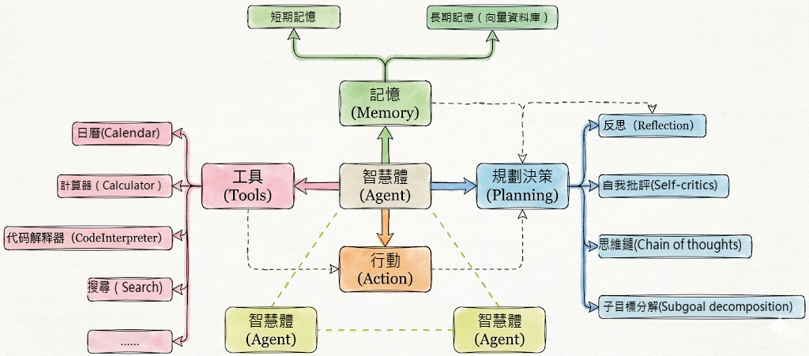

實際開發中幾個要素並不需要同時出現，一句話總結

- 必須的：**行動**（Action）

- 幾乎總是存在的：**工具**（Tool）

- 有條件存在的：**規劃決策**（Planning）

- 最容易被省略的：**記憶**（Memory）

### 1.4 Agent建立與呼叫

#### 1.4.1 歷史上的呼叫

在 LangChain 0.x 時代，框架內的 Agent 系統經歷了“碎片化”階段。當時的設計理念是 “**針對場景設計特定 Agent**”：

- 如果你要實現思維鏈推理（ReAct），就用 `create_react_agent` ；

- 如果需要結構化輸出，就用 `create_structured_chat_agent` ；

- 要工具呼叫，則用 `create_tool_calling_agent` 。

舉例：❌ v0.x 的複雜方式

```python
# 需要多個步驟
from langchain_openai import ChatOpenAI
from langchain.agents import AgentExecutor, create_react_agent
from langchain_core.prompts import PromptTemplate

# 1. 模型初始化
model = ChatOpenAI(model="gpt-4o-mini")

# 2. 建立提示詞模板
prompt = PromptTemplate.from_template("""
You are a helpful assistant.

Tools: {tools}
Tool Names: {tool_names}

{agent_scratchpad}
""")

# 3. 建立 agent
agent = create_react_agent(
    llm=model,
    tools=tools,
    prompt=prompt
)

# 4. 建立 executor
executor = AgentExecutor(
    agent=agent,
    tools=tools,
    verbose=True
)

# 5. 呼叫
result = executor.invoke({"input": "問題"})
```

這種方式靈活，但也帶來了三個明顯問題：

1. **心智負擔高**——每種 Agent 都要單獨記憶 API 與引數；  
2. **可組合性差**——多個 Agent 之間無法統一排程；  
3. **生態碎片化**——不同模組難以複用或協同演化。

#### 1.4.2 全新的呼叫

LangChain 在 1.0 版本後，團隊做出了徹底重構：將所有 Agent 的建立方式**統一為一個入口：create_agent**()。它取代了舊版本中的 `create_react_agent` 、 `create_json_agent` 、`create_tool_calling_agent` 等多種分支函式，真正讓開發者用一行程式碼即可建立任何型別的智慧體。

同時在底層透過“中介軟體機制（Middleware）”和“標準模型介面（invoke / stream）”實現全域性統一。這讓框架更輕、更穩，也更易於被整合到其他 Agent 平臺中。

舉例：✅ v1.x 的簡潔方式：

```python
from langchain.chat_models import init_chat_model
from langchain.agents import create_agent

# 1. 初始化模型
model = init_chat_model("gpt-4o-mini", model_provider="openai")

# 2. 建立 agent（一步完成）
agent = create_agent(
    model=model,
    tools=[tool1, tool2],
    system_prompt="Agent 的行為指令"  # 可選
)

# 3. 呼叫
result = agent.invoke({
    "messages": [{"role": "user", "content": "問題"}]
})
```

## 2、Agent的基本用法1：模型的傳入方式

在 LangChain 1.2 中， `create_agent` 是構建智慧體的核心方式，底層基於 `LangGraph` 實現。

**create_agent 完整引數**：

```python
from langchain.agents import create_agent

agent = create_agent(
    model: str | BaseChatModel,            # 必需：聊天模型
    tools: List[BaseTool],                 # 必需：工具列表
    *,
    system_prompt: str = "",               # 系統提示詞
    middleware: Seguence[AgentMiddleware[StateT_co, ContextT]] = () # 中介軟體
    interrupt_before: List[str] = None,    # 在某些工具前暫停（人機協作）
    interrupt_after: List[str] = None,     # 在某些工具後暫停
    debug: bool = False                    # 除錯模式
    name: str 丨 None = None,              # 設定模型名稱
)
```

Agent在建立時，涉及到 `模型(Agent使用的模型)` 、 `可呼叫工具` 、 `系統提示詞` 等引數的設定。

更多引數參考：[https://reference.langchain.com/python/langchain/agents/factory/create_agent](https://reference.langchain.com/python/langchain/agents/factory/create_agent)

**Agent中模型的傳入方式**：

本節我們只關注模型的傳入。

模型是 Agent 的“大腦”，負責決策和推理。根據模型傳入agent方式的不同，分為兩種方式。

### 2.1 傳入模型字串

Agent根據傳入的模型字串，自主建立模型物件

```python
from langchain.agents import create_agent

from dotenv import load_dotenv

load_dotenv(override=True)

agent = create_agent("deepseek-v4-flash")
print(type(agent))

from IPython.display import Image, display
display(Image(agent.get_graph().draw_mermaid_png()))
```

輸出

```
<class 'langgraph.graph.state.CompiledStateGraph'>
```

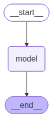

由上可知，agent本質上是LangGraph的**CompiledStateGraph**例項，底層實現是一個圖結構。

透過上述程式碼最後一行可以看到agent的圖結構。

### 2.2 傳入模型物件

```python
from langchain.chat_models import init_chat_model
from langchain.agents import create_agent
from langchain_deepseek import ChatDeepSeek
from dotenv import load_dotenv
import os
load_dotenv(override=True)

# 以ChatDeepSeek為例
# model = ChatDeepSeek(model="deepseek-v4-flash")

# 以init_chat_model為例
model = init_chat_model(
    model="gpt-5.4-mini",
    model_provider="openai",
    api_key=os.getenv("CLOSEAI_API_KEY"),
    base_url=os.getenv("CLOSEAI_BASE_URL")
)


agent = create_agent(model)

print(type(agent))

from IPython.display import Image, display
display(Image(agent.get_graph().draw_mermaid_png()))
```

輸出同上

```
<class 'langgraph.graph.state.CompiledStateGraph'>
```


## 3、Agent的基本用法2：如何呼叫Agent

`agent.invoke()` 是Agent 最基本的同步呼叫方法，它會阻塞程式執行直到返回最終結果。具體的：

- **輸入**：傳入的引數為字典型別，字典內透過 `messages欄位傳遞訊息列表` 。即：“ `{"messages": [{"role": "...", "content": "..."}]}` ”

- **輸出**：透過invoke呼叫Agent，底層可能會經歷多輪互動，返回的是完整的 `訊息列表` ，被封裝在字典中，是 `messages欄位的值` 。

```python
response = agent.invoke({"messages": [...]})

# response 是字典型別
{
    "messages": [
        HumanMessage(...),       # 使用者問題
        AIMessage(...),          # AI 工具呼叫
        ToolMessage(...),        # 工具返回結果
        AIMessage(...)           # 最終回答 ← 通常取這個
    ]
}

# 獲取最終回答
final_answer = response['messages'][-1].content
```

舉例1：

```python
from langchain.agents import create_agent
from langchain.chat_models import init_chat_model
from dotenv import load_dotenv
import os
load_dotenv(override=True)
from rich import print as rprint

# 以init_chat_model為例
model = init_chat_model(
    model="gpt-5.4-mini",
    model_provider="openai",
    api_key=os.getenv("CLOSEAI_API_KEY"),
    base_url=os.getenv("CLOSEAI_BASE_URL")
)

agent = create_agent(model=model)

response = agent.invoke({"messages": ["你好"]}) # 預設是HumanMessage
print(type(response))
rprint(response)
```

輸出如下

```python
{
 'messages': [
     HumanMessage(
         content='你好',
         additional_kwargs={},
         response_metadata={},
         id='93ffcb22-179a-4cab-81a7-a3bd3a1795d4'
     ),
     AIMessage(
         content='你好！有什麼我可以幫你的嗎？',
         additional_kwargs={'refusal': None},
         response_metadata={
             'token_usage': {
                 'completion_tokens': 13,
                 'prompt_tokens': 7,
                 'total_tokens': 20,
                 'completion_tokens_details': {
                     'accepted_prediction_tokens': 0,
                     'audio_tokens': 0,
                     'reasoning_tokens': 0,
                     'rejected_prediction_tokens': 0
                 },
                 'prompt_tokens_details': {'audio_tokens': 0, 'cached_tokens': 0},
                 'latency_checkpoint': {
                     'engine_tbt_ms': 3,
                     'engine_ttft_ms': 48,
                     'engine_ttlt_ms': 90,
                     'pre_inference_ms': 95,
                     'service_tbt_ms': 4,
                     'service_ttft_ms': 673,
                     'service_ttlt_ms': 712,
                     'total_duration_ms': 626,
                     'user_visible_ttft_ms': 578
                 }
             },
             'model_provider': 'openai',
             'model_name': 'gpt-5.4-mini-2026-03-17',
             'system_fingerprint': None,
             'id': 'chatcmpl-DlUJdEGrlJtKPHQ9wgdp1KsrEjIDc',
             'service_tier': 'default',
             'finish_reason': 'stop',
             'logprobs': None
         },
         id='lc_run--019e7ccd-c08b-7f60-8b07-32324cccf2c2-0',
         tool_calls=[],
         invalid_tool_calls=[],
         usage_metadata={
             'input_tokens': 7,
             'output_tokens': 13,
             'total_tokens': 20,
             'input_token_details': {'audio': 0, 'cache_read': 0},
             'output_token_details': {'audio': 0, 'reasoning': 0}
         }
     )
 ]
}
```

舉例2：

invoke呼叫的核心就是輸入一系列訊息（messages），每條訊息通常包含 role（如 "user", "assistant", "system", "tool"）和 "content"。

我們也可以在message列表的開頭加入"system"角色的訊息來定義Agent的行為。

```python
from langchain.agents import create_agent
from langchain.chat_models import init_chat_model
from dotenv import load_dotenv
import os
load_dotenv(override=True)
from rich import print as rprint

# 以init_chat_model為例
model = init_chat_model(
    model="gpt-5.4-mini",
    model_provider="openai",
    api_key=os.getenv("CLOSEAI_API_KEY"),
    base_url=os.getenv("CLOSEAI_BASE_URL")
)

agent = create_agent(model)

resp = agent.invoke( {
    "messages": [
        {"role": "system", "content": "你是一個小學數學老師，耐心，幽默，講解深入淺出"},
        {"role": "user", "content": "100加上50等於多少？"}
    ]
})

rprint(resp)
```

```python
{
 'messages': [
     SystemMessage(
         content='你是一個小學數學老師，耐心，幽默，講解深入淺出',
         additional_kwargs={},
         response_metadata={},
         id='6e02c29f-0360-499a-9d31-f6fcf5921310'
     ),
     HumanMessage(
         content='100加上50等於多少？',
         additional_kwargs={},
         response_metadata={},
         id='7a70d206-28d9-4081-9bb3-2f387aba2fd3'
     ),
     AIMessage(
         content='100 加上 50 等於 **150**。  \n\n可以這樣想：  \n- 100 是1 個百  \n- 再加 50，也就是 5 個十
\n- 合起來就是 **150**\n\n如果你願意，我還可以教你怎麼用“數數法”快速算這種題。',
         additional_kwargs={'refusal': None},
         response_metadata={
             'token_usage': {
                 'completion_tokens': 71,
                 'prompt_tokens': 36,
                 'total_tokens': 107,
                 'completion_tokens_details': {
                     'accepted_prediction_tokens': 0,
                     'audio_tokens': 0,
                     'reasoning_tokens': 0,
                     'rejected_prediction_tokens': 0
                 },
                 'prompt_tokens_details': {'audio_tokens': 0, 'cached_tokens': 0},
                 'latency_checkpoint': {
                     'engine_tbt_ms': 6,
                     'engine_ttft_ms': 33,
                     'engine_ttlt_ms': 426,
                     'pre_inference_ms': 75,
                     'service_tbt_ms': 6,
                     'service_ttft_ms': 253,
                     'service_ttlt_ms': 638,
                     'total_duration_ms': 572,
                     'user_visible_ttft_ms': 178
                 }
             },
             'model_provider': 'openai',
             'model_name': 'gpt-5.4-mini-2026-03-17',
             'system_fingerprint': None,
             'id': 'chatcmpl-DlUOHPXmUQEGFyu46rJf2kmbbjWrG',
             'service_tier': 'default',
             'finish_reason': 'stop',
             'logprobs': None
         },
         id='lc_run--019e7cd2-260e-7ae0-a8c0-e247fbdf767e-0',
         tool_calls=[],
         invalid_tool_calls=[],
         usage_metadata={
             'input_tokens': 36,
             'output_tokens': 71,
             'total_tokens': 107,
             'input_token_details': {'audio': 0, 'cache_read': 0},
             'output_token_details': {'audio': 0, 'reasoning': 0}
         }
     )
 ]
}
```

## 4、Agent的基本用法3：繫結工具

只有接入了一些工具，create_agent完成Agent建立才算完整。

Agent支援 `靜態` 和 `動態` 繫結工具，後者需要用到**中介軟體**，後面會講。在執行時：

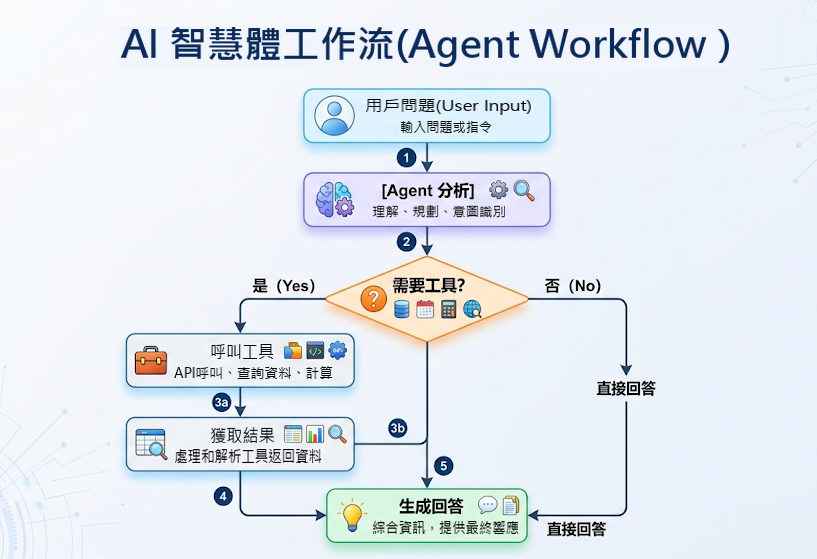

這裡的工具可以是LangChain內建的，也可以是自定義的。LangChain生態中已經內建整合了非常多的實用工具，開發者可以快速呼叫這些工具完成更加複雜工作流的開發。

LangChain內建工具列表：[https://docs.langchain.com/oss/python/integrations/tools](https://docs.langchain.com/oss/python/integrations/tools)

其中典型的工具如下：

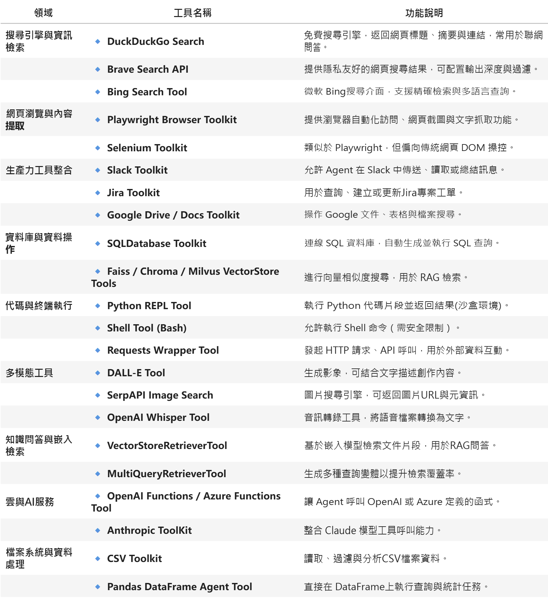

### 4.1 基本用法

Agents支援繫結一或多個工具。

#### 舉例1：繫結一個工具

呼叫查詢天氣工具進行天氣查詢

```python
from langchain.agents import create_agent
from langchain.tools import tool
from rich import print as rprint


@tool(parse_docstring=True)
def get_weather(city: str) -> str:
    """
    天氣查詢工具

    Args:
        city: 城市名稱
    """
    return f"{city}的天氣為晴朗，25°C。"


agent = create_agent(
    model = model,
    tools=[get_weather]
)

resp = agent.invoke( {
    "messages": [
        {"role": "system", "content": "你是一個天氣查詢助手，只回答天氣相關的問題，其他問題請直接回答：我不清楚這問題答案。"},
        {"role": "user", "content": "北京的天氣怎麼樣？"}
        # {"role": "user", "content": "100加上50等於多少？"}
    ]
})

rprint(resp)
```

以上程式碼執行結果如下：

```python
{
 'messages': [
     SystemMessage(
         content='你是一個天氣查詢助手，只回答天氣相關的問題，其他問題請直接回答：我不清楚這問題答案。',
         additional_kwargs={},
         response_metadata={},
         id='6f754fe0-7cd2-4e6b-a3a0-7592a71a7d20'
     ),
     HumanMessage(
         content='北京的天氣怎麼樣？',
         additional_kwargs={},
         response_metadata={},
         id='ecf89457-2901-41d3-b960-ac8f7484d48e'
     ),
     AIMessage(
         content='',
         additional_kwargs={'refusal': None},
         response_metadata={
             'token_usage': {
                 'completion_tokens': 18,
                 'prompt_tokens': 162,
                 'total_tokens': 180,
                 'completion_tokens_details': {
                     'accepted_prediction_tokens': 0,
                     'audio_tokens': 0,
                     'reasoning_tokens': 0,
                     'rejected_prediction_tokens': 0
                 },
                 'prompt_tokens_details': {'audio_tokens': 0, 'cached_tokens': 0},
                 'latency_checkpoint': {
                     'engine_tbt_ms': 3,
                     'engine_ttft_ms': 48,
                     'engine_ttlt_ms': 110,
                     'pre_inference_ms': 102,
                     'service_tbt_ms': 4,
                     'service_ttft_ms': 312,
                     'service_ttlt_ms': 368,
                     'total_duration_ms': 274,
                     'user_visible_ttft_ms': 210
                 }
             },
             'model_provider': 'openai',
             'model_name': 'gpt-5.4-mini-2026-03-17',
             'system_fingerprint': None,
             'id': 'chatcmpl-DlavpIfl1rVj1nwpU8F39s8IAkexg',
             'service_tier': 'default',
             'finish_reason': 'tool_calls',
             'logprobs': None
         },
         id='lc_run--019e7e51-d485-7331-aa8b-cf03d9e23d7f-0',
         tool_calls=[
             {
                 'name': 'get_weather',
                 'args': {'city': '北京'},
                 'id': 'call_4dp4PGy6Ghaj5m6WcNkrwKFe',
                 'type': 'tool_call'
             }
         ],
         invalid_tool_calls=[],
         usage_metadata={
             'input_tokens': 162,
             'output_tokens': 18,
             'total_tokens': 180,
             'input_token_details': {'audio': 0, 'cache_read': 0},
             'output_token_details': {'audio': 0, 'reasoning': 0}
         }
     ),
     ToolMessage(
         content='北京的天氣為晴朗，25°C。',
         name='get_weather',
         id='b5b82403-973c-463b-b9f2-2aa76e0bff77',
         tool_call_id='call_4dp4PGy6Ghaj5m6WcNkrwKFe'
     ),
     AIMessage(
         content='北京天氣晴朗，25°C。',
         additional_kwargs={'refusal': None},
         response_metadata={
             'token_usage': {
                 'completion_tokens': 12,
                 'prompt_tokens': 200,
                 'total_tokens': 212,
                 'completion_tokens_details': {
                     'accepted_prediction_tokens': 0,
                     'audio_tokens': 0,
                     'reasoning_tokens': 0,
                     'rejected_prediction_tokens': 0
                 },
                 'prompt_tokens_details': {'audio_tokens': 0, 'cached_tokens': 0},
                 'latency_checkpoint': {
                     'engine_tbt_ms': 3,
                     'engine_ttft_ms': 34,
                     'engine_ttlt_ms': 71,
                     'pre_inference_ms': 94,
                     'service_tbt_ms': 3,
                     'service_ttft_ms': 272,
                     'service_ttlt_ms': 303,
                     'total_duration_ms': 219,
                     'user_visible_ttft_ms': 178
                 }
             },
             'model_provider': 'openai',
             'model_name': 'gpt-5.4-mini-2026-03-17',
             'system_fingerprint': None,
             'id': 'chatcmpl-Dlavq02DEdjb4JOBx3MTblngJKbTQ',
             'service_tier': 'default',
             'finish_reason': 'stop',
             'logprobs': None
         },
         id='lc_run--019e7e51-d9d7-7e81-bed0-cc990abfa293-0',
         tool_calls=[],
         invalid_tool_calls=[],
         usage_metadata={
             'input_tokens': 200,
             'output_tokens': 12,
             'total_tokens': 212,
             'input_token_details': {'audio': 0, 'cache_read': 0},
             'output_token_details': {'audio': 0, 'reasoning': 0}
         }
     )
 ]
}
```

進一步：

```python
from IPython.display import Image, display

display(Image(agent.get_graph().draw_mermaid_png()))
```

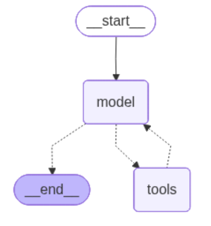

#### 舉例2：接入內建工具

繫結內建的TavilySearch搜尋工具，可以藉助Tavily進行網路搜尋和資訊爬取。

這裡我們需要先在tavily官網註冊並獲得API-KEY（每月有免費額度）：[https://www.tavily.com/](https://www.tavily.com/)。

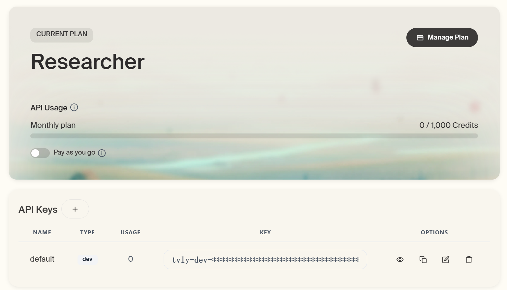

然後將API-KEY寫到本地.env中的 `TAVILY_API_KEY` 變數中，即可進行呼叫了。

```python
from langchain_tavily import TavilySearch
from dotenv import load_dotenv
import os

load_dotenv(override=True)

web_search = TavilySearch(
    tavily_api_key=os.getenv("TAVILY_API_KEY"),
    max_results=2
)

#這是一個高度封裝的網路搜尋工具，可以直接呼叫：
web_search.invoke("請問2026年足球世界盃有哪些參賽隊？")
```

```
{'query': '請問2026年足球世界盃有哪些參賽隊？',
'follow_up_questions': None,
'answer': None,
'images': [],
'results': [{'url': 'https://www.instagram.com/p/DWk8mU-geNg',
'title': '你準備好了嗎？ 2026 FIFA世界盃™ 48支隊伍全數到齊 ... - Instagram',
'content': '本屆賽事由美國、加拿大、墨西哥三國聯合主辦，總共48 支球隊、104 場比賽、39 天賽程，這次的世界盃賽程本身就是前所未見的規模。',
'score': 0.9974885,
'raw_content': None},
{'url': 'https://zh.wikipedia.org/zh-hans/2026%E5%B9%B4%E5%9C%8B%E9%9A%9B%E8%B6%B3%E5%8D%94%E4%B8%96%E7%95%8C%E7%9B%83%E5%A4%96%E5%9C%8D%E8%B3%BD',
'title': '2026年國際足聯世界盃預選賽 - 維基百科',
'content': '2026年國際足聯世界盃預選賽是一項國家隊足球預選賽賽事，以決定出哪些球隊能夠參與由加拿大、墨西哥和美國聯合舉辦的2026年國際足聯世界盃。本屆世界盃決賽周名額增',
'score': 0.9974291,
'raw_content': None}],
'response_time': 0.79,
'request_id': 'dc00f93f-1b75-4222-86cc-4b6af567edf1'}
```

可以直接帶入create_agent中作為外部工具。

```python
from langchain.chat_models import init_chat_model
from langchain.agents import create_agent
from langchain_tavily import TavilySearch
from dotenv import load_dotenv
import os
load_dotenv(override=True)
from rich import print as rprint

# 1.模型初始化
model = init_chat_model(
    model="gpt-5.4-mini",
    model_provider="openai",
    api_key=os.getenv("CLOSEAI_API_KEY"),
    base_url=os.getenv("CLOSEAI_BASE_URL")
)
# 2.工具例項化
web_search = TavilySearch(max_results=2)

# 3.建立Agent
agent = create_agent(
    model=model,
    tools=[web_search],
    #system_prompt="你是一名多才多藝的智慧助手，可以呼叫工具幫助使用者解決問題。"
)

# 4.執行Agent獲得結果
result = agent.invoke(
    {"messages": [{"role": "user", "content": "請幫我查詢2024年諾貝爾物理學獎得主是誰？"}]}
)

# rprint(result)
print(result['messages'][-1].content)
```

```
2024年諾貝爾物理學獎得主是：

- **John J. Hopfield**
- **Geoffrey E. Hinton**

授獎理由是：**“為實現機器學習的人工神經網路奠定基礎性的發現和發明”**。
```

如果仔細觀察本次執行過程，本次工具呼叫仍然是一次典型的Function calling執行流程，包括使用者首次發起訊息在內，總共建立了4條訊息，分別是human message、ai message (涉及function call message）、tool message（涉及function response message）以及ai message（涉及final responses）。

一次完整的 `Function calling` 執行流程如下：

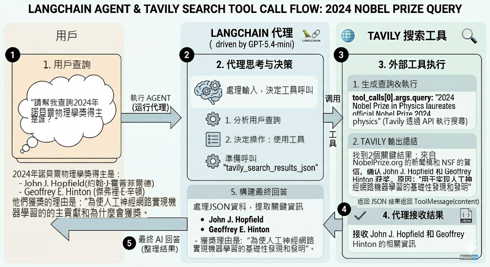

#### 舉例3：繫結多個工具

```python
from langchain.agents import create_agent
from langchain.tools import tool
from dotenv import load_dotenv
from rich import print as rprint

load_dotenv()

@tool(parse_docstring=True)
def get_weather(city: str):
    """
    天氣查詢工具

    Args:
        city: 城市名稱
    """
    return f"{city}今天天氣挺好"

@tool(parse_docstring=True)
def get_news():
    """
    新聞查詢工具
    """
    return "近期，受全球儲蓄晶片短缺等多重因素影響，多地回收商稱廢舊手機回收市場迎來“火熱潮”，回收價格普遍上漲，舊手機成“香餑餑”。"

agent = create_agent(
    model,
    tools=[get_weather, get_news]
)
response = agent.invoke({
    "messages": ["你好，杭州今天的天氣如何？今天有哪些新聞？"]
})

rprint(response)
```

輸出

```python
{
 'messages': [
     HumanMessage(
         content='你好，杭州今天的天氣如何？今天有哪些新聞？',
         additional_kwargs={},
         response_metadata={},
         id='6f69ed6d-76fe-4d1d-9e31-c00a4bedf623'
     ),
     AIMessage(
         content='',
         additional_kwargs={'refusal': None},
         response_metadata={
             'token_usage': {
                 'completion_tokens': 46,
                 'prompt_tokens': 152,
                 'total_tokens': 198,
                 'completion_tokens_details': {
                     'accepted_prediction_tokens': 0,
                     'audio_tokens': 0,
                     'reasoning_tokens': 0,
                     'rejected_prediction_tokens': 0
                 },
                 'prompt_tokens_details': {'audio_tokens': 0, 'cached_tokens': 0},
                 'latency_checkpoint': {
                     'engine_tbt_ms': 4,
                     'engine_ttft_ms': 32,
                     'engine_ttlt_ms': 197,
                     'pre_inference_ms': 90,
                     'service_tbt_ms': 4,
                     'service_ttft_ms': 272,
                     'service_ttlt_ms': 429,
                     'total_duration_ms': 348,
                     'user_visible_ttft_ms': 182
                 }
             },
             'model_provider': 'openai',
             'model_name': 'gpt-5.4-mini-2026-03-17',
             'system_fingerprint': None,
             'id': 'chatcmpl-DlcRS3bbpm4iVX6laeXtWj2vYnYMm',
             'service_tier': 'default',
             'finish_reason': 'tool_calls',
             'logprobs': None
         },
         id='lc_run--019e7eaa-6712-7323-91e6-8af52084b894-0',
         tool_calls=[
             {
                 'name': 'get_weather',
                 'args': {'city': '杭州'},
                 'id': 'call_w9ARuAgN8iqfG2GR7gv00iBq',
                 'type': 'tool_call'
             },
             {'name': 'get_news', 'args': {}, 'id': 'call_vOLekRymIme8bWuVQdIew4vu', 'type': 'tool_call'}
         ],
         invalid_tool_calls=[],
         usage_metadata={
             'input_tokens': 152,
             'output_tokens': 46,
             'total_tokens': 198,
             'input_token_details': {'audio': 0, 'cache_read': 0},
             'output_token_details': {'audio': 0, 'reasoning': 0}
         }
     ),
     ToolMessage(
         content='杭州今天天氣挺好',
         name='get_weather',
         id='21da1cc4-1d26-4d5b-a04a-a836644274fc',
         tool_call_id='call_w9ARuAgN8iqfG2GR7gv00iBq'
     ),
     ToolMessage(
         content='近期，受全球儲蓄晶片短缺等多重因素影響，多地回收商稱廢舊手機回收市場迎來“火熱潮”，回收價格普遍
上漲，舊手機成“香餑餑”。',
         name='get_news',
         id='d1fd947b-3d0f-47f5-9942-c4330f4d7fc6',
         tool_call_id='call_vOLekRymIme8bWuVQdIew4vu'
     ),
     AIMessage(
         content='杭州今天天氣挺好。\n\n今天的新聞：\n1.
近期受全球儲蓄晶片短缺等多重因素影響，多地回收商稱廢舊手機回收市場迎來“火熱潮”，回收價格普遍上漲，舊手機成了“香餑餑
”。\n\n如果你願意，我也可以幫你繼續整理成“天氣 + 新聞摘要”的簡版。',
         additional_kwargs={'refusal': None},
         response_metadata={
             'token_usage': {
                 'completion_tokens': 91,
                 'prompt_tokens': 272,
                 'total_tokens': 363,
                 'completion_tokens_details': {
                     'accepted_prediction_tokens': 0,
                     'audio_tokens': 0,
                     'reasoning_tokens': 0,
                     'rejected_prediction_tokens': 0
                 },
                 'prompt_tokens_details': {'audio_tokens': 0, 'cached_tokens': 0},
                 'latency_checkpoint': {
                     'engine_tbt_ms': 5,
                     'engine_ttft_ms': 38,
                     'engine_ttlt_ms': 466,
                     'pre_inference_ms': 83,
                     'service_tbt_ms': 5,
                     'service_ttft_ms': 265,
                     'service_ttlt_ms': 686,
                     'total_duration_ms': 610,
                     'user_visible_ttft_ms': 183
                 }
             },
             'model_provider': 'openai',
             'model_name': 'gpt-5.4-mini-2026-03-17',
             'system_fingerprint': None,
             'id': 'chatcmpl-DlcRTgUZZHsugIYnroPNDk3PXXQwW',
             'service_tier': 'default',
             'finish_reason': 'stop',
             'logprobs': None
         },
         id='lc_run--019e7eaa-6cac-7901-b58c-d677bf6135be-0',
         tool_calls=[],
         invalid_tool_calls=[],
         usage_metadata={
             'input_tokens': 272,
             'output_tokens': 91,
             'total_tokens': 363,
             'input_token_details': {'audio': 0, 'cache_read': 0},
             'output_token_details': {'audio': 0, 'reasoning': 0}
         }
     )
 ]
}
```

```python
from IPython.display import Image, display

display(Image(agent.get_graph().draw_mermaid_png()))
```

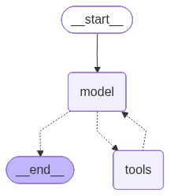

> 注意：只給 Agent 需要的工具，工具太多會混淆。一般2-5 個工具最佳

### 4.2 工具呼叫流程分析

LangChain 的 Agent 會將 `模型` 與 `工具` 結合起來，在實現上由一個基於 LangGraph 的圖結構來編排執行流程，如下所示。

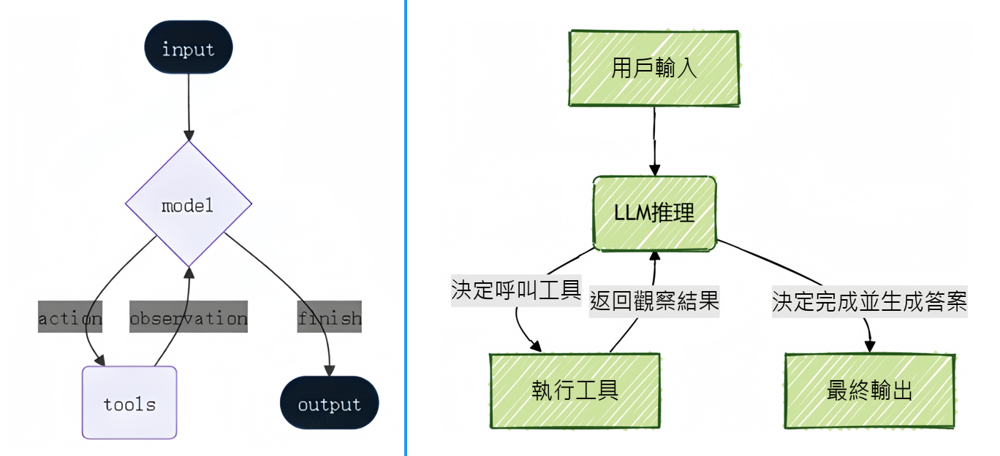

這與前文得到的 Agent 圖結構是一致的，本質上就是經典的 **ReAct 結構**：一個具備“ `思考-行動-觀察` ”不斷迴圈的自主工作者。

```
使用者問題 → AI 思考 → 呼叫工具 → 觀察結果 → 繼續思考 → ... → 最終答案
```

當使用者提出一個複雜需求時，Agent會像人類一樣，先理解任務、規劃步驟、使用合適的工具（如搜尋網路、查詢資料庫、執行計算）獲取資訊，Agent 會在一個迴圈中 `反覆呼叫模型和工具` ，直到某次模型輸出中 `不再包含工具呼叫` 則結束，最後綜合所有資訊給出最終答案。

完整流程：

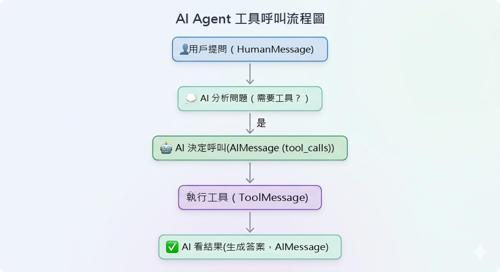

**舉例：使用者問題：“找出當前最流行的無線耳機並檢查庫存”的任務**。

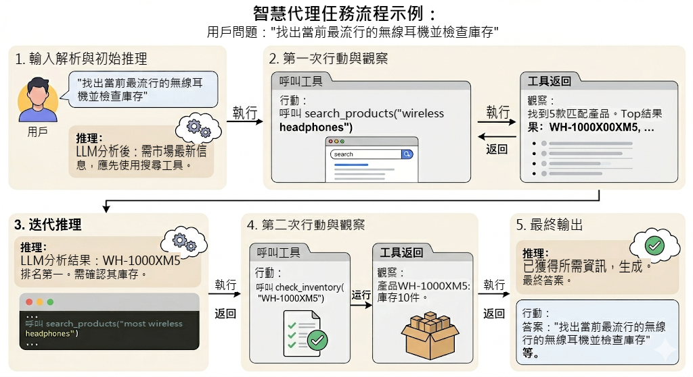

`1、輸入解析與初始推理`

- 輸入：使用者查詢：“找出當前最流行的無線耳機並檢查庫存”。

- 推理：LLM分析任務後認為：“要找出‘最流行’的產品，需要最新的市場資訊，我應該先使用搜尋工具。”

`2、第一次行動(action)與觀察(observation)`

- 行動：Agent呼叫 `search_products工具` ，引數為“wireless headphones”。

- 觀察：工具返回結果：“找到5款匹配產品。Top結果：WH-1000XM5, ...”

`3、迭代推理`

- 推理：LLM根據搜尋結果分析：“WH-1000XM5是排名第一的型號。現在需要確認其庫存狀態才能回答使用者問題。”

`4、第二次行動(action)與觀察(observation)`

- 行動：Agent呼叫 `check_inventory工具` ，引數為“WH-1000XM5”。

- 觀察：工具返回：“產品WH-1000XM5：庫存10件。”

`5、最終輸出`

- 推理：LLM綜合所有資訊後認為：“已獲得所需資訊，可以生成最終答案。”

- 行動：模型生成最終答案，不再呼叫工具。

### 4.3 重試機制

Agent可以在工具呼叫結果不滿足要求時，自主重試。

```python
from langchain.agents import create_agent
from langchain.tools import tool
from langchain.messages import SystemMessage, HumanMessage
from dotenv import load_dotenv
from rich import print as rprint

load_dotenv(override=True)

flag = 0

@tool
def get_weather(city: str):
    """
    天氣查詢工具

    Args:
        city: 城市名稱
    """
    global flag
    flag += 1

    if flag < 3:
        # raise Exception("暫時無法訪問")
        return "TEMP_UNAVAILABLE: 天氣服務暫時不可用，請稍後重試"

    return f"{city}今天天氣挺好"


messages = [
    SystemMessage("""
    你是一個天氣助手。
    當工具返回以 'TEMP_UNAVAILABLE:' 開頭的結果時，
    說明是臨時故障，不要立即放棄；
    你應再次呼叫同一個工具，最多重試 3 次。
    如果 3 次後仍失敗，再向使用者說明服務暫時不可用。
    """),
    HumanMessage("你好，杭州今天的天氣如何？")
]
agent = create_agent(model, tools=[get_weather])
response = agent.invoke({"messages": messages})

# rprint(response)

for msg in response["messages"]:
    msg.pretty_print()
```

輸出

```python
================================ System Message ================================


 你是一個天氣助手。
 當工具返回以 'TEMP_UNAVAILABLE:' 開頭的結果時，
 說明是臨時故障，不要立即放棄；
 你應再次呼叫同一個工具，最多重試 3 次。
 如果 3 次後仍失敗，再向使用者說明服務暫時不可用。

================================ Human Message =================================

你好，杭州今天的天氣如何？
================================== Ai Message ==================================
Tool Calls:
  get_weather (call_cvICuCPSk4U7aWk6YYkAzI5o)
Call ID: call_cvICuCPSk4U7aWk6YYkAzI5o
Args:
 city: 杭州
================================= Tool Message =================================
Name: get_weather

TEMP_UNAVAILABLE: 天氣服務暫時不可用，請稍後重試
================================== Ai Message ==================================
Tool Calls:
get_weather (call_UQL2QTDxKaTCOXbY5Crwbae0)
Call ID: call_UQL2QTDxKaTCOXbY5Crwbae0
  Args:
 city: 杭州
================================= Tool Message =================================
Name: get_weather

TEMP_UNAVAILABLE: 天氣服務暫時不可用，請稍後重試
================================== Ai Message ==================================
Tool Calls:
get_weather (call_gZKuGbhp36wEyhjYgeupfu3b)
Call ID: call_gZKuGbhp36wEyhjYgeupfu3b
Args:
   city: 杭州
================================= Tool Message =================================
Name: get_weather

杭州今天天氣挺好
================================== Ai Message ==================================

杭州今天天氣挺好。
```

模型三次呼叫 `get_weather` ，最終獲得了滿意的結果。

### 4.4 常見問題

**問題1：Agent 如何選擇工具**？

`依據` ：工具的 docstring

```python
@tool
def get_weather(city: str) -> str:
    """獲取指定城市的天氣資訊"""  # ← AI Agent讀這個！
    ...

@tool
def calculator(operation: str, a: float, b: float) -> str:
    """執行基本的數學計算"""  # ← AI Agent也讀這個！
    ...
```

AI 會根據：

1. 問題內容  
2. 每個工具的描述  
3. 自動選擇最匹配的工具

**問題2：Agent 為什麼沒有呼叫工具**？

`原因：`

- 工具的 docstring 不清晰

- 問題表述不明確

- 模型認為不需要工具

`解決：`

```python
# ❌ 不好
@tool
def tool1(x: str) -> str:
    """做一些事情"""  # 太模糊


# ✅ 好
@tool
def get_weather(city: str) -> str:
    """
    獲取指定城市的實時天氣資訊

    Args:
        city: 城市名稱，如"北京"、"上海"
    """
```

**問題3：Agent 選錯工具**？

`原因：`

- 多個工具的功能描述相似

- 工具太多導致混淆

`解決：`

- 只給必要的工具

- 工具描述要有明確區分

- 在 system_prompt 中說明工具使用場景

```python
# ✅ 好：只給需要的工具
agent = create_agent(
    model=model,
    tools=[get_weather, calculator]  # 2-5 個工具最佳
)

# ❌ 不好：工具太多
agent = create_agent(
    model=model,
    tools=[tool1, tool2, ..., tool20]  # 會混淆
)
```

**問題4：如何知道 Agent 何時完成**？

當 AIMessage 不包含 tool_calls 時：

```python
for msg in response['messages']:
    if isinstance(msg, AIMessage):
        if hasattr(msg, 'tool_calls') and msg.tool_calls:
            print("還在呼叫工具...")
        else:
            print("完成！最終答案：", msg.content)
```

**問題5：Agent 可以呼叫多少次工具**？

預設沒有限制，直到得到最終答案。但可能會：

- 超時

- 達到 token 限制

- 模型決定停止

**問題6：如何限制工具呼叫次數**？

LangChain 1.0 的 `create_agent` 預設使用 LangGraph，可以透過配置限制：

```python
# 注意：這是高階用法，後續會詳細學習
config = {
    "recursion_limit": 5  # 最多 5 步
}

response = agent.invoke(input, config=config)
```

## 5、Agent的高階用法1：設定Agent名稱

建立Agent時，LangChain允許使用者指定其名稱

### 5.1 用法

```python
from langchain.agents import create_agent
from langchain.chat_models import init_chat_model
from dotenv import load_dotenv
import os
from rich import print as rprint

# 從.env檔案中載入環境變數
load_dotenv(override=True)

model = init_chat_model(
    model="gpt-5.4-mini",
    model_provider="openai",
    api_key=os.getenv("CLOSEAI_API_KEY"),
    base_url=os.getenv("CLOSEAI_BASE_URL")
)


agent = create_agent(
    model=model,
    name = "chat_assistant"
)

response = agent.invoke({"messages": ["你好"]})

# rprint(response)

for msg in response["messages"]:
    msg.pretty_print()
```

輸出

```python
================================ Human Message =================================

你好
================================== Ai Message ==================================
Name: chat_assistant

你好！有什麼我可以幫你的嗎？
```

輸出的AI Message帶有**Name**資訊。

### 5.2 經典使用場景

`name` 在 Multi-Agent 場景中最常被提及，用於區分不同的 Agent。但它的作用並不侷限於多 Agent 編排。在實際工程中，出現如下場景，通常都建議為 Agent `設定一個清晰且穩定的 name` 。

**1. 流式輸出歸因**

在啟用流式輸出時，name 可用於 `標識當前輸出內容來自哪個 Agent` 。

這在多 Agent 協作、Agent 巢狀呼叫，或前端需要實時展示不同執行主體輸出時尤其有用，便於準確區分 token 或事件的來源。

**2. 訊息身份標記**

設定 name 後，Agent 產生的 `AIMessage 會攜帶對應的name資訊` 。

這使得系統在 `儲存會話記錄` 、 `回放執行過程` 、 `構建審計日誌` 或 `前端展示訊息角色` 時，能夠明確識別訊息的生成者。

**3. 除錯與trace可讀性**

在除錯、日誌分析和鏈路追蹤過程中，name 可以作為 Agent 的穩定標識，幫助開發者 `快速判斷當前執行的是哪個 Agent` 。

當系統中存在多個能力相近的 Agent，或一個 Agent 被巢狀在更復雜的工作流中時，名稱能夠顯著提升`trace 的可讀性` 和 `問題定位` 效率。

**4. 元件化封裝**

在工程實踐中，Agent 常被封裝為可複用的能力模組，例如檢索助手、SQL 助手、報告生成助手等。

為 Agent 設定 name ，有助於在模組註冊、執行監控、日誌歸檔和能力複用時保持一致的身份標識。

如果後續需要將該 Agent 進一步作為子圖節點、工具能力或子模組接入更複雜系統，也能降低維護和遷移成本。

**5. 前端展示與執行態可觀測性**

在帶有視覺化介面的應用中，name 還可以直接作為執行時 `展示標識` 使用。

例如，在執行面板中顯示“當前活躍 Agent”“本輪輸出來源”或“呼叫鏈路中的執行節點”時，name 能幫助開發者和使用者更直觀地理解系統當前的執行狀態。

**6. 作為穩定的執行時身份標識**

從更通用的角度看，name 可以理解為 Agent 在系統中的“ `執行時身份 ID` ”。

相比臨時性的展示名稱，一個穩定、規範的 name 更適合用於 `日誌檢索` 、 `監控統計` 、 `鏈路分析` 和`跨模組協作` ，因此在生產環境中通常建議顯式設定，而不是依賴預設行為。

## 6、Agent的高階用法2：系統提示詞

使用 create_agent 建立 Agent 時，需傳入 `模型` 和 `工具` 、可選地傳入 `系統提示詞` 。**提示詞為Agent提供了任務背景、行為準則和操作指南**。

系統指令，即SystemMessage，透過 `system_prompt` 設定，定義 Agent 行為。這個引數可以是 `str`或者 `SystemMessage型別` 。

使用建議：

- 明確說明 Agent 的角色

- 定義輸出格式

- 說明何時使用工具

比如：

```python
agent = create_agent(
    model=model,
    tools=[get_weather],
    system_prompt="""你是天氣助手。

工作流程：
1. 理解使用者的城市查詢
2. 使用 get_weather 工具獲取資料
3. 簡潔清晰地回答

輸出格式：
- 天氣狀況
- 溫度
- 注意事項（如有）
"""
)
```

提示詞設定有兩種方式： `靜態設定` 和 `動態設定` 。動態設定需要藉助**中介軟體**，後續講解。

舉例1：

```python
from langchain_tavily import TavilySearch
from langchain.agents import create_agent
from langchain.chat_models import init_chat_model
from dotenv import load_dotenv
import os
load_dotenv(override=True)


# 1.匯入模型
model = init_chat_model(
    model="gpt-5.4-mini",
    model_provider="openai",
    api_key=os.getenv("CLOSEAI_API_KEY"),
    base_url=os.getenv("CLOSEAI_BASE_URL")
)

# 2.匯入工具
web_search = TavilySearch(max_results=2)

# 3.建立Agent
agent = create_agent(
    model=model,
    tools=[web_search],
    system_prompt="你是一名多才多藝的智慧助手，可以呼叫工具幫助使用者解決問題。"
)

# 4.執行Agent獲得結果
result = agent.invoke(
    {"messages": [
        {"role": "user", "content": "請幫我查詢2026年足球世界盃是哪個國家舉辦的？"}
    ]}
)

print(result['messages'][-1].content)
```

```
2026年足球世界盃由**三個國家聯合舉辦**：**加拿大、墨西哥和美國**。
```

舉例2：

```python
from langchain.agents import create_agent
from langchain_core.messages import SystemMessage
from langchain_core.tools import tool
from rich import print as rprint

# 工具：實現兩數相加
@tool
def add_numbers(a: int, b: int) -> str:
    """計算並返回兩個數的和。"""
    return f"和為：{a + b}"


# 建立客服助手Agent
agent = create_agent(
    model=model,
    tools=[add_numbers],  # 工具列表
    # system_prompt="你是一個數學助手，解決日常的算術問題"
    system_prompt=SystemMessage(content="你是一個數學助手，解決日常的算術問題")
)

response = agent.invoke(
    {"messages": [
        {"role": "user", "content": "10加上20再加上30是多少？"}
    ]},
)

rprint(response)
# print(response["messages"][-1].content)
```

結果如下：

```python
{
 'messages': [
     HumanMessage(
         content='10加上20再加上30是多少？',
         additional_kwargs={},
         response_metadata={},
         id='bd84f000-da12-450c-aeef-0719afcfecfd'
     ),
     AIMessage(
         content='',
         additional_kwargs={'refusal': None},
         response_metadata={
             'token_usage': {
                 'completion_tokens': 22,
                 'prompt_tokens': 158,
                 'total_tokens': 180,
                 'completion_tokens_details': {
                     'accepted_prediction_tokens': 0,
                     'audio_tokens': 0,
                     'reasoning_tokens': 0,
                     'rejected_prediction_tokens': 0
                 },
                 'prompt_tokens_details': {'audio_tokens': 0, 'cached_tokens': 0},
                 'latency_checkpoint': {
                     'engine_tbt_ms': 3,
                     'engine_ttft_ms': 31,
                     'engine_ttlt_ms': 106,
                     'pre_inference_ms': 94,
                     'service_tbt_ms': 4,
                     'service_ttft_ms': 282,
                     'service_ttlt_ms': 352,
                     'total_duration_ms': 267,
                     'user_visible_ttft_ms': 188
                 }
             },
             'model_provider': 'openai',
             'model_name': 'gpt-5.4-mini-2026-03-17',
             'system_fingerprint': None,
             'id': 'chatcmpl-DmKgu0QquKeWrXBncvxCak9zkIkEf',
             'service_tier': 'default',
             'finish_reason': 'tool_calls',
             'logprobs': None
         },
         id='lc_run--019e88cd-d248-76b0-836c-71c63856787a-0',
         tool_calls=[
             {
                 'name': 'add_numbers',
                 'args': {'a': 10, 'b': 20},
                 'id': 'call_PWuscHI7NFdVbAV9wsMzOWKy',
                 'type': 'tool_call'
             }
         ],
         invalid_tool_calls=[],
         usage_metadata={
             'input_tokens': 158,
             'output_tokens': 22,
             'total_tokens': 180,
             'input_token_details': {'audio': 0, 'cache_read': 0},
             'output_token_details': {'audio': 0, 'reasoning': 0}
         }
     ),
     ToolMessage(
         content='和為：30',
         name='add_numbers',
         id='12635dff-6bd8-4325-b64b-bf203d4cacbb',
         tool_call_id='call_PWuscHI7NFdVbAV9wsMzOWKy'
     ),
     AIMessage(
         content='',
         additional_kwargs={'refusal': None},
         response_metadata={
             'token_usage': {
                 'completion_tokens': 22,
                 'prompt_tokens': 194,
                 'total_tokens': 216,
                 'completion_tokens_details': {
                     'accepted_prediction_tokens': 0,
                     'audio_tokens': 0,
                     'reasoning_tokens': 0,
                     'rejected_prediction_tokens': 0
                 },
                 'prompt_tokens_details': {'audio_tokens': 0, 'cached_tokens': 0},
                 'latency_checkpoint': {
                     'engine_tbt_ms': 3,
                     'engine_ttft_ms': 31,
                     'engine_ttlt_ms': 105,
                     'pre_inference_ms': 82,
                     'service_tbt_ms': 4,
                     'service_ttft_ms': 257,
                     'service_ttlt_ms': 336,
                     'total_duration_ms': 269,
                     'user_visible_ttft_ms': 176
                 }
             },
             'model_provider': 'openai',
             'model_name': 'gpt-5.4-mini-2026-03-17',
             'system_fingerprint': None,
             'id': 'chatcmpl-DmKgvO5dZRkveTKDtLdPF4BObFmdZ',
             'service_tier': 'default',
             'finish_reason': 'tool_calls',
             'logprobs': None
         },
         id='lc_run--019e88cd-d880-7601-a250-d4ddea91669d-0',
         tool_calls=[
             {
                 'name': 'add_numbers',
                 'args': {'a': 30, 'b': 30},
                 'id': 'call_dZDyMZS1BYRJHdW32uj4z8R8',
                 'type': 'tool_call'
             }
         ],
         invalid_tool_calls=[],
         usage_metadata={
             'input_tokens': 194,
             'output_tokens': 22,
             'total_tokens': 216,
             'input_token_details': {'audio': 0, 'cache_read': 0},
             'output_token_details': {'audio': 0, 'reasoning': 0}
         }
     ),
     ToolMessage(
         content='和為：60',
         name='add_numbers',
         id='ffa8b21a-d3fe-4970-bddf-57d3e121f3bf',
         tool_call_id='call_dZDyMZS1BYRJHdW32uj4z8R8'
     ),
     AIMessage(
         content='10加上20再加上30等於 **60**。',
         additional_kwargs={'refusal': None},
         response_metadata={
             'token_usage': {
                 'completion_tokens': 18,
                 'prompt_tokens': 230,
                 'total_tokens': 248,
                 'completion_tokens_details': {
                     'accepted_prediction_tokens': 0,
                     'audio_tokens': 0,
                     'reasoning_tokens': 0,
                     'rejected_prediction_tokens': 0
                 },
                 'prompt_tokens_details': {'audio_tokens': 0, 'cached_tokens': 0},
                 'latency_checkpoint': {
                     'engine_tbt_ms': 4,
                     'engine_ttft_ms': 41,
                     'engine_ttlt_ms': 115,
                     'pre_inference_ms': 91,
                     'service_tbt_ms': 4,
                     'service_ttft_ms': 294,
                     'service_ttlt_ms': 360,
                     'total_duration_ms': 278,
                     'user_visible_ttft_ms': 203
                 }
             },
             'model_provider': 'openai',
             'model_name': 'gpt-5.4-mini-2026-03-17',
             'system_fingerprint': None,
             'id': 'chatcmpl-DmKgwNFV9EzDelG0YCsReEfggh4Gg',
             'service_tier': 'default',
             'finish_reason': 'stop',
             'logprobs': None
         },
         id='lc_run--019e88cd-dd3b-7271-80ec-76a8b980a858-0',
         tool_calls=[],
         invalid_tool_calls=[],
         usage_metadata={
             'input_tokens': 230,
             'output_tokens': 18,
             'total_tokens': 248,
             'input_token_details': {'audio': 0, 'cache_read': 0},
             'output_token_details': {'audio': 0, 'reasoning': 0}
         }
     )
 ]
}
```

舉例3：

```python
from langchain.agents import create_agent
from langchain.tools import tool
from langchain.messages import SystemMessage, HumanMessage

flag = 0

@tool
def get_weather(city: str):
    """
    天氣查詢工具

    Args:
        city: 城市名稱
    """
    global flag
    flag += 1

    if flag < 3:
        # raise Exception("暫時無法訪問")
        return "TEMP_UNAVAILABLE: 天氣服務暫時不可用，請稍後重試"

    return f"{city}今天天氣挺好"


messages = [
    HumanMessage("你好，杭州今天的天氣如何？")
]

agent = create_agent(
    model=model,
    tools=[get_weather],
    system_prompt=SystemMessage(
        "你是一個天氣助手。"
        "當工具返回以 'TEMP_UNAVAILABLE:' 開頭的結果時，"
        "說明是臨時故障，不要立即放棄；"
        "你應再次呼叫同一個工具，最多重試 3 次。"
        "如果 3 次後仍失敗，再向使用者說明服務暫時不可用。"
    )
)
response = agent.invoke({"messages": messages})
# print(response)
for msg in response["messages"]:
    msg.pretty_print()
```

輸出如下

```python
================================ Human Message =================================

你好，杭州今天的天氣如何？
================================== Ai Message ==================================
Tool Calls:
get_weather (call_1NZMHHj1xByT0Zx7WhiK6AO1)
Call ID: call_1NZMHHj1xByT0Zx7WhiK6AO1
Args:
   city: 杭州
================================= Tool Message =================================
Name: get_weather

TEMP_UNAVAILABLE: 天氣服務暫時不可用，請稍後重試
================================== Ai Message ==================================
Tool Calls:
get_weather (call_Lgfn3Ll8WTJqQRVVwLIzRQnX)
Call ID: call_Lgfn3Ll8WTJqQRVVwLIzRQnX
Args:
 city: 杭州
================================= Tool Message =================================
Name: get_weather

TEMP_UNAVAILABLE: 天氣服務暫時不可用，請稍後重試
================================== Ai Message ==================================
Tool Calls:
get_weather (call_PghYww2kjkigDZK8h6P5Lth0)
Call ID: call_PghYww2kjkigDZK8h6P5Lth0
Args:
 city: 杭州
================================= Tool Message =================================
Name: get_weather

杭州今天天氣挺好
================================== Ai Message ==================================

杭州今天天氣挺好。
```

## 7、Agent的高階用法3：結構化輸出

結構化輸出是Agent的核心功能之一，它允許Agent以特定、可預測的格式返回資料，而不是傳統的自然語言響應。透過結構化輸出，開發者可以直接獲得 `Pydantic模型` 、 `JSON物件` 或 `資料類` 等結構化資料，這些資料能夠被應用程式直接使用，無需複雜的解析過程。

### 7.1 模型 vs Agent的結構化輸出對比

第06章已經介紹過結構化輸出，當時的重點是與 `模型物件` 的繫結，這裡與Agent的結構化輸出做對比：

| **維度** | **模型的結構化輸出** | **Agent 結構化輸出** |
|---|---|---|
| **操作物件** | 作用於 `大模型物件` | 作用於 `Agent` |
| **解析時機** | 每次模型呼叫 `生成 AIMessage` 時，進行解析 | 僅在 Agent 決定 `"任務結束"` 並輸出最終答案時解析 |
| **資料流轉** | 模型 結構化物件 | 模型 工具 反思 ... 結構化物件 |
| **繫結方式** | 使用 `with_structured_output` | 使用 `response_format` 引數 |
| **適用場景** | `單次、確定性` 的任務（如提取欄位、翻譯、分類） | `多步、複雜推理` 的任務（如查文件後彙總報表） |

### 7.2 結構化輸出的4種策略

LangChain的create_agent()函式自動處理結構化輸出的全過程。使用者只需透過 `“response_format”引數` 設定期望的輸出模式（Schema）。

當模型生成結構化資料時，系統會自動捕獲、驗證並將結果儲存在Agent狀態的 `structured_response`鍵中。

```python
def create_agent(
    ...
    response_format: Union[
        ToolStrategy[StructuredResponseT],
        ProviderStrategy[StructuredResponseT],
        type[StructuredResponseT],
        None,
    ]
```

create_agent函式中的response_format引數支援四種不同的策略設定方式：

#### ① ProviderStrategy

使用模型提供商的 `原生結構化輸出功能` 實現結構化輸出。

- 這裡所說的“原生結構化輸出”指的是大語言模型（LLM）提供商透過其API直接提供的、在模型響應階段就強制保證 `輸出格式符合預定規範` 的能力，這種能力能夠在模型生成內容的源頭確保結構化準確性。

- 適用於支援原生結構化輸出的模型，比如OpenAI、Anthropic Claude或xAI Grok等。

舉例：

```python
from pydantic import BaseModel, Field
from langchain.agents import create_agent
from langchain.agents.structured_output import ProviderStrategy
from langchain.messages import HumanMessage
from rich import print as rprint
from langchain.chat_models import init_chat_model
from dotenv import load_dotenv
import os

load_dotenv(override=True)

# 1.模型初始化
model = init_chat_model(
    model="gpt-5.4-mini",
    model_provider="openai",
    api_key=os.getenv("CLOSEAI_API_KEY"),
    base_url=os.getenv("CLOSEAI_BASE_URL")
)
# 2.Pydantic結構化方式定義
class ContactInfo(BaseModel):
    """使用者的聯絡方式"""
    name: str = Field(description="使用者姓名")
    email: str = Field(description="使用者郵箱地址")
    phone: str = Field(description="使用者的手機號")

# 3.agent初始化
agent = create_agent(
    model=model,
    response_format=ProviderStrategy(ContactInfo)
)

# 4.呼叫
response = agent.invoke({
        "messages": [
            HumanMessage("從這段話中抽取結構化資訊：小明的郵箱地址為：shkstart@atguigu.com，手機號：12345678912")
        ]
    }
)

# rprint(response)

for msg in response["messages"]:
    msg.pretty_print()
```

輸出

```
================================ Human Message =================================

從這段話中抽取結構化資訊：小明的郵箱地址為：shkstart@atguigu.com，手機號：12345678912
================================== Ai Message ==================================

{"name":"小明","email":"shkstart@atguigu.com","phone":"12345678912"}
```

#### ② ToolStrategy

對於不支援原生結構化輸出的模型，LangChain採用“ToolStrategy”工具呼叫的方式實現結構化輸出。

此策略相容絕大多數 `支援工具呼叫` 的現代模型，其核心原理是動態建立一個" `虛擬工具` "，該工具的輸入引數對應著期望的資料結構。

當模型需要生成最終答案時，系統會引導模型 `"呼叫"這個虛擬工具` ，從而間接產生符合要求的結構化資料。

舉例：

```python
from pydantic import BaseModel
from langchain.agents import create_agent
from langchain.agents.structured_output import ToolStrategy
from langchain.chat_models import init_chat_model
from dotenv import load_dotenv
import os

load_dotenv(override=True)

# 1.模型初始化
model = init_chat_model(
    model="gpt-5.4-mini",
    model_provider="openai",
    api_key=os.getenv("CLOSEAI_API_KEY"),
    base_url=os.getenv("CLOSEAI_BASE_URL")
)

# 2.Pydantic結構化方式定義
class ContactInfo(BaseModel):
    name: str = Field(description="姓名")
    email: str = Field(description="郵箱")
    phone: str = Field(description="電話")

# 3.工具的定義（根據需要定義）
@tool
def search_tool(query: str) -> str:
    """這是一個搜尋引擎。當大模型發現給定的上下文裡缺少必要的聯絡人資訊，
    需要去網際網路上查詢時，才會呼叫這個工具。
    """
    return f"搜尋結果: 未找到關於 '{query}' 的更多額外資訊。"

# 3.agent初始化
agent = create_agent(
    model=model,
    tools=[search_tool],
    response_format=ToolStrategy(ContactInfo)
)

result = agent.invoke({
    "messages": [{"role": "user", "content": "聯絡人資訊: John Doe, john@atguigu.com, (010) 56253825"}]
})

# print(result)
print(result["structured_response"])
```

```python
name='John Doe' email='john@atguigu.com' phone='(010) 56253825'
```

#### ③ type / AutoStrategy

官方沒有在引數列表或官方文件列出這種策略，但閱讀原始碼可以看到。

```python
ResponseFormat = ToolStrategy[SchemaT] | ProviderStrategy[SchemaT] |AutoStrategy[SchemaT]
"""Union type for all supported response format strategies."""
```

當我們**直接傳入一個定義型別**時，LangChain會**自動包裝**為**AutoStrategy**，觸發 `自動選擇策略` ：如果模型支援原生結構化輸出（如OpenAI、Anthropic Claude或xAI Grok），則優先使用ProviderStrategy；否則使用ToolStrategy。

舉例1：

```python
from langchain.agents.structured_output import AutoStrategy
from pydantic import BaseModel, Field
from langchain.agents import create_agent


class ContactInfo(BaseModel):
    """聯絡人資訊"""
    name: str = Field(description="姓名")
    email: str = Field(description="郵箱")
    phone: str = Field(description="電話")


agent = create_agent(
    model=model,
    response_format=AutoStrategy(ContactInfo)
)

result = agent.invoke({
    "messages": [{"role": "user", "content": "聯絡人資訊: John Doe, john@atguigu.com, (010) 56253825"}]
})

# print(result)
print(result["structured_response"])
```

輸出

```python
name='John Doe' email='john@atguigu.com' phone='(010) 56253825'
```

**特別注意**：在LangChain 1.0及以上版本中，直接傳遞模式（如response_format=ContactInfo）不再支援，必須顯式使用ToolStrategy或ProviderStrategy。（經過測試，目前LangChain 1.2版本還可使用）。

舉例2：

```python
from pydantic import BaseModel, Field
from langchain.agents import create_agent


class ContactInfo(BaseModel):
    """聯絡人資訊"""
    name: str = Field(description="姓名")
    email: str = Field(description="郵箱")
    phone: str = Field(description="電話")

agent = create_agent(
    model=model,
    response_format=ContactInfo  # Auto-selects ProviderStrategy
)

result = agent.invoke({
    "messages": [{"role": "user", "content": "聯絡人資訊: John Doe, john@atguigu.com, (010) 56253825"}]
})

# print(result)
print(result["structured_response"])
```

```python
name='John Doe' email='john@atguigu.com' phone='(010) 56253825'
```

#### ④ None

預設配置，表示不以結構化輸出，以 `自然語言` 響應使用者問題。

**總結**：

在實際大模型Agent開發場景中，如果使用到了結構化輸出，推薦使用 `“ToolStrategy”策略` ，所以後續重點介紹這種策略方式結構化輸出。

### 7.3 ToolStrategy使用詳解

ToolStrategy透過 `工具呼叫` （Tool Calling/Function Calling）實現結構化輸出，所以LangChain會在訊息列表末尾 `追加一條ToolMessage` ，讓整個鏈路完整。但實際上沒有實際的工具執行，這是一條偽訊息。

ToolStrategy適用於任何支援工具呼叫的現代模型。

ToolStrategy的配置包含三個主要引數：

```python
class ToolStrategy(Generic[SchemaT]):
    schema: type[SchemaT]
    tool_message_content: str | None
    handle_errors: Union[bool, str, type[Exception], tuple[type[Exception], ...], Callable[[Exception], str]]
```

- **schema（必需引數**）：與提供商策略的schema引數功能一致，支援 `Pydantic模型` 、`TypedDict` 、 `JSON Schema` 、 `資料類(@dataclass)` ，同時還支援聯合型別 `Union[型別1, 型別2]` （允許模型根據輸入內容選擇最匹配的資料結構）。

- **tool_message_content（可選引數**）：用於自定義生成結構化輸出時，會話歷史中記錄的提示資訊。預設使用展示輸出資料的標準響應語句。

- **handle_errors（可選引數**）：用於指定資料校驗失敗時的重試策略， `預設值為True` 。

#### 7.3.1 結構化輸出：schema引數

下面演示四種Schema進行結構化輸出程式碼實現。

提前說明：因為涉及到不同的Schema在不同模型供應商下表現的支援力度不同（上一章有說明，這裡提供了兩個模型供應商，大家自己選擇）

使用CloseAI平臺的模型：

```python
from langchain.chat_models import init_chat_model
from dotenv import load_dotenv
import os

# 從.env檔案中載入環境變數
load_dotenv(override=True)

CLOSEAI_API_KEY = os.getenv("CLOSEAI_API_KEY")
CLOSEAI_BASE_URL = os.getenv("CLOSEAI_BASE_URL")

model = init_chat_model(
    model="gpt-5.4-mini",
    model_provider="openai",
    api_key=CLOSEAI_API_KEY,
    base_url=CLOSEAI_BASE_URL
)
```

使用OpenRouter平臺的模型（使用梯子）：

```python
from langchain_openrouter import ChatOpenRouter
from dotenv import load_dotenv
import os

load_dotenv(override=True)

OPENROUTER_API_KEY = os.getenv("OPENROUTER_API_KEY")
OPENROUTER_API_BASE = os.getenv("OPENROUTER_API_BASE")

model = ChatOpenRouter(
    model="openai/gpt-5.4-mini",
    api_key=OPENROUTER_API_KEY,
    base_url=OPENROUTER_API_BASE,
)
```

**輸出模式1：Pydantic型別**

Pydantic型別的Schema支援資料驗證，**是優先推薦使用的方式**。

舉例1：

```python
from pydantic import BaseModel, Field
from langchain.agents.structured_output import ToolStrategy
from langchain.agents import create_agent
from langchain.messages import HumanMessage

class ContactInfo(BaseModel):
    """使用者的聯絡方式"""
    name: str = Field(description="使用者姓名")
    email: str = Field(description="使用者郵箱地址")
    phone: str = Field(description="使用者的手機號")


agent = create_agent(
    model=model,
    response_format=ToolStrategy(ContactInfo)
)

response = agent.invoke({
        "messages": [
            HumanMessage("從這段話中抽取結構化資訊：小明的郵箱地址為：songhk@atguigu.com，手機號：12345678912")
        ]
    }
)

for msg in response["messages"]:
    msg.pretty_print()

# print(response["structured_response"])
```

輸出

```
================================ Human Message =================================

從這段話中抽取結構化資訊：小明的郵箱地址為：songhk@atguigu.com，手機號：12345678912
================================== Ai Message ==================================
Tool Calls:
 ContactInfo (call_0ULr5y5MWny1wAgv2JXLDDyO)
Call ID: call_0ULr5y5MWny1wAgv2JXLDDyO
 Args:
    name: 小明
    email: songhk@atguigu.com
    phone: 12345678912
================================= Tool Message =================================
Name: ContactInfo

Returning structured response: name='小明' email='songhk@atguigu.com' phone='12345678912'
```

觀察日誌可知，這種方式將結構化資訊作為 `偽工具傳遞` ，顯然使用了Function Calling方法。

舉例2：

```python
from langchain_core.messages import SystemMessage
from pydantic import BaseModel, Field
from typing import Literal
from langchain.agents import create_agent
from langchain.agents.structured_output import ToolStrategy
from langchain.tools import tool
from rich import print as rprint

# 定義工具
@tool(parse_docstring=True)
def search_customer_database(query: str) -> str:
    """
    在客戶資料庫中搜尋資訊

    Args:
        query (str): 客戶查詢字串，例如 "張三" 或 "李四"

    Returns:
        str: 客戶記錄字串，包含客戶姓名、等級、最近購買日期和累計消費
    """
    # 模擬資料庫查詢結果
    if "張三" in query.lower():
        return "客戶記錄：張三，VIP客戶，最近購買日期：2026-01-15，累計消費：$15,000"
    elif "李四" in query.lower():
        return "客戶記錄：李四，普通客戶，最近購買日期：2025-12-20，累計消費：$3,200"
    else:
        return f"關於客戶{query}，無記錄"


@tool(parse_docstring=True)
def send_email(customer: str) -> str:
    """
    傳送感謝郵件

    Args:
        customer (str): 客戶名稱，例如 "張三" 或 "李四"

    Returns:
        str: 確認訊息，包含已傳送的客戶名稱
    """
    return f"已向 {customer} 傳送感謝郵件"


# 定義Pydantic Schema
class CustomerAnalysis(BaseModel):
    """客戶分析報告"""
    customer_name: str = Field(None, description="客戶姓名")
    customer_tier: Literal["潛在客戶", "普通客戶", "VIP客戶", "流失風險"] = Field("潛在客戶",description="客戶等級,只能是潛在客戶、普通客戶、VIP客戶或流失風險")
    recent_activity: str = Field(None, description="最近活動")
    spending_level: Literal["低", "中", "高"] = Field(None, description="消費水平")
    send_email: bool = Field(False, description="是否已傳送感謝郵件")


# 建立智慧體
agent = create_agent(
    model=model,
    system_prompt=SystemMessage(content=""
                                        "請分析指定客戶的情況："
                                        "1. 先搜尋客戶資料庫瞭解最新情況 "
                                        "2. 如果是VIP客戶，則傳送感謝郵件 "
                                        "3. 基於搜尋結果生成結構化分析報告 "
                                        "4. 如果使用者提問與客戶記錄無關或找不到客戶資訊，則返回空物件，不傳送感謝郵件"
                                ),
    tools=[search_customer_database, send_email],
    response_format=ToolStrategy(CustomerAnalysis)
)

# 執行分析
result = agent.invoke({
    "messages": [{"role": "user", "content": "請分析客戶張三"}]
    # "messages": [{"role": "user","content": "請分析客戶李四"}]
    # "messages": [{"role": "user","content": "請分析客戶王五"}]
    # "messages": [{"role": "user","content": "今天天氣如何"}]
})

# 處理結果
# rprint(result)

if "structured_response" in result:
    analysis = result["structured_response"]
    print(analysis)
```

```python
customer_name='張三' customer_tier='VIP客戶' recent_activity='最近購買日期：2026-01-15' spending_level='高' send_email=True
```

注意：

1. 如果是結構化輸出，在系統提示詞中**最後提示結構化輸出結果**，如果提示詞中先結構化輸出結果（Agent已經執行完成），可能會導致一些工具不會再被呼叫。  
2. 系統提示詞中最後加入“未找到使用者”時的處理提示，避免程式一直呼叫工具嘗試查詢對應使用者資訊。

**輸出模式2：TypedDict型別**

TypedDict 允許為字典物件定義固定的鍵名和對應的 `值型別` ，是 `帶有型別提示的字典結構` 。具體的：

1. TypedDict欄位定義採用 Annotated[型別, 預設值, "描述"]格式  
2. 可選欄位使用 Optional包裝，預設值在 Annotated 中指定  
3. TypedDict 不支援執行時驗證。

舉例1：

```python
from typing import TypedDict, Annotated
from langchain.agents.structured_output import ToolStrategy
from langchain.agents import create_agent
from langchain.messages import HumanMessage


class ContactInfo(TypedDict):
    """使用者的聯絡方式"""
    name: Annotated[str, ..., "使用者姓名"]
    email: Annotated[str, ..., "使用者郵箱地址"]
    phone: Annotated[str, ..., "使用者的手機號"]

agent = create_agent(
    model=model,
    response_format=ToolStrategy(ContactInfo)
)

response = agent.invoke({
        "messages": [
            HumanMessage("從這段話中抽取結構化資訊：小明的郵箱地址為：songhk@atguigu.com，手機號：12345678912")
        ]
    }
)

for msg in response["messages"]:
    msg.pretty_print()

# print(response["structured_response"])
```

```
================================ Human Message =================================

從這段話中抽取結構化資訊：小明的郵箱地址為：songhk@atguigu.com，手機號：12345678912
================================== Ai Message ==================================
Tool Calls:
ContactInfo (call_cyte01flJ8pJnPcsq7Gkb5V7)
Call ID: call_cyte01flJ8pJnPcsq7Gkb5V7
Args:
 name: 小明
 email: songhk@atguigu.com
 phone: 12345678912
================================= Tool Message =================================
Name: ContactInfo

Returning structured response: {'name': '小明', 'email': 'songhk@atguigu.com', 'phone': '12345678912'}
```

舉例2：

```python
from langchain_core.messages import SystemMessage
from typing import Literal, Optional
from langchain.agents import create_agent
from langchain.agents.structured_output import ToolStrategy
from langchain.tools import tool


# 定義工具
@tool(parse_docstring=True)
def search_customer_database(query: str) -> str:
    """
    在客戶資料庫中搜尋資訊

    Args:
        query (str): 客戶查詢字串，例如 "張三" 或 "李四"

    Returns:
        str: 客戶記錄字串，包含客戶姓名、等級、最近購買日期和累計消費
    """
    # 模擬資料庫查詢結果
    if "張三" in query.lower():
        return "客戶記錄：張三，VIP客戶，最近購買日期：2026-01-15，累計消費：$15,000"
    elif "李四" in query.lower():
        return "客戶記錄：李四，普通客戶，最近購買日期：2025-12-20，累計消費：$3,200"
    else:
        return f"關於客戶{query}，無記錄"


@tool(parse_docstring=True)
def send_email(customer: str) -> str:
    """
    傳送感謝郵件

    Args:
        customer (str): 客戶名稱，例如 "張三" 或 "李四"

    Returns:
        str: 確認訊息，包含已傳送的客戶名稱
    """
    return f"已向 {customer} 傳送感謝郵件"


# 使用 TypedDict 定義客戶分析報告 Schema
class CustomerAnalysis(TypedDict):
    """客戶分析報告"""
    customer_name: Annotated[Optional[str], None, "客戶姓名"]
    customer_tier: Annotated[Literal["潛在客戶", "普通客戶", "VIP客戶", "流失風險"], "潛在客戶", "客戶等級"]
    recent_activity: Annotated[Optional[str], None, "最近活動"]
    spending_level: Annotated[Optional[Literal["低", "中", "高"]], None, "消費水平"]
    send_email: Annotated[bool, False, "是否已傳送感謝郵件"]


# 建立智慧體
agent = create_agent(
    model=model,
    system_prompt=SystemMessage(content=""
                                        "請分析指定客戶的情況："
                                        "1. 先搜尋客戶資料庫瞭解最新情況 "
                                        "2. 如果是VIP客戶，則傳送感謝郵件 "
                                        "3. 基於搜尋結果生成結構化分析報告 "
                                        "4. 如果使用者提問與客戶記錄無關或找不到客戶資訊，則返回空物件，不傳送感謝郵件"
                                ),
    tools=[search_customer_database, send_email],
    response_format=ToolStrategy(CustomerAnalysis)
)

# 執行分析
result = agent.invoke({
    "messages": [{"role": "user", "content": "請分析客戶張三"}]
    # "messages": [{"role": "user","content": "請分析客戶李四"}]
    # "messages": [{"role": "user","content": "請分析客戶王五"}]
    # "messages": [{"role": "user","content": "今天天氣如何"}]
})

# 處理結果
# print("result:", result)
if "structured_response" in result:
    analysis = result["structured_response"]
    print(analysis)
```

```
{'customer_name': '張三', 'customer_tier': 'VIP客戶', 'recent_activity': '最近購買日期：2026-01-15，累計消費：$15,000', 'spending_level': '高', 'send_email': True}
```

**輸出模式3：JsonSchema型別**

JSON Schema是提供一個標準的 JSON Schema 字典來定義結構。適合需要與多種程式語言互動或進行復雜資料約束定義的場景。

舉例1：

```python
from langchain.agents import create_agent
from langchain.messages import HumanMessage


json_schema = {
    "title": "ContactInfo",
    "description": "使用者的聯絡方式",
    "type": "object",
    "properties": {
        "name": {
            "description": "使用者姓名",
            "type": "string"
        },
        "email": {
            "description": "使用者郵箱地址",
            "type": "string"
        },
        "phone": {
            "description": "使用者的手機號",
            "type": "string"
        }
    },
    "required": [
        "name",
        "email",
        "phone"
    ]
}

agent = create_agent(
    model=model,
    response_format=ToolStrategy(json_schema)
)

response = agent.invoke(
    {
        "messages": [
            HumanMessage("從這段話中抽取結構化資訊：小明的郵箱地址為：songhk@atguigu.com，手機號：12345678912")
        ]
    }
)

for msg in response["messages"]:
    msg.pretty_print()

# print(response["structured_response"])
```

輸出

```
================================ Human Message =================================

從這段話中抽取結構化資訊：小明的郵箱地址為：songhk@atguigu.com，手機號：12345678912
================================== Ai Message ==================================
Tool Calls:
ContactInfo (call_4Q8JPgCttdnV9AHZEpNgSyuM)
Call ID: call_4Q8JPgCttdnV9AHZEpNgSyuM
Args:
 name: 小明
 email: songhk@atguigu.com
 phone: 12345678912
================================= Tool Message =================================
Name: ContactInfo

Returning structured response: {'name': '小明', 'email': 'songhk@atguigu.com', 'phone': '12345678912'}
```

舉例2：

```python
from langchain_core.messages import SystemMessage
from typing import Literal, Optional
from langchain.agents import create_agent
from langchain.agents.structured_output import ToolStrategy
from langchain.tools import tool


# 定義工具
@tool(parse_docstring=True)
def search_customer_database(query: str) -> str:
    """
    在客戶資料庫中搜尋資訊

    Args:
        query (str): 客戶查詢字串，例如 "張三" 或 "李四"

    Returns:
        str: 客戶記錄字串，包含客戶姓名、等級、最近購買日期和累計消費
    """
    # 模擬資料庫查詢結果
    if "張三" in query.lower():
        return "客戶記錄：張三，VIP客戶，最近購買日期：2026-01-15，累計消費：$15,000"
    elif "李四" in query.lower():
        return "客戶記錄：李四，普通客戶，最近購買日期：2025-12-20，累計消費：$3,200"
    else:
        return f"關於客戶{query}，無記錄"


@tool(parse_docstring=True)
def send_email(customer: str) -> str:
    """
    傳送感謝郵件

    Args:
        customer (str): 客戶名稱，例如 "張三" 或 "李四"

    Returns:
        str: 確認訊息，包含已傳送的客戶名稱
    """
    return f"已向 {customer} 傳送感謝郵件"


# 定義 JSON Schema 替代 Pydantic 模型
customer_analysis_schema = {
    "title": "CustomerAnalysis",
    "type": "object",
    "description": "客戶分析報告",
    "properties": {
        "customer_name": {
            "type": "string",
            "default": "",
            "description": "客戶姓名"
        },
        "customer_tier": {
            "type": "string",
            "enum": ["潛在客戶", "普通客戶", "VIP客戶", "流失風險"],
            "default": "潛在客戶",
            "description": "客戶等級"
        },
        "recent_activity": {
            "type": "string",
            "default": "",
            "description": "最近活動"
        },
        "spending_level": {
            "type": "string",
            "enum": ["低", "中", "高"],
            "default": "低",
            "description": "消費水平"
        },
        "send_email": {
            "type": "boolean",
            "default": False,
            "description": "是否已傳送感謝郵件"
        }
    },
    # 所有欄位都是必須輸出的
    "required": ["customer_name", "customer_tier", "recent_activity", "spending_level"]
}

# 建立智慧體
agent = create_agent(
    model=model,
    system_prompt=SystemMessage(content=""
                                        "請分析指定客戶的情況："
                                        "1. 先搜尋客戶資料庫瞭解最新情況 "
                                        "2. 如果是VIP客戶，則傳送感謝郵件 "
                                        "3. 基於搜尋結果生成結構化分析報告 "
                                        "4. 如果使用者提問與客戶記錄無關或找不到客戶資訊，則返回空物件，不傳送感謝郵件"
                                ),
    tools=[search_customer_database, send_email],
    response_format=ToolStrategy(customer_analysis_schema)
)

# 執行分析
result = agent.invoke({
    "messages": [{"role": "user", "content": "請分析客戶張三"}]
    # "messages": [{"role": "user","content": "請分析客戶李四"}]
    # "messages": [{"role": "user","content": "請分析客戶王五"}]
    # "messages": [{"role": "user","content": "今天天氣如何"}]
})

# 處理結果
# print("result:", result)
if "structured_response" in result:
    analysis = result["structured_response"]
    print(analysis)
```

```
{'customer_name': '張三', 'customer_tier': 'VIP客戶', 'recent_activity': '最近購買日期：2026-01-15，累計消費：$15,000', 'spending_level': '高', 'send_email': True}
```

注意以上程式碼中定義json_schema的時候指定的title, description, type, properties, required是遵循JSON Schema 規範的標準關鍵字，是固定寫法。具體細節在第06章2.3節已經介紹過了。

**輸出模式4：@dataclass型別**

@dataclass是Python 3.7引入的一個裝飾器，用於簡化**資料儲存類的定義**。

舉例1：

```python
from dataclasses import dataclass
from langchain.agents import create_agent
from langchain.messages import HumanMessage

@dataclass
class ContactInfo:
    """使用者的聯絡方式"""
    name: str = Field(description="使用者姓名")
    email: str = Field(description="使用者郵箱地址")
    phone: str = Field(description="使用者的手機號")


agent = create_agent(
    model=model,
    response_format=ToolStrategy(ContactInfo)
)

response = agent.invoke(
    {
        "messages": [
            HumanMessage("從這段話中抽取結構化資訊：小明的郵箱地址為：songhk@atguigu.com，手機號：12345678912")
        ]
    }
)

for msg in response["messages"]:
    msg.pretty_print()

# print(response["structured_response"])
```

```
================================ Human Message =================================

從這段話中抽取結構化資訊：小明的郵箱地址為：songhk@atguigu.com，手機號：12345678912
================================== Ai Message ==================================
Tool Calls:
ContactInfo (call_3MRoBpJHDaoYB6jK7plgW1YF)
Call ID: call_3MRoBpJHDaoYB6jK7plgW1YF
Args:
 name: 小明
 email: songhk@atguigu.com
 phone: 12345678912
================================= Tool Message =================================
Name: ContactInfo

Returning structured response: ContactInfo(name='小明', email='songhk@atguigu.com', phone='12345678912')
```

舉例2：

```python
                     from langchain_core.messages import SystemMessage
                     from pydantic import BaseModel, Field
                     from typing import Literal
                     from langchain.agents import create_agent
                     from langchain.agents.structured_output import ToolStrategy
                     from langchain.tools import tool


                     # 定義工具
                     @tool(parse_docstring=True)
                     def search_customer_database(query: str) -> str:
                         """
                         在客戶資料庫中搜尋資訊

                         Args:
                             query (str): 客戶查詢字串，例如 "張三" 或 "李四"

                         Returns:
                             str: 客戶記錄字串，包含客戶姓名、等級、最近購買日期和累計消費
                         """
                         # 模擬資料庫查詢結果
                         if "張三" in query.lower():
                             return "客戶記錄：張三，VIP客戶，最近購買日期：2026-01-15，累計消費：$15,000"
                         elif "李四" in query.lower():
                             return "客戶記錄：李四，普通客戶，最近購買日期：2025-12-20，累計消費：$3,200"
                         else:
                             return f"關於客戶{query}，無記錄"


                     @tool(parse_docstring=True)
                     def send_email(customer: str) -> str:
                         """
                         傳送感謝郵件

                         Args:
                             customer (str): 客戶名稱，例如 "張三" 或 "李四"

                         Returns:
                             str: 確認訊息，包含已傳送的客戶名稱
                         """
                         return f"已向 {customer} 傳送感謝郵件"


                     # 使用Dataclass定義Schema
                     @dataclass
                     class CustomerAnalysis:
                         """客戶分析報告"""
                         customer_name: str = Field(None, description="客戶姓名")
                         customer_tier: Literal["潛在客戶", "普通客戶", "VIP客戶", "流失風險"] = Field("潛在客戶",
description="客戶等級,只能是潛在客戶、普通客戶、VIP客戶或流失風險")
                         recent_activity: str = Field(None, description="最近活動")
                         spending_level: Literal["低", "中", "高"] = Field(None, description="消費水平")
                         send_email: bool = Field(False, description="是否已傳送感謝郵件")


                     # 建立智慧體
                     agent = create_agent(
                         model=model,
                         system_prompt=SystemMessage(content=""
                                                             "請分析指定客戶的情況："
                                                             "1. 先搜尋客戶資料庫瞭解最新情況 "
                                                             "2. 如果是VIP客戶，則傳送感謝郵件 "
                                                             "3. 基於搜尋結果生成結構化分析報告 "
                                                             "4. 如果使用者提問與客戶記錄無關或找不到客戶資訊，則返回空物件，不傳送感謝郵件"
                                                     ),
                         tools=[search_customer_database, send_email],
                         response_format=ToolStrategy(CustomerAnalysis)
                     )

                     # 執行分析
                     result = agent.invoke({
                         "messages": [{"role": "user", "content": "請分析客戶張三"}]
                         # "messages": [{"role": "user","content": "請分析客戶李四"}]
                         # "messages": [{"role": "user","content": "請分析客戶王五"}]
                         # "messages": [{"role": "user","content": "今天天氣如何"}]
                     })

                     # 處理結果
                     # print("result:", result)
                     if "structured_response" in result:
                         analysis = result["structured_response"]
                         print(analysis)
```

```
CustomerAnalysis(customer_name='張三', customer_tier='VIP客戶', recent_activity='最近購買日期：2026-01-15', spending_level='高', send_email=True)
```

**多schema聯合模式**

ToolStrategy允許指定多個型別“ `Union[型別1, 型別2]` ”這種寫法，LLM能夠根據輸入文字的內容，智慧地選擇 `最合適的一個` 資料模型（Schema）來生成結構化輸出，但是最終會只有一種型別輸出。

適用於根據不同輸入內容，生成不同的結構化輸出的場景，但是底層工具轉換結構化輸出只會轉換成一種結構化型別輸出。

```python
from pydantic import BaseModel, Field
from typing import Union
from langchain.agents import create_agent
from langchain.agents.structured_output import ToolStrategy
from langchain.messages import HumanMessage


class ContactInfo(BaseModel):
    """使用者的聯絡方式"""
    name: str = Field(description="使用者姓名")
    email: str = Field(description="使用者郵箱地址")
    phone: str = Field(description="使用者的手機號")

class EventInfo(BaseModel):
    """事件詳情"""
    event_name: str = Field(description="事件名稱")
    date: str = Field(description="事件發生日期")

agent = create_agent(
    model=model,
    response_format=ToolStrategy(
        Union[ContactInfo, EventInfo]
    )
)

response = agent.invoke(
    {
        "messages": [
            HumanMessage("從這段話中抽取結構化資訊：小明的郵箱地址為：shkstart@atguigu.com，手機號：12345678912")
        ]
    }
)

for msg in response["messages"]:
    msg.pretty_print()

print(response["structured_response"])
```

輸出

```python
================================ Human Message =================================

從這段話中抽取結構化資訊：小明的郵箱地址為：shkstart@atguigu.com，手機號：12345678912
================================== Ai Message ==================================
Tool Calls:
ContactInfo (call_teJAkORKANUHugePT4Flnrut)
Call ID: call_teJAkORKANUHugePT4Flnrut
Args:
 name: 小明
 email: shkstart@atguigu.com
 phone: 12345678912
================================= Tool Message =================================
Name: ContactInfo

Returning structured response: name='小明' email='shkstart@atguigu.com' phone='12345678912'
name='小明' email='shkstart@atguigu.com' phone='12345678912'
```

繼續：

```python
response = agent.invoke(
    {
        "messages": [
            HumanMessage("從這段話中抽取結構化資訊：2026年高考報名人數突破1200萬")
        ]
    }
)

for msg in response["messages"]:
    msg.pretty_print()

print(response["structured_response"])
```

輸出

```python
================================ Human Message =================================

從這段話中抽取結構化資訊：2026年高考報名人數突破1200萬
================================== Ai Message ==================================
Tool Calls:
EventInfo (call_BrkVCSmkMZqWthLaW3sDaOzr)
Call ID: call_BrkVCSmkMZqWthLaW3sDaOzr
Args:
 event_name: 高考報名人數突破1200萬
 date: 2026年
================================= Tool Message =================================
Name: EventInfo

Returning structured response: event_name='高考報名人數突破1200萬' date='2026年'
event_name='高考報名人數突破1200萬' date='2026年'
```

#### 7.3.2 自定義工具訊息：tool_message_content引數

> 如果採用ToolStrategy策略處理結構化輸出時，LangChain會在訊息列表末尾追加一條Tool_message，讓整個鏈路完整。但實際上沒有實際的工具執行，這是一條偽訊息。

我們可以透過ToolStrategy的 `tool_message_content` 引數定製其訊息內容，將指定的內容寫入對話歷史的提示資訊，這樣做的好處如下：

1. 在終端使用者可見的對話流中，使用 `更自然的訊息` 替代原始資料。  
2. 用簡短的確認資訊替代可能很長的資料塊， `減少token消耗` 。

舉例：

當不設定 tool_message_content時，模型收到的 ToolMessage裡就包含了像 `{'name': '張三', 'email': 'zhangsan@email.com'... ...}` 這樣的具體資料。當設定了tool_message_content時，模型收到的ToolMessage只是一個預定義的確認資訊，如“ `格式化輸出成功！` ”。這種方式節省了上下文視窗的令牌消耗，並且讓對話流對終端使用者更友好。

**說明**： 無論 tool_message_content如何設定，成功提取的結構化資料最終都會正確存入`result["structured_response"]` 返回，自定義訊息僅影響對話歷史中的一條記錄。

舉例：

預設情況

```python
from pydantic import BaseModel, Field
from langchain.agents.structured_output import ToolStrategy
from langchain.agents import create_agent
from langchain.messages import HumanMessage
from rich import print as rprint

class ContactInfo(BaseModel):
    """使用者的聯絡方式"""
    name: str = Field(description="使用者姓名")
    email: str = Field(description="使用者郵箱地址")
    phone: str = Field(description="使用者的手機號")


agent = create_agent(
    model=model,
    response_format=ToolStrategy(ContactInfo)
)

response = agent.invoke({
        "messages": [
            HumanMessage("從這段話中抽取結構化資訊：小明的郵箱地址為：songhk@atguigu.com，手機號：12345678912")
        ]
    }
)

rprint(response)
```

輸出

```python
{
 'messages': [
     HumanMessage(
         content='從這段話中抽取結構化資訊：小明的郵箱地址為：songhk@atguigu.com，手機號：12345678912',
         additional_kwargs={},
         response_metadata={},
         id='cee8f1fc-fb73-43b0-827f-3c7db875b21f'
     ),
     AIMessage(
         content='',
         additional_kwargs={},
         response_metadata={
             'model_name': 'openai/gpt-5.4-mini-20260317',
             'id': 'gen-1780468963-yh9c7lZAjqiNoxJJwr5f',
             'created': 1780468963,
             'object': 'chat.completion',
             'finish_reason': 'tool_calls',
             'logprobs': None,
             'model_provider': 'openrouter'
         },
         id='lc_run--019e8c38-53c3-7801-9c2d-073587f3aea5-0',
         tool_calls=[
             {
                 'name': 'ContactInfo',
                 'args': {'name': '小明', 'email': 'songhk@atguigu.com', 'phone': '12345678912'},
                 'id': 'call_qPF7AApZBYkhS8Lv5DuXWYtr',
                 'type': 'tool_call'
             }
         ],
         invalid_tool_calls=[],
         usage_metadata={
             'input_tokens': 91,
             'output_tokens': 35,
             'total_tokens': 126,
             'input_token_details': {'cache_read': 0, 'cache_creation': 0},
             'output_token_details': {'reasoning': 0}
         }
     ),
     ToolMessage(
         content="Returning structured response: name='小明' email='songhk@atguigu.com' phone='12345678912'",
         name='ContactInfo',
         id='3d644146-3292-4817-b3e0-fffced5b55f1',
         tool_call_id='call_qPF7AApZBYkhS8Lv5DuXWYtr'
     )
 ],
 'structured_response': ContactInfo(name='小明', email='songhk@atguigu.com', phone='12345678912')
}
```

自定義tool_message_content

```python
from pydantic import BaseModel, Field
from langchain.agents.structured_output import ToolStrategy
from langchain.agents import create_agent
from langchain.messages import HumanMessage
from rich import print as rprint

class ContactInfo(BaseModel):
    """使用者的聯絡方式"""
    name: str = Field(description="使用者姓名")
    email: str = Field(description="使用者郵箱地址")
    phone: str = Field(description="使用者的手機號")


agent = create_agent(
    model=model,
    response_format=ToolStrategy(ContactInfo,tool_message_content="已成功抽取資訊")
)

response = agent.invoke({
        "messages": [
            HumanMessage("從這段話中抽取結構化資訊：小明的郵箱地址為：songhk@atguigu.com，手機號：12345678912")
        ]
    }
)

rprint(response)
```

輸出

```python
{
 'messages': [
     HumanMessage(
         content='從這段話中抽取結構化資訊：小明的郵箱地址為：songhk@atguigu.com，手機號：12345678912',
         additional_kwargs={},
         response_metadata={},
         id='189ac7ea-a632-4391-ab01-dba014fe8e89'
     ),
     AIMessage(
         content='',
         additional_kwargs={},
         response_metadata={
             'model_name': 'openai/gpt-5.4-mini-20260317',
             'id': 'gen-1780469017-pHgxPoxhnVjrXf30SKgy',
             'created': 1780469017,
             'object': 'chat.completion',
             'finish_reason': 'tool_calls',
             'logprobs': None,
             'model_provider': 'openrouter'
         },
         id='lc_run--019e8c39-26df-7bb3-afb1-19cda137f52a-0',
         tool_calls=[
             {
                 'name': 'ContactInfo',
                 'args': {'name': '小明', 'email': 'songhk@atguigu.com', 'phone': '12345678912'},
                 'id': 'call_3WLGnyP5fjHRcBe5JjJX3eIa',
                 'type': 'tool_call'
             }
         ],
         invalid_tool_calls=[],
         usage_metadata={
             'input_tokens': 91,
             'output_tokens': 35,
             'total_tokens': 126,
             'input_token_details': {'cache_read': 0, 'cache_creation': 0},
             'output_token_details': {'reasoning': 0}
         }
     ),
     ToolMessage(
         content='已成功抽取資訊',
         name='ContactInfo',
         id='0db7198c-edc2-4401-a09f-13aca5a7d3ae',
         tool_call_id='call_3WLGnyP5fjHRcBe5JjJX3eIa'
     )
 ],
 'structured_response': ContactInfo(name='小明', email='songhk@atguigu.com', phone='12345678912')
}
```

#### 7.3.3 錯誤處理：handle_errors引數

受限於模型能力，大模型輸出的內容可能並 `不符合格式要求` ，ToolStrategy透過其 `handle_errors引數` 提供了結構化過程錯誤處理策略，以下是主要的幾種方式及其用途：

- **handle_errors=True**： `LangChain預設方式` ， `捕獲所有異常` ，並使用LangChain 內建的、資訊明確的 `錯誤訊息模板` 提示模型重試，確保最終能得到符合預定格式的有效資料。適用於大多數希望自動處理錯誤的通用場景。

- **handle_errors=False**：關閉自動重試機制，任何異常都會 `直接丟擲` ，會 `中斷程式` 執行。

- **handle_errors="自定義字串**"：捕獲所有異常，但使用開發者 `預設的固定字串` 作為錯誤訊息。適用於需要統一、友好的使用者提示，或進行特定業務引導的場景。

- **handle_errors=ExceptionType**：僅 `捕獲指定型別(如ValueError)` 或元組中的異常型別並進行重試， `其他異常直接丟擲` 。適用於需要 `精準控制` ，只對特定錯誤進行重試的場景。

- **handle_errors=callable**：靈活性最高的方式，使用開發者 `自定義的函式來處理異常` ，可根據不同的異常型別返回差異化的提示資訊。適用於需要複雜、精細化錯誤處理的場景。

**情況1：設定為True/False/固定字串**

設計思路：模型對於單條資訊的格式化輸出請求，輸出了多個工具呼叫請求。也稱為多結構化輸出錯誤。

```python
from pydantic import BaseModel, Field
from typing import Union
from langchain.agents import create_agent
from langchain.agents.structured_output import ToolStrategy
from rich import print as rprint

class ContactInfo(BaseModel):
    """個人聯絡資訊"""
    name: str = Field(description="姓名")
    email: str = Field(description="電子郵箱")


class EventDetails(BaseModel):
    """活動詳情"""
    event_name: str = Field(description="活動名稱")
    date: str = Field(description="活動日期")


agent = create_agent(
    model=model,
    response_format=ToolStrategy(
        Union[ContactInfo, EventDetails],
        tool_message_content="提取完成！",
        handle_errors=True
        #handle_errors="請檢查輸入資料"
    )
)

result = agent.invoke({
    "messages": [{
        "role": "user",
        "content": f"請提取以下文字中內容：姓名：張三，電子郵箱：zhang3@atguigu.com，活動名稱：公司年會，活動日期：2026-07-15"
    }]
})

rprint(result)

# for msg in result["messages"]:
#     msg.pretty_print()
#
# report_data = result["structured_response"]
# print(report_data)
```

**1）handle_errors設定為True**

執行後結果如下：

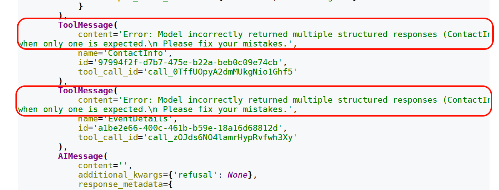

模型接收到錯誤反饋後，再次生成新的呼叫請求，直至成功或達到內部的最大重試次數。

ToolStrategy中自定義的tool_message_content控制的是成功後的訊息內容，不影響錯誤訊息內容。

**2）handle_errors設定為False**

執行後結果如下：

```
MultipleStructuredOutputsError: Model incorrectly returned multiple structured responses (ContactInfo, EventDetails) when only one is expected.
During task with name 'model' and id 'db9a512a-d2a9-f6e4-0051-fc5703dcb9c0'
```

**3）handle_errors設定為“請檢查輸入資料**”

執行後結果如下：

```python
}
{
 'messages': [
     HumanMessage(
         content='請提取以下文字中內容：姓名：張三，電子郵箱：zhang3@atguigu.com，活動名稱：公司年會，活動日期：
2026-07-15',
         additional_kwargs={},
         response_metadata={},
         id='fc016142-2bba-4d7d-ae9d-a049d89339bb'
     ),
     AIMessage(
         content='',
         additional_kwargs={'refusal': None},
         response_metadata={
             'token_usage': {
                 'completion_tokens': 71,
                 'prompt_tokens': 208,
                 'total_tokens': 279,
                 'completion_tokens_details': {
                     'accepted_prediction_tokens': 0,
                     'audio_tokens': 0,
                     'reasoning_tokens': 0,
                     'rejected_prediction_tokens': 0
                 },
                 'prompt_tokens_details': {'audio_tokens': 0, 'cached_tokens': 0},
                 'latency_checkpoint': {
                     'engine_tbt_ms': 3,
                     'engine_ttft_ms': 33,
                     'engine_ttlt_ms': 276,
                     'pre_inference_ms': 88,
                     'service_tbt_ms': 3,
                     'service_ttft_ms': 375,
                     'service_ttlt_ms': 609,
                     'total_duration_ms': 531,
                     'user_visible_ttft_ms': 288
                 }
             },
             'model_provider': 'openai',
             'model_name': 'gpt-5.4-mini-2026-03-17',
             'system_fingerprint': None,
             'id': 'chatcmpl-DmaeBotSr05l6BGYZkf2AfZiXCW4j',
             'service_tier': 'default',
             'finish_reason': 'tool_calls',
             'logprobs': None
         },
         id='lc_run--019e8c75-b72e-7121-8492-c4850c549ba7-0',
         tool_calls=[
             {
                 'name': 'ContactInfo',
                 'args': {'name': '張三', 'email': 'zhang3@atguigu.com'},
                 'id': 'call_NBLcCvMstWj1CK8PiOJ3yH4Z',
                 'type': 'tool_call'
             },
             {
                 'name': 'EventDetails',
                 'args': {'event_name': '公司年會', 'date': '2026-07-15'},
                 'id': 'call_74mfheDESm2LsUcO2SpC9rRD',
                 'type': 'tool_call'
             }
         ],
         invalid_tool_calls=[],
         usage_metadata={
             'input_tokens': 208,
             'output_tokens': 71,
             'total_tokens': 279,
             'input_token_details': {'audio': 0, 'cache_read': 0},
             'output_token_details': {'audio': 0, 'reasoning': 0}
         }
     ),
     ToolMessage(
         content='請檢查輸入資料',
         name='ContactInfo',
         id='e4c86dc2-c481-489b-b47a-a3a4a1c6fc17',
         tool_call_id='call_NBLcCvMstWj1CK8PiOJ3yH4Z'
     ),
     ToolMessage(
         content='請檢查輸入資料',
         name='EventDetails',
         id='d7675b23-eb5e-4bc4-adcc-7a1d82399edf',
         tool_call_id='call_74mfheDESm2LsUcO2SpC9rRD'
     ),
     AIMessage(
         content='',
         additional_kwargs={'refusal': None},
         response_metadata={
             'token_usage': {
                 'completion_tokens': 71,
                 'prompt_tokens': 303,
                 'total_tokens': 374,
                 'completion_tokens_details': {
                     'accepted_prediction_tokens': 0,
                     'audio_tokens': 0,
                     'reasoning_tokens': 0,
                     'rejected_prediction_tokens': 0
                 },
                 'prompt_tokens_details': {'audio_tokens': 0, 'cached_tokens': 0},
                 'latency_checkpoint': {
                     'engine_tbt_ms': 3,
                     'engine_ttft_ms': 31,
                     'engine_ttlt_ms': 254,
                     'pre_inference_ms': 79,
                     'service_tbt_ms': 4,
                     'service_ttft_ms': 414,
                     'service_ttlt_ms': 623,
                     'total_duration_ms': 636,
                     'user_visible_ttft_ms': 335
                 }
             },
             'model_provider': 'openai',
             'model_name': 'gpt-5.4-mini-2026-03-17',
             'system_fingerprint': None,
             'id': 'chatcmpl-DmaeCOCB5Uxpn7FAtTGpNOPsBgSZm',
             'service_tier': 'default',
             'finish_reason': 'tool_calls',
             'logprobs': None
         },
         id='lc_run--019e8c75-c0c0-76f1-95cb-a350fc846794-0',
         tool_calls=[
             {
                 'name': 'ContactInfo',
                 'args': {'name': '張三', 'email': 'zhang3@atguigu.com'},
                 'id': 'call_jlVDo6MSOODjW3S6qQ2Rks47',
                 'type': 'tool_call'
             },
             {
                 'name': 'EventDetails',
                 'args': {'event_name': '公司年會', 'date': '2026-07-15'},
                 'id': 'call_0yyMPD4ff2P5BlB7tZP1g3lX',
                 'type': 'tool_call'
             }
         ],
         invalid_tool_calls=[],
         usage_metadata={
             'input_tokens': 303,
             'output_tokens': 71,
             'total_tokens': 374,
             'input_token_details': {'audio': 0, 'cache_read': 0},
             'output_token_details': {'audio': 0, 'reasoning': 0}
         }
     ),
     ToolMessage(
         content='請檢查輸入資料',
         name='ContactInfo',
         id='8fc7e28a-c20a-459b-a1cf-4975561d6037',
         tool_call_id='call_jlVDo6MSOODjW3S6qQ2Rks47'
     ),
     ToolMessage(
         content='請檢查輸入資料',
         name='EventDetails',
         id='620c3d86-ff48-4af4-aa81-07370d56c548',
         tool_call_id='call_0yyMPD4ff2P5BlB7tZP1g3lX'
     ),
     AIMessage(
         content='',
         additional_kwargs={'refusal': None},
         response_metadata={
             'token_usage': {
                 'completion_tokens': 71,
                 'prompt_tokens': 398,
                 'total_tokens': 469,
                 'completion_tokens_details': {
                     'accepted_prediction_tokens': 0,
                     'audio_tokens': 0,
                     'reasoning_tokens': 0,
                     'rejected_prediction_tokens': 0
                 },
                 'prompt_tokens_details': {'audio_tokens': 0, 'cached_tokens': 0},
                 'latency_checkpoint': {
                     'engine_tbt_ms': 4,
                     'engine_ttft_ms': 46,
                     'engine_ttlt_ms': 310,
                     'pre_inference_ms': 128,
                     'service_tbt_ms': 3,
                     'service_ttft_ms': 487,
                     'service_ttlt_ms': 687,
                     'total_duration_ms': 571,
                     'user_visible_ttft_ms': 359
                 }
             },
             'model_provider': 'openai',
             'model_name': 'gpt-5.4-mini-2026-03-17',
             'system_fingerprint': None,
             'id': 'chatcmpl-DmaeDvP6HV3Zn4eEv5fRqEXV92Nhy',
             'service_tier': 'default',
             'finish_reason': 'tool_calls',
             'logprobs': None
         },
         id='lc_run--019e8c75-c65d-7d42-881f-3557838a3f03-0',
         tool_calls=[
             {
                 'name': 'ContactInfo',
                 'args': {'name': '張三', 'email': 'zhang3@atguigu.com'},
                 'id': 'call_o935XfYmmwgt5ZimBJVg8fS7',
                 'type': 'tool_call'
             },
             {
                 'name': 'EventDetails',
                 'args': {'event_name': '公司年會', 'date': '2026-07-15'},
                 'id': 'call_loG60u2yeX3cSToqvEwjG4DI',
                 'type': 'tool_call'
             }
         ],
         invalid_tool_calls=[],
         usage_metadata={
             'input_tokens': 398,
             'output_tokens': 71,
             'total_tokens': 469,
             'input_token_details': {'audio': 0, 'cache_read': 0},
             'output_token_details': {'audio': 0, 'reasoning': 0}
         }
     ),
     ToolMessage(
         content='請檢查輸入資料',
         name='ContactInfo',
         id='6a5dc8d1-1a9f-4934-83a2-6dc037296b69',
         tool_call_id='call_o935XfYmmwgt5ZimBJVg8fS7'
     ),
     ToolMessage(
         content='請檢查輸入資料',
         name='EventDetails',
         id='fc8b46e9-cfb9-42cb-b92f-97c650f91937',
         tool_call_id='call_loG60u2yeX3cSToqvEwjG4DI'
     ),
     AIMessage(
         content='',
         additional_kwargs={'refusal': None},
         response_metadata={
             'token_usage': {
                 'completion_tokens': 29,
                 'prompt_tokens': 493,
                 'total_tokens': 522,
                 'completion_tokens_details': {
                     'accepted_prediction_tokens': 0,
                     'audio_tokens': 0,
                     'reasoning_tokens': 0,
                     'rejected_prediction_tokens': 0
                 },
                 'prompt_tokens_details': {'audio_tokens': 0, 'cached_tokens': 0},
                 'latency_checkpoint': {
                     'engine_tbt_ms': 4,
                     'engine_ttft_ms': 39,
                     'engine_ttlt_ms': 166,
                     'pre_inference_ms': 126,
                     'service_tbt_ms': 5,
                     'service_ttft_ms': 405,
                     'service_ttlt_ms': 525,
                     'total_duration_ms': 414,
                     'user_visible_ttft_ms': 279
                 }
             },
             'model_provider': 'openai',
             'model_name': 'gpt-5.4-mini-2026-03-17',
             'system_fingerprint': None,
             'id': 'chatcmpl-DmaeF5dnz4cKcsowkMwqaysAyy4s2',
             'service_tier': 'default',
             'finish_reason': 'tool_calls',
             'logprobs': None
         },
         id='lc_run--019e8c75-cce4-7403-81f6-dbd0cd24ce63-0',
         tool_calls=[
             {
                 'name': 'ContactInfo',
                 'args': {'name': '張三', 'email': 'zhang3@atguigu.com'},
                 'id': 'call_FXgGHA6Q2eYrXIqtyp7rLb37',
                 'type': 'tool_call'
             }
         ],
         invalid_tool_calls=[],
         usage_metadata={
             'input_tokens': 493,
             'output_tokens': 29,
             'total_tokens': 522,
             'input_token_details': {'audio': 0, 'cache_read': 0},
             'output_token_details': {'audio': 0, 'reasoning': 0}
         }
     ),
     ToolMessage(
         content='提取完成！',
         name='ContactInfo',
         id='ff4ca4b0-eec0-485a-972b-4fc07fb0f799',
         tool_call_id='call_FXgGHA6Q2eYrXIqtyp7rLb37'
     )
 ],
 'structured_response': ContactInfo(name='張三', email='zhang3@atguigu.com')
}
```

以上程式碼中注意如下幾點：

1. ToolStrategy允許指定多個型別“Union[ContactInfo, EventDetails]”這種寫法，但是最終只會轉換成一種結構化型別輸出。

2. 當ToolStrategy透過“Union[ContactInfo, EventDetails]”指定多個型別時，在內部呼叫生成結構化型別工具會報錯。此時：

  - handle_errors=True（預設值）開始發揮作用，系統會生成一個ToolMessage，明確告訴LLM“Error: Model incorrectly returned multiple structured responses (ContactInfo, EventDetails) when only one is expected.”，大模型收到這個精準的反饋後，會重新進行推理，最終選擇並輸出一個最符合要求的Schema。

  - 如果handle_errors 設定為False，執行程式碼過程直接報錯。

3. 當格式化輸出有錯誤時，Agent內部會進行工具呼叫重試，直到符合要求格式化輸出前， `可能會進行多次重試` 。

**情況2：設定為指定異常型別**

預設情況下，LangChain會處理結構化輸出處理時丟擲的兩類異常：

**1. MultipleStructuredOutputsError**

多結構化輸出錯誤，當返回的工具呼叫**請求數量大於1**時，丟擲該異常，預設情況下LangChain會攔截異常並提醒模型重試。

**2. StructuredOutputValidationError**

輸出結構化驗證錯誤，當輸出格式不符合結構化要求時，丟擲上述異常。

預設情況下LangChain會攔截該異常並自動重試。

```python
from pydantic import BaseModel, Field
from typing import Union
from langchain.agents import create_agent
from langchain.agents.structured_output import ToolStrategy, StructuredOutputValidationError,    MultipleStructuredOutputsError
from rich import print as rprint

class ContactInfo(BaseModel):
    """個人聯絡資訊"""
    name: str = Field(description="姓名")
    email: str = Field(description="電子郵箱")


class EventDetails(BaseModel):
    """活動詳情"""
    event_name: str = Field(description="活動名稱")
    date: str = Field(description="活動日期")


agent = create_agent(
    model=model,
    response_format=ToolStrategy(
        Union[ContactInfo, EventDetails],
        tool_message_content="提取完成！",
        handle_errors=(MultipleStructuredOutputsError,StructuredOutputValidationError)
        # handle_errors=(StructuredOutputValidationError)
    )
)

result = agent.invoke({
    "messages": [{
        "role": "user",
        "content": f"請提取以下文字中內容：姓名：張三，電子郵箱：zhang3@atguigu.com，活動名稱：公司年會，活動日期：2026-07-15"
    }]
})

rprint(result)
```

輸出如下：

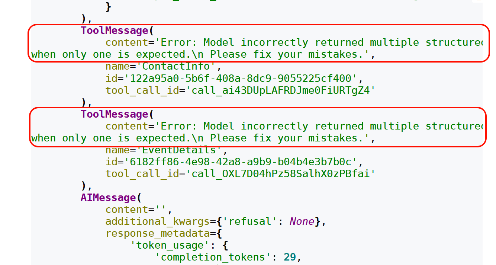

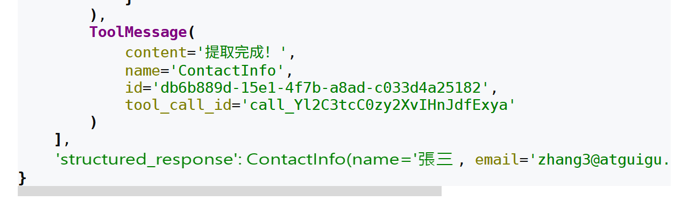

**情況3：設定為自定義錯誤處理函式**

指定異常處理函式並返回字串時，LangChain會在遇到異常時自動重試並將異常處理函式的返回值作為ToolMessage的內容。

我們也可以選擇在異常處理函式中丟擲異常。

```python
from pydantic import BaseModel, Field
from typing import Union
from langchain.agents import create_agent
from langchain.agents.structured_output import ToolStrategy, StructuredOutputValidationError,    MultipleStructuredOutputsError
from rich import print as rprint

# 自定義錯誤處理函式
def custom_error_handler(error: Exception) -> str:
    """自定義錯誤處理器"""
    error_str = str(error)

    print(f"捕獲到錯誤型別：{type(error).__name__}")
    print(f"錯誤詳情：{error_str}")

    if isinstance(error, StructuredOutputValidationError):
        return "資料格式有誤，請檢查欄位是否符合要求。"
    elif isinstance(error, MultipleStructuredOutputsError):
        return "檢測到多個響應，請選擇最相關的一個進行返回。"
    else:
        return f"Error: {error_str}"


class ContactInfo(BaseModel):
    """個人聯絡資訊"""
    name: str = Field(description="姓名")
    email: str = Field(description="電子郵箱")


class EventDetails(BaseModel):
    """活動詳情"""
    event_name: str = Field(description="活動名稱")
    date: str = Field(description="活動日期")


agent = create_agent(
    model=model,
    response_format=ToolStrategy(
        Union[ContactInfo, EventDetails],
        tool_message_content="提取完成！",
        handle_errors=custom_error_handler
    )
)

result = agent.invoke({
    "messages": [{
        "role": "user",
        "content": f"請提取以下文字中內容：姓名：張三，電子郵箱：zhang3@atguigu.com，活動名稱：公司年會，活動日期：2026-07-15"
    }]
})

rprint(result)
```

handle_errors指定自定義錯誤處理，執行後結果如下：

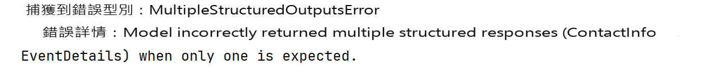

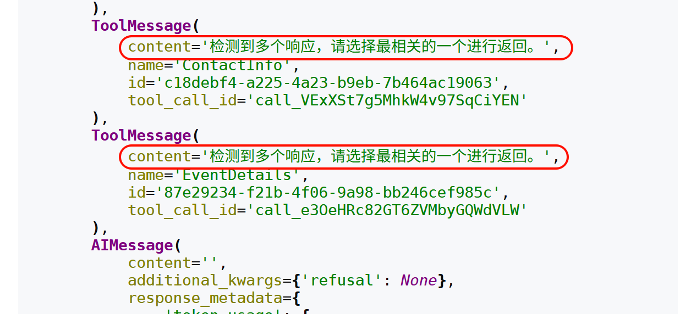

## 8、Agent的高階用法4：流式輸出及模式

### 8.1 流式輸出的說明

透過 `invoke` 呼叫Agent時，內部可能經歷多次呼叫，長時間看不到呼叫情況，使用者體驗不好，可以透過 `流式呼叫` （漸進式顯示輸出）最佳化使用者體驗， `實時顯示` Agent 執行過程中的更新。特別是在處理LLM 延遲時尤其有效。

**流式輸出好處**：

- 大型語言模型生成完整響應通常需要幾秒鐘時間，對於長輸出可能達到10-20 秒，使用者期望即時反饋， `流式傳輸讓等待過程更加可控` 。

- 相比非流式傳輸需要使用者長時間等待完整響應，流式傳輸可以立即顯示文字逐漸出現的效果， `大幅降低使用者的等待焦慮` 。

**設定方式**：

透過“ `agent.stream(stream_mode=指定模式)` ”來指定。具體模式有：values、updates（預設）、messages、custom、checkpoints、tasks、debug。

### 8.2 具體的輸出模式

#### 8.2.1 values輸出模式

當 `stream_mode` 設定為values模式時，每個步驟執行後，都會輸出完整的狀態資訊，適用於每一步都要獲取完整狀態、狀態持久化場景。

舉例：

```python
from langchain.agents import create_agent
from langchain.tools import tool
from typing import Dict, Any
from rich import print as rprint

@tool
def query_customer_data(customer_id: str) -> Dict[str, Any]:
    """
    查詢客戶基本資訊

    Args:
        customer_id: 客戶ID，用於唯一標識客戶

    Returns:
        包含客戶基本資訊的字典，如姓名、等級、加入日期等
    """
    # 模擬資料庫查詢
    return {"name": "張三","level": "VIP","join_date": "2023-01-15"}


@tool
def check_order_history(customer_id: str) -> Dict[str, Any]:
    """
    查詢客戶訂單歷史

    Args:
        customer_id: 客戶ID，用於唯一標識客戶

    Returns:
        包含客戶訂單歷史的字典，如總訂單數、總花費等
    """
    return {"total_orders": 15,"total_spent": 25800.00}


@tool
def get_current_promotions() -> Dict[str, Any]:
    """
    獲取當前可用促銷活動

    Returns:
        包含當前可用促銷活動的字典，如活動名稱、有效日期等
    """
    return {
        "promotions": ["老使用者優惠", "會員專屬折扣"],
        "valid_until": "2027-01-31"
    }


# 建立客戶服務Agent
customer_service_agent = create_agent(
    model=model,
    tools=[query_customer_data, check_order_history, get_current_promotions]
)


for chunk in customer_service_agent.stream(

        {"messages": [{"role": "user","content": "查詢客戶ID為 CUST123456 的個人資訊、歷史訂單和可用優惠"}]},
        stream_mode="values"
):
    rprint(chunk)
    print("-" * 50)
```

程式碼執行後示意結果如下：

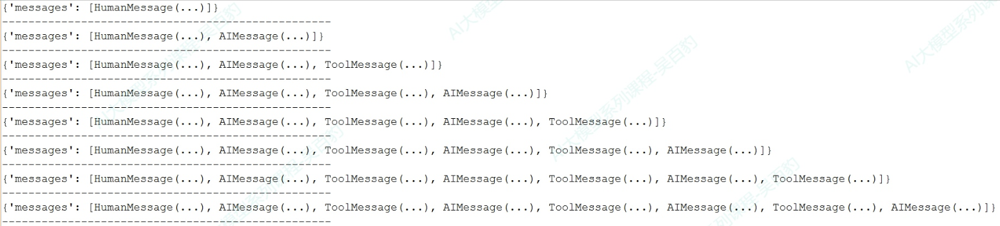

#### 8.2.2 updates輸出模式

這種模式就是預設模式。該模式中，每個步驟執行後，只增量更新狀態中發生變化的內容，用於監控Agent 執行進度，例如觀察Agent決定呼叫工具、工具執行結果等步驟。

程式碼如下：

```python
# 其他工具程式碼同上，保持不變
# ... ...
for chunk in customer_service_agent.stream(
        {"messages": [{"role": "user","content": "查詢客戶ID為 CUST123456 的完整資訊和可用優惠"}]},
        stream_mode="updates"
):
    rprint(chunk)
    print("-" * 50)
```

執行結果如下：

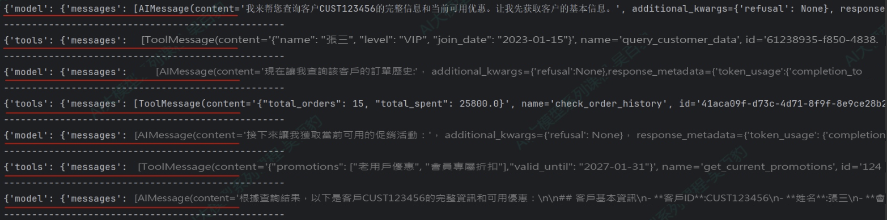

#### 8.2.3 messages輸出模式

該模式中會輸出流式返回的Token以及相關的後設資料（如：來自哪個節點），可以用在實現類似ChatGPT 的打字機效果場景，為聊天機器人等互動式應用提供最佳的實時體驗。

程式碼如下：

```python
# 其他工具程式碼同上，保持不變
# ... ...
for chunk in customer_service_agent.stream(
        {"messages": [{"role": "user","content": "查詢客戶ID為 CUST123456 的完整資訊和可用優惠"}]},
        stream_mode="messages"
):
    print(chunk)
    print("-" * 50)

    # print(chunk[0].content,end="",flush=True)
```

執行結果如下：

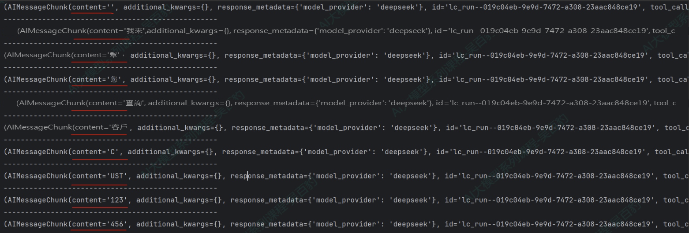

#### 8.2.4 tasks輸出模式

該模式會輸出當前task任務開始和結束的時間，包含任務的結果和錯誤資訊，該模式用於監控任務的生命週期。

程式碼如下：

```python
# 其他工具程式碼同上，保持不變
# ... ...
for chunk in customer_service_agent.stream(
        {"messages": [{"role": "user","content": "查詢客戶ID為 CUST123456 的完整資訊和可用優惠"}]},
        stream_mode="tasks"
):
    print(chunk)
    print("-" * 50)
```

執行結果如下：

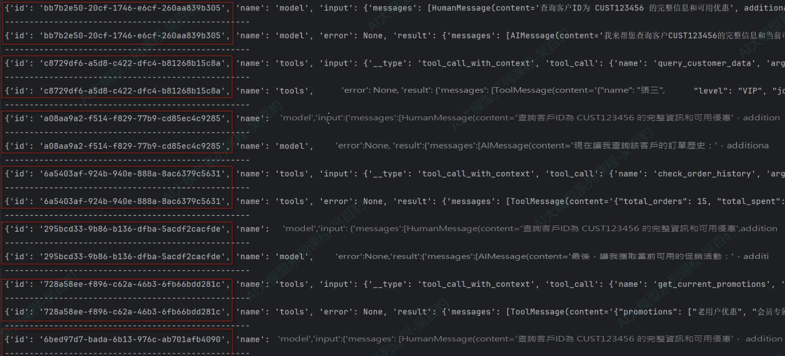

#### 8.2.5 debug輸出模式

該模式與tasks模式類似，比task模式多輸出任務步驟、時間戳、task型別（task/task_result），該模式用於除錯、監控task任務的生命週期。

程式碼如下：

```python
# 其他工具程式碼同上，保持不變
# ... ...
for chunk in customer_service_agent.stream(
        {"messages": [{"role": "user","content": "查詢客戶ID為 CUST123456 的完整資訊和可用優惠"}]},
        stream_mode="debug"
):
    print(chunk)
    print("-" * 50)
```

執行結果如下：

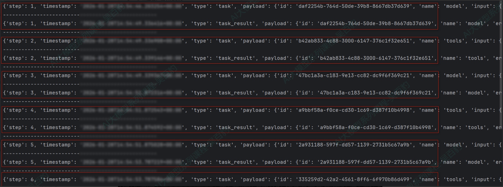

#### 8.2.6 checkpoints輸出模式

該模式中，每當檢查點（checkpoint）被建立時會觸發輸出，輸出包含檢查點中的狀態，用於需要狀態持久化、工作流恢復或分散式執行跟蹤的高階場景。

程式碼案例如下：

```python
from langgraph.checkpoint.memory import InMemorySaver

# 其他工具程式碼同上，保持不變
# ... ...
# 1. 建立記憶體檢查點儲存
checkpointer = InMemorySaver()

# 2. 建立Agent
customer_service_agent = create_agent(
    model=model,
    tools=[query_customer_data, check_order_history, get_current_promotions],
    checkpointer=checkpointer  # 啟用檢查點
)

# 3. 建立唯一的會話ID
config = {"configurable": {"thread_id": "session01"}}

# 4. 呼叫Agent
checkpoint_count = 0

# 使用checkpoints模式進行流式監控
for chunk in customer_service_agent.stream(
        {"messages": [{"role": "user","content": "查詢客戶ID為 CUST123456 的完整資訊和可用優惠"}]},
        config=config,
        stream_mode="checkpoints"
):
    checkpoint_count += 1
    print(f"檢查點 #{checkpoint_count}")
    print(chunk)
    print("-" * 50)
```

執行結果如下，每次輸出都會將相關MESSAGE追加到values.messages中。

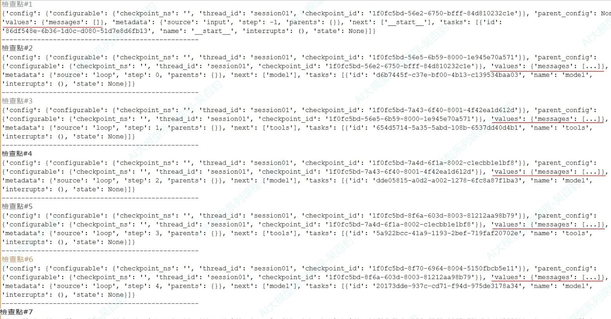

#### 8.2.7 custom輸出模式

開發者透過 `get_stream_writer` 在工具或節點內部 `自定義傳送的資料` ，用於 `輸出` 業務邏輯相關的進度資訊（如“已處理10/100條記錄”）、自定義日誌或指標。

舉例：生成銷售報告和庫存報告Agent

```python
from langchain.agents import create_agent
from langgraph.config import get_stream_writer
from langchain.tools import tool
import time

@tool
def generate_sales_report() -> str:
    """生成銷售報告"""
    writer = get_stream_writer()

    writer({"type": "生成銷售報告", "message": "開始生成銷售報告"})

    # 模擬資料處理
    for i in range(1, 4):
        time.sleep(0.5)
        writer({"type": "生成銷售報告","message": f"生成銷售報告進度百分比：{i * 25}%"})

    writer({"type": "生成銷售報告", "message": "報告生成完成"})

    return f"銷售報告：總收入150萬元，同比增長12%"


@tool
def generate_inventory_report() -> str:
    """生成庫存報告"""
    writer = get_stream_writer()
    writer("開始庫存分析...")
    time.sleep(0.5)
    writer("檢查當前庫存量...")
    time.sleep(0.5)
    writer("生成庫存報告...")

    return "當前庫存量為10000件，庫存充足，無異常"


# 建立報告生成agent
reporting_agent = create_agent(
    model=model,
    tools=[generate_sales_report, generate_inventory_report]
)

for chunk in reporting_agent.stream(
        {"messages": [{"role": "user","content": "生成銷售報告和庫存報告"}]},
        stream_mode="custom"
):
    print(chunk)
    print("-" * 50)
```

執行結果如下：

```
{'type': '生成銷售報告', 'message': '開始生成銷售報告'}
--------------------------------------------------
開始庫存分析...
--------------------------------------------------
{'type': '生成銷售報告', 'message': '生成銷售報告進度百分比：25%'}
--------------------------------------------------
檢查當前庫存量...
--------------------------------------------------
{'type': '生成銷售報告', 'message': '生成銷售報告進度百分比：50%'}
--------------------------------------------------
生成庫存報告...
--------------------------------------------------
{'type': '生成銷售報告', 'message': '生成銷售報告進度百分比：75%'}
--------------------------------------------------
{'type': '生成銷售報告', 'message': '報告生成完成'}
--------------------------------------------------
```

### 8.3 流式輸出模式總結

如下是LangChain Agent輸出模式對比：

| **模式** | **輸出內容** | **使用場景** |
|---|---|---|
| values | 每個步驟執行後，都會輸出完整的狀態資訊 | 適用於每一步都要獲取完整狀態、狀態持久化場景 |
| updates（預設） | 每個步驟執行後，只增量更新狀態中發生變化的內容 | 用於監控Agent 執行進度，例如觀察Agent決定呼叫工具、工具執行結果等步驟 |
| messages | 輸出流式返回的Token以及相關的後設資料（如：來自哪個節點model/tool） | 實現類似ChatGPT 的打字機效果，為聊天機器人等互動式應用提供最佳的實時體驗 |
| tasks | 輸出當前task任務開始和結束的時間，包含任務的結果和錯誤資訊 | 該模式用於監控任務的生命週期 |
| debug | 與tasks模式類似，比task模式多輸出任務步驟、時間戳、task型別<br>（task/task_result） | 該模式用於除錯、監控task任務的生命週期 |
| checkpoints | 當檢查點（checkpoint）被建立時會觸發輸出，輸出包含檢查點中的狀態 | 用於需要狀態持久化、工作流恢復或分散式執行跟蹤的高階場景 |
| custom | 透過get_stream_writer在工具或節點內部自定義傳送的資料 | 用於輸出業務邏輯相關的進度資訊（如“已處理10/100條記錄”）、自定義日誌或指標 |

我們可以根據不同的目標來選擇不同的輸出模式。例如：

- 實現 `實時對話互動` ，優先選擇messages模式；

- 觀察Agent的 `思考與執行步驟` ，優先選擇updates模式；

- 需要檢視 `每一步狀態` 優先選擇values/tasks/debug模式；

- 在工具執行時 `輸出自定義業務` 日誌優先選擇custom模式。

此外，以上這些模式還可以組合使用，例如，可以同時指定 `stream_mode=[“tasks”，“updates”]` ，這樣在同一個迴圈裡 `既能` 檢視Agent task任務執行內容， `又能` 顯示Agent每步的更新。

舉例：

```python
# 其他工具程式碼同上，保持不變
# ... ...
# 建立客戶服務Agent
customer_service_agent = create_agent(
    model=model,
    tools=[query_customer_data, check_order_history, get_current_promotions]
)


for stream_mode, chunk in customer_service_agent.stream(
        {"messages": [{"role": "user","content": "查詢客戶ID為 CUST123456 的完整資訊和可用優惠"}]},
        stream_mode=["tasks", "updates"]
):
    print(f"當前流模式: {stream_mode}, 當前資料: {chunk}")
    print("-" * 50)
```

當指定多模式後，可以透過“ `for stream_mode, chunk in customer_service_agent.stream...` ”來遍歷dict，dict的key(stream_mode)是執行模式，value(chunk)是該模式輸出的結果。程式碼執行輸出結果如下：

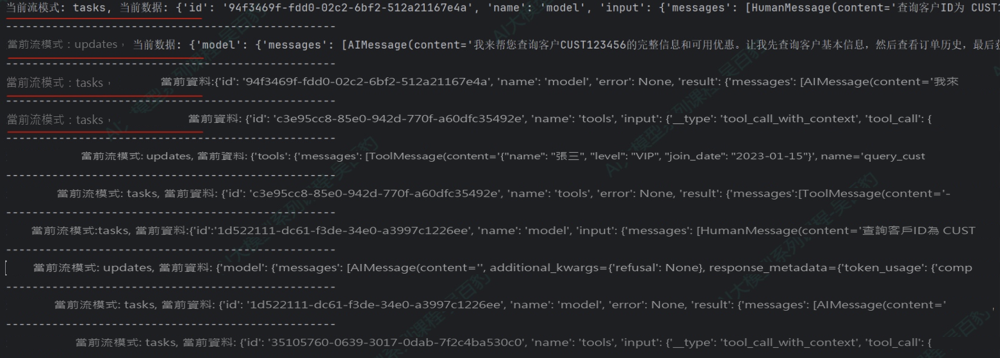

## 9、實戰：多功能智慧助手

專案需求：開發一個多功能智慧助手，支援：

1. **天氣查詢**：查詢城市天氣  
2. **數學計算**：複雜數學運算  
3. **時間查詢**：獲取當前時間、日期計算  
4. **貨幣轉換**：多種貨幣之間轉換  
5. **資訊搜尋**：搜尋產品、新聞等資訊

### 9.1 模型的初始化

```python

# 1、模型的初始化
import os
from dotenv import load_dotenv
from langchain.chat_models import init_chat_model

# 從.env檔案中載入環境變數
load_dotenv(override=True)

# 模型的初始化
model = init_chat_model(
    model="gpt-5.4-mini",
    model_provider="openai",
    api_key=os.getenv("CLOSEAI_API_KEY"),
    base_url=os.getenv("CLOSEAI_BASE_URL")
)
```

### 9.2 工具的定義

```python
# ==================== 工具定義 ====================
from langchain_core.tools import tool
import math
from datetime import datetime, timedelta

@tool
def get_weather(city: str) -> str:
    """獲取指定城市的實時天氣資訊

    支援中國主要城市的天氣查詢

    Args:
        city: 城市名稱，如"北京"、"上海"、"深圳"等

    Returns:
        包含溫度、天氣狀況、空氣質量的詳細資訊

    Examples:
        get_weather("北京") 返回 "多雲，15-22℃，空氣質量良"
    """
    weather_db = {
        "北京": "多雲，15-22℃，空氣質量良，溼度 45%",
        "上海": "晴天，18-25℃，空氣質量優，溼度 60%",
        "深圳": "小雨，22-28℃，空氣質量優，溼度 75%",
        "成都": "陰天，16-23℃，空氣質量良，溼度 70%",
        "杭州": "晴天，17-24℃，空氣質量優，溼度 55%",
        "廣州": "多雲，21-29℃，空氣質量良，溼度 72%"
    }

    result = weather_db.get(city)
    if result:
        return f"{city}：{result}"
    else:
        return f"抱歉，暫不支援查詢{city}的天氣資訊。當前支援：北京、上海、深圳、成都、杭州、廣州"

@tool
def calculator(expression: str) -> str:
    """執行數學計算

    支援基本運算子（+、-、*、/、**）和常用數學函式

    Args:
        expression: 數學表示式，可以包含：
            - 基本運算：2 + 3, 10 * 5, 100 / 4
            - 冪運算：2 ** 10
            - 函式：sqrt(16), abs(-5), pow(2, 3)

    Returns:
        計算結果或錯誤資訊

    Examples:
        calculator("2 + 3 * 4") 返回 "14"
        calculator("sqrt(16)") 返回 "4.0"
    """
    try:
        # 安全的數學運算環境
        safe_functions = {
            "sqrt": math.sqrt,
            "pow": pow,
            "abs": abs,
            "round": round,
            "sin": math.sin,
            "cos": math.cos,
            "tan": math.tan,
            "log": math.log,
            "pi": math.pi,
            "e": math.e
        }

        result = eval(expression, {"__builtins__": {}}, safe_functions)
        return f"{expression} = {result}"
    except Exception as e:
        return f"計算出錯：{str(e)}\n提示：請檢查表示式格式，支援的函式有 sqrt, abs, pow, sin, cos, tan, log"

@tool
def get_time_info(query_type: str = "current") -> str:
    """獲取時間相關資訊

    Args:
        query_type: 查詢型別
            - "current": 當前時間
            - "date": 今天日期
            - "tomorrow": 明天日期
            - "yesterday": 昨天日期
            - "weekday": 星期幾

    Returns:
        時間資訊字串

    Examples:
        get_time_info("current") 返回 "2025年1月25日 14:30:25"
        get_time_info("weekday") 返回 "星期六"
    """
    now = datetime.now()

    if query_type == "current":
        return now.strftime("當前時間：%Y年%m月%d日 %H:%M:%S")
    elif query_type == "date":
        return now.strftime("今天是：%Y年%m月%d日")
    elif query_type == "tomorrow":
        tomorrow = now + timedelta(days=1)
        return tomorrow.strftime("明天是：%Y年%m月%d日")
    elif query_type == "yesterday":
        yesterday = now - timedelta(days=1)
        return yesterday.strftime("昨天是：%Y年%m月%d日")
    elif query_type == "weekday":
        weekdays = ["星期一", "星期二", "星期三", "星期四", "星期五", "星期六", "星期日"]
        return f"今天是{weekdays[now.weekday()]}"
    else:
        return f"不支援的查詢型別：{query_type}。支援：current, date, tomorrow, yesterday, weekday"

@tool
def convert_currency(amount: float, from_curr: str, to_curr: str) -> str:
    """貨幣轉換工具
    支援主要貨幣之間的實時匯率轉換

    Args:
        amount: 金額數值
        from_curr: 源貨幣程式碼（CNY/USD/EUR/GBP/JPY/HKD）
        to_curr: 目標貨幣程式碼（CNY/USD/EUR/GBP/JPY/HKD）

    Returns:
        轉換結果

    Examples:
        convert_currency(100, "CNY", "USD") 返回 "100 CNY = 14.00 USD"
    """
    # 匯率表（相對於 CNY）
    exchange_rates = {
        "CNY": 1.0,      # 人民幣
        "USD": 0.14,     # 美元
        "EUR": 0.13,     # 歐元
        "GBP": 0.11,     # 英鎊
        "JPY": 20.8,     # 日元
        "HKD": 1.09      # 港幣
    }

    # 貨幣名稱
    currency_names = {
        "CNY": "人民幣", "USD": "美元", "EUR": "歐元",
        "GBP": "英鎊", "JPY": "日元", "HKD": "港幣"
    }

    from_curr = from_curr.upper()
    to_curr = to_curr.upper()

    if from_curr not in exchange_rates:
        return f"不支援的源貨幣：{from_curr}。支援的貨幣：CNY, USD, EUR, GBP, JPY, HKD"
    if to_curr not in exchange_rates:
        return f"不支援的目標貨幣：{to_curr}。支援的貨幣：CNY, USD, EUR, GBP, JPY, HKD"

    # 轉換邏輯：先轉為 CNY，再轉為目標貨幣
    cny_amount = amount / exchange_rates[from_curr]
    result_amount = cny_amount * exchange_rates[to_curr]

    from_name = currency_names[from_curr]
    to_name = currency_names[to_curr]

    return f"{amount} {from_name}（{from_curr}）= {result_amount:.2f} {to_name}（{to_curr}）"

@tool
def search_info(keyword: str, category: str = "all") -> str:
    """搜尋各類資訊

    Args:
        keyword: 搜尋關鍵詞
        category: 搜尋分類
            - "product": 搜尋產品
            - "news": 搜尋新聞
            - "all": 搜尋所有

    Returns:
        搜尋結果
    """
    # 模擬資料庫
    products = {
        "手機": "iPhone 15 (¥5999), 小米14 (¥3999), 華為Mate60 (¥6999)",
        "筆記本": "MacBook Pro (¥12999), ThinkPad X1 (¥9999), 華為MateBook (¥7999)",
        "耳機": "AirPods Pro (¥1999), Sony WH-1000XM5 (¥2499)"
    }

    news = {
        "AI": "1. GPT-5 即將釋出  2. AI 晶片市場增長 30%  3. 新AI法規出臺",
        "科技": "1. 量子計算新突破  2. 6G 技術測試  3. 新能源汽車銷量創新高"
    }

    results = []

    if category in ["product", "all"]:
        for key, value in products.items():
            if keyword in key:
                results.append(f"【產品】{key}：{value}")

    if category in ["news", "all"]:
        for key, value in news.items():
            if keyword in key or keyword in value:
                results.append(f"【新聞】{key} 相關：{value}")

    if results:
        return "\n".join(results)
    else:
        return f"未找到關於 '{keyword}' 的{category}資訊"
```

### 9.3 agent的建立

```python
from langchain.agents import create_agent


class SmartAssistant:
    """多功能智慧助手"""
    def __init__(self):
        # 初始化模型
        self.model = model

        # 工具列表
        self.tools = [
            get_weather,
            calculator,
            get_time_info,
            convert_currency,
            search_info
        ]

        # 系統提示詞
        system_prompt = """你是一個多功能智慧助手，可以幫助使用者：

          🌤 查詢天氣：使用 get_weather 工具
          🔢 數學計算：使用 calculator 工具
          ⏰ 時間查詢：使用 get_time_info 工具
          💱 貨幣轉換：使用 convert_currency 工具
          🔍 資訊搜尋：使用 search_info 工具

          重要提示：
          1. 仔細閱讀使用者問題，確定需要使用哪個工具
          2. 如果需要多個工具，按順序呼叫
          3. 總是用友好、專業的語氣回答
          4. 如果工具返回了資料，要用通俗易懂的語言解釋給使用者
          5. 如果無法完成任務，誠實地告訴使用者原因

          請始終使用中文回答。"""

        # ✅ 建立 agent
        self.agent = create_agent(
            model=self.model,
            tools=self.tools,
            system_prompt=system_prompt
        )

        # 對話歷史
        self.messages = []

    def chat(self, user_input: str) -> str:
        """對話介面"""
        # 新增使用者訊息
        self.messages.append({"role": "user", "content": user_input})

        # 呼叫 agent
        result = self.agent.invoke({"messages": self.messages})

        # 更新訊息歷史
        self.messages = result["messages"]

        # 返回最後一條 AI 訊息
        for msg in reversed(self.messages):
            if msg.type == "ai" and msg.content:
                return msg.content

        return "抱歉，我無法處理這個請求。"

    def reset(self):
        """重置對話歷史"""
        self.messages = []
```

### 9.4 主程式

```python
# ==================== 主程式 ====================

def main():
    assistant = SmartAssistant()

    print("=" * 40)
    print("🤖 多功能智慧助手（LangChain 1.2）")
    print("=" * 40)
    print("\n我可以幫你：")
    print("  🌤  查詢天氣")
    print("  🔢 數學計算")
    print("  ⏰ 時間查詢")
    print("  💱 貨幣轉換")
    print("  🔍 資訊搜尋")
    print("\n輸入 'quit' 退出，輸入 'reset' 重置對話\n")

    demos = [
        "北京今天天氣怎麼樣？",
        "幫我算一下 (25 + 17) * 3",
        "現在幾點了？",
        "100 美元等於多少人民幣？"
    ]

    for demo in demos:
        print(f"👤 {demo}")
        response = assistant.chat(demo)
        print(f"🤖 {response}\n")

    # 重置對話
    assistant.reset()

    # 互動模式
    print("=" * 40)
    print("💬 進入互動模式")
    print("=" * 40)

    while True:
        user_input = input("\n👤 你: ")

        if user_input.lower() == 'quit':
            print("再見！👋")
            break

        if user_input.lower() == 'reset':
            assistant.reset()
            print("✅ 對話已重置")
            continue

        if not user_input.strip():
            continue

        # 呼叫助手
        response = assistant.chat(user_input)
        print(f"🤖 助手: {response}")

if __name__ == "__main__":
    main()
```

輸出：

```
========================================
🤖 多功能智慧助手（LangChain 1.2）
========================================

我可以幫你：
🌤  查詢天氣
🔢 數學計算
⏰ 時間查詢
💱 貨幣轉換
🔍 資訊搜尋

輸入 'quit' 退出，輸入 'reset' 重置對話

👤 北京今天天氣怎麼樣？
🤖 北京今天天氣是：**多雲，15–22℃**，**空氣質量良**，溼度 **45%**。
整體來說比較適合外出，建議穿**輕薄外套**會更舒服。

👤 幫我算一下 (25 + 17) * 3
🤖 計算結果是：**126**。

👤 現在幾點了？
🤖 現在是：**2026年06月03日 19:45:40**。

👤 100 美元等於多少人民幣？
🤖 **100 美元（USD）約等於 714.29 人民幣（CNY）**。

========================================
💬 進入互動模式
========================================
再見！👋
```
