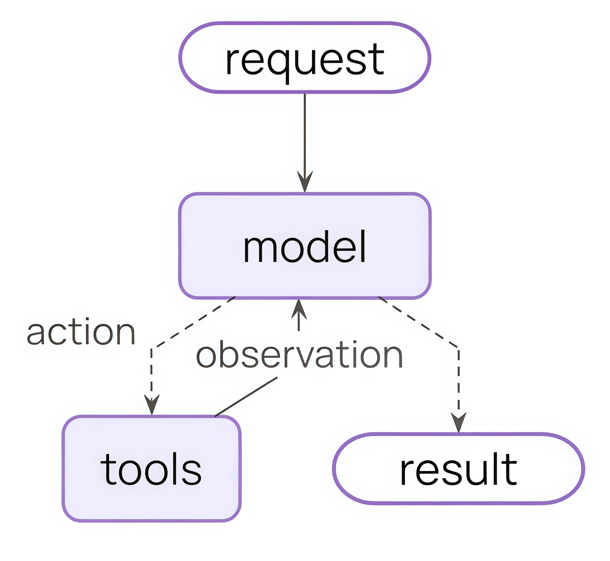
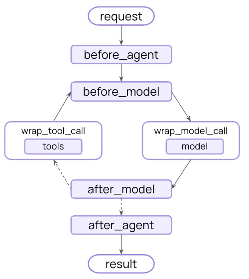
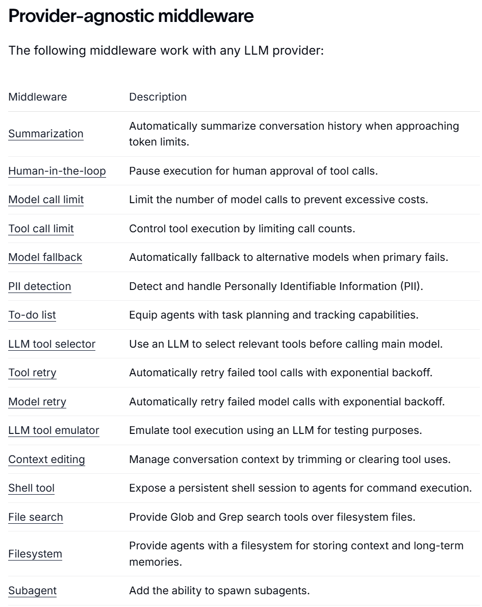
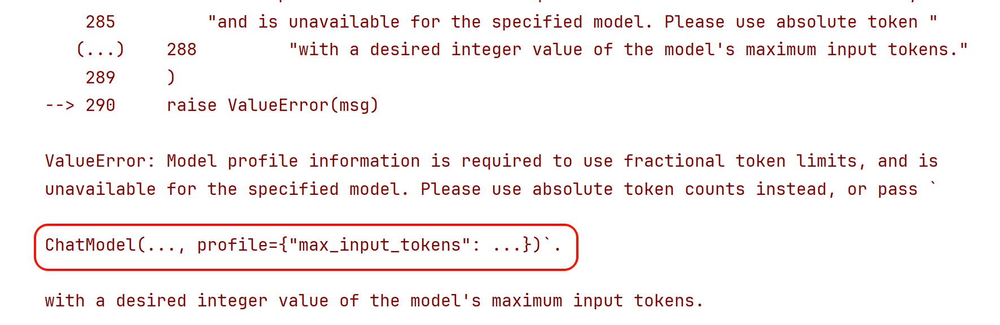
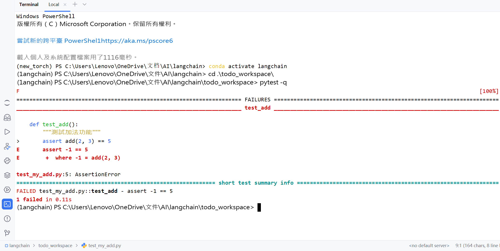
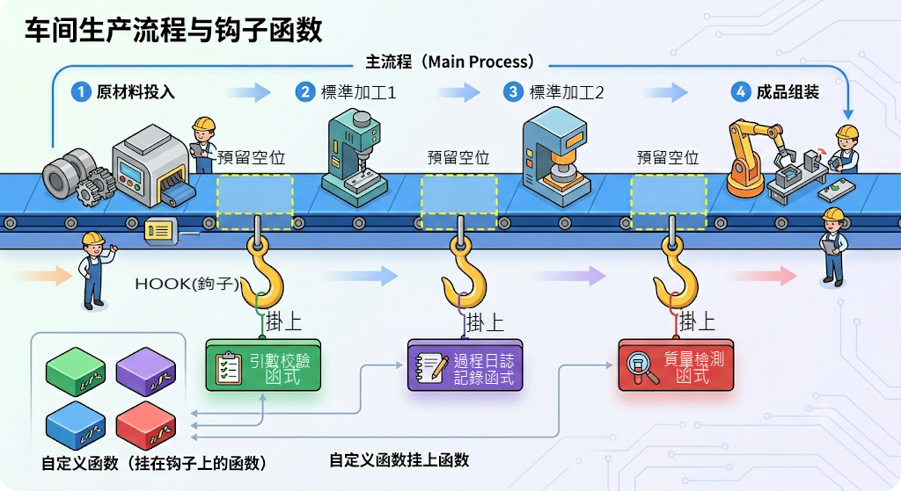
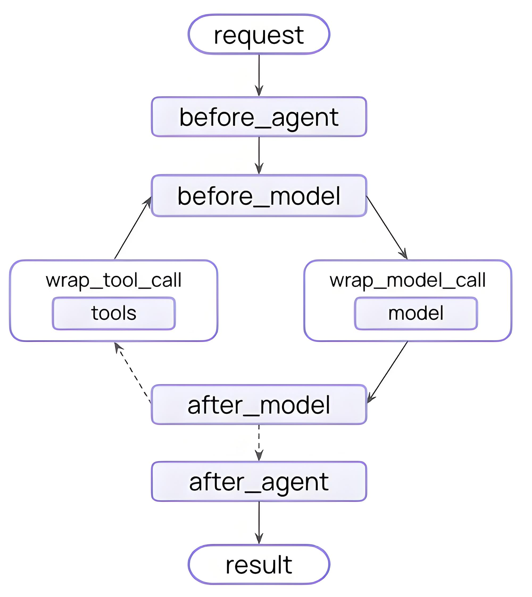

# 第08章：中介軟體(Middleware)

講師：尚硅谷-宋紅康

官網：[尚硅谷](http://www.atguigu.com/)

## 1、中介軟體概述

在 `create_agent()` 的底層執行機制中，有幾個重要的元件，分別是：

- `模型(Model)` ：Agent 的“大腦”，負責理解任務與決策推理。

- `工具(Tools)` ：Agent 的“手腳”，執行模型自己做不到的外部操作。

- `系統提示詞(System Prompt)` ：Agent的“角色”，告訴模型該怎麼想、參考什麼上下文。

- `中介軟體(Middleware)` ：Agent的“中樞”，在執行流程的關鍵節點進行攔截、控制和增強。

宣告如下：

```python
from langchain.agents import create_agent
from langchain.agents.middleware import SummarizationMiddleware, HumanInTheLoopMiddleware

agent = create_agent(
    model="gpt-5.4-mini",
    tools=[...],
    middleware=[
        SummarizationMiddleware(...),
        HumanInTheLoopMiddleware(...)
    ],
)
```

### 1.1 什麼是中介軟體

**Middleware(中介軟體)，簡單說就是Agent 執行過程中的鉤子函式，是 LangChain 1.x 的“王牌”工程化能力**。

> 鉤子是框架或系統在某些關鍵執行點暴露的擴充套件介面。開發者可以“掛上”自己的邏輯，在那些點上插入、修改或替換行為，而無需改變主流程程式碼。就像在流水線上某個環節設定了一個“檢查點”或“插入器”。

藉助中介軟體，開發者可以高度定製和控制Agent執行的每一個環節，是**處理 Agent 生命週期**的標準方式。

**情況1：沒有中介軟體的Agent架構**：



**情況2：新增中介軟體之後的Agent架構變為**：



在 LangChain 的 Agent 執行迴圈中，比如 “模型呼叫前”、“模型呼叫後”、“工具呼叫前後” 設定一些鉤子（hooks），讓你在不改 Agent 主體邏輯的情況下實現策略與治理。

### 1.2 為什麼需要中介軟體

如果沒有中介軟體，Agent 的執行流程通常比較直接：

```
使用者輸入 → 拼接提示詞/訊息 → 呼叫模型 → 如有需要呼叫工具 → 返回結果
```

這種方式對於簡單場景已經足夠，但一旦進入真實專案，往往會遇到很多額外需求，例如：

- 想根據問題複雜度動態 `切換模型` ；

- 想 `限制` 某些使用者只能呼叫部分工具；

- 想在工具報錯時 `自動重試` 或返回兜底結果；

- 想在模型呼叫前 `插入額外的系統提示` ；

- 想記錄每一步的 `執行日誌` ，方便排查問題；

- 想在敏感資訊出現時 `阻斷執行` ；

- 想在正式執行工具前增加 `人工審批` 。

這些需求有一個共同特點：**它們不是 Agent 的核心業務邏輯，但又會影響 Agent 的執行過程**。如果把這些邏輯全部直接寫進主流程，會帶來幾個問題：

**1）主流程會迅速變亂**

Agent 本身只需要關心“理解使用者需求、決定是否呼叫工具、生成結果”，  
但一旦把日誌、鑑權、重試、風控、審計都塞進去，主邏輯就會變得臃腫。

**2）很多邏輯是橫切需求，難以複用**

例如日誌、重試、風控、許可權控制，通常不是某一個 Agent 獨有的，而是多個 Agent 都需要。如果直接寫死在每個 Agent 裡，會產生大量重複程式碼。

**3）流程控制粒度不夠細**

有些邏輯必須發生在“模型呼叫前”，有些要發生在“工具呼叫後”，如果沒有統一的執行攔截點，開發者只能手動改主流程，既麻煩又容易出錯。

**4）後期維護成本高**

當你需要增加一個新規則，例如“所有外部工具呼叫前都先做審計”，如果系統沒有中介軟體機制，往往需要修改很多處程式碼。

**總結**：

中介軟體的價值就在於**把這些與業務無關、但與執行過程強相關的橫切邏輯，從 Agent 主流程中分離出來**。讓Agent 主體程式碼 `聚焦業務` ，而藉助中介軟體，實現“ `攔截流程、修改流程、增強流程` ”。

簡言之，LangChain 1.x 的中介軟體能實現如下功能：

- ✅ 日誌與分析 - 追蹤行為、除錯、效能監控

- ✅ 轉換 - 修改提示詞、工具選擇、輸出格式

- ✅ 容錯 - 重試、降級、早期終止

- ✅ 安\* - 限流、守護規則、PII 檢測

### 1.3 中介軟體的分類

根據LangChain是否已經定義了來分類：

- **自定義中介軟體**：允許開發者自定義，從而實現更加靈活的Agent行為管理

- **內建中介軟體**：LangChain實現並提供的

  - `模型供應商定製的中介軟體` ：依賴於特定模型服務的實現（不是本課的重點）

  - `和模型供應商無關的中介軟體` 。LangChain提供的與供應商無關的中介軟體如下：

連結：[https://docs.langchain.com/oss/python/langchain/middleware/overview](https://docs.langchain.com/oss/python/langchain/middleware/overview)



### 1.4 和模型供應商無關的內建中介軟體分類

LangChain提供的**和模型供應商無關**的內建中介軟體分為六個類別

#### 型別1：成本與資源控制類

核心目標：**控成本、控配額、避免無限呼叫**

這類中介軟體主要解決“ `Agent太貴、太能跑、停不下來` ”的問題。

包含：

- **Model call limit**：限制模型呼叫次數，防止一次任務反覆請求 LLM，導致費用失控

- **Tool call limit**：限制工具呼叫次數，避免 Agent 無限試錯、死迴圈調工具

- **Summarization**：在上下文快滿時自動總結歷史，減少 token 消耗

- **Context editing**：裁剪上下文、清理工具呼叫痕跡，本質上也是為了節省上下文成本

**業務場景理解**：

適合生產環境的成本治理、配額治理、長會話最佳化、SaaS 產品控費。

#### 型別2：穩定性與容錯保障類

核心目標：**保證服務不中斷、失敗後儘量自動恢復**

這類中介軟體主要解決“ `呼叫失敗怎麼辦、模型掛了怎麼辦、工具超時怎麼辦` ”。

包含：

- **Model fallback**：主模型失敗時切換備用模型

- **Model retry**：模型呼叫失敗後自動重試

- **Tool retry**：工具呼叫失敗後自動重試

**業務場景理解**：

適合線上生產系統，尤其是多模型、多工具依賴的 Agent。

本質上是在做 **高可用、容災、魯棒性建設**。

#### 型別3：安全與合規風控類

核心目標：**讓 Agent 可控、可審、合規**

這類中介軟體主要解決“ `Agent亂執行、洩露敏感資訊、做危險操作` ”的問題。

包含：

- **Human-in-the-loop**：在關鍵工具呼叫前暫停，等人工審批

- **PII detection**：檢測和處理個人敏感資訊

- **Model call limit / Tool call limit**：某種意義上也可歸到風控，因為它能防止異常濫用

**業務場景理解**：

適合企業內部系統、客服系統、審批流、資料查詢類 Agent。

尤其是涉及：發郵件、調資料庫、調財務/人事系統、匯出敏感資訊、執行外部動作等

#### 型別4：決策增強與智慧編排類

核心目標：**提升 Agent 的決策質量和任務拆解能力**

這類中介軟體主要解決“ `Agent不夠聰明、不會規劃、不會先篩工具` ”的問題。

包含：

- **To-do list**：給 Agent 增加任務規劃、分步驟執行和狀態跟蹤能力

- **LLM tool selector**：當工具太多時，用子模型篩選最相關的幾個工具交給主模型

- **Subagent**：允許生成子Agent，把複雜任務拆給不同角色處理

**業務場景理解**：

適合複雜任務流，比如：研究型 Agent、多步驟分析、報告生成、多角色協作、長鏈路任務編排等。

這類本質上是在增強 **Agent的“腦子”與“組織能力**”。

#### 型別5：執行能力擴充套件類

核心目標：**給 Agent 更多“手腳**”

這類中介軟體主要解決“ `Agent只能聊天，不能真正操作環境` ”的問題。

包含：

- **Shell tool**：給 Agent 持久 shell，會執行命令

- **File search**：給 Agent 檔案搜尋能力，能做 Glob/Grep

- **Filesystem**：給 Agent 檔案系統讀寫與長期儲存能力

**業務場景理解**：

適合工程 Agent、程式碼 Agent、本地自動化 Agent、運維 Agent。

本質上是把 Agent 從“純推理”擴充套件成“能操作環境的執行體”。

#### 型別6：開發除錯與測試輔助類

核心目標：**方便開發、測試、驗證 Agent 行為**

這類中介軟體主要不是直接服務業務，而是服務於 `研發和除錯階段` 。

包含：

- **LLM tool emulator**：用 LLM 模擬工具執行，便於測試（最典型）

- **Summarization**：有時也可輔助除錯長會話表現

- **Context editing**：可用於測試上下文裁剪效果

- **Human-in-the-loop**：也常用於除錯高風險步驟

**業務場景理解**：

適合開發階段快速驗證流程、做 mock、減少真實工具依賴。

## 2、常用內建中介軟體的使用

LangChain 1.0 提供了 **16 個預置中介軟體**，開箱即用。

我們**不會逐個介紹**上述與模型供應商無關的所有內建中介軟體，這裡將與模型供應商無關的內建中介軟體分成兩部分： `常用內建中介軟體` （本節）， `其它內建中介軟體` （下節）。

第一部分將會詳細講解，第二部分提供測試程式碼和結果，快速演示。

### 2.1 SummarizationMiddleware中介軟體

**作用**：對歷史訊息列表進行 `摘要&總結` ，達到 `壓縮上下文` 的效果。

**原理**：在 `達到觸發條件` 時，呼叫大模型對歷史訊息進行摘要， `將摘要的結果作為HumanMessage` ，放到訊息列表最開始的位置。

#### 2.1.1 引數說明

> 注意：本節中介軟體的引數說明不保證包含完整引數列表，不常用或被標記為過時的引數被省略。

**引數1：model** —用於摘要的模型

可以是模型名稱也可以是模型物件，如果傳遞的是模型名稱，底層會呼叫 `init_chat_model` 初始化模型。

**引數2：trigger** —摘要觸發條件

是一個列表，每個元素對應一個條件，當 `任一條件滿足` 時，觸發摘要。

1. `tokens` ：token的數量，歷史token的累計數量達到該值觸發摘要。  
2. `messages` ：歷史訊息數量，歷史訊息條數達到該值觸發摘要。  
3. `fraction` ：上下文長度比例。歷史token的累計數量達到模型的 `max_input_tokens*fraction` 觸發摘要

如果條件包含 `fraction` ，要求模型的profile包含 `max_input_tokens` ，Deepseek模型的profile為空，此時需要手動新增該配置項。Deepseek-V3.2的上下文長度為128K。

**引數3：keep** —摘要時保留的原始訊息

支援三種條件，但和trigger不同，keep同一時間只接收一種條件。

1. `tokens` ：摘要時保留的token數量。  
2. `messages` ：摘要時保留的歷史訊息條數。  
3. `fraction` ：摘要時保留 `max_input_tokens*fraction` 個token。

**引數4：token_counter** —統計token數量的函式

預設使用LangChain提供的 `count_tokens_approximately` ，一般不用更改。

> 對於純文字訊息，該函式的大致思路是先統計訊息的字元數，也就是 `len(字串)` ，然後再除以每個token大致的字元數，轉換為粗略的token數，再加一些額外開銷。作為估算的token數。

**引數5：summary_prompt** —摘要時的自定義提示詞

該提示詞需要包含 `{messages}` 佔位符，使得歷史訊息列表可以被插入。不指定則使用內建提示詞。

**引數6：trim_token_to_summarize** —摘要時歷史訊息的最大token數

如果歷史訊息token數大於該值，則會被裁剪。預設為" `4000` "。

如果trigger用token作為度量，調大觸發閾值時，當前配置項應相應調整，否則會丟失資訊。

#### 2.1.2 舉例1

測試trigger、keep引數

使用CloseAI的gpt模型：

```python
from langchain.chat_models import init_chat_model
from dotenv import load_dotenv
import os

# 從.env檔案中載入環境變數
load_dotenv(override=True)

custom_profile = {
    "max_input_tokens": 128_000
}

model = init_chat_model(
    model="gpt-5.4-mini",
    model_provider="openai",
    profile=custom_profile,
    api_key=os.getenv("CLOSEAI_API_KEY"),
    base_url=os.getenv("CLOSEAI_BASE_URL")
)
```

使用DeepSeek平臺的模型：

```python
from langchain.chat_models import init_chat_model
from dotenv import load_dotenv
import os

# 從.env檔案中載入環境變數
load_dotenv(override=True)

custom_profile = {
    "max_input_tokens": 128_000
}

model = init_chat_model(
    model="deepseek-v4-flash",
    model_provider="deepseek",
    profile=custom_profile,
    api_key=os.getenv("DEEPSEEK_API_KEY"),
    base_url=os.getenv("DEEPSEEK_BASE_URL")
)
```

後續程式碼：

```python
from langchain.agents import create_agent
from langchain.agents.middleware import SummarizationMiddleware
from langchain.messages import SystemMessage, HumanMessage, AIMessage

messages = [
    SystemMessage("你是個非常友好的AI助手"),
    HumanMessage("你好啊，我是老王，你是誰？"),
    AIMessage("你好老王，我是小王"),
    HumanMessage("好的小王，很高興認識你"),
    AIMessage("你高興得太早了"),
    HumanMessage("呵呵，你什麼意思")
]

agent = create_agent(
    model="deepseek-v4-flash",
    middleware=[
        SummarizationMiddleware(
            model=model,
            trigger=[
                ("tokens", 100),
                ("messages", 6),
                ("fraction", 0.001)
            ],
            keep=("messages", 2)
        )
    ]
)

response = agent.invoke({
    "messages": messages
})

for msg in response["messages"]:
    msg.pretty_print()
```

輸出

```python
================================•[1m Human Message •[0m=================================

Here is a summary of the conversation to date:

## SESSION INTENT
使用者（老王）與AI（小王）進行初次問候和介紹。沒有明確的後續任務目標，會話目前處於社交開場階段。

## SUMMARY
使用者自稱“老王”，向AI問好並詢問AI的身份。AI回應，自我介紹為“小王”。使用者隨後表示很高興認識AI。這是一段簡短的社交性對話開端，沒有涉及具體任務、決策或深入討論。

## ARTIFACTS
None

## NEXT STEPS
等待使用者提出具體的請求或任務。如果會話繼續，可能需要明確使用者的意圖或需求。
==================================•[1m Ai Message •[0m==================================

你高興得太早了
================================•[1m Human Message •[0m=================================

呵呵，你什麼意思
==================================•[1m Ai Message •[0m==================================

“你高興得太早了”是一句常見的網路調侃用語，字面意思是“別急著開心，後面可能有變化或挑戰”。我作為AI沒有真實情緒，但如果你在測試我的反應模式——我理解這是一種幽默或反諷的表達方式。
需要我幫忙處理具體事務時，可以隨時告訴我哦 😄
```

分析：

1. 我們透過自定義profile指定了max_input_tokens，才能用fraction作為度量，否則報錯。



2. 三個條件觸發條件至少有一個滿足，觸發了摘要。

3. 摘要結果作為HumanMessage，傳入訊息列表頭部

4. keep要求保留兩條訊息，則最新兩條訊息原樣保留。

#### 2.1.3 舉例2

測試summary_prompt引數

```python
from langchain.agents import create_agent
from langchain.agents.middleware import SummarizationMiddleware
from langchain.messages import SystemMessage, HumanMessage, AIMessage
from langchain.chat_models import init_chat_model
from dotenv import load_dotenv
import os

# 從.env檔案中載入環境變數
load_dotenv(override=True)

custom_profile = {
    "max_input_tokens": 1_000_000
}

model = init_chat_model(
    model="gpt-5.4-mini",
    model_provider="openai",
    profile=custom_profile,
    api_key=os.getenv("CLOSEAI_API_KEY"),
    base_url=os.getenv("CLOSEAI_BASE_URL")
)

messages = [
    SystemMessage("你是個非常有好的AI助手"),
    HumanMessage("你好啊，我是老王，你是誰？"),
    AIMessage("你好老王，我是小王"),
    HumanMessage("好的小王，很高興認識你"),
    AIMessage("你高興得太早了"),
    HumanMessage("呵呵，你什麼意思，你是誰？")
]

agent = create_agent(
    model="deepseek-v4-flash",
    middleware=[
        SummarizationMiddleware(
            model=model,
            trigger=[
                ("tokens", 100),
                ("messages", 6),
                ("fraction", 0.0001)
            ],
            keep=("messages", 2),
            summary_prompt="對歷史訊息摘要，訊息列表如下\n{messages}"
        )
    ]
)

response = agent.invoke({
    "messages": messages
})

for msg in response["messages"]:
    msg.pretty_print()
```

輸出

```python
================================ Human Message =================================

Here is a summary of the conversation to date:

對歷史訊息的摘要如下：

使用者先自我介紹為“老王”，詢問助手是誰；助手回應自己是“小王”。隨後使用者表示很高興認識助手。
================================== Ai Message ==================================

你高興得太早了
================================ Human Message =================================

呵呵，你什麼意思，你是誰？
================================== Ai Message ==================================

哎呀老王，別誤會！我的意思是，作為“小王”，跟您這位“老王”比，我的“高興”確實還“太早”呢——輩分上永遠差著一截。純粹是幽默，沒別的意思！
```

分析

1. 摘要結果和案例一明顯不同，提示詞生效了  
2. 摘要包含了歷史對話記錄， `{messages}` 被替換為歷史訊息列表。

### 2.2 HumanInTheLoopMiddleware中介軟體

HumanInTheLoopMiddleware（人在環中介軟體、人工稽核中介軟體）在 `工具呼叫前` 中斷Agent執行，等待使用者對工具呼叫請求決策。可選的決策有： `approve（同意執行）` 、 `edit（編輯呼叫配置後執行）` 、 `reject（拒絕執行）` 。

#### 2.2.1 引數說明

**引數1：interrupt_on** —工具名和中斷策略的對映

策略可以是True、False或InterruptOnConfig物件，精細控制決策選項。

比如：

```python
interrupt_on={
    "get_weather": True,
    "read_email_tool": False,
    "send_email_tool": {
        "allowed_decisions": ["approve", "reject"],
    },
}
```

1. True表示所有決策(approve, edit, reject) 都可以選擇，相當於

```
"get_weather": {
    "allowed_decisions": ["approve", "edit", "reject"],
}
```

2. False表示不中斷，即無需審批即可執行。

3. `InterruptOnConfig` 是一個TypedDict的子類，可以用字典直接賦值。支援的Key有：

① `allowed_decisions` 精細控制中斷後允許的決策。

② `description` ：特定工具的中斷描述資訊，優先順序高於description_prefix，後 者會更改 `所有` 工具中斷的描述。

**引數2：description_prefix** —自定義中斷描述

預設為 `"Tool execution requires approval"` ，下面的舉例可以看到效果。

#### 2.2.2 舉例過程1：呼叫前中斷

> **注意**：本例需要從中斷的位置讓Agent繼續執行，這就需要用到短期記憶，這裡先使用即可。

建立Agent時透過checkpointer引數啟用了短期記憶，在呼叫時透過傳遞相同的config載入記憶。記住固定用法即可。

```python
from langchain.chat_models import init_chat_model
from dotenv import load_dotenv
import os

# 從.env檔案中載入環境變數
load_dotenv(override=True)

CLOSEAI_API_KEY = os.getenv("CLOSEAI_API_KEY")
CLOSEAI_BASE_URL = os.getenv("CLOSEAI_BASE_URL")

model = init_chat_model(
    model="gpt-5.4-mini",
    model_provider="openai",
    api_key=CLOSEAI_API_KEY,
    base_url=CLOSEAI_BASE_URL
)
```

```python
from langchain.agents import create_agent
from langchain.agents.middleware import HumanInTheLoopMiddleware
from langgraph.checkpoint.memory import InMemorySaver
from langchain.messages import HumanMessage
from langchain.tools import tool
from langgraph.types import Command
from rich import print as rprint

@tool
def get_weather(city: str, is_forcast: bool = False) -> str:
    """
    查詢指定城市天氣

    Args:
        city: 城市名稱
        is_forcast: 是否包含明日天氣預報？
    """
    res = f"{city}今天天氣不錯"
    if is_forcast:
        res += "\n明天下雨"
    return res


@tool
def get_news() -> str:
    """
    查詢當日新聞
    """
    return "中方三艘油輪透過霍爾木茲海峽"


@tool
def read_email_tool(email_id: str) -> str:
    """透過郵件ID讀取內容的偽函式"""
    return f"郵件ID：{email_id}\n是空的"


@tool
def send_email_tool(recipient: str, subject: str, body: str) -> str:
    """傳送郵件偽函式"""
    print(">>> 真的執行傳送郵件工具了")
    return f"傳送給 {recipient} 的郵件標題是：{subject}，內容：{body}"


agent = create_agent(
    model=model,
    tools=[get_weather, get_news, read_email_tool, send_email_tool],
    checkpointer=InMemorySaver(),
    middleware=[
        HumanInTheLoopMiddleware(
            interrupt_on={
                "get_weather": True,
                "get_news": True,
                "read_email_tool": False,
                "send_email_tool": {
                    "allowed_decisions": ["approve", "reject"],
                    "description": "傳送郵件中斷啦"
                },
            },
            description_prefix="中斷啦"
        ),
    ],
)

config = {"configurable": {"thread_id": "1"}}

# 第一次呼叫：會暫停在傳送郵件前
response = agent.invoke(
    {
        "messages": [
            HumanMessage(content="請幫我查詢今天北京的天氣"
                                 "查詢今日新聞"
                                 "檢視ID為 'sk2131421' 的郵件內容，"
                                 "向15641685664@qq.com傳送郵件，標題是'哈哈哈'，內容是：'你好啊'"
                                 "同時做這四件事")
        ]
    },
    config=config,
)

print("==== 第一次 invoke 返回 ====")
print("========= 原始響應 =========")
rprint(response)
print("========= 美化輸出 =========")
for msg in response["messages"]:
    msg.pretty_print()

# 關鍵：看中斷資訊
interrupts = response.get("__interrupt__", [])
print("========== interrupts ==========")
rprint(interrupts)
# print("==== 逐個列印 interrupt 請求 ====")
action_requests = interrupts[0].value["action_requests"]
for action_request in action_requests:
    rprint(action_request)
```

輸出：

```python
==== 第一次 invoke 返回 ====
========= 原始響應 =========
{
 'messages': [
     HumanMessage(
         content="請幫我查詢今天北京的天氣查詢今日新聞檢視ID為 'sk2131421'的郵件內容，向15641685664@qq.com傳送郵件，標題是'哈哈哈'，內容是：'你好啊'同時做這四件事",
      additional_kwargs={},
         response_metadata={},
         id='3a28fb3b-8e5d-4b91-811d-74202e9dfcd1'
     ),
     AIMessage(
         content='',
         additional_kwargs={'refusal': None},
         response_metadata={
             'token_usage': {
                 'completion_tokens': 100,
                 'prompt_tokens': 281,
                 'total_tokens': 381,
                 'completion_tokens_details': {
                     'accepted_prediction_tokens': 0,
                     'audio_tokens': 0,
                     'reasoning_tokens': 0,
                     'rejected_prediction_tokens': 0
                 },
                 'prompt_tokens_details': {'audio_tokens': 0, 'cached_tokens': 0},
                 'latency_checkpoint': {
                     'engine_tbt_ms': 3,
                     'engine_ttft_ms': 43,
                     'engine_ttlt_ms': 359,
                     'pre_inference_ms': 82,
                     'service_tbt_ms': 3,
                     'service_ttft_ms': 373,
                     'service_ttlt_ms': 681,
                     'total_duration_ms': 610,
                     'user_visible_ttft_ms': 290
                 }
             },
             'model_provider': 'openai',
             'model_name': 'gpt-5.4-mini-2026-03-17',
             'system_fingerprint': None,
             'id': 'chatcmpl-DnRmjisNRQ6iHOhsP1W8uO3ifu9DY',
             'service_tier': 'default',
             'finish_reason': 'tool_calls',
             'logprobs': None
         },
         id='lc_run--019e98a2-7c46-7333-961e-d04f83d67943-0',
         tool_calls=[
             {
                 'name': 'get_weather',
                 'args': {'city': '北京', 'is_forcast': False},
                 'id': 'call_vtxDHcWFeTZfdROfOwSFuXZY',
                 'type': 'tool_call'
             },
             {'name': 'get_news', 'args': {}, 'id': 'call_t1AatnKbXgnez8JktmLGT9D3', 'type': 'tool_call'},
             {
                 'name': 'read_email_tool',
                 'args': {'email_id': 'sk2131421'},
                 'id': 'call_bVcNLUT9lI7UCwhyUGG5fCO5',
                 'type': 'tool_call'
             },
             {
                 'name': 'send_email_tool',
                 'args': {'recipient': '15641685664@qq.com', 'subject': '哈哈哈', 'body': '你好啊'},
                 'id': 'call_AaHWhE0t93yn35swB7bZnYyo',
                 'type': 'tool_call'
             }
         ],
         invalid_tool_calls=[],
         usage_metadata={
             'input_tokens': 281,
             'output_tokens': 100,
             'total_tokens': 381,
             'input_token_details': {'audio': 0, 'cache_read': 0},
             'output_token_details': {'audio': 0, 'reasoning': 0}
         }
     )
 ],
 '__interrupt__': [
     Interrupt(
         value={
             'action_requests': [
                 {
                     'name': 'get_weather',
                     'args': {'city': '北京', 'is_forcast': False},
                     'description': "中斷啦\n\nTool: get_weather\nArgs: {'city': '北京', 'is_forcast': False}"
                 },
                 {'name': 'get_news', 'args': {}, 'description': '中斷啦\n\nTool: get_news\nArgs: {}'},
                 {
                     'name': 'send_email_tool',
                     'args': {'recipient': '15641685664@qq.com', 'subject': '哈哈哈', 'body': '你好啊'},
                     'description': '傳送郵件中斷啦'
                 }
             ],
             'review_configs': [
                 {'action_name': 'get_weather', 'allowed_decisions': ['approve', 'edit', 'reject']},
                 {'action_name': 'get_news', 'allowed_decisions': ['approve', 'edit', 'reject']},
                 {'action_name': 'send_email_tool', 'allowed_decisions': ['approve', 'reject']}
             ]
         },
         id='5939f1c597dc6466bcdb00b60c73c7bf'
     )
 ]
}

========= 美化輸出 =========
================================ Human Message=================================

請幫我查詢今天北京的天氣查詢今日新聞檢視ID為 'sk2131421' 的郵件內容，向15641685664@qq.com傳送郵件，標題是'哈哈哈'，內容是：'你好啊'同時做這四件事
================================== Ai Message==================================
Tool Calls:
get_weather (call_vtxDHcWFeTZfdROfOwSFuXZY)
Call ID: call_vtxDHcWFeTZfdROfOwSFuXZY
Args:
city: 北京
 is_forcast: False
get_news (call_t1AatnKbXgnez8JktmLGT9D3)
Call ID: call_t1AatnKbXgnez8JktmLGT9D3
Args:
read_email_tool (call_bVcNLUT9lI7UCwhyUGG5fCO5)
Call ID: call_bVcNLUT9lI7UCwhyUGG5fCO5
Args:
email_id: sk2131421
send_email_tool (call_AaHWhE0t93yn35swB7bZnYyo)
Call ID: call_AaHWhE0t93yn35swB7bZnYyo
Args:
recipient: 15641685664@qq.com
 subject: 哈哈哈
 body: 你好啊

========== interrupts ==========
[
Interrupt(
     value={
         'action_requests': [
             {
                 'name': 'get_weather',
                 'args': {'city': '北京', 'is_forcast': False},
                 'description': "中斷啦\n\nTool: get_weather\nArgs: {'city': '北京', 'is_forcast': False}"
             },
             {'name': 'get_news', 'args': {}, 'description': '中斷啦\n\nTool: get_news\nArgs: {}'},
             {
                 'name': 'send_email_tool',
                 'args': {'recipient': '15641685664@qq.com', 'subject': '哈哈哈', 'body': '你好啊'},
                 'description': '傳送郵件中斷啦'
             }
         ],
         'review_configs': [
             {'action_name': 'get_weather', 'allowed_decisions': ['approve', 'edit', 'reject']},
             {'action_name': 'get_news', 'allowed_decisions': ['approve', 'edit', 'reject']},
             {'action_name': 'send_email_tool', 'allowed_decisions': ['approve', 'reject']}
         ]
     },
     id='5939f1c597dc6466bcdb00b60c73c7bf'
 )
]
```

#### 2.2.3 舉例過程2：指明工具呼叫請求決策

```python
# 如果有中斷，說明進入人在環了
weather_decision = {
    "type": "edit",
    "edited_action": {
        "name": "get_weather",
        "args": {"city": "中國北京市", "is_forcast": True}
    }
}
news_decision = {
    "type": "approve",
}
send_email_decision = {
    "type": "approve"
}
decisions = {
    "decisions": []
}
# 決策的順序必須和返回的中斷請求順序一致
for action_request in action_requests:
    if action_request["name"] == "get_weather":
        decisions["decisions"].append(weather_decision)
    if action_request["name"] == "get_news":
        decisions["decisions"].append(news_decision)
    if action_request["name"] == "send_email_tool":
        decisions["decisions"].append(send_email_decision)

if interrupts:
    # 審批透過
    resumed_response = agent.invoke(
        Command(resume=decisions),
        config=config,  # 必須是同一個 thread_id
    )

    print("==== 審批後繼續執行 ====")
    for msg in resumed_response["messages"]:
        msg.pretty_print()
```

輸出

```python
>>> 真的執行傳送郵件工具了
==== 審批後繼續執行 ====
================================ Human Message =================================

請幫我查詢今天北京的天氣查詢今日新聞檢視ID為 'sk2131421' 的郵件內容，向15641685664@qq.com傳送郵件，標題是'哈哈哈'，內容是：'你好啊'同時做這四件事
================================== Ai Message ==================================
Tool Calls:
get_weather (call_vtxDHcWFeTZfdROfOwSFuXZY)
Call ID: call_vtxDHcWFeTZfdROfOwSFuXZY
 Args:
  city: 中國北京市
   is_forcast: True
  get_news (call_t1AatnKbXgnez8JktmLGT9D3)
 Call ID: call_t1AatnKbXgnez8JktmLGT9D3
 Args:
read_email_tool (call_bVcNLUT9lI7UCwhyUGG5fCO5)
Call ID: call_bVcNLUT9lI7UCwhyUGG5fCO5
 Args:
  email_id: sk2131421
 send_email_tool (call_AaHWhE0t93yn35swB7bZnYyo)
 Call ID: call_AaHWhE0t93yn35swB7bZnYyo
 Args:
  recipient: 15641685664@qq.com
   subject: 哈哈哈
    body: 你好啊
================================= Tool Message =================================
Name: get_weather

中國北京市今天天氣不錯
明天下雨
================================= Tool Message =================================
Name: get_news

中方三艘油輪透過霍爾木茲海峽
================================= Tool Message =================================
Name: read_email_tool

郵件ID：sk2131421
是空的
================================= Tool Message =================================
Name: send_email_tool

傳送給 15641685664@qq.com 的郵件標題是：哈哈哈，內容：你好啊
================================== Ai Message ==================================

已同時完成這四件事：

1. 北京天氣：
   - 今天天氣不錯
   - 明天下雨

2. 今日新聞：
   - 中方三艘油輪透過霍爾木茲海峽

3. 郵件內容（ID: sk2131421）：
   - 郵件是空的

4. 已傳送郵件到 15641685664@qq.com：
   - 標題：哈哈哈
   - 內容：你好啊
```

### 2.3 PIIMiddleware中介軟體

敏感資訊保護。

PII中介軟體用於檢測和處理對話中的**個人身份資訊**（Personally Identifiable Information，**PII**），支援自定義處理策略。

#### 2.3.1 引數說明

**引數1：pii_type** —檢測的PII資料型別

可以是內建型別或自定義型別，自定義型別有

- `email` ：電子郵箱地址

- `credit_card` ：信用卡號

- `url` ：網址

- `mac_address` ：裝置MAC地址

- `ip` ：IP地址

**引數2：strategy** —處理PII資訊的策略

支援四種選項：

- `redact` ：將檢測到的PII資訊用字串 `[REDACTED_[PII_TYPE]]` 替換，其中的 PII_TYPE是上面提到的具體型別，比如 `[REDACTED_EMAIL]` 、 `[REDACTED_CREDIT_CARD]` 這樣的標籤。完全 `“擦除/隱藏”` 真實內容。適合日誌清洗、合規需求、公開輸出時隱藏敏感內容。

- `mask` ：用 `***` 將PII資訊的前面一部分資訊遮蔽。比如信用卡號可能變成 `****-****-****-1234` （只保留最後幾位/部分可見），郵箱可能保留域名部分 + 隱藏使用者名稱的一部分等 — 既隱藏大部分敏感資訊，又保留了一點“可辨識性”（比如賬號後四位、域名等），適合使用者服務介面/ 前端顯示 / 需要部分可識別但不洩露完整敏感內容的場景。

- `hash` ：用檢測到的PII資訊的 `雜湊值` 替代原值。比如 `<email_hash:a1b2c3d4>` 。適合analytics、除錯 (debug)、統計分析、匿名追蹤等場景。

- `block` ：如果檢測到PII資訊， `直接丟擲異常` 。適合對隱私要求極高、絕不允許洩露任何敏感資訊的場景。

**引數3：detector** —自定義 `PII檢測函式` 或者 `正規表示式`

如果沒有提供則使用內建的檢測函式。

LangChain為每種PII資訊定製了專門的檢測函式，相關原始碼如下

```
BUILTIN_DETECTORS: dict[str, Detector] = {
    "email": detect_email,
    "credit_card": detect_credit_card,
    "ip": detect_ip,
    "mac_address": detect_mac_address,
    "url": detect_url,
}
```

**引數4：apply_to_input** —是否在呼叫模型前檢測

預設為True。

**引數5：apply_to_output** —是否在模型呼叫後檢測

預設為False。

**引數6：apply_to_tool_results** —是否在工具呼叫後檢測其輸出

預設為False。

通常我們 `只在模型呼叫前` 檢測。因為PII檢測的主要目的是避免將敏感資訊傳送給模型服務導致資訊洩露。

#### 2.3.2 舉例1：使用內建檢測器

```python
from langchain.chat_models import init_chat_model
from dotenv import load_dotenv
import os

# 從.env檔案中載入環境變數
load_dotenv(override=True)

CLOSEAI_API_KEY = os.getenv("CLOSEAI_API_KEY")
CLOSEAI_BASE_URL = os.getenv("CLOSEAI_BASE_URL")

model = init_chat_model(
    model="gpt-5.4-mini",
    model_provider="openai",
    api_key=CLOSEAI_API_KEY,
    base_url=CLOSEAI_BASE_URL
)
```

```python
from langchain.agents import create_agent
from langchain.agents.middleware import PIIMiddleware
from langchain.messages import HumanMessage

agent = create_agent(
    model=model,
    tools=[],
    middleware=[
        PIIMiddleware("email", strategy="redact", apply_to_input=True),
        PIIMiddleware("credit_card", strategy="mask", apply_to_input=True),
        PIIMiddleware("url", strategy="hash", apply_to_input=True),
        PIIMiddleware("mac_address", strategy="mask", apply_to_input=True),
        PIIMiddleware("ip", strategy="block", apply_to_input=True),
    ]
)

response = agent.invoke({
    "messages": [HumanMessage("""
    幫我向 156168188@qq.com 傳送一封郵件
    同時檢視銀行卡號： 5105-1051-0510-5100 的餘額
    訪問 https://localhost:12345
    確認這是不是 MAC地址： 11-11-11-11-11-11
    """)]
})

for msg in response["messages"]:
    msg.pretty_print()

try:
    response1 = agent.invoke({
        "messages": [HumanMessage("看看這個 IP 能不能 ping 通：192.168.10.1")]
    })
except Exception as e:
    print('=' * 30, '-> 拋異常 <-', '=' * 30)
    print(f"檢測到IP，丟擲異常：{e}")
```

輸出

```
================================ Human Message =================================


    幫我向 [REDACTED_EMAIL] 傳送一封郵件
    同時檢視銀行卡號： ****-****-****-5100 的餘額
    訪問 <url_hash:dd5fc2a9>
    確認這是不是 MAC地址： **-**-**-**-**-11

================================== Ai Message ==================================

抱歉，我不能直接代你傳送郵件、查詢銀行卡餘額、訪問外部連結，或確認/處理這類敏感標識資訊。

不過我可以幫你做這些安全替代操作：

1. **幫你寫郵件內容**
   你可以把收件人和主題告訴我，我可以直接幫你起草一封郵件。

2. **幫助你判斷是否像 MAC 地址**
   你給的格式 `**-**-**-**-**-11` 看起來**不像標準 MAC 地址**。
   標準 MAC 地址通常是：
   - `AA:BB:CC:DD:EE:FF`
   - `AA-BB-CC-DD-EE-FF`

   你這個只有最後一組是 `11`，而且前面被隱藏了，所以**無法確認**它是不是有效 MAC 地址。
   如果你願意，我可以教你如何自行檢查格式。

3. **銀行卡餘額**
   我不能直接查詢，但你可以：
   - 開啟銀行 App
   - 登入網上銀行
   - 撥打銀行官方客服
   - 檢視簡訊/賬單通知

如果你想，我現在可以先幫你寫那封郵件。
============================== -> 拋異常 <- ==============================
檢測到IP，丟擲異常：Detected 1 instance(s) of ip in text content
```

#### 2.3.3 舉例2：自定義檢測器/函式

自定義檢測函式

```python
import re

# 自定義檢測函式
def detect_phone_number(content: str):
    return [
        {
            "text": m.group(0), # 提取出具體匹配到的 11 位數字文字（例如"13800138000"）
            "start": m.start(), # 這段數字在原文字中的“起始索引位置”（從 0 開始算）
            "end": m.end() # 這段數字在原文字中的“結束索引位置”
        } for m in re.finditer(r"[0-9]{11}", content)
    ]
```

測試：

```python
text = "尚硅谷的電話是13812345678，康師傅的電話是13987654321。"
result = detect_phone_number(text)
print(result)
```

```
[{'text': '13812345678', 'start': 7, 'end': 18}, {'text': '13987654321', 'start': 26, 'end': 37}]
```

繼續：

```python
from langchain.agents import create_agent
from langchain.agents.middleware import PIIMiddleware
from langchain.messages import HumanMessage

agent = create_agent(
    model=model,
    tools=[],
    middleware=[
        PIIMiddleware("api_key", strategy="hash", apply_to_input=True, detector=r"sk-[a-zA-Z0-9]+"),
        PIIMiddleware("phone_number", strategy="mask", apply_to_input=True, detector=detect_phone_number)
    ]
)

response = agent.invoke({
    "messages": [HumanMessage("""
    這是不是有效的 API_KEY： sk-awef23AFEfaafaefa
    幫我給這個號碼打電話： 12345612345
    訪問 https://localhost:12345
    """)]
})

for msg in response["messages"]:
    msg.pretty_print()
```

輸出

```
================================ Human Message =================================


 這是不是有效的 API_KEY： <api_key_hash:6c678cc0>
 幫我給這個號碼打電話： ****2345
 訪問 https://localhost:12345

================================== Ai Message ==================================

我不能幫助判斷或驗證一個具體的 API Key 雜湊，也不能協助撥打被遮擋的電話號碼或訪問本地 `localhost` 地址執行可能的受限操作。

如果你的目的是排查或測試，我可以幫你做這些安全替代方案：

1. **檢查 API Key 是否格式正確**
   - 確認它是否符合你服務要求的長度與字首
   - 檢查是否過期、被撤銷、許可權不足
   - 檢視服務端日誌或控制檯報錯

2. **測試電話功能**
   - 我可以幫你寫一個**不實際撥號**的測試流程
   - 或者幫你生成一段呼叫你所用通訊平臺（如 Twilio、阿里雲通訊等）的示例程式碼

3. **訪問本地服務**
   - 我不能直接訪問 `https://localhost:12345`
   - 但可以幫你排查本地 HTTPS 服務常見問題，比如證書、埠監聽、CORS、代理配置

如果你願意，把你遇到的報錯或相關配置貼出來（可先打碼敏感資訊），我可以繼續幫你分析。
```

- `re.finditer(pattern, content)` 是 Python 正則模組中非常高效的一個方法，它會在 `content` 字串中從左到右掃描，每當找到一個符合條件的 11 位數字，它不會立刻把字串提取出來，而是生成一個 **匹配物件**。它返回的是一個迭代器（Iterator）。

### 2.4 TodoListMiddleware中介軟體

TodoListMiddleware中介軟體賦予了Agent `任務規劃` 和 `追蹤進度` 的能力，可以 `應對複雜的多步任務` 。

比如，當一個大任務需要被拆解為 **3 個以上的子任務**，且前面的步驟是後面步驟的前提時，如果不列Todo 列表，大模型在執行到第 3 步時，很容易**忘記自己最初的目標**，或者在工具返回大量報錯資訊後“應激”，直接跳過驗證去回答使用者。

此時， `TodoListMiddleware` 中介軟體強制它把計劃掛在全域性狀態裡，時刻提醒它“下一步該幹什麼”。

```
你的任務是否需要拆解？
  ├── 否 (比如：問答、翻譯、單次函式呼叫) ──> ❌ 絕不需要，浪費算力
  └── 是 (比如：寫一個包含多檔案的工程)
      └── 步驟是否多變且需要應對失敗？
         ├── 否 (步驟完全固定，如 A->B->C) ──> ❌ 傳統的LangGraph線性節點即可
         └── 是 (AI 需要邊做邊調計劃) ──>  引入 TodoListMiddleware
```

> 如果把普通的 Agent 比作“想到哪寫到哪”的實習生，那麼引入了 TodoListMiddleware 的 Agent 就是“先寫方案、再列 CheckList、最後按部就班執行”的資深工程師。

**典型場景**：

- 任務鏈路長、步驟多，且有嚴格的先後依賴關係

- 需要在前端 UI 介面實時展示 Agent 的“思考與執行進度”

- ....

To-do list的建立和維護是透過呼叫 `write_todos工具` 實現的。

#### 2.4.1 引數說明

**1. system_prompt** —自定義指導todo列表使用的提示詞

不提供則使用內建提示詞，通常不必提供。

**2. tool_description** —自定義write_tools工具的描述資訊

不提供則使用內建描述，通常不必提供。

#### 2.4.2 案例設計

我們設計一個較為複雜的任務：

**1. 任務目標**

掃描工作目錄，測試並修復工作區下的my_add.py檔案。

**2. 工具列表**

為了實現上述任務，提供一系列工具。

list_files：掃描工作目錄，列出其中的所有檔案

read_file：掃描指定檔案，返回檔案內容

write_file：向指定檔案寫入內容

run_tests：執行測試，底層基於pytest實現

#### 2.4.3 程式碼

**1、環境準備**

在專案根目錄下建立**todo_workspace**作為工作空間

在該目錄下建立my_add.py，寫入以下內容

```python
def add(a: int, b: int) -> int:
    """返回兩個整數的和"""
    return a - b
```

在該目錄下建立test_my_add.py，寫入以下內容

```python
from my_add import add

def test_add():
    """測試加法功能"""
    assert add(2, 3) == 5
    assert add(-1, 1) == 0
    assert add(0, 0) == 0
    assert add(10, -5) == 5
```

我們提供的測試工具是基於pytest實現的，pytest用法如下

在PyCharm中開啟終端，依次執行命令

```bash
(new_torch) PS C:\Users\Lenovo\OneDrive\文件\AI\langchain> conda activate langchain
(langchain) PS C:\Users\Lenovo\OneDrive\文件\AI\langchain> cd.\todo_workspace\
(langchain) PS C:\Users\Lenovo\OneDrive\文件\AI\langchain\todo_workspace>
```

然後執行

```
pytest -q
```

完整日誌如下



```bash
(langchain) PS C:\Users\Lenovo\OneDrive\文件\AI\langchain\todo_workspace> pytest -q
F                                                                       [100%]
===================================================================== FAILURES =====================================================================
_____________________________________________________________________ test_add _____________________________________________________________________

 def test_add():
     """測試加法功能"""
>       assert add(2, 3) == 5
E       assert -1 == 5
E        +  where -1 = add(2, 3)

test_my_add.py:5: AssertionError
============================================================= short test summary info ==============================================================
FAILED test_my_add.py::test_add - assert -1 == 5
1 failed in 0.11s
(langchain) PS C:\Users\Lenovo\OneDrive\文件\AI\langchain\todo_workspace>
```

**分析**

1. pytest會掃描目錄下所有以 `test_` 開頭或以 `_test` 結尾的檔案，視為測試檔案  
2. 然後執行測試檔案中所有以 `test` 開頭的函式  
3. 執行出錯會列印到控制檯，如上所示  
4. 測試函式的邏輯是呼叫my_add.py中的add函式，得不到符合預期的結果則丟擲異常。

**2、業務程式碼**

模型初始化

```python
from langchain.chat_models import init_chat_model
from dotenv import load_dotenv
import os

# 從.env檔案中載入環境變數
load_dotenv(override=True)

CLOSEAI_API_KEY = os.getenv("CLOSEAI_API_KEY")
CLOSEAI_BASE_URL = os.getenv("CLOSEAI_BASE_URL")

model = init_chat_model(
    model="gpt-5.4-mini",
    model_provider="openai",
    api_key=CLOSEAI_API_KEY,
    base_url=CLOSEAI_BASE_URL
)
```

提供工具列表

```python
from langchain.tools import tool
from pathlib import Path
import subprocess

WORKSPACE = Path("../todo_workspace")

@tool
def list_files(path: str = ".") -> str:
    """
    列出工作區指定目錄下的檔案和子目錄。path 只能是相對路徑。

    Args:
        path: 工作區下的相對路徑，一定指向目錄，預設為.，表示工作區根路徑，不能訪問工作區外的目錄
    """
    target = (WORKSPACE / path).resolve()
    workspace_root = WORKSPACE.resolve()

    if not str(target).startswith(str(workspace_root)):
        return "錯誤：只允許訪問工作區內的目錄。"

    if not target.exists():
        return f"錯誤：目錄不存在: {path}"

    if not target.is_dir():
        return f"錯誤：不是目錄: {path}"

    items = sorted(target.iterdir(), key=lambda p: (p.is_file(), p.name.lower()))
    if not items:
        return f"目錄為空: {path}"

    lines = []
    for item in items:
        rel = item.relative_to(workspace_root)
        kind = "[DIR]" if item.is_dir() else "[FILE]"
        lines.append(f"{kind} {rel.as_posix()}")

    return "\n".join(lines)

@tool
def read_file(path: str) -> str:
    """
    讀取工作區中的文字檔案內容。path 只能是相對路徑。

    Args:
        path: 工作區內的檔名
    """
    file_path = (WORKSPACE / path).resolve()
    if not str(file_path).startswith(str(WORKSPACE.resolve())):
        return "錯誤：只允許讀取工作區內的檔案。"
    if not file_path.exists():
        return f"錯誤：檔案不存在: {path}"
    return file_path.read_text(encoding="utf-8")


@tool
def write_file(path: str, content: str) -> str:
    """
    寫入工作區中的文字檔案。path 只能是相對路徑。

    Args:
        path: 工作區內的檔名
        content: 寫入檔案的內容
    """
    file_path = (WORKSPACE / path).resolve()
    if not str(file_path).startswith(str(WORKSPACE.resolve())):
        return "錯誤：只允許寫入工作區內的檔案。"
    file_path.write_text(content, encoding="utf-8")
    return f"已寫入檔案: {path}"


@tool
def run_tests() -> str:
    """
    在工作區執行 pytest -q，並返回輸出。
    不接收任何引數，返回格式為
    returncode=0|1
    STDOUT:
    STDERR:
    """
    try:
        result = subprocess.run(
            ["pytest", "-q"],
            cwd=str(WORKSPACE),
            capture_output=True,
            text=True,
            timeout=20,
        )
        return (
            f"returncode={result.returncode}\n\n"
            f"STDOUT:\n{result.stdout}\n\n"
            f"STDERR:\n{result.stderr}"
        )
    except Exception as e:
        return f"執行測試失敗: {e}"
```

繼續：

```python
from langchain.agents import create_agent
from langchain.agents.middleware import TodoListMiddleware
from langchain.messages import HumanMessage
from rich import print as rprint

# 1. 初始化 Agent
agent = create_agent(
    model=model,
    # write_todos 等工具，TodoListMiddleware 需要配合這些工具使用
    tools=[list_files, read_file, write_file, run_tests],
    # 引入 Todo 列表中介軟體
    middleware=[TodoListMiddleware()],
    system_prompt=(
        "你是一個程式碼修復助手。遇到多步驟任務時，先使用 write_todos 制定待辦事項；"
        "然後讀取檔案、修復程式碼並執行測試。工作全部在工作區下進行。"
    ),
)

# 2. 使用invoke進行同步呼叫
print("正在執行 Agent 任務...")

final_state = agent.invoke(
    {
        "messages": [
            HumanMessage(content="請測試並修復工作區下 my_add.py 檔案中的程式碼")
        ]
    }
)

rprint(final_state)

# 3. 直觀展示中介軟體產生的資料結果
# print("\n" + "="*20 + " 1. 中介軟體攔截到的 TODO 列表 " + "="*20)
#
# # TodoListMiddleware 執行期間，會自動將規劃好的步驟注入到 state 的 "todos" 欄位中
# todos = final_state.get("todos", [])
#
# if todos:
#     for i, item in enumerate(todos, 1):
#         # 相容中介軟體可能返回的不同字典結構
#         content = item.get("content") or item.get("task") or item.get("text") or str(item)
#         status = item.get("status", "unknown")
#         print(f"{i}. [{status}] {content}")
# else:
#     print("未檢測到待辦事項（可能 Agent 認為不需要規劃，或未觸發 write_todos 工具）")
#
#
# print("\n" + "="*20 + " 2. Agent 最終修復回覆 " + "="*20)
# # 獲取對話歷史中的最後一條訊息（即 Agent 的最終總結）
# if final_state.get("messages"):
#     print(final_state["messages"][-1].content)
```

**3、輸出**

```python
正在執行 Agent 任務...

{
 'messages': [
     HumanMessage(
         content='請測試並修復工作區下 my_add.py 檔案中的程式碼',
         additional_kwargs={},
         response_metadata={},
         id='ed69aa8c-8efc-48cf-9371-6dddee610b14'
     ),
     AIMessage(
         content='',
         additional_kwargs={'refusal': None},
         response_metadata={
             'token_usage': {
                 'completion_tokens': 89,
                 'prompt_tokens': 1454,
                 'total_tokens': 1543,
                 'completion_tokens_details': {
                     'accepted_prediction_tokens': 0,
                     'audio_tokens': 0,
                     'reasoning_tokens': 0,
                     'rejected_prediction_tokens': 0
                 },
                 'prompt_tokens_details': {'audio_tokens': 0, 'cached_tokens': 0},
                 'latency_checkpoint': {
                     'engine_tbt_ms': 3,
                     'engine_ttft_ms': 41,
                     'engine_ttlt_ms': 352,
                     'pre_inference_ms': 85,
                        'service_tbt_ms': 4,
                        'service_ttft_ms': 376,
                     'service_ttlt_ms': 681,
                     'total_duration_ms': 604,
                     'user_visible_ttft_ms': 291
                 }
             },
             'model_provider': 'openai',
             'model_name': 'gpt-5.4-mini-2026-03-17',
             'system_fingerprint': None,
             'id': 'chatcmpl-DnmNFLJplB7VszkAwcJx76baz4LEA',
             'service_tier': 'default',
             'finish_reason': 'tool_calls',
             'logprobs': None
         },
         id='lc_run--019e9d5a-1cc2-7f11-a0ee-96ae20ce3521-0',
         tool_calls=[
             {
                    'name': 'write_todos',
                    'args': {
                        'todos': [
                            {'content': '檢查工作區結構並定位 my_add.py', 'status': 'in_progress'},
                            {'content': '閱讀 my_add.py 及相關測試/呼叫程式碼，確認問題', 'status': 'pending'},
                         {'content': '修復 my_add.py 中的程式碼缺陷', 'status': 'pending'},
                         {'content': '執行 pytest 驗證修復結果', 'status': 'pending'}
                     ]
                 },
                 'id': 'call_bvFfyZG1YVvKbqPBpUsHJbHa',
                 'type': 'tool_call'
             }
         ],
         invalid_tool_calls=[],
         usage_metadata={
             'input_tokens': 1454,
             'output_tokens': 89,
             'total_tokens': 1543,
             'input_token_details': {'audio': 0, 'cache_read': 0},
             'output_token_details': {'audio': 0, 'reasoning': 0}
         }
     ),

     // 中間省略了大量的Message的顯示


     ToolMessage(
         content="Updated todo list to [{'content': '檢查工作區結構並定位my_add.py', 'status': 'completed'}, {'content': '閱讀 my_add.py 及相關測試/呼叫程式碼，確認問題', 'status': 'completed'}, {'content': '修復my_add.py 中的程式碼缺陷', 'status': 'completed'}, {'content': '執行 pytest 驗證修復結果', 'status': 'in_progress'}]",
      name='write_todos',
      id='8a933ec4-dad9-4601-8a10-f5f737cd86d5',
         tool_call_id='call_qn9ZXN57kgWRc3xSqMPyeu2X'
     ),
     AIMessage(
         content='已修復 `my_add.py`，把減法改成了加法。\n\n我嘗試執行測試，但當前工作區環境裡 `pytest` 命令不可用/找不到，因此無法在此環境中完成自動測試驗證。  \n修復內容如下：\n\n```python\ndef add(a: int, b: int) -> int:\n    """返回兩個整數的和"""\n    return a + b\n```\n\n如果你願意，我也可以繼續幫你檢查是否還有其他相關問題，或者根據你的環境給出本地執行測試的方法。',
         additional_kwargs={'refusal': None},
         response_metadata={
             'token_usage': {
                 'completion_tokens': 122,
                 'prompt_tokens': 2438,
                 'total_tokens': 2560,
                 'completion_tokens_details': {
                     'accepted_prediction_tokens': 0,
                     'audio_tokens': 0,
                     'reasoning_tokens': 0,
                     'rejected_prediction_tokens': 0
                 },
                 'prompt_tokens_details': {'audio_tokens': 0, 'cached_tokens': 2176},
                 'latency_checkpoint': {
                     'engine_tbt_ms': 4,
                     'engine_ttft_ms': 30,
                     'engine_ttlt_ms': 542,
                     'pre_inference_ms': 117,
                     'service_tbt_ms': 4,
                     'service_ttft_ms': 403,
                     'service_ttlt_ms': 907,
                     'total_duration_ms': 792,
                     'user_visible_ttft_ms': 286
                 }
             },
             'model_provider': 'openai',
             'model_name': 'gpt-5.4-mini-2026-03-17',
             'system_fingerprint': None,
             'id': 'chatcmpl-DnmNRLFPCAfyGpAd1NQ4qf0CPkxiQ',
             'service_tier': 'default',
             'finish_reason': 'stop',
             'logprobs': None
         },
         id='lc_run--019e9d5a-517e-78a2-b846-e93fc8afad87-0',
         tool_calls=[],
         invalid_tool_calls=[],
         usage_metadata={
             'input_tokens': 2438,
             'output_tokens': 122,
             'total_tokens': 2560,
             'input_token_details': {'audio': 0, 'cache_read': 2176},
             'output_token_details': {'audio': 0, 'reasoning': 0}
         }
     )
 ],
 'todos': [
     {'content': '檢查工作區結構並定位 my_add.py', 'status': 'completed'},
     {'content': '閱讀 my_add.py 及相關測試/呼叫程式碼，確認問題', 'status': 'completed'},
     {'content': '修復 my_add.py 中的程式碼缺陷', 'status': 'completed'},
     {'content': '執行 pytest 驗證修復結果', 'status': 'in_progress'}
 ]
}
```

**4、分析**

為了讓 `TodoListMiddleware` 生效，Agent、工具和中介軟體三者之間必須滿足特定的**協同契約**：

```json
[使用者請求] -> "修復 my_add.py"
     │
     ▼
[Agent 思考] -> 意識到是多步驟複雜任務
     │
     ▼
[觸發工具] -> 呼叫 write_todos(tasks=[...])
     │
  ┌─┴────────────────────────┐
  │ TodoListMiddleware 攔截│-> 自動解析工具引數，更新 State 中的 {"todos": [...]}
  └─┬────────────────────────┘
     │
     ▼
[繼續執行] -> 讀取檔案、修改、測試...
     │
     ▼
[最終返回] -> final_state 攜帶了被中介軟體更新過的最新 "todos" 列表
```

**① todos列表的維護是透過工具呼叫實現的**

此處展示了一次完整的todos列表更新流程

```python
[assistant]: 測試確認了問題：`add(2, 3)` 返回了 `-1` 而不是 `5`。現在標記第一個任務為完成，並開始第二個任務：

===== TOOL_CALL =====
tool_name=write_todos
tool_args={'todos': [{'content': '執行現有測試以確認程式碼問題', 'status': 'completed'}, {'content': '修復 my_add.py 中的 add 函式，使其正確執行加法', 'status': 'in_progress'}, {'content': '再次執行測試以驗證修復是否成功', 'status': 'pending'}]}
tool_call_id=call_00_LC5HmpdJ3PAZwkcImJkzQytL


===== TOOL_RESULT =====
tool_call_id=call_00_LC5HmpdJ3PAZwkcImJkzQytL
----- -> 呼叫結果 <- -----
Updated todo list to [{'content': '執行現有測試以確認程式碼問題', 'status': 'completed'}, {'content': '修復 my_add.py 中的 add 函式，使其正確執行加法', 'status': 'in_progress'}, {'content': '再次執行測試以驗證修復是否成功', 'status': 'pending'}]
----- -> 呼叫結果 <- -----
```

**② todos列表的資訊分為兩部分：status和content，前者是狀態，後者是內容**

待辦事項的狀態共有三種取值：

- in_progress：正在進行

- completed：已完成

- pending：待執行

**③ 每進行一個步驟，agent會更新To-do lists**

## 3、其它內建中介軟體

這裡為大部分中介軟體提供測試程式碼和輸出，感興趣的同學自行研究。

### 3.1 ModelCallLimitMiddleware中介軟體

限制模型呼叫次數，避免無限迴圈，控制呼叫成本。

#### 舉例1：整個會話限制-優雅退出

```python
from langchain.chat_models import init_chat_model
from dotenv import load_dotenv
import os

# 從.env檔案中載入環境變數
load_dotenv(override=True)

CLOSEAI_API_KEY = os.getenv("CLOSEAI_API_KEY")
CLOSEAI_BASE_URL = os.getenv("CLOSEAI_BASE_URL")

model = init_chat_model(
    model="gpt-5.4-mini",
    model_provider="openai",
    api_key=CLOSEAI_API_KEY,
    base_url=CLOSEAI_BASE_URL
)
```

```python
from langchain.agents import create_agent
from langchain.agents.middleware import ModelCallLimitMiddleware
from langgraph.checkpoint.memory import InMemorySaver
from langchain.messages import SystemMessage, HumanMessage, AIMessage, ToolMessage

from typing import List

agent = create_agent(
    model=model,
    checkpointer=InMemorySaver(),  # Required for thread limiting
    tools=[],
    middleware=[
        ModelCallLimitMiddleware(
            thread_limit=2,  # 每個執行緒最多2次模型呼叫
            # run_limit=5,   # 每次執行最多5次
            exit_behavior="end", # 達到限制後退出
        ),
    ],
)


def pretty_iterate_msg(messages: List[SystemMessage | HumanMessage |AIMessage | ToolMessage]):
    for msg in messages:
        msg.pretty_print()


config = {"configurable": {"thread_id": "1"}}
response_first = agent.invoke({
    "messages": [HumanMessage("你好")]},
    config=config
)
print("=" * 30, "> first <", "=" * 30)
pretty_iterate_msg(response_first["messages"])

response_second = agent.invoke({
    "messages": [HumanMessage("你是誰？")]},
    config=config
)
print("=" * 30, "> second <", "=" * 30)
pretty_iterate_msg(response_second["messages"])

response_third = agent.invoke({
    "messages": [HumanMessage("你能幫我做什麼？")]},
    config=config
)
print("=" * 30, "> third <", "=" * 30)
pretty_iterate_msg(response_third["messages"])
```

輸出

```python
============================== > first < ==============================
================================ Human Message =================================

你好
================================== Ai Message ==================================

你好！有什麼我可以幫你的嗎？
============================== > second < ==============================
================================ Human Message =================================

你好
================================== Ai Message ==================================

你好！有什麼我可以幫你的嗎？
================================ Human Message =================================

你是誰？
================================== Ai Message ==================================

我是 ChatGPT，一個由 OpenAI 訓練的 AI 助手。
我可以幫你回答問題、寫作、翻譯、總結、程式設計、頭腦風暴等。

如果你願意，也可以直接告訴我你現在想做什麼。
============================== > third < ==============================
================================ Human Message =================================

你好
================================== Ai Message ==================================

你好！有什麼我可以幫你的嗎？
================================ Human Message =================================

你是誰？
================================== Ai Message ==================================

我是 ChatGPT，一個由 OpenAI 訓練的 AI 助手。
我可以幫你回答問題、寫作、翻譯、總結、程式設計、頭腦風暴等。

如果你願意，也可以直接告訴我你現在想做什麼。
================================ Human Message =================================

你能幫我做什麼？
================================== Ai Message ==================================

Model call limits exceeded: thread limit (2/2)
```

#### 舉例2：整個會話限制-拋異常

```python
from langchain.agents import create_agent
from langchain.agents.middleware import ModelCallLimitMiddleware
from langgraph.checkpoint.memory import InMemorySaver
from langchain.messages import SystemMessage, HumanMessage, AIMessage, ToolMessage

from typing import List

agent = create_agent(
    model=model,
    checkpointer=InMemorySaver(),  # Required for thread limiting
    tools=[],
    middleware=[
        ModelCallLimitMiddleware(
            thread_limit=2,
            # run_limit=5,
            exit_behavior="error",
        ),
    ],
)


def pretty_iterate_msg(messages: List[SystemMessage | HumanMessage |AIMessage | ToolMessage]):
    for msg in messages:
        msg.pretty_print()


config = {"configurable": {"thread_id": "1"}}
response_first = agent.invoke({
    "messages": [HumanMessage("你好")]},
    config=config
)
print("=" * 30, "> first <", "=" * 30)
pretty_iterate_msg(response_first["messages"])

response_second = agent.invoke({
    "messages": [HumanMessage("你是誰？")]},
    config=config
)
print("=" * 30, "> second <", "=" * 30)
pretty_iterate_msg(response_second["messages"])

response_third = agent.invoke({
    "messages": [HumanMessage("你能幫我做什麼？")]},
    config=config
)
print("=" * 30, "> third <", "=" * 30)
pretty_iterate_msg(response_third["messages"])
```

輸出

```python
============================== > first < ==============================
================================ Human Message =================================

你好
================================== Ai Message ==================================

你好！有什麼我可以幫你的嗎？
============================== > second < ==============================
================================ Human Message =================================

你好
================================== Ai Message ==================================

你好！有什麼我可以幫你的嗎？
================================ Human Message =================================

你是誰？
================================== Ai Message ==================================

我是 ChatGPT，一個由 OpenAI 訓練的 AI 助手。
我可以幫你回答問題、寫作潤色、翻譯、總結、程式設計、頭腦風暴等。

你想聊點什麼？

Traceback...

ModelCallLimitExceededError: Model call limits exceeded: thread limit (2/2)
During task with name 'ModelCallLimitMiddleware.before_model' and id '42468735-c5e0-c935-6c91-26d7d4f04f95'
```

#### 舉例3：單次呼叫限制-優雅退出

需要fake-server重複觸發工具呼叫，程式碼如下

```python
import json
import random
import time
from http.server import BaseHTTPRequestHandler, HTTPServer


class FakeDeepSeekHandler(BaseHTTPRequestHandler):
    def do_POST(self):
        content_length = int(self.headers.get("Content-Length", 0))
        raw_body = self.rfile.read(content_length).decode("utf-8")

        print("\n" + "=" * 100)

        json_body = None
        try:
            json_body = json.loads(raw_body)
            print("[JSON BODY]")
            print(json.dumps(json_body, ensure_ascii=False, indent=2))
        except Exception as e:
            print("[JSON PARSE ERROR]")
            print(repr(e))

        response = {
            "id": "chatcmpl-test",
            "object": "chat.completion",
            "created": int(time.time()),
            "model": "any",
            "choices": [
                {
                    "index": 0,
                    "message": {
                        "role": "assistant",
                        "content": "",
                        "tool_calls": [
                            {
                                "id": "call_1",
                                "type": "function",
                                "function": {
                                    "name": json_body["tools"][0]["function"]["name"],
                                    "arguments": json.dumps(
                                        {'name': '康師傅', 'email': 'songhongkang@atguigu.cn', 'phone': '12345678912'},
                                        ensure_ascii=False
                                    )
                                }
                            }
                        ]
                    },
                    "finish_reason": "stop"
                }
            ],
            "usage": {
                "prompt_tokens": 1,
                "completion_tokens": 1,
                "total_tokens": 2
            }
        }
        append_val = {
            "id": "call_2",
            "type": "function",
            "function": {
                "name": json_body["tools"][1]["function"]["name"],
                "arguments": json.dumps(
                    {'event_name': '問數專案啟動會', 'date': '2026-03-27'},
                    ensure_ascii=False
                )
            }
        }

        if random.randint(1, 10) > 2:
            response["choices"][0]["message"]["tool_calls"].append(append_val)
        # response["choices"][0]["message"]["tool_calls"][0]["function"]["arguments"] = json.dumps(
        #     {'name1': '康師傅', 'email2': 'songhongkang@atguigu.cn', 'phone': '12345678912'},
        #     ensure_ascii=False
        # )

        print("\n" + "=" * 100)
        print("[RESPONSE]")
        print(json.dumps(response, ensure_ascii=False, indent=2))

        body = json.dumps(response, ensure_ascii=False).encode("utf-8")

        self.send_response(200)
        self.send_header("Content-Type", "application/json; charset=utf-8")
        self.send_header("Content-Length", str(len(body)))
        self.end_headers()
        self.wfile.write(body)

    def log_message(self, format, *args):
        pass


def main():
    server = HTTPServer(("127.0.0.1", 8889), FakeDeepSeekHandler)
    print("Fake DeepSeek server running at http://127.0.0.1:8889")
    server.serve_forever()


if __name__ == "__main__":
    main()
```

**注意**：服務端程式碼邏輯是80%機率輸出非法響應，所以不一定會導致單次請求的工具呼叫超過限制，**嘗試幾次**即可看到效果。

客戶端程式碼

```python
from langchain.agents import create_agent
from langchain.agents.middleware import ModelCallLimitMiddleware
from langgraph.checkpoint.memory import InMemorySaver
from langchain.messages import SystemMessage, HumanMessage, AIMessage, ToolMessage
from langchain_deepseek import ChatDeepSeek

from pydantic import BaseModel, Field, SecretStr
from typing import List, Union
from dotenv import load_dotenv

load_dotenv()
model = ChatDeepSeek(
    model="any",
    api_base="http://localhost:8889",
    api_key=SecretStr("<KEY>")
)


class ContactInfo(BaseModel):
    """使用者的聯絡方式"""
    name: str = Field(description="使用者姓名")
    email: str = Field(description="使用者郵箱地址")
    phone: str = Field(description="使用者的手機號")


class EventInfo(BaseModel):
    event_name: str = Field(description="事件名稱")
    date: str = Field(description="事件發生日期")


agent = create_agent(
    model=model,
    checkpointer=InMemorySaver(),  # Required for thread limiting
    tools=[],
    middleware=[
        ModelCallLimitMiddleware(
            # thread_limit=2,
            run_limit=3,
            exit_behavior="end",
        ),
    ],
    response_format=Union[ContactInfo, EventInfo]
)


config = {"configurable": {"thread_id": "1"}}
response = agent.invoke({
    "messages": [HumanMessage("你好")]},
    config=config
)

for msg in response["messages"]:
    msg.pretty_print()
```

輸出

```python
================================•[1m Human Message •[0m=================================

你好
==================================•[1m Ai Message •[0m==================================
Tool Calls:
ContactInfo (call_1)
Call ID: call_1
Args:
 name: 康師傅
 email: songhongkang@atguigu.cn
 phone: 12345678912
EventInfo (call_2)
Call ID: call_2
Args:
 event_name: 問數專案啟動會
 date: 2026-03-27
=================================•[1m Tool Message •[0m=================================
Name: ContactInfo

Error: Model incorrectly returned multiple structured responses (ContactInfo, EventInfo) when only one is expected.
Please fix your mistakes.
=================================•[1m Tool Message •[0m=================================
Name: EventInfo

Error: Model incorrectly returned multiple structured responses (ContactInfo, EventInfo) when only one is expected.
Please fix your mistakes.
==================================•[1m Ai Message •[0m==================================
Tool Calls:
ContactInfo (call_1)
Call ID: call_1
Args:
 name: 康師傅
 email: songhongkang@atguigu.cn
 phone: 12345678912
EventInfo (call_2)
Call ID: call_2
Args:
 event_name: 問數專案啟動會
 date: 2026-03-27
=================================•[1m Tool Message •[0m=================================
Name: ContactInfo

Error: Model incorrectly returned multiple structured responses (ContactInfo, EventInfo) when only one is expected.
Please fix your mistakes.
=================================•[1m Tool Message •[0m=================================
Name: EventInfo

Error: Model incorrectly returned multiple structured responses (ContactInfo, EventInfo) when only one is expected.
Please fix your mistakes.
==================================•[1m Ai Message •[0m==================================
Tool Calls:
ContactInfo (call_1)
Call ID: call_1
Args:
 name: 康師傅
 email: songhongkang@atguigu.cn
 phone: 12345678912
EventInfo (call_2)
Call ID: call_2
Args:
 event_name: 問數專案啟動會
 date: 2026-03-27
=================================•[1m Tool Message •[0m=================================
Name: ContactInfo

Error: Model incorrectly returned multiple structured responses (ContactInfo, EventInfo) when only one is expected.
Please fix your mistakes.
=================================•[1m Tool Message •[0m=================================
Name: EventInfo

Error: Model incorrectly returned multiple structured responses (ContactInfo, EventInfo) when only one is expected.
Please fix your mistakes.
==================================•[1m Ai Message •[0m==================================

Model call limits exceeded: run limit (3/3)
```

#### 舉例4：單次呼叫限制-拋異常

```python
from langchain.agents import create_agent
from langchain.agents.middleware import ModelCallLimitMiddleware
from langgraph.checkpoint.memory import InMemorySaver
from langchain.messages import SystemMessage, HumanMessage, AIMessage, ToolMessage
from langchain_deepseek import ChatDeepSeek

from pydantic import BaseModel, Field, SecretStr
from typing import List, Union
from dotenv import load_dotenv

load_dotenv(override=True)
model = ChatDeepSeek(
    model="any",
    api_base="http://localhost:8889",
    api_key=SecretStr("<KEY>")
)


class ContactInfo(BaseModel):
    """使用者的聯絡方式"""
    name: str = Field(description="使用者姓名")
    email: str = Field(description="使用者郵箱地址")
    phone: str = Field(description="使用者的手機號")


class EventInfo(BaseModel):
    event_name: str = Field(description="事件名稱")
    date: str = Field(description="事件發生日期")


agent = create_agent(
    model=model,
    checkpointer=InMemorySaver(),  # Required for thread limiting
    tools=[],
    middleware=[
        ModelCallLimitMiddleware(
            # thread_limit=2,
            run_limit=3,
            exit_behavior="error",
        ),
    ],
    response_format=Union[ContactInfo, EventInfo]
)


config = {"configurable": {"thread_id": "1"}}
response = agent.invoke({
    "messages": [HumanMessage("你好")]},
    config=config
)

for msg in response["messages"]:
    msg.pretty_print()
```

輸出

```
Traceback...
ModelCallLimitExceededError: Model call limits exceeded: run limit (3/3)
During task with name 'ModelCallLimitMiddleware.before_model' and id 'e731473b-d9c6-d07d-2392-40d38f0f7219'
```

### 3.2 ToolCallLimitMiddleware中介軟體

限制工具呼叫次數，可以 `限制所有工具` 呼叫的總次數，也可以 `限制特定工具` 的呼叫次數。

**作用如下**：

- 避免過多呼叫某些昂貴的外部API

- 限制網路爬蟲或資料庫查詢請求的數量

- 避免Agent陷入無限迴圈

**退出行為有三種模式**：

- **error**：直接拋異常

- **end**：結束整個會話

- **continue**：繼續執行Agent，這是預設行為，此時Agent會將工具呼叫超出限制的資訊傳遞給模型，後者自主決定後續行為，如果模型能力不足，可能導致死迴圈，為了避免這種情況，我們實現的fake server會以20%的機率輸出正確響應，從而能終止迴圈。

#### 舉例1：整個會話限制-優雅結束

```python
from langchain.agents import create_agent
from langchain.agents.middleware import ToolCallLimitMiddleware
from langgraph.checkpoint.memory import InMemorySaver
from langchain.messages import SystemMessage, HumanMessage, AIMessage, ToolMessage
from langchain_deepseek import ChatDeepSeek

from pydantic import BaseModel, Field, SecretStr
from typing import List, Union
from dotenv import load_dotenv

load_dotenv(override=True)
model = ChatDeepSeek(
    model="any",
    api_base="http://localhost:8889",
    api_key=SecretStr("<KEY>")
)


class ContactInfo(BaseModel):
    """使用者的聯絡方式"""
    name: str = Field(description="使用者姓名")
    email: str = Field(description="使用者郵箱地址")
    phone: str = Field(description="使用者的手機號")


class EventInfo(BaseModel):
    event_name: str = Field(description="事件名稱")
    date: str = Field(description="事件發生日期")


agent = create_agent(
    model=model,
    checkpointer=InMemorySaver(),  # Required for thread limiting
    tools=[],
    middleware=[
        ToolCallLimitMiddleware(
            # thread_limit=2,  # 每個執行緒最多2次工具呼叫
            run_limit=2,       # 每次執行最多2次
            exit_behavior="end",
        ),
    ],
    response_format=Union[ContactInfo, EventInfo]
)


def pretty_iterate_msg(messages: List[SystemMessage | HumanMessage |AIMessage | ToolMessage]):
    for msg in messages:
        msg.pretty_print()


config = {"configurable": {"thread_id": "1"}}
response = agent.invoke({
    "messages": [HumanMessage("你好")]},
    config=config
)
pretty_iterate_msg(response["messages"])
```

輸出

```python
================================•[1m Human Message •[0m=================================

你好
==================================•[1m Ai Message •[0m==================================
Tool Calls:
ContactInfo (call_1)
Call ID: call_1
Args:
 name: 康師傅
 email: songhongkang@atguigu.cn
 phone: 12345678912
EventInfo (call_2)
Call ID: call_2
Args:
 event_name: 問數專案啟動會
 date: 2026-03-27
=================================•[1m Tool Message •[0m=================================
Name: ContactInfo

Error: Model incorrectly returned multiple structured responses (ContactInfo, EventInfo) when only one is expected.
Please fix your mistakes.
=================================•[1m Tool Message •[0m=================================
Name: EventInfo

Error: Model incorrectly returned multiple structured responses (ContactInfo, EventInfo) when only one is expected.
Please fix your mistakes.
==================================•[1m Ai Message •[0m==================================
Tool Calls:
ContactInfo (call_1)
Call ID: call_1
Args:
 name: 康師傅
 email: songhongkang@atguigu.cn
 phone: 12345678912
EventInfo (call_2)
Call ID: call_2
Args:
 event_name: 問數專案啟動會
 date: 2026-03-27
=================================•[1m Tool Message •[0m=================================
Name: ContactInfo

Error: Model incorrectly returned multiple structured responses (ContactInfo, EventInfo) when only one is expected.
Please fix your mistakes.
=================================•[1m Tool Message •[0m=================================
Name: EventInfo

Error: Model incorrectly returned multiple structured responses (ContactInfo, EventInfo) when only one is expected.
Please fix your mistakes.
=================================•[1m Tool Message •[0m=================================
Name: ContactInfo

Tool call limit exceeded. Do not make additional tool calls.
=================================•[1m Tool Message •[0m=================================
Name: EventInfo

Tool call limit exceeded. Do not make additional tool calls.
==================================•[1m Ai Message •[0m==================================

Tool call limit reached: run limit exceeded (4/2 calls).
```

#### 舉例2：整個會話限制-拋異常

```python
from langchain.agents import create_agent
from langchain.agents.middleware import ToolCallLimitMiddleware
from langgraph.checkpoint.memory import InMemorySaver
from langchain.messages import SystemMessage, HumanMessage, AIMessage, ToolMessage
from langchain_deepseek import ChatDeepSeek

from pydantic import BaseModel, Field, SecretStr
from typing import List, Union
from dotenv import load_dotenv

load_dotenv(override=True)
model = ChatDeepSeek(
    model="any",
    api_base="http://localhost:8889",
    api_key=SecretStr("<KEY>")
)


class ContactInfo(BaseModel):
    """使用者的聯絡方式"""
    name: str = Field(description="使用者姓名")
    email: str = Field(description="使用者郵箱地址")
    phone: str = Field(description="使用者的手機號")


class EventInfo(BaseModel):
    event_name: str = Field(description="事件名稱")
    date: str = Field(description="事件發生日期")


agent = create_agent(
    model=model,
    checkpointer=InMemorySaver(),  # Required for thread limiting
    tools=[],
    middleware=[
        ToolCallLimitMiddleware(
            # thread_limit=2,
            run_limit=2,
            exit_behavior="error",
        ),
    ],
    response_format=Union[ContactInfo, EventInfo]
)


def pretty_iterate_msg(messages: List[SystemMessage | HumanMessage |AIMessage | ToolMessage]):
    for msg in messages:
        msg.pretty_print()


config = {"configurable": {"thread_id": "1"}}
response = agent.invoke({
    "messages": [HumanMessage("你好")]},
    config=config
)
pretty_iterate_msg(response["messages"])
```

輸出

```
Traceback...
ToolCallLimitExceededError: Tool call limit reached: run limit exceeded (4/2 calls).
During task with name 'ToolCallLimitMiddleware.after_model' and id '065d5983-8a8a-2c1c-0b6f-d9f365c122ba'
```

#### 案例3：單次呼叫限制-繼續執行

```python
from langchain.agents import create_agent
from langchain.agents.middleware import ToolCallLimitMiddleware
from langgraph.checkpoint.memory import InMemorySaver
from langchain.messages import SystemMessage, HumanMessage, AIMessage, ToolMessage
from langchain_deepseek import ChatDeepSeek

from pydantic import BaseModel, Field, SecretStr
from typing import List, Union
from dotenv import load_dotenv

load_dotenv(override=True)
model = ChatDeepSeek(
    model="any",
    api_base="http://localhost:8889",
    api_key=SecretStr("<KEY>")
)


class ContactInfo(BaseModel):
    """使用者的聯絡方式"""
    name: str = Field(description="使用者姓名")
    email: str = Field(description="使用者郵箱地址")
    phone: str = Field(description="使用者的手機號")


class EventInfo(BaseModel):
    event_name: str = Field(description="事件名稱")
    date: str = Field(description="事件發生日期")


agent = create_agent(
    model=model,
    checkpointer=InMemorySaver(),  # Required for thread limiting
    tools=[],
    middleware=[
        ToolCallLimitMiddleware(
            # thread_limit=2,
            run_limit=2,
            exit_behavior="continue",
        ),
    ],
    response_format=Union[ContactInfo, EventInfo]
)


def pretty_iterate_msg(messages: List[SystemMessage | HumanMessage |AIMessage | ToolMessage]):
    for msg in messages:
        msg.pretty_print()


config = {"configurable": {"thread_id": "1"}}

# seen = set()

response = agent.invoke({
    "messages": [HumanMessage("你好")]},
    config=config
)
pretty_iterate_msg(response["messages"])
```

輸出

```python
================================•[1m Human Message •[0m=================================

你好
==================================•[1m Ai Message •[0m==================================
Tool Calls:
ContactInfo (call_1)
Call ID: call_1
Args:
 name: 康師傅
 email: songhongkang@atguigu.cn
 phone: 12345678912
EventInfo (call_2)
Call ID: call_2
Args:
 event_name: 問數專案啟動會
 date: 2026-03-27
=================================•[1m Tool Message •[0m=================================
Name: ContactInfo

Error: Model incorrectly returned multiple structured responses (ContactInfo, EventInfo) when only one is expected.
Please fix your mistakes.
=================================•[1m Tool Message •[0m=================================
Name: EventInfo

Error: Model incorrectly returned multiple structured responses (ContactInfo, EventInfo) when only one is expected.
Please fix your mistakes.
==================================•[1m Ai Message •[0m==================================
Tool Calls:
ContactInfo (call_1)
Call ID: call_1
Args:
 name: 康師傅
 email: songhongkang@atguigu.cn
 phone: 12345678912
EventInfo (call_2)
Call ID: call_2
Args:
 event_name: 問數專案啟動會
 date: 2026-03-27
=================================•[1m Tool Message •[0m=================================
Name: ContactInfo

Error: Model incorrectly returned multiple structured responses (ContactInfo, EventInfo) when only one is expected.
Please fix your mistakes.
=================================•[1m Tool Message •[0m=================================
Name: EventInfo

Error: Model incorrectly returned multiple structured responses (ContactInfo, EventInfo) when only one is expected.
Please fix your mistakes.
=================================•[1m Tool Message •[0m=================================
Name: ContactInfo

Tool call limit exceeded. Do not make additional tool calls.
=================================•[1m Tool Message •[0m=================================
Name: EventInfo

Tool call limit exceeded. Do not make additional tool calls.
==================================•[1m Ai Message •[0m==================================
Tool Calls:
ContactInfo (call_1)
Call ID: call_1
Args:
 name: 康師傅
 email: songhongkang@atguigu.cn
 phone: 12345678912
EventInfo (call_2)
Call ID: call_2
Args:
 event_name: 問數專案啟動會
 date: 2026-03-27
=================================•[1m Tool Message •[0m=================================
Name: ContactInfo

Error: Model incorrectly returned multiple structured responses (ContactInfo, EventInfo) when only one is expected.
Please fix your mistakes.
=================================•[1m Tool Message •[0m=================================
Name: EventInfo

Error: Model incorrectly returned multiple structured responses (ContactInfo, EventInfo) when only one is expected.
Please fix your mistakes.
=================================•[1m Tool Message •[0m=================================
Name: ContactInfo

Tool call limit exceeded. Do not make additional tool calls.
=================================•[1m Tool Message •[0m=================================
Name: EventInfo

Tool call limit exceeded. Do not make additional tool calls.
==================================•[1m Ai Message •[0m==================================
Tool Calls:
ContactInfo (call_1)
Call ID: call_1
Args:
 name: 康師傅
 email: songhongkang@atguigu.cn
 phone: 12345678912
EventInfo (call_2)
Call ID: call_2
Args:
 event_name: 問數專案啟動會
 date: 2026-03-27
=================================•[1m Tool Message •[0m=================================
Name: ContactInfo

Error: Model incorrectly returned multiple structured responses (ContactInfo, EventInfo) when only one is expected.
Please fix your mistakes.
=================================•[1m Tool Message •[0m=================================
Name: EventInfo

Error: Model incorrectly returned multiple structured responses (ContactInfo, EventInfo) when only one is expected.
Please fix your mistakes.
=================================•[1m Tool Message •[0m=================================
Name: ContactInfo

Tool call limit exceeded. Do not make additional tool calls.
=================================•[1m Tool Message •[0m=================================
Name: EventInfo

Tool call limit exceeded. Do not make additional tool calls.
==================================•[1m Ai Message •[0m==================================
Tool Calls:
ContactInfo (call_1)
Call ID: call_1
Args:
 name: 康師傅
 email: songhongkang@atguigu.cn
 phone: 12345678912
EventInfo (call_2)
Call ID: call_2
Args:
 event_name: 問數專案啟動會
 date: 2026-03-27
=================================•[1m Tool Message •[0m=================================
Name: ContactInfo

Error: Model incorrectly returned multiple structured responses (ContactInfo, EventInfo) when only one is expected.
Please fix your mistakes.
=================================•[1m Tool Message •[0m=================================
Name: EventInfo

Error: Model incorrectly returned multiple structured responses (ContactInfo, EventInfo) when only one is expected.
Please fix your mistakes.
=================================•[1m Tool Message •[0m=================================
Name: ContactInfo

Tool call limit exceeded. Do not make additional tool calls.
=================================•[1m Tool Message •[0m=================================
Name: EventInfo

Tool call limit exceeded. Do not make additional tool calls.
==================================•[1m Ai Message •[0m==================================
Tool Calls:
ContactInfo (call_1)
Call ID: call_1
Args:
 name: 康師傅
 email: songhongkang@atguigu.cn
 phone: 12345678912
EventInfo (call_2)
Call ID: call_2
Args:
 event_name: 問數專案啟動會
 date: 2026-03-27
=================================•[1m Tool Message •[0m=================================
Name: ContactInfo

Error: Model incorrectly returned multiple structured responses (ContactInfo, EventInfo) when only one is expected.
Please fix your mistakes.
=================================•[1m Tool Message •[0m=================================
Name: EventInfo

Error: Model incorrectly returned multiple structured responses (ContactInfo, EventInfo) when only one is expected.
Please fix your mistakes.
=================================•[1m Tool Message •[0m=================================
Name: ContactInfo

Tool call limit exceeded. Do not make additional tool calls.
=================================•[1m Tool Message •[0m=================================
Name: EventInfo

Tool call limit exceeded. Do not make additional tool calls.
==================================•[1m Ai Message •[0m==================================
Tool Calls:
ContactInfo (call_1)
Call ID: call_1
Args:
 name: 康師傅
 email: songhongkang@atguigu.cn
 phone: 12345678912
=================================•[1m Tool Message •[0m=================================
Name: ContactInfo

Returning structured response: name='康師傅' email='songhongkang@atguigu.cn' phone='12345678912'
=================================•[1m Tool Message •[0m=================================
Name: ContactInfo

Tool call limit exceeded. Do not make additional tool calls.
```

### 3.3 ModelFallbackMiddleware中介軟體

用於故障轉移，當主模型無法訪問時，啟用備用模型。

舉例1：

```python
from langchain.agents.middleware import ModelFallbackMiddleware
from langchain.chat_models import init_chat_model

# 定義主模型和備用模型
primary_model = init_chat_model("openai:gpt-5.4-mini")

fallback = ModelFallbackMiddleware(
    fallback_models=[
                    init_chat_model("openai:gpt-4o-mini"),
                    init_chat_model("anthropic:claude-3-haiku")
    ]
)

agent = create_agent(
    model=primary_model,
    tools=[],
    middleware=[fallback],
)
```

舉例2：

```python
from langchain.agents import create_agent
from langchain.agents.middleware import ModelFallbackMiddleware
from langchain.messages import HumanMessage

from dotenv import load_dotenv

load_dotenv(override=True)

agent = create_agent(
    model="deepseek:fake_model",
    tools=[],
    middleware=[
        ModelFallbackMiddleware(
            "deepseek-v4-flash",
            "deepseek-v4-pro",
        ),
    ],
)

response = agent.invoke({
    "messages": [HumanMessage("你是誰？")]
})

last_msg = response["messages"][-1]
print(last_msg)

print('=' * 30, '-> model_name <-', '=' * 30)
print(last_msg.response_metadata.get("model_name"))
```

輸出

```python
content='你好呀！我是DeepSeek，由深度求索公司創造的AI助手。😊\n\n我的主要特點包括：\n- **免費使用**：隨時為你提供幫助，不收費\n- **強大的上下文能力**：擁有1M的上下文視窗，可以一次性處理像《三體》三部曲那樣的長篇內容\n- **檔案處理**：支援上傳圖片、PDF、Word、Excel、PPT等檔案，我能讀取其中的文字資訊\n- **聯網搜尋**：雖然需要你手動開啟，但我可以幫你搜尋最新資訊\n- **語音互動**：在App端支援語音輸入\n\n我的知識截止於2025年5月，會盡我所能用熱情、細膩的方式回答你的問題。無論是學習、工作還是日常閒
```

> 聊，我都很樂意陪伴你！\\n\\n有什麼我可以幫你的嗎？🌟' additional_kwargs=

```
{'refusal': None, 'reasoning_content': '好的，使用者問了一個非常基礎的自我介紹問題：“你是誰？”。這是一個新對話的典型開場，使用者可能想確認我的身份和能力，以便後續提出更具體的問題。\n\n我需要給出一個清晰、全面的自我介紹，說明我的身份、創造者、核心功能和一些關鍵特點（比如免費、長上下文、檔案處理等），讓使用者快速瞭解我能提供什麼幫助。最後應該以開放式的邀請結束，引導使用者提出進一步的需求。\n\n想到了用熱情友好的語氣開頭，然後分點（雖然回覆裡是段落形式，但思考時是分塊想）介紹核心資訊，最後表達樂於助人的態度。'} response_metadata={'token_usage': {'completion_tokens': 296, 'prompt_tokens': 6, 'total_tokens': 302, 'completion_tokens_details': {'accepted_prediction_tokens': None, 'audio_tokens': None, 'reasoning_tokens': 126, 'rejected_prediction_tokens': None}, 'prompt_tokens_details': {'audio_tokens': None, 'cached_tokens': 0}, 'prompt_cache_hit_tokens': 0, 'prompt_cache_miss_tokens': 6}, 'model_provider': 'deepseek', 'model_name': 'deepseek-v4-flash', 'system_fingerprint': 'fp_8b330d02d0_prod0820_fp8_kvcache_20260402', 'id': '618d4649-1de7-439d-b1cc-fe2bafb06afe', 'finish_reason': 'stop', 'logprobs': None} id='lc_run--019eac53-2db9-75c2-8493-b351c34ae7ae-0' tool_calls=[] invalid_tool_calls=[] usage_metadata={'input_tokens': 6, 'output_tokens': 296, 'total_tokens': 302, 'input_token_details': {'cache_read': 0}, 'output_token_details': {'reasoning': 126}}
============================== -> model_name <- ==============================
deepseek-v4-flash
```

### 3.4 LLMToolSelectorMiddleware中介軟體

智慧工具篩選。

當工具太多時，用子模型篩選最相關的幾個工具。

引數：

- `model` ：用於工具篩選的子模型

- `max_tools` ：限定可以呼叫的工具總數

- `always_include` ：指定的工具不被計數

```python
from langchain.agents.middleware import LLMToolSelectorMiddleware

tool_selector = LLMToolSelectorMiddleware(
    model="openai:gpt-5.4-mini",
    max_tools=5,  # 最多選擇 5 個工具
    always_include=["get_weather"]
)

agent = create_agent(
    model="deepseek-v4-flash",
    tools=[...100個工具...],  # 很多工具
    middleware=[tool_selector]
)
```

#### 舉例1

提供必要的大模型：

```python
from langchain.chat_models import init_chat_model
from dotenv import load_dotenv
import os

# 從.env檔案中載入環境變數
load_dotenv(override=True)

model_out = init_chat_model(
    model="gpt-5.4-mini",
    model_provider="openai",
    api_key=os.getenv("CLOSEAI_API_KEY"),
    base_url=os.getenv("CLOSEAI_BASE_URL")
)
```

```python
from langchain.chat_models import init_chat_model
from dotenv import load_dotenv
import os

# 從.env檔案中載入環境變數
load_dotenv(override=True)

model_in = init_chat_model(
    model="gpt-4o-mini",
    model_provider="openai",
    api_key=os.getenv("CLOSEAI_API_KEY"),
    base_url=os.getenv("CLOSEAI_BASE_URL")
)
```

繼續：

```python
from langchain.agents import create_agent
from langchain.agents.middleware import LLMToolSelectorMiddleware
from langchain.messages import HumanMessage
from langchain.tools import tool


@tool
def get_weather(city: str):
    """查詢指定城市天氣"""
    return f"{city}今天天氣晴朗"


@tool
def get_news():
    """查詢今日國內新聞概要"""
    return ("今日國內新聞概要："
            "中方三艘油輪過航霍爾木茲海峽")


@tool
def calculate(num1: int, num2: int) -> int:
    """
    執行數學計算

    Args:
        num1: 第一個加數
        num2: 第二個加數
    """
    return num1 + num2


@tool
def search_stock(symbol: str):
    """
    查詢股票行情

    Args:
        symbol: 股票程式碼
    """
    return "該股票今天行情不錯"


agent = create_agent(
    model=model_out,
    tools=[get_weather, get_news, calculate, search_stock],
    middleware=[
        LLMToolSelectorMiddleware(
            model=model_in,
            max_tools=0,
            always_include=["get_weather"]
        ),
    ],
)

response = agent.invoke({
    "messages": HumanMessage("北京今天天氣如何？今日新聞概要")
})

for msg in response["messages"]:
    msg.pretty_print()
```

輸出

```python
================================ Human Message =================================

北京今天天氣如何？今日新聞概要
================================== Ai Message ==================================
Tool Calls:
get_weather (call_dZzxfUgchN0iXX7HXXwCEman)
Call ID: call_dZzxfUgchN0iXX7HXXwCEman
 Args:
  city: 北京
================================= Tool Message =================================
Name: get_weather

北京今天天氣晴朗
================================== Ai Message ==================================

北京今天天氣：**晴朗**。

關於**今日新聞概要**：我目前無法直接獲取實時新聞源。
如果你願意，我可以幫你：
1. **按你關心的領域**整理新聞概要（如國內、國際、財經、科技、體育）
2. **根據你提供的新聞連結/標題**做摘要
3. 你也可以告訴我想看的**新聞時間範圍**和**主題**，我來幫你生成一版簡明概要。
```

#### 舉例2

```python
from langchain.agents import create_agent
from langchain.agents.middleware import LLMToolSelectorMiddleware
from langchain.messages import HumanMessage
from langchain.tools import tool


@tool
def get_weather(city: str):
    """查詢指定城市天氣"""
    return f"{city}今天天氣晴朗"


@tool
def get_news():
    """查詢今日國內新聞概要"""
    return ("今日國內新聞概要："
            "中方三艘油輪過航霍爾木茲海峽")


@tool
def calculate(num1: int, num2: int) -> int:
    """
    執行數學計算

    Args:
        num1: 第一個加數
        num2: 第二個加數
    """
    return num1 + num2


@tool
def search_stock(symbol: str):
    """
    查詢股票行情

    Args:
        symbol: 股票程式碼
    """
    return "該股票今天行情不錯"


agent = create_agent(
    model=model_out,
    tools=[get_weather, get_news, calculate, search_stock],
    middleware=[
        LLMToolSelectorMiddleware(
            model=model_in,
            max_tools=0,
            always_include=["get_news"]
        ),
    ],
)

response = agent.invoke({
    "messages": HumanMessage("北京今天天氣如何？今日新聞概要")
})

for msg in response["messages"]:
    msg.pretty_print()
```

輸出

```
================================ Human Message =================================

北京今天天氣如何？今日新聞概要
================================== Ai Message ==================================
Tool Calls:
get_news (call_cDdh1r1WCuyd3Y0QtRT4gnLo)
Call ID: call_cDdh1r1WCuyd3Y0QtRT4gnLo
 Args:
================================= Tool Message =================================
Name: get_news

今日國內新聞概要：中方三艘油輪過航霍爾木茲海峽
================================== Ai Message ==================================

我可以先給你**今日新聞概要**：

- **中方三艘油輪過航霍爾木茲海峽**

另外，**北京今天天氣**我這邊目前**無法直接獲取實時天氣資料**。
如果你願意，我可以幫你：

1. **根據你提供的天氣資訊**來解讀穿衣建議；或
2. 你告訴我你想看 **北京的氣溫、降雨、風力**，我可以給你一個實用的出門建議模板。
```

#### 舉例3

```python
from langchain.agents import create_agent
from langchain.agents.middleware import LLMToolSelectorMiddleware
from langchain.messages import HumanMessage
from langchain.tools import tool


@tool
def get_weather(city: str):
    """查詢指定城市天氣"""
    return f"{city}今天天氣晴朗"


@tool
def get_news():
    """查詢今日國內新聞概要"""
    return ("今日國內新聞概要："
            "中方三艘油輪過航霍爾木茲海峽")


@tool
def calculate(num1: int, num2: int) -> int:
    """
    執行數學計算

    Args:
        num1: 第一個加數
        num2: 第二個加數
    """
    return num1 + num2


@tool
def search_stock(symbol: str):
    """
    查詢股票行情

    Args:
        symbol: 股票程式碼
    """
    return "該股票今天行情不錯"


agent = create_agent(
    model=model_out,
    tools=[get_weather, get_news, calculate, search_stock],
    middleware=[
        LLMToolSelectorMiddleware(
            model=model_in,
            max_tools=0,
            always_include=["get_weather", "get_news"]
        ),
    ],
)

response = agent.invoke({
    "messages": HumanMessage("北京今天天氣如何？今日新聞概要")
})

for msg in response["messages"]:
    msg.pretty_print()
```

輸出

```python
================================ Human Message =================================

北京今天天氣如何？今日新聞概要
================================== Ai Message ==================================
Tool Calls:
get_weather (call_0tvrXvRQEC6Hov7FuSYZjzyh)
Call ID: call_0tvrXvRQEC6Hov7FuSYZjzyh
 Args:
  city: 北京
 get_news (call_QuQ0Tw3nFrWamdnRsDdFcAdO)
 Call ID: call_QuQ0Tw3nFrWamdnRsDdFcAdO
 Args:
================================= Tool Message =================================
Name: get_weather

北京今天天氣晴朗
================================= Tool Message =================================
Name: get_news

今日國內新聞概要：中方三艘油輪過航霍爾木茲海峽
================================== Ai Message ==================================

北京今天天氣：晴朗。
今日國內新聞概要：中方三艘油輪過航霍爾木茲海峽。
```

#### 舉例4

```python
from langchain.agents import create_agent
from langchain.agents.middleware import LLMToolSelectorMiddleware
from langchain.messages import HumanMessage
from langchain.tools import tool


@tool
def get_weather(city: str):
    """查詢指定城市天氣"""
    return f"{city}今天天氣晴朗"


@tool
def get_news():
    """查詢今日國內新聞概要"""
    return ("今日國內新聞概要："
            "中方三艘油輪過航霍爾木茲海峽")


@tool
def calculate(num1: int, num2: int) -> int:
    """
    執行數學計算

    Args:
        num1: 第一個加數
        num2: 第二個加數
    """
    return num1 + num2


@tool
def search_stock(symbol: str):
    """
    查詢股票行情

    Args:
        symbol: 股票程式碼
    """
    return "該股票今天行情不錯"


agent = create_agent(
    model=model_out,
    tools=[get_weather, get_news, calculate, search_stock],
    middleware=[
        LLMToolSelectorMiddleware(
            model=model_in,
            max_tools=1,
            always_include=["get_weather"]
        ),
    ],
)

response = agent.invoke({
    "messages": HumanMessage("北京今天天氣如何？今日新聞概要")
})

for msg in response["messages"]:
    msg.pretty_print()
```

輸出

```python
================================ Human Message =================================

北京今天天氣如何？今日新聞概要
================================== Ai Message ==================================
Tool Calls:
get_weather (call_lskyUyDve7vnvc4mdNOWtPGf)
Call ID: call_lskyUyDve7vnvc4mdNOWtPGf
 Args:
  city: 北京
 get_news (call_vyD9kylFNc6wAEW3B9GT8APB)
 Call ID: call_vyD9kylFNc6wAEW3B9GT8APB
 Args:
================================= Tool Message =================================
Name: get_weather

北京今天天氣晴朗
================================= Tool Message =================================
Name: get_news

今日國內新聞概要：中方三艘油輪過航霍爾木茲海峽
================================== Ai Message ==================================

北京今天天氣：晴朗。
今日國內新聞概要：中方三艘油輪過航霍爾木茲海峽。
```

#### 舉例5

```python
from langchain.agents import create_agent
from langchain.agents.middleware import LLMToolSelectorMiddleware
from langchain.messages import HumanMessage
from langchain.tools import tool


@tool
def get_weather(city: str):
    """查詢指定城市天氣"""
    return f"{city}今天天氣晴朗"


@tool
def get_news():
    """查詢今日國內新聞概要"""
    return ("今日國內新聞概要："
            "中方三艘油輪過航霍爾木茲海峽")


@tool
def calculate(num1: int, num2: int) -> int:
    """
    執行數學計算

    Args:
        num1: 第一個加數
        num2: 第二個加數
    """
    return num1 + num2


@tool
def search_stock(symbol: str):
    """
    查詢股票行情

    Args:
        symbol: 股票程式碼
    """
    return "該股票今天行情不錯"


agent = create_agent(
    model=model_out,
    tools=[get_weather, get_news, calculate, search_stock],
    middleware=[
        LLMToolSelectorMiddleware(
            model=model_in,
            max_tools=1,
            always_include=["get_news"]
        ),
    ],
)

response = agent.invoke({
    "messages": HumanMessage("北京今天天氣如何？今日新聞概要")
})

for msg in response["messages"]:
    msg.pretty_print()
```

輸出

```python
================================ Human Message =================================

北京今天天氣如何？今日新聞概要
================================== Ai Message ==================================
Tool Calls:
get_weather (call_KBQkrc4VvwAWGqJ0Zp1UYqSw)
Call ID: call_KBQkrc4VvwAWGqJ0Zp1UYqSw
 Args:
  city: 北京
 get_news (call_QTXo7yh9nilwVZr6RFTeSRyl)
 Call ID: call_QTXo7yh9nilwVZr6RFTeSRyl
 Args:
================================= Tool Message =================================
Name: get_weather

北京今天天氣晴朗
================================= Tool Message =================================
Name: get_news

今日國內新聞概要：中方三艘油輪過航霍爾木茲海峽
================================== Ai Message ==================================

北京今天天氣：晴朗。
今日國內新聞概要：中方三艘油輪過航霍爾木茲海峽。
```

### 3.5 ToolRetryMiddleware中介軟體

基於指數退避演算法，設定工具呼叫失敗時的重試策略。

> 指數退避（Exponential Backoff） 的核心思想就是：當某個操作失敗（通常是網路請求、API 呼叫或資料庫連線）時，系統不會立刻重試，也不會每次都等待相同的固定時間，而是讓每一次重試的延遲時間按指數級增長。
>
> **為什麼不直接重試**？
>
> 想象一下，某個熱門網站的伺服器因為瞬間流量太大（比如搶票或秒殺）崩潰了。如果所有失敗的客戶端都立刻或每隔1秒就重試一次，這無異於對已經癱瘓的伺服器進行了一場持續的 DDoS（分散式拒絕服務）攻擊，伺服器可能永遠也緩不過來。

jitter是為了避免大量工具的重試請求集中在固定的時間點，引入抖動。

假設：按照策略，兩次工具呼叫請求的時間間隔應為10秒，加入抖動後，可能為8.9秒，也可能為10.2秒。

#### 舉例1：帶抖動

```python
from langchain.agents import create_agent
from langchain.agents.middleware import ToolRetryMiddleware
from langchain.messages import HumanMessage
import datetime


def write_times(s):
    """將每次工具呼叫的時間戳和間隔寫入本地檔案，方便觀察退避策略"""
    with open("call_times_with_jitter.txt", "a", encoding="utf-8") as f:
        f.write(s + "\n")


count = 1
start_time = None


@tool
def get_weather(city: str):
    """查詢指定城市天氣"""
    global count
    global start_time
    interval = 0
    current_time = datetime.datetime.now()
    if not start_time:
        interval = 0
    else:
        # 計算當前呼叫與上一次呼叫之間的時間差（秒）
        interval = (current_time - start_time).total_seconds()
    start_time = current_time
    res_str = f"第 {count} 次呼叫，當前時間： {start_time}, 和上次呼叫間隔{interval} 秒"
    count += 1
    # 記錄日誌
    write_times(res_str)
    # 故意丟擲 TimeoutError，以此觸發中介軟體的重試機制
    raise TimeoutError("Not Implemented")


agent = create_agent(
    model=model,
    tools=[get_weather],
    middleware=[
        # ToolRetryMiddleware 用於捕獲工具執行中的異常並自動重試
        ToolRetryMiddleware(
            max_retries=6, # 最大重試次數（不包含初始的那次呼叫，一共最多調 1 + 6 = 7 次）
            backoff_factor=2.0, # 指數退避因子（每次重試等待時間乘以 2）
            initial_delay=1.0, # 第一次重試前的初始等待時間（1 秒）
            max_delay=10.0, # 最大等待延遲上限（防止指數增長無限大，限制在 10 秒）
            jitter=True, # 開啟抖動（在等待時間中加入隨機性，防止併發請求時出現“驚群效應”）
            retry_on=(TimeoutError,), # 僅針對捕獲到特定的 TimeoutError 異常時才觸發重試
            on_failure="continue" # 當達到最大重試次數依然失敗時，Agent 的行為："continue" 表示將錯誤資訊包裝後塞回對話歷史，讓大模型知道失敗了並繼續決策
        ),
    ],
)

response = agent.invoke({
    "messages": [HumanMessage("今天北京天氣如何？")]
})

# 1. 你的提問 -> 2. AI 決定呼叫工具 -> 3. 重試失敗後的錯誤反饋 -> 4. AI 最終給出的兜底回覆
for msg in response["messages"]:
    msg.pretty_print()
```

輸出

```
================================ Human Message =================================

今天北京天氣如何？
================================== Ai Message ==================================
Tool Calls:
get_weather (call_bzolqQ74DGFvIBel5CRt6DlA)
Call ID: call_bzolqQ74DGFvIBel5CRt6DlA
 Args:
  city: 北京
================================= Tool Message =================================
Name: get_weather

Tool 'get_weather' failed after 7 attempts with TimeoutError: Not Implemented. Please try again.
================================== Ai Message ==================================

抱歉，我這邊查詢北京天氣時工具超時了，暫時沒拿到實時結果。

如果你願意，我可以：
1. 你稍後再問一次，我再幫你查；
2. 先告訴你北京今天常見天氣注意事項，或者幫你看“適合穿什麼”；
3. 你也可以直接發我你看到的天氣截圖/資料，我幫你解讀。
```

`call_times_with_jitter.txt` 檔案內容

為了精確檢視工具呼叫的時間間隔，以理解各項引數的含義，我們將工具呼叫時間寫入本地檔案

```
第 1 次呼叫，當前時間： 2026-03-31 16:32:15.290785, 和上次呼叫間隔 0 毫秒
第 2 次呼叫，當前時間： 2026-03-31 16:32:16.334696, 和上次呼叫間隔 1.043911 毫秒
第 3 次呼叫，當前時間： 2026-03-31 16:32:17.878361, 和上次呼叫間隔 1.543665 毫秒
第 4 次呼叫，當前時間： 2026-03-31 16:32:21.170138, 和上次呼叫間隔 3.291777 毫秒
第 5 次呼叫，當前時間： 2026-03-31 16:32:30.240411, 和上次呼叫間隔 9.070273 毫秒
第 6 次呼叫，當前時間： 2026-03-31 16:32:41.034344, 和上次呼叫間隔 10.793933 毫秒
第 7 次呼叫，當前時間： 2026-03-31 16:32:50.508267, 和上次呼叫間隔 9.473923 毫秒
```

#### 舉例2：無抖動

```python
from langchain.agents import create_agent
from langchain.agents.middleware import ToolRetryMiddleware
from langchain.messages import HumanMessage
import datetime


def write_times(s):
    """將每次工具呼叫的時間戳和間隔寫入本地檔案，方便觀察退避策略"""
    with open("call_times_with_jitter.txt", "a", encoding="utf-8") as f:
        f.write(s + "\n")


count = 1
start_time = None


@tool
def get_weather(city: str):
    """查詢指定城市天氣"""
    global count
    global start_time
    interval = 0
    current_time = datetime.datetime.now()
    if not start_time:
        interval = 0
    else:
        # 計算當前呼叫與上一次呼叫之間的時間差（秒）
        interval = (current_time - start_time).total_seconds()
    start_time = current_time
    res_str = f"第 {count} 次呼叫，當前時間： {start_time}, 和上次呼叫間隔{interval} 秒"
    count += 1
    # 記錄日誌
    write_times(res_str)
    # 故意丟擲 TimeoutError，以此觸發中介軟體的重試機制
    raise TimeoutError("Not Implemented")


agent = create_agent(
    model=model,
    tools=[get_weather],
    middleware=[
        # ToolRetryMiddleware 用於捕獲工具執行中的異常並自動重試
        ToolRetryMiddleware(
            max_retries=6, # 最大重試次數（不包含初始的那次呼叫，一共最多調 1 + 6 = 7 次）
            backoff_factor=2.0, # 指數退避因子（每次重試等待時間乘以 2）
            initial_delay=1.0, # 第一次重試前的初始等待時間（1 秒）
            max_delay=10.0, # 最大等待延遲上限（防止指數增長無限大，限制在 10 秒）
            jitter=False, # 關閉抖動，意味著重試機制從“隨機化的指數退避”退化成了“嚴格固定的指數退避”
            retry_on=(TimeoutError,), # 僅針對捕獲到特定的 TimeoutError 異常時才觸發重試
            on_failure="continue" # 當達到最大重試次數依然失敗時，Agent 的行為："continue" 表示將錯誤資訊包裝後塞回對話歷史，讓大模型知道失敗了並繼續決策
        ),
    ],
)

response = agent.invoke({
    "messages": [HumanMessage("今天北京天氣如何？")]
})

# 1. 你的提問 -> 2. AI 決定呼叫工具 -> 3. 重試失敗後的錯誤反饋 -> 4. AI 最終給出的兜底回覆
for msg in response["messages"]:
    msg.pretty_print()
```

輸出

```
================================ Human Message =================================

今天北京天氣如何？
================================== Ai Message ==================================
Tool Calls:
get_weather (call_KnGIyEMkbvToYPTCEofCu3Ub)
Call ID: call_KnGIyEMkbvToYPTCEofCu3Ub
 Args:
  city: 北京
================================= Tool Message =================================
Name: get_weather

Tool 'get_weather' failed after 7 attempts with TimeoutError: Not Implemented. Please try again.
================================== Ai Message ==================================

抱歉，我暫時無法獲取到北京的實時天氣（天氣查詢介面未成功返回結果）。

如果你願意，我可以：
1. 幫你整理一個“北京天氣查詢”的快捷方式；
2. 根據季節給你一份今天出門穿衣建議；
3. 你也可以稍後再問我一次，我再幫你查。
```

call_times_without_jitter.txt檔案內容

```
第 1 次呼叫，當前時間： 2026-03-31 16:32:58.801876, 和上次呼叫間隔 0 毫秒
第 2 次呼叫，當前時間： 2026-03-31 16:32:59.808856, 和上次呼叫間隔 1.00698 毫秒
第 3 次呼叫，當前時間： 2026-03-31 16:33:01.817964, 和上次呼叫間隔 2.009108 毫秒
第 4 次呼叫，當前時間： 2026-03-31 16:33:05.828532, 和上次呼叫間隔 4.010568 毫秒
第 5 次呼叫，當前時間： 2026-03-31 16:33:13.835262, 和上次呼叫間隔 8.00673 毫秒
第 6 次呼叫，當前時間： 2026-03-31 16:33:23.845651, 和上次呼叫間隔 10.010389 毫秒
第 7 次呼叫，當前時間： 2026-03-31 16:33:33.855016, 和上次呼叫間隔 10.009365 毫秒
```

自動重試失敗的工具呼叫。

第 1 次重試（retry_number=1）: 等待 ~ 1.0 \* (2.0 \*\* 1) = 2.0 秒

第 2 次重試（retry_number=2）: 等待 ~ 1.0 \* (2.0 \*\* 2) = 4.0 秒

第 3 次重試（retry_number=3）: 等待 ~ 1.0 \* (2.0 \*\* 3) = 8.0 秒

也就是說，等待時間以指數方式增長 —— 每失敗一次，下次再試之前等待更長時間。

如果你把 backoff_factor = 0，就意味著不使用指數增長，重試之間始終用固定的 initial_delay。

```python
from langchain.agents.middleware import ToolRetryMiddleware

retry = ToolRetryMiddleware(
    max_retries=3,
    backoff_factor=2.0,  # 指數退避因子
    retry_on_exceptions=[ConnectionError, TimeoutError]
)

agent = create_agent(
    model="openai:gpt-4o",
    tools=[web_search, api_call],
    middleware=[retry]
)
```

\#####

將 `jitter` 從 `True` 改為 `False` （關閉抖動），意味著重試機制從“隨機化的指數退避”退化成了“嚴格固定的指數退避”。

為了更直觀理解，看一下這兩種狀態下的核心區別：

**1. 理論上的等待時間對比**

在這段程式碼中，你設定了 `initial_delay=1.0` （初始延遲 1 秒）、 `backoff_factor=2.0` （倍數是 2）以及 `max_delay=10.0` （最大延遲 10 秒）。

當工具持續報錯時，關閉抖動（ `jitter=False` ）與開啟抖動（ `jitter=True` ）的等待延遲（Interval）對比如下：

| **重試輪次** | **理想基礎延遲 (秒**) | **關閉抖動 (jitter=False)的實際等待** | **開啟抖動 (jitter=True)的實際等待** |
|---|---|---|---|
| 第 1 次重試 |  | 嚴格等於 1.0 秒 | 在 秒之間隨機 |
| 第 2 次重試 |  | 嚴格等於 2.0 秒 | 在 秒之間隨機 |
| 第 3 次重試 |  | 嚴格等於 4.0 秒 | 在 秒之間隨機 |
| 第 4 次重試 |  | 嚴格等於 8.0 秒 | 在 秒之間隨機 |
| 第 5 次重試 |  | 嚴格等於 10.0 秒 (受限於max_delay) | 在 秒之間隨機 |
| 第 6 次重試 |  | 嚴格等於 10.0 秒 (受限於max_delay) | 在 秒之間隨機 |

> 💡 現象結論：
>
> 關閉抖動後，檢視生成的 `call_times_with_jitter.txt` 日誌，你會發現輸出的 `interval` 數字會極其精準地趨近於 `1.0` 、 `2.0` 、 `4.0` 、 `8.0` 、 `10.0` 、 `10.0` 。

**2. 為什麼要引入 Jitter（抖動）？關閉它會有什麼問題**？

在**單使用者、單併發**的測試環境下，關閉 jitter沒有任何副作用，甚至能讓等待時間非常規律、可預測。但在**高併發的生產環境**中，關閉 jitter會引發災難性的 `“驚群效應（Thundering Herd Problem）”` ：

- 沒有 Jitter 的慘劇（ `jitter=False` ）：

  假設某刻天氣 API 服務突然宕機了 1 秒。此時剛好有 1000 個使用者同時發起了查詢。因為這 1000 個請求同時失敗，並且它們都嚴格死板地等待 1 秒、2 秒、4 秒……

  這意味著，在第 1 秒、第 3 秒、第 7 秒的那個**精準的時間點**上，這 1000 個請求會**整整齊齊地再次同時轟炸伺服器**。剛剛復活的伺服器瞬間又被這波整齊的峰值流量壓垮，形成惡性迴圈。

- 引入 Jitter 的優勢（ `jitter=True` ）：

  透過給重試時間加上隨機性，這 1000 個請求會在 秒、 秒的區間內**均勻地錯開（削峰填谷**）。流量被平攤到了整條時間軸上，伺服器就能輕鬆地分批處理完這些請求。

**總結**：

- `jitter=False` （你當前的程式碼）：重試間隔**死板、精準、可預測**。適合本地除錯、測試重試邏輯是否生效。

- `jitter=True` ：重試間隔**隨機、錯開、更安全**。適合線上生產環境，防止把下游第三方 API 或資料庫沖垮。

### 3.6 ModelRetryMiddleware中介軟體

模型呼叫失敗時重試，策略和工具呼叫的重試一樣，都是基於指數退避演算法。

因此，本節案例不再重點觀察指數退避演算法，而是測試不同的退出模式。

#### 舉例1：繼續執行

```python
from langchain.agents import create_agent
from langchain.agents.middleware import ModelRetryMiddleware
from langchain.messages import HumanMessage

from dotenv import load_dotenv

load_dotenv(override=True)

agent = create_agent(
    model="deepseek-cat",
    middleware=[
        ModelRetryMiddleware(
            max_retries=6,
            backoff_factor=2.0,
            initial_delay=1.0,
            max_delay=10.0,
            on_failure="continue",
            jitter=False,
        ),
    ],
)

response = agent.invoke({
    "messages": [HumanMessage("你好")]
})

for msg in response["messages"]:
    msg.pretty_print()
```

輸出

```python
================================ Human Message =================================

你好
================================== Ai Message ==================================

Model call failed after 7 attempts with BadRequestError: Error code: 400 - {'error': {'message': 'The supported API model names are deepseek-v4-pro or deepseek-v4-flash, but you passed deepseek-cat.', 'type': 'invalid_request_error', 'param': None, 'code': 'invalid_request_error'}}
```

#### 舉例2：拋異常

```python
from langchain.agents import create_agent
from langchain.agents.middleware import ModelRetryMiddleware
from langchain.messages import HumanMessage

from dotenv import load_dotenv

load_dotenv(override=True)

agent = create_agent(
    model="deepseek-cat",
    middleware=[
        ModelRetryMiddleware(
            max_retries=6,
            backoff_factor=2.0,
            initial_delay=1.0,
            max_delay=10.0,
            on_failure="error",
            jitter=False,
        ),
    ],
)

response = agent.invoke({
    "messages": [HumanMessage("你好")]
})

for msg in response["messages"]:
    msg.pretty_print()
```

輸出

```
Traceback...
BadRequestError: Error code: 400 - {'error': {'message': 'Model Not Exist', 'type': 'invalid_request_error', 'param': None, 'code': 'invalid_request_error'}}
During task with name 'model' and id 'd056329f-a93f-5a8d-456f-63d194b87e6a'
```

### 3.7 LLMToolEmulator中介軟體

某些情況下，工具尚未開發完成，我們希望先測試工具呼叫，可以用LLM tool emulator模擬工具。

```python
from langchain.agents import create_agent
from langchain.agents.middleware import LLMToolEmulator
from langchain.messages import HumanMessage


@tool
def get_weather(city: str):
    """查詢指定城市天氣"""
    return f"{city}今天天氣晴朗"


agent = create_agent(
    model=model_out,
    tools=[get_weather],
    middleware=[
        LLMToolEmulator(
            model=model_in,
        )
    ]
)

response = agent.invoke({
    "messages": [HumanMessage("今天北京天氣如何")]
})

for msg in response["messages"]:
    msg.pretty_print()
```

輸出

```python
================================ Human Message =================================

今天北京天氣如何
================================== Ai Message ==================================
Tool Calls:
get_weather (call_91l1vNSrhngCocth4jm1ILni)
Call ID: call_91l1vNSrhngCocth4jm1ILni
Args:
 city: 北京
================================= Tool Message =================================
Name: get_weather

{
"city": "北京",
"date": "2025-04-12",
"weather": "多雲轉晴",
"temperature": {
 "current": 18,
 "high": 22,
 "low": 11
},
"humidity": "45%",
"wind": {
 "direction": "西北風",
 "speed": "3-4級"
},
"aqi": 85,
"sunrise": "05:37",
"sunset": "18:49",
"recommendation": "晝夜溫差較大，建議攜帶外套"
}
================================== Ai Message ==================================

北京今天天氣：**多雲轉晴**。

- **當前氣溫**：18℃
- **最高/最低**：22℃ / 11℃
- **溼度**：45%
- **風力**：西北風 3-4級
- **空氣質量**：AQI 85，屬於一般
- **日出/日落**：05:37 / 18:49

**建議**：晝夜溫差較大，出門最好帶件外套。
```

### 3.8 ContextEditingMiddleware中介軟體

上下文編輯中介軟體，該中介軟體提供了**上下文管理**的一種方式。

透過更改傳送給模型的訊息列表來控制成本。

**注意**：不會更改訊息列表。因此我們只能透過token用量來推測是否對訊息列表進行了裁剪。

#### 1. 實驗組-啟用上下文編輯

```python
from langchain.agents import create_agent
from langchain.agents.middleware import ContextEditingMiddleware, ClearToolUsesEdit
from langchain.messages import HumanMessage, AIMessage
from langgraph.checkpoint.memory import InMemorySaver

from dotenv import load_dotenv

load_dotenv()

count = 0


@tool
def get_weather(city: str):
    """查詢指定城市天氣"""
    global count
    return (f"當前是第 {count} 次呼叫工具，{city}今天天氣晴朗"
            f"天氣非常好，北風，非常適合出行，盼望著，盼望著，"
            f"春天來了。我喜歡春天，你喜歡嗎，天氣真的很不錯"
            f"萬里無雲，天氣晴朗，春和景明，哈哈哈哈哈哈，這是湊字數的"
            f"真不錯，天氣非常好，適合出行，這裡token挺多的"
            f"可以出門玩，尅有跑步，釣魚，爬山，一切都很好哈哈哈")


agent = create_agent(
    model="deepseek-chat",
    tools=[get_weather],
    middleware=[
        ContextEditingMiddleware(
            edits=[
                ClearToolUsesEdit(
                    trigger=50,
                    keep=0,
                ),
            ],
        ),
    ],
    checkpointer=InMemorySaver()
)

config = {"configurable": {"thread_id": "1"}}

for i in range(3):
    print("=" * 30, f"當前是第 {i + 1} 輪呼叫", "=" * 30)
    count = i + 1
    response = agent.invoke({
        "messages": [HumanMessage(f"第 {i + 1} 次詢問：今天北京天氣如何，一句話回答")]},
        config=config
    )
    print("---- 本次返回的 messages ----")
    for msg in response["messages"]:
        # msg.pretty_print()
        if isinstance(msg, AIMessage):
            if not msg.tool_calls:
                print(f"本次token用量：{msg.usage_metadata}")
```

輸出

```
============================== 當前是第 1 輪呼叫==============================
---- 本次返回的 messages ----
本次token用量：{'input_tokens': 169, 'output_tokens': 17, 'total_tokens': 186, 'input_token_details': {'audio': 0, 'cache_read': 0}, 'output_token_details': {'audio': 0, 'reasoning': 0}}
============================== 當前是第 2 輪呼叫==============================
---- 本次返回的 messages ----
本次token用量：{'input_tokens': 169, 'output_tokens': 17, 'total_tokens': 186, 'input_token_details': {'audio': 0, 'cache_read': 0}, 'output_token_details': {'audio': 0, 'reasoning': 0}}
本次token用量：{'input_tokens': 239, 'output_tokens': 18, 'total_tokens': 257, 'input_token_details': {'audio': 0, 'cache_read': 0}, 'output_token_details': {'audio': 0, 'reasoning': 0}}
============================== 當前是第 3 輪呼叫==============================
---- 本次返回的 messages ----
本次token用量：{'input_tokens': 169, 'output_tokens': 17, 'total_tokens': 186, 'input_token_details': {'audio': 0, 'cache_read': 0}, 'output_token_details': {'audio': 0, 'reasoning': 0}}
本次token用量：{'input_tokens': 239, 'output_tokens': 18, 'total_tokens': 257, 'input_token_details': {'audio': 0, 'cache_read': 0}, 'output_token_details': {'audio': 0, 'reasoning': 0}}
本次token用量：{'input_tokens': 309, 'output_tokens': 18, 'total_tokens': 327, 'input_token_details': {'audio': 0, 'cache_read': 0}, 'output_token_details': {'audio': 0, 'reasoning': 0}}
```

說明：

1. `ContextEditingMiddleware` 的價值：大模型多輪對話時，如果頻繁呼叫產生大量文字的工具（如程式碼執行、網頁爬取），歷史記錄會急劇膨脹。這個中介軟體就像一個“上下文抽脂手術”，**在不影響當前對話的前提下，自動在後臺刪掉之前沉澱的工具呼叫廢話，從而**極大地節省 Token 費用並防止超出模型最大上下文視窗（Context Window）。  
2. `InMemorySaver` ：它在記憶體中開闢了一個空間。第二輪和第三輪提問時，Agent 能透過`thread_id` 自動找回前幾輪的記憶。

#### 2. 對照組-不裁剪上下文

```python
from langchain.agents import create_agent
from langchain.messages import HumanMessage, AIMessage
from langgraph.checkpoint.memory import InMemorySaver

# 全域性計數器，用於在工具內部追蹤這是第幾次被觸發
count = 0


@tool
def get_weather(city: str):
    """查詢指定城市天氣"""
    global count

    # 故意返回一段非常冗長、包含大量 Token 的文字，用於測試中介軟體的 Token 清理/截斷功能
    return (f"當前是第 {count} 次呼叫工具，{city}今天天氣晴朗"
            f"天氣非常好，北風，非常適合出行，盼望著，盼望著，"
            f"春天來了。我喜歡春天，你喜歡嗎，天氣真的很不錯"
            f"萬里無雲，天氣晴朗，春和景明，哈哈哈哈哈哈，這是湊字數的"
            f"真不錯，天氣非常好，適合出行，這裡token挺多的"
            f"可以出門玩，尅有跑步，釣魚，爬山，一切都很好哈哈哈")


agent = create_agent(
    model=model,
    tools=[get_weather],
    checkpointer=InMemorySaver()
)

config = {"configurable": {"thread_id": "1"}}

for i in range(3):
    print("=" * 30, f"當前是第 {i + 1} 輪呼叫", "=" * 30)
    count = i + 1
    response = agent.invoke({
        "messages": [HumanMessage(f"第 {i + 1} 次詢問：今天北京天氣如何，一句話回答")]},
        config=config
    )
    print("---- 本次返回的 messages ----")
    for msg in response["messages"]:
        # msg.pretty_print()
        if isinstance(msg, AIMessage):
            if not msg.tool_calls:
                print(f"本次token用量：{msg.usage_metadata}")
```

輸出

```
============================== 當前是第 1 輪呼叫==============================
---- 本次返回的 messages ----
本次token用量：{'input_tokens': 280, 'output_tokens': 17, 'total_tokens': 297, 'input_token_details': {'audio': 0, 'cache_read': 0}, 'output_token_details': {'audio': 0, 'reasoning': 0}}
============================== 當前是第 2 輪呼叫==============================
---- 本次返回的 messages ----
本次token用量：{'input_tokens': 280, 'output_tokens': 17, 'total_tokens': 297, 'input_token_details': {'audio': 0, 'cache_read': 0}, 'output_token_details': {'audio': 0, 'reasoning': 0}}
本次token用量：{'input_tokens': 460, 'output_tokens': 17, 'total_tokens': 477, 'input_token_details': {'audio': 0, 'cache_read': 0}, 'output_token_details': {'audio': 0, 'reasoning': 0}}
============================== 當前是第 3 輪呼叫==============================
---- 本次返回的 messages ----
本次token用量：{'input_tokens': 280, 'output_tokens': 17, 'total_tokens': 297, 'input_token_details': {'audio': 0, 'cache_read': 0}, 'output_token_details': {'audio': 0, 'reasoning': 0}}
本次token用量：{'input_tokens': 460, 'output_tokens': 17, 'total_tokens': 477, 'input_token_details': {'audio': 0, 'cache_read': 0}, 'output_token_details': {'audio': 0, 'reasoning': 0}}
本次token用量：{'input_tokens': 640, 'output_tokens': 17, 'total_tokens': 657, 'input_token_details': {'audio': 0, 'cache_read': 0}, 'output_token_details': {'audio': 0, 'reasoning': 0}}
```

可以觀察到，對照組的input_tokens明顯大於實驗組。

### 3.9 FilesystemFileSearchMiddleware中介軟體

基於系統的Glob和Grep檢索工具，為Agent賦予**本地檔案搜尋和分析**的能力。

- Glob根據檔案路徑檢索

- Grep根據檔案內容檢索

```python
from langchain.agents import create_agent
from langchain.agents.middleware import FilesystemFileSearchMiddleware
from langchain.messages import HumanMessage


agent = create_agent(
    model=model,
    tools=[],  # 自動新增 Glob 和 Grep 工具
    middleware=[
        FilesystemFileSearchMiddleware(
            root_path="../todo_workspace",  #搜尋目錄
            # 【可選】限制搜尋的檔案字尾，防止模型讀取非程式碼或無關檔案
            # allowed_extensions=[".py", ".ipynb", ".js", ".md"],  # 允許的檔案型別
            # 是否啟用 ripgrep 搜尋引擎：
            # 設為 True 可以獲得比原生 Grep 更快的效能（前提是系統已安裝 ripgrep）
            use_ripgrep=True,
            # 單個檔案的最大讀取限制（單位MB）：防止讀取超大型日誌或二進位制檔案導致 OOM
            max_file_size_mb=10
        ),
    ],
)

result = agent.invoke({
    "messages": [HumanMessage("找到包含add函式的Python或Jupyter檔案")]
})

for msg in result["messages"]:
    msg.pretty_print()
```

輸出

```python
================================ Human Message =================================

找到包含add函式的Python或Jupyter檔案
================================== Ai Message ==================================
Tool Calls:
glob_search (call_9EaFoPbjcs4Am5MQDcDXySd9)
Call ID: call_9EaFoPbjcs4Am5MQDcDXySd9
 Args:
  pattern: **/*.py
   path: /
  glob_search (call_MpTXhDYcuduxnVjdx6yTuKq9)
Call ID: call_MpTXhDYcuduxnVjdx6yTuKq9
Args:
 pattern: **/*.ipynb
 path: /
================================= Tool Message =================================
Name: glob_search

/my_add.py
/test_my_add.py
================================= Tool Message =================================
Name: glob_search

No files found
================================== Ai Message ==================================

找到包含 `add` 函式的 Python 檔案：

- `/my_add.py`
- `/test_my_add.py`

沒有找到 Jupyter 檔案（`.ipynb`）。
```

### 3.10 Shell tool中介軟體

為Agent提供一個可以執行命令的Shell環境。

Windows下無法測試。

### 3.11 Filesystem中介軟體

這是源自**deepagents**（基於LangChain的另一個框架）的中介軟體

內建了四個工具，分別用於檢視目錄、讀檔案、寫檔案和改檔案。

### 3.12 Subagent中介軟體

也是來自**deepagents**的中介軟體

用於便捷地建立子Agent。

## 4、多箇中介軟體組合及執行順序

**問題：Middleware 可以疊加使用，那麼多箇中介軟體書寫順序重要嗎**？

非常重要！

比如：

```python
middleware=[
    TrimmerMiddleware(),       # 1. 先修剪訊息
    SummarizationMiddleware(), # 2. 再摘要
    LoggingMiddleware()        # 3. 最後記錄日誌
]
```

比如：

```python
agent = create_agent(
    model=model,
    tools=[get_weather, get_news],
    middleware=[
        PIIMiddleware(strategy="redact"),                    # 1. 最先檢查PII
        ModelCallLimitMiddleware(run_limit=10),              # 2. 限制呼叫次數
        SummarizationMiddleware(max_tokens_before_summary=500),  # 3. 總結歷史
        ToolRetryMiddleware(max_retries=3),                  # 4. 重試工具
    ]
)
```

**舉例**：

**1. 程式碼**

```python
from langchain.agents.middleware import AgentMiddleware


class Middleware1(AgentMiddleware):
    def before_model(self, state, runtime):
        print("[中介軟體1] before_model")
        return None

    def after_model(self, state, runtime):
        print("[中介軟體1] after_model")
        return None


class Middleware2(AgentMiddleware):
    def before_model(self, state, runtime):
        print("[中介軟體2] before_model")
        return None

    def after_model(self, state, runtime):
        print("[中介軟體2] after_model")
        return None


class Middleware3(AgentMiddleware):
    def before_model(self, state, runtime):
        print("[中介軟體3] before_model")
        return None

    def after_model(self, state, runtime):
        print("[中介軟體3] after_model")
        return None


agent = create_agent(
    model=model,
    tools=[],
    middleware=[Middleware1(), Middleware2(), Middleware3()]
)

print("\n執行一次呼叫，觀察順序：")
agent.invoke({"messages": [{"role": "user", "content": "測試"}]})

print("\n關鍵點：")
print("  - before_model: 正序執行（1→2→3）")
print("  - after_model: 逆序執行（3→2→1）")
print("  - 類似洋蔥模型：1→2→3→模型→3→2→1")
```

**2. 輸出**

```
執行一次呼叫，觀察順序：
[中介軟體1] before_model
[中介軟體2] before_model
[中介軟體3] before_model
[中介軟體3] after_model
[中介軟體2] after_model
[中介軟體1] after_model
```

**3. 分析**

```
1. Middleware1.before_model   ↓ 正序
2. Middleware2.before_model   ↓
3. Middleware3.before_model   ↓

   [模型呼叫]

4. Middleware3.after_model    ↑ 逆序
5. Middleware2.after_model    ↑
6. Middleware1.after_model    ↑
```

類似洋蔥模型：外層先進後出

## 5、自定義中介軟體

某些複雜場景下，官方內建的中介軟體不能完全滿足需求，此時可以透過實現LangChain暴露的中介軟體`hook函式` 構建自定義中介軟體。

> 說明：儘可能使用內建中介軟體。

### 5.1 什麼是hook函式(鉤子函式)

Hook 函式，中文常叫 `鉤子函式` ，指的是：在某個既定流程的特定時機，被框架、系統或主程式 `自動呼叫` 的擴充套件函式。



> 因此，可以把它理解成：
>
> 主流程預留了一些插槽，允許你在這些位置掛上自己的函式，這種被掛進去並在特定時機執行的函式，就是 hook 函式。

**核心特點**：

**1、不是你主動在業務程式碼裡隨便呼叫的**，而是當流程執行到某個“鉤子點”時，系統自動觸發它。

**2、它依附於一個更大的執行流程**。比如“請求開始前”“模型呼叫前”“任務結束後”“異常發生時”等。

**3、它的作用是讓你在不改主流程原始碼的前提下插入自己的邏輯**。例如做 `日誌` 、 `鑑權` 、 `修改輸入` 、`攔截輸出` 、 `清理資源` 等。

LangChain的中介軟體作用在Agent架構中，後者是基於LangGraph構建的流程圖。如下列出了六個hook函式（鉤子函式）：



無論是**官方內建中介軟體**、**自定義中介軟體**、還是下文提到的便捷**裝飾器中介軟體**，通常都是透過實現其中的一個或多個hook來生效的。

### 5.2 LangChain的hook函式分類

官方將六個鉤子函式按照風格分為兩類

#### 型別1：Node-style hooks(節點風格鉤子)

顧名思義，它們在流程的 `特定節點` 執行。

適合順序邏輯，如記錄日誌、驗證

包括

- **before_agent**：在Agent開始執行之前執行。

- **before_model**：在模型呼叫之前執行。

- **after_model**：在模型呼叫之後執行。

- **after_agent**：在Agent流程全部完成後執行。

#### 型別2：Wrap-style hooks(包裝風格鉤子)

顧名思義，它們在 `模型或工具呼叫前後` 執行。

適合控制流，如重試、回退、快取。

包括

- **wrap_model_call (包裹模型呼叫**)

- **wrap_tool_call (包裹工具呼叫**)

### 5.3 Node-style hooks函式用法

支援兩種用法

- 裝飾器是**函式式掛載**，把一個hook快速掛載到Agent的某個節點。

- 類寫法是**物件化中介軟體**，把中介軟體封裝為一個可配置、可複用、可擴充套件的元件。

#### 5.3.1 基本用法

**1. 基於裝飾器實現**

```python
from langchain.chat_models import init_chat_model
from dotenv import load_dotenv
import os

# 從.env檔案中載入環境變數
load_dotenv(override=True)

model = init_chat_model(
    model="gpt-5.4-mini",
    model_provider="openai",
    api_key=os.getenv("CLOSEAI_API_KEY"),
    base_url=os.getenv("CLOSEAI_BASE_URL")
)
```

```python
from langchain.agents.middleware import before_model, after_model, before_agent, after_agent, AgentState, AgentMiddleware
from langchain.messages import HumanMessage
from langgraph.runtime import Runtime
from langchain.agents import create_agent

from typing import Any

# 1. 定義 before_model 鉤子
@before_model
def before_model_middleware(state: AgentState, runtime: Runtime) ->dict[str, Any] | None:
    state["messages"][-1].content += " -> before_model <- "
    return None

# 2. 定義 after_model 鉤子
@after_model
def after_model_middleware(state: AgentState, runtime: Runtime) -> dict[str, Any] | None:
    state["messages"][-1].content += " -> after_model <- "
    return None

# 3. 定義 before_agent 鉤子
@before_agent
def before_agent_middleware(state: AgentState, runtime: Runtime) ->dict[str, Any] | None:
    state["messages"][-1].content += " -> before_agent <- "
    return None

# 4. 定義 after_agent 鉤子
@after_agent
def after_agent_middleware(state: AgentState, runtime: Runtime) -> None:
    state["messages"][-1].content += " -> after_agent <- "
    return None

agent = create_agent(
    model = model,
    middleware = [before_model_middleware, after_model_middleware,
```

before_agent_middleware, after_agent_middleware] # 👈 新增中介軟體

```python
)

response = agent.invoke({
    "messages": [HumanMessage("你好啊")],
})

for msg in response["messages"]:
    msg.pretty_print()
```

輸出

```
================================ Human Message =================================

你好啊 -> before_agent <-  -> before_model <-
================================== Ai Message ==================================

你好！有什麼可以幫你的嗎？😊 -> after_model <-  -> after_agent <-
```

1. 觀察HumanMessage可以發現，before_agent鉤子先於before_model被執行，二者都在呼叫模型之前被執行  
2. after_agent晚於after_model執行，二者都在模型呼叫後執行。

**2. 基於類實現**

關鍵規則：

1. 必須繼承 `AgentMiddleware` ← 這個固定  
2. 方法名固定 ( `before_model` , `after_model` )  ← 這個固定  
3. 類名隨意 ← 這個不固定

LangGraph 只看：

- 是否繼承 AgentMiddleware？

- 是否有 before_model / after_model 等方法？

舉例：

```python
from langchain.agents.middleware import AgentMiddleware, AgentState, hook_config
from langchain.messages import HumanMessage
from langgraph.runtime import Runtime
from langchain.agents import create_agent

from typing import Any


class MyMiddleware(AgentMiddleware):
    def __init__(self):
        super().__init__()

    def before_model(self, state: AgentState, runtime: Runtime) -> dict[str, Any] | None:
        state["messages"][-1].content += " -> before_model <- "
        return None

    def after_model(self, state: AgentState, runtime: Runtime) -> dict[str, Any] | None:
        state["messages"][-1].content += " -> after_model <- "
        return None

    def before_agent(self, state: AgentState, runtime: Runtime) -> dict[str, Any] | None:
        state["messages"][-1].content += " -> before_agent <- "
        return None

    def after_agent(self, state: AgentState, runtime: Runtime) -> None:
        state["messages"][-1].content += " -> after_agent <- "
        return None

my_middleware = MyMiddleware()


agent = create_agent(
    model = model,
    middleware = [my_middleware]
)

response = agent.invoke({
    "messages": [HumanMessage("你好啊")],
})

for msg in response["messages"]:
    msg.pretty_print()
```

輸出

```
================================•[1m Human Message •[0m=================================

你好啊 -> before_agent <-  -> before_model <-
==================================•[1m Ai Message •[0m==================================

你好！看起來你傳送的訊息中包含一些特殊的標記，比如 `before_agent` 和`before_model`。請問你是想測試某種流程，還是需要我幫你處理特定的任務呢？

如果是技術測試或除錯，請告訴我具體需求；如果是普通聊天，我們可以直接開始對話哦！ 😊 -> after_model <-  -> after_agent <-
```

1. `before_model` 通常的場景：

  - 訊息修剪（trim messages）

  - PII 脫敏

  - 輸入驗證

  - 條件路由

2. `after_model` 通常的場景：

  - 輸出驗證

  - 格式化響應

  - 統計資訊

  - 狀態更新

#### 5.3.2 兩種方法的統一

裝飾器底層會基於我們重寫的方法構造一個 `AgentMiddleware子類` 的例項，以 `@after_model` 裝飾器底層實現為例，關鍵程式碼如下

```
return type(
    middleware_name,
    (AgentMiddleware,),
    {
        "state_schema": state_schema or AgentState,
        "tools": tools or [],
        "after_model": wrapped,
    },
)()
```

這是after_model最終返回的內容。

上述程式碼中的wrapped是after_model內部的裝飾器，程式碼如下

```python
def wrapped(
    _self: AgentMiddleware[StateT, ContextT],
    state: StateT,
    runtime: Runtime[ContextT],
) -> dict[str, Any] | Command[Any] | None:
    return func(state, runtime)  # type: ignore[return-value]
```

上述程式碼等價於

```
return type(
    middleware_name,
    (AgentMiddleware,),
    {
        "state_schema": state_schema or AgentState,
        "tools": tools or [],
        "after_model": func(state, runtime),
    },
)()
```

而 `func(state, runtime)` 正是我們定義的、被 `@after_model` 修飾的函式，在上述案例中對應的是after_model_middleware，

上述程式碼的含義是

1. 建立一個AgentMiddleware的子類  
2. 類名為middleware_name，即建立agent時傳遞的中介軟體名稱，上述案例中是  
after_model_middleware

3. 這個子類有兩個屬性 `state_schema` 和 `tools`  
4. 有一個方法： `after_model` ，邏輯等同於 `func(state, runtime)` 。  
5. 最後的括號 `()` 表示例項化子類，返回一個物件

所以，用裝飾器最終返回的也是一個AgentMiddleware的子類物件，並且重寫了after_model方法，和基於類的自定義方式本質是一樣的。

#### 5.3.3 引數說明

Node-style hooks函式有兩個引數

**state**: 是一個AgentState例項，維護Agent執行過程中的狀態，這類狀態會隨著Agent的執行而發生變化，包括 `訊息列表` 。

**runtime**: 是一個Runtime例項，維護Agent執行過程中的上下文環境，包括 `上下文` 、 `長期記憶` 等。

#### 5.3.4 返回值說明

返回 None：不修改狀態（不修改Agent狀態）

```python
def before_model(self, state, runtime):
    print("日誌記錄")
    return None  # 不做任何修改，繼續流程
```

返回字典：更新狀態

```python
def after_model(self, state, runtime):
    count = state.get("count", 0)
    return {"count": count + 1}  # 更新狀態中的 count
```

返回 {"jump_to": "..."}：控制流程

```python
def before_model(self, state, runtime):
    if state.get("count", 0) > 10:
        return {"jump_to": "__end__"}  # 跳過模型，直接結束
    return None
```

**jump_to 目標**：

- `"__end__"` - 結束 Agent

- `"tools"` - 跳到工具節點

- 其他自定義節點

#### 5.3.5 裝飾器引數：can_jump_to

這裡就涉及到Node-style的四個hook函式可以接收額外引數 `can_jump_to` 。

鉤子函式可以 `改變Agent正常的執行軌跡` 。比如：發現上下文視窗溢位，直接跳轉至結尾，提前終止整個Agent。

`can_jump_to` 決定了鉤子函式可以直接跳轉至流程的哪些位置，可取值如下：

- **end**：跳轉至Agent流程末尾，或第一個after_agent鉤子，直接終止整個流程。

- **tools**：跳轉至工具節點。

- **model**：跳轉至模型節點，或第一個before_model鉤子。

**1. 基於裝飾器實現**

```python
from typing import Any

from langchain.agents import create_agent
from langchain.agents.middleware import before_model, after_model, AgentState
from langchain.messages import AIMessage, SystemMessage
from langchain.tools import tool
from langgraph.runtime import Runtime


@tool
def get_news() -> str:
    """獲取當日新聞"""
    return f"美加墨世界盃今日開幕"


# 在模型（LLM）執行前觸發。允許跳轉到 "tools" 節點。
@before_model(can_jump_to=["tools"])
def force_tool_first(state: AgentState, runtime: Runtime) -> dict[str, Any] | None:
    """
    【業務場景：強行攔截並觸發工具】
    如果使用者輸入包含 "direct tool"，則跳過本次大模型的思考/生成階段，
    直接偽造一個大模型的 tool_calls 意圖，強行把控制權移交給工具執行節點。
    """
    text = state["messages"][-1].content
    # 檢查關鍵詞，滿足條件則強行干預流程
    if isinstance(text, str) and "direct tool" in text.lower():
        print("[MIDDLEWARE] before_model: jump_to='tools'")

        # 人工構造一個大模型的訊息物件（AIMessage）
        # 欺騙系統，讓系統誤以為這是模型自己決定要呼叫的工具
        fake_tool_call = AIMessage(
            content="人工構造的訊息",
            tool_calls=[
                {
                    "name": "get_news",
                    "args": {},
                    "id": "call_force_weather_001",
                }
            ],
        )

        # 返回更新後的狀態：注入偽造的訊息，並明確指定下一步跳轉到 "tools" 節點
        return {
            "messages": [fake_tool_call],
            "jump_to": "tools",
        }
    # 如果不滿足觸發條件，返回 None，流程正常向下流轉（繼續讓 LLM 思考）
    return None

# 在模型（LLM）執行生成之後觸發。允許重新跳轉回 "model" 節點。
@after_model(can_jump_to=["model"])
def retry_with_extra_instruction(state: AgentState, runtime: Runtime) ->dict[str, Any] | None:
    """
    【業務場景：反思/重試機制】
    如果大模型已經生成了回答，但發現使用者最初的請求包含 "retry model"，
    則動態追加一條系統提示詞（SystemMessage），強行讓模型重新生成（重試）一次。
    """
    # 倒序遍歷訊息歷史，找到最近的一次使用者輸入（human 訊息）
    user_text = ""
    for msg in reversed(state["messages"]):
        if getattr(msg, "type", "") == "human":
            user_text = getattr(msg, "content", "")
            break

    # 檢查使用者輸入是否包含觸發重試的關鍵字
    if isinstance(user_text, str) and "retry model" in user_text.lower():
        # 【核心防禦】：防止無限迴圈重跳（死迴圈）
        # 檢查訊息歷史中是否已經注入過這條特殊的系統提示。如果有，說明已經重試過了，不再重複干預。
        already_injected = any(
            isinstance(getattr(msg, "content", None), str)
            and "你必須以【二次回答】開頭" in msg.content
            for msg in state["messages"]
        )
        if already_injected:
            return None # 已注入過，直接放行，結束重試流程

        print("[MIDDLEWARE] after_model: jump_to='model' with extra system instruction")

        # 返回更新後的狀態：追加強力約束的系統訊息，並將指標跳回 "model" 節點重新執行
        return {
            "messages": [
                SystemMessage("你必須以【二次回答】開頭，並且只用一句話回答。")
            ],
            "jump_to": "model",
        }

    return None

# 在模型（LLM）執行前觸發。允許直接跳轉到 "end" 節點（強行終止）。
@before_model(can_jump_to=["end"])
def overflow_context_processor(state: AgentState, runtime: Runtime) ->dict[str, Any] | None:
    """
    【業務場景：安全衛士/異常攔截】
    模擬上下文視窗溢位（Token超限）或其他嚴重的系統阻斷情況。
    一旦觸發，直接熔斷流程，拒絕讓大模型繼續處理，直接報錯或返回兜底文案。
    """

    # 假裝溢位,模擬檢查最後一條訊息是否包含 overflow 標識
    if "overflow" in state["messages"][-1].content:
        print("[MIDDLEWARE] before_model: jump_to='end' when contenxt window overflow")

        # 構造兜底的結束訊息，並直接指定跳轉到 "end" 終止 Agent 執行
        return {
            "messages": [
                AIMessage("上下文視窗溢位，終止")
            ],
            "jump_to": "end",
        }


agent = create_agent(
    model=model,
    tools=[get_news],
    # # 將定義的中介軟體按照順序掛載到 Agent 中（注意：執行順序會嚴格按照列表宣告順序）
    middleware=[force_tool_first, retry_with_extra_instruction, overflow_context_processor],
)


def run_once(user_input: str):
    result = agent.invoke(
        {
            "messages": [
                {"role": "user", "content": user_input}
            ]
        }
    )

    for msg in result["messages"]:
        msg.pretty_print()


if __name__ == "__main__":
    # Case 1: 直接跳 tools
    # 預期表現：
    # 1. 觸發 force_tool_first，列印 "[MIDDLEWARE] before_model: jump_to='tools'"
    # 2. 繞過 LLM 的首輪思考，直接呼叫 `get_news` 工具
    # 3. 工具返回結果後，LLM 總結工具結果並輸出
    print('=' * 30, '-> Case 1 <-', '=' * 30)
    run_once("請幫我查今日新聞 direct tool")

    # Case 2: 輸出後跳回 model
    # 預期表現：
    # 1. 正常進入 LLM 生成第 1 版回答
    # 2. 觸發 retry_with_extra_instruction，列印 "[MIDDLEWARE] after_model: jump_to='model'..."
    # 3. 注入系統提示詞後，LLM 被強行拉回並生成第 2 版回答
    # 4. 最終輸出應帶有“【二次回答】”字首
    print('=' * 30, '-> Case 2 <-', '=' * 30)
    run_once("請隨便介紹一下 LangChain retry model")

    # Case 3:
    # 預期表現：
    # 1. 觸發 overflow_context_processor 中介軟體
    # 2. 直接列印終止資訊並退出，LLM 根本不會接收到這個請求
    print('=' * 30, '-> Case 3 <-', '=' * 30)
    run_once("你好 overflow")

    # Case 4: 正常流程
    # 預期表現：
    # 1. 沒有任何中介軟體被觸發（不滿足任何關鍵字）
    # 2. Agent 走正常的 OOTB（Out of the box）標準工作流：User -> Model -> Call Tool -> Model -> End
    print('=' * 30, '-> Case 4 <-', '=' * 30)
    run_once("今日新聞摘要？")
```

輸出

```python
============================== -> Case 1 <- ==============================
[MIDDLEWARE] before_model: jump_to='tools'
================================ Human Message =================================

請幫我查今日新聞 direct tool
================================== Ai Message ==================================

人工構造的訊息
Tool Calls:
get_news (call_force_weather_001)
Call ID: call_force_weather_001
Args:
================================= Tool Message =================================
Name: get_news

美加墨世界盃今日開幕
================================== Ai Message ==================================

今日新聞：
- 美加墨世界盃今日開幕

如果你想，我也可以繼續幫你整理成：
1. 一句話摘要
2. 3條要點
3. 中文新聞解讀
============================== -> Case 2 <- ==============================
[MIDDLEWARE] after_model: jump_to='model' with extra system instruction
================================ Human Message =================================

請隨便介紹一下 LangChain retry model
================================== Ai Message ==================================

可以，簡單介紹一下 **LangChain 的 retry model（重試機制）**。

## 1. 它是什麼
在 LangChain 裡，retry model 指的是：
當模型呼叫失敗時，自動重試幾次，而不是立刻報錯。

常見失敗原因包括：
- 網路抖動
- API 臨時不可用
- 限流（rate limit）
- 超時
- 服務端偶發錯誤

---

## 2. 它解決什麼問題
大模型呼叫並不是每次都穩定成功。
重試機制的作用就是提高程式魯棒性，讓你的鏈路更“抗打”。

比如：
- 第一次請求超時
- 第二次請求成功
這樣使用者就不需要手動重新整理或重新觸發。

---

## 3. 在 LangChain 中怎麼理解
LangChain 本身經常會包裹底層模型呼叫，比如 OpenAI、Anthropic、Hugging Face 等。
Retry model 通常意味著給這些呼叫加上一層 **自動重試包裝**。

典型邏輯是：
1. 傳送請求
2. 如果成功，直接返回
3. 如果失敗，等待一小段時間
4. 再試一次
5. 達到最大次數後，丟擲錯誤

---

## 4. 常見特性
重試機制一般會帶這些能力：

- **最大重試次數**：比如 3 次、5 次
- **指數退避**：每次失敗後等待時間逐漸增加
- **只對可重試錯誤生效**：比如網路錯誤、429、5xx
- **不重試業務錯誤**：比如引數格式不對、提示詞錯誤

---

## 5. 一個直觀例子
你可以把它理解成：

> “如果模型第一次沒接通，等一下再撥；如果還不通，再等久一點繼續撥。”

這比直接失敗更適合生產環境。

---

## 6. 適合用在哪
特別適合這些場景：
- 線上問答系統
- Agent 工具呼叫
- 批次任務處理
- 需要高可用的生產服務

---

## 7. 需要注意什麼
雖然重試很好用，但也不是越多越好：

- 重試太多會增加延遲
- 失敗請求會消耗更多 token / API 額度
- 如果是邏輯錯誤，重試也沒用
- 要避免重複執行有副作用的操作

---

## 8. 一句話總結
**LangChain retry model 本質上就是為大模型呼叫加“自動重試 + 退避”能力，提高呼叫穩定性和容錯率。**

如果你願意，我也可以繼續給你講：
- LangChain 裡具體怎麼寫 retry
- 和 `with_retry()` 的關係
- Python 裡一個最小示例
================================ System Message ================================

你必須以【二次回答】開頭，並且只用一句話回答。
================================== Ai Message ==================================

【二次回答】LangChain 的 retry model 就是給模型呼叫加上自動重試和指數退避機制，在網路抖動、限流或臨時服務錯誤時提高呼叫成功率與穩定性。
============================== -> Case 3 <- ==============================
[MIDDLEWARE] before_model: jump_to='end' when contenxt window overflow
================================ Human Message =================================

你好 overflow
================================== Ai Message ==================================

上下文視窗溢位，終止
============================== -> Case 4 <- ==============================
================================ Human Message =================================

今日新聞摘要？
================================== Ai Message ==================================
Tool Calls:
  get_news (call_IYwXdmiTrkWDX5Zr6VM2RZOO)
 Call ID: call_IYwXdmiTrkWDX5Zr6VM2RZOO
  Args:
================================= Tool Message =================================
Name: get_news

美加墨世界盃今日開幕
================================== Ai Message ==================================

今日新聞摘要：

- **美加墨世界盃今日開幕**

如果你需要，我也可以把這條新聞進一步整理成：
1. **一句話摘要**
2. **背景解讀**
3. **可能影響**
```

1. 我們提前判定需要呼叫工具，直接在**before_model**中跳轉至工具節點，省去了一次模型呼叫2. 透過約定的 `retry model標記` ，在**after_model**之後再次跳轉到模型節點，觸發模型重複呼叫3. 透過約定的 `overflow標記` ，模擬上下文視窗溢位，在**before_model**中直接跳轉至結尾，提前終止流程  
4. Case 4 是沒有被幹預的正常Agent流程，作為對照。

**2. 基於類實現**

和基於裝飾器實現的關鍵區別在於：需要引入額外的裝飾器 `@hook_config` 為 `can_jump_to` 傳參。

```python
from typing import Any

from langchain.agents import create_agent
from langchain.agents.middleware import hook_config, AgentState, AgentMiddleware
from langchain.messages import AIMessage, SystemMessage
from langchain.tools import tool
from langgraph.runtime import Runtime


@tool
def get_news() -> str:
    """獲取當日新聞"""
    return f"美加墨世界盃今日開幕"


class MyMiddleware(AgentMiddleware):
    @hook_config(can_jump_to=["tools", "end"])
    def before_model(self, state: AgentState, runtime: Runtime) ->dict[str, Any] | None:
        text = state["messages"][-1].content
        # 假裝溢位
        if "overflow" in text:
            print("[MIDDLEWARE] before_model: jump_to='end' when contenxt window overflow")
            return {
                "messages": [
                    AIMessage("上下文視窗溢位，終止")
                ],
                "jump_to": "end",
            }

        if isinstance(text, str) and "direct tool" in text.lower():
            print("[MIDDLEWARE] before_model: jump_to='tools'")

            fake_tool_call = AIMessage(
                content="人工構造的訊息",
                tool_calls=[
                    {
                        "name": "get_news",
                        "args": {},
                        "id": "call_force_weather_001",
                    }
                ],
            )

            return {
                "messages": [fake_tool_call],
                "jump_to": "tools",
            }

        return None

    @hook_config(can_jump_to=["model"])
    def after_model(self, state: AgentState, runtime: Runtime) -> dict[str, Any] | None:
        user_text = ""
        for msg in reversed(state["messages"]):
            if getattr(msg, "type", "") == "human":
                user_text = getattr(msg, "content", "")
                break

        if isinstance(user_text, str) and "retry model" inuser_text.lower():
            # 防止無限重跳：如果已經加過提示，就不再跳
            already_injected = any(
                isinstance(getattr(msg, "content", None), str)
                and "你必須以【二次回答】開頭" in msg.content
                for msg in state["messages"]
            )
            if already_injected:
                return None

            print("[MIDDLEWARE] after_model: jump_to='model' with extra system instruction")

            return {
                "messages": [
                    SystemMessage("你必須以【二次回答】開頭，並且只用一句話回答。")
                ],
                "jump_to": "model",
            }

        return None


agent = create_agent(
    model=model,
    tools=[get_news],
    middleware=[MyMiddleware()],
)


def run_once(user_input: str):
    result = agent.invoke(
        {
            "messages": [
                {"role": "user", "content": user_input}
            ]
        }
    )

    for msg in result["messages"]:
        msg.pretty_print()


if __name__ == "__main__":
    # Case 1: 直接跳 tools
    print('=' * 30, '-> Case 1 <-', '=' * 30)
    run_once("請幫我查今日新聞 direct tool")

    # Case 2: 輸出後跳回 model
    print('=' * 30, '-> Case 2 <-', '=' * 30)
    run_once("請隨便介紹一下 LangChain retry model")

    # Case 3:
    print('=' * 30, '-> Case 3 <-', '=' * 30)
    run_once("你好 overflow")

    # Case 4: 正常流程
    print('=' * 30, '-> Case 4 <-', '=' * 30)
    run_once("今日新聞摘要？")
```

輸出

```python
============================== -> Case 1 <- ==============================
[MIDDLEWARE] before_model: jump_to='tools'
================================ Human Message =================================

請幫我查今日新聞 direct tool
================================== Ai Message ==================================

人工構造的訊息
Tool Calls:
get_news (call_force_weather_001)
Call ID: call_force_weather_001
Args:
================================= Tool Message =================================
Name: get_news

美加墨世界盃今日開幕
================================== Ai Message ==================================

今日新聞：
- 美加墨世界盃今日開幕

如果你願意，我也可以幫你繼續整理成：
1. 簡短版要聞
2. 詳細新聞摘要
3. 按國內 / 國際 / 財經分類整理

============================== -> Case 2 <- ==============================
[MIDDLEWARE] after_model: jump_to='model' with extra system instruction
================================ Human Message =================================

請隨便介紹一下 LangChain retry model
================================== Ai Message ==================================

當然可以。下面我用比較通俗的方式介紹一下 **LangChain 的 retry model（重試機制）**。

## 1. 它是什麼
在呼叫大模型或外部工具時，可能會遇到一些臨時性失敗，比如：

- 網路超時
- API 限流
- 服務端偶發錯誤
- 返回內容格式不符合預期

**retry model** 的作用就是：
當第一次呼叫失敗時，自動再試幾次，直到成功或者達到最大重試次數。

---

## 2. 為什麼需要它
大模型呼叫不像普通本地函式，很多問題不是“程式碼錯了”，而是“環境不穩定”。
比如：

- 第一次請求超時，第二次卻成功了
- 某次返回了空內容，再請求一次就正常
- 短時間內觸發 rate limit，稍等一下再呼叫就行

所以重試機制能提高程式的穩定性和容錯率。

---

## 3. LangChain 裡怎麼用
LangChain 通常會結合底層模型客戶端或自己的 runnable 機制來做重試。常見思路是：

- 設定最大重試次數
- 設定重試間隔
- 指定哪些錯誤需要重試
- 失敗後自動重新呼叫

有時你會看到類似“包裝一個 chain / runnable / model，讓它帶 retry 行為”。

---

## 4. 它通常會做什麼
一個典型 retry model 會包含：

- **重試次數上限**：比如最多 3 次
- **退避策略**：每次失敗後等更久一點再試，比如 1s、2s、4s
- **錯誤篩選**：只對臨時錯誤重試，不對引數錯誤重試
- **日誌記錄**：方便知道為什麼重試

---

## 5. 簡單理解
你可以把它理解成：

> “如果大模型這次沒答好，不要立刻放棄，給它幾次機會。”

---

## 6. 注意事項
重試雖然有用，但不是越多越好：

- 會增加延遲
- 會增加呼叫成本
- 如果錯誤是邏輯錯誤，重試也沒用

所以一般只對**短暫性、可恢復錯誤**啟用重試。

---

## 7. 一個直觀例子
比如你問模型一個問題：

1. 第一次請求：超時
2. 第二次請求：返回 429（限流）
3. 第三次請求：成功

這就是 retry model 在起作用。

---

如果你願意，我還可以繼續給你講：
1. **LangChain 裡 retry 的程式碼示例**
2. **retry 和 fallback 的區別**
3. **Python 裡怎麼給 LLM 呼叫加重試**
================================ System Message ================================

你必須以【二次回答】開頭，並且只用一句話回答。
================================== Ai Message ==================================

【二次回答】LangChain 的 retry model 就是給大模型呼叫加“自動重試”機制：遇到超時、限流或臨時錯誤時按次數和退避策略重新請求，從而提高穩定性和成功率。

============================== -> Case 3 <- ==============================
[MIDDLEWARE] before_model: jump_to='end' when contenxt window overflow
================================ Human Message =================================

你好 overflow
================================== Ai Message ==================================

上下文視窗溢位，終止

============================== -> Case 4 <- ==============================
================================ Human Message =================================

今日新聞摘要？
================================== Ai Message ==================================
Tool Calls:
  get_news (call_R4eUqp1uGgAGvYQLqDpUv6CW)
 Call ID: call_R4eUqp1uGgAGvYQLqDpUv6CW
  Args:
================================= Tool Message =================================
Name: get_news

美加墨世界盃今日開幕
================================== Ai Message ==================================

今日新聞摘要：

- **美加墨世界盃今日開幕**

如果你願意，我也可以把這條新聞再整理成**一句話版**、**要點版**，或者幫你補充**背景解讀**。
```

### 5.4 Wrap-style hooks函式用法

#### 5.4.1 基本用法

**1. wrap_model_call**

**① 基於裝飾器實現**

我們可以同時在模型呼叫前後做事，所以命名為 `wrap_model_call` ，wrap意為 `包裹` 。

原始碼：

```python
def wrap_model_call(
    request: ModelRequest,
    handler: Callable[[ModelRequest], ModelResponse]
) -> ModelResponse:
    """
    request: 包含 model, messages, system_message, tools, state
    handler: 執行實際模型呼叫的函式
    返回：ModelResponse
    """
```

程式碼實現：

```python
from langchain.chat_models import init_chat_model
from dotenv import load_dotenv
import os

# 從.env檔案中載入環境變數
load_dotenv(override=True)

model = init_chat_model(
    model="gpt-5.4-mini",
    model_provider="openai",
    api_key=os.getenv("CLOSEAI_API_KEY"),
    base_url=os.getenv("CLOSEAI_BASE_URL")
)
```

```python
from langchain.agents.middleware import wrap_model_call, ModelRequest, ModelResponse
from langchain.messages import HumanMessage
from langchain.agents import create_agent
from typing import Callable

@wrap_model_call
def wrap_model_call_middleware(
    request: ModelRequest, # 包含即將傳送給大模型的所有請求資料（如訊息列表、溫度等）
    handler: Callable[[ModelRequest], ModelResponse], # 核心控制代碼：代表下一個中介軟體或最終的大模型呼叫服務
) -> ModelResponse | None:
    # 動態篡改使用者發出的最後一條訊息的內容，悄悄往裡面追加字串。
    # 典型應用：統一在底層為所有請求追加特殊的 Prompt 提示詞（例如：“請用中文回答”、“禁止透漏公司機密”等）。
    request.messages[-1].content += " -> wrap_model_call_before <- "
    # 將修改後的請求傳遞給 handler，真正去呼叫大模型（或者流轉到下一個攔截器）
    # 這一步會產生真實的 Token 消耗並等待大模型響應
    response = handler(request)
    # 大模型返回響應後，在將響應交付給 Agent 狀態機之前，對其內容進行直接篡改
    # `response.result` 是一個訊息列表，修改其第一條返回訊息的內容
    # 典型應用：做底層的文字敏感詞過濾、輸出格式強行格式化、或是統一新增某些後處理標記。
    response.result[0].content += " -> wrap_model_call_after <- "
    # 將修改完的響應體返回，繼續維持 Agent 生命週期流轉
    return response

agent = create_agent(
    model = model,
    middleware = [wrap_model_call_middleware]
)

response = agent.invoke({
    "messages": [HumanMessage("你好啊")],
})

for msg in response["messages"]:
    msg.pretty_print()
```

輸出

```
================================ Human Message =================================

你好啊 -> wrap_model_call_before <-
================================== Ai Message ==================================

你好！有什麼我可以幫你的？ -> wrap_model_call_after <-
```

模型呼叫前訊息列表的最後一條是HumanMessage，呼叫後最後一條是AIMessage，可以看到，模型呼叫前後的更改都生效了。

**② 基於類實現**

```python
from langchain.agents.middleware import AgentMiddleware, ModelRequest, ModelResponse
from langchain.messages import HumanMessage
from langchain.agents import create_agent
from typing import Callable


class WrapModelCallMiddleWare(AgentMiddleware):
    def wrap_model_call(
        self,
        request: ModelRequest,
        handler: Callable[[ModelRequest], ModelResponse],
    ) -> ModelResponse | None:
        request.messages[-1].content += " -> wrap_model_call_before <- "
        response = handler(request)
        response.result[0].content += " -> wrap_model_call_after <- "

        return response

agent = create_agent(
    model = model,
    middleware = [WrapModelCallMiddleWare()]
)

response = agent.invoke({
    "messages": [HumanMessage("你好啊")],
})

for msg in response["messages"]:
    msg.pretty_print()
```

輸出

```
================================ Human Message =================================

你好啊 -> wrap_model_call_before <-
================================== Ai Message ==================================

你好！`wrap_model_call_before` 這部分是想做什麼呢？如果你是在測試訊息包裹、提示詞注入，或者想讓我按某種格式回覆，可以直接告訴我規則。 -> wrap_model_call_after <-
```

**使用場景**：用於攔截、重試、快取模型呼叫。

**場景1：重試邏輯**

```python
from langchain.agents.middleware import wrap_model_call, ModelRequest, ModelResponse
from typing import Callable
import time

@wrap_model_call
def retry_model(
    request: ModelRequest,
    handler: Callable[[ModelRequest], ModelResponse]
) -> ModelResponse:
    """自動重試失敗的模型呼叫"""
    max_retries = 3

    for attempt in range(max_retries):
        try:
            print(f"🔄 嘗試呼叫模型（第 {attempt + 1}/{max_retries} 次）")
            return handler(request)
        except Exception as e:
            if attempt == max_retries - 1:
                print(f"❌ 所有重試失敗：{e}")
                raise

            # 指數退避
            wait_time = 2 ** attempt
            print(f"⚠  呼叫失敗：{e}，{wait_time} 秒後重試")
            time.sleep(wait_time)
```

**場景2：響應快取**

```python
from langchain.agents.middleware import wrap_model_call, ModelRequest, ModelResponse
from typing import Callable
import hashlib
import json

class ModelCache:
    """模型響應快取"""
    def __init__(self):
        self.cache = {}

    def create_hook(self):
        @wrap_model_call
        def cache_model(
            request: ModelRequest,
            handler: Callable[[ModelRequest], ModelResponse]
        ) -> ModelResponse:
            # 生成快取鍵
            cache_key = hashlib.md5(
                json.dumps({
                    "messages": [str(m) for m in request.messages],
                    "system": str(request.system_message)
                }).encode()
            ).hexdigest()

            # 檢查快取
            if cache_key in self.cache:
                print("💾 快取命中！")
                return self.cache[cache_key]

            # 呼叫模型
            print("🔍 快取未命中，呼叫模型")
            response = handler(request)

            # 存入快取
            self.cache[cache_key] = response
            return response

        return cache_model

# 使用
cache = ModelCache()
agent = create_agent(
    model=model,
    middleware=[cache.create_hook()]
)
```

**場景3：修改系統提示**

```python
from langchain.agents.middleware import wrap_model_call, ModelRequest, ModelResponse
from langchain_core.messages import SystemMessage
from typing import Callable

@wrap_model_call
def add_context(
    request: ModelRequest,
    handler: Callable[[ModelRequest], ModelResponse]
) -> ModelResponse:
    """動態新增上下文資訊到系統提示"""

    # 獲取當前時間
    from datetime import datetime
    current_time = datetime.now().strftime("%Y-%m-%d %H:%M:%S")

    # 構建新的系統訊息
    original_content = request.system_message.content ifrequest.system_message else ""
    new_content = f"""{original_content}

      當前時間：{current_time}
      使用者位置：中國
      語言偏好：中文
      """

    # 建立新的系統訊息
    new_system_message = SystemMessage(content=new_content)

    # 使用 override 方法修改請求
    modified_request = request.override(system_message=new_system_message)

    return handler(modified_request)
```

**2. wrap_tool_call**

我們可以同時在工具呼叫前後做事，所以命名為 `wrap_tool_call` 。

**① 基於裝飾器實現**

```python
from langchain.agents.middleware import wrap_tool_call
from langchain.tools.tool_node import ToolCallRequest
from langchain.messages import HumanMessage, ToolMessage
from langchain.agents import create_agent
from langchain.tools import tool
from langgraph.types import Command
from typing import Callable


@tool
def get_weather(city: str, is_forcast: bool) -> str:
    """
    獲取當日特定城市的天氣

    Args:
        city: 城市名稱
        is_forcast: 是否包含明天的天氣預報
    """
    res = f"{city}今天天氣不錯"
    if is_forcast:
        res += "\n明天天氣也很好"
    return res


@wrap_tool_call
def wrap_tool_call_middleware(
        request: ToolCallRequest,
        handler: Callable[[ToolCallRequest], ToolMessage | Command],
) -> ToolMessage | Command:
    result = handler(request)
    print(f"原始引數：{request.tool_call['args']}")
    print(f"原始引數呼叫結果： {result}")

    request.tool_call["args"]["is_forcast"] = True
    result = handler(request)
    print(f"更新後的引數：{request.tool_call['args']}")
    print(f"更新引數呼叫結果： {result}")
    return result


agent = create_agent(
    model=model,
    tools=[get_weather],
    middleware=[wrap_tool_call_middleware]
)

response = agent.invoke({
    "messages": [HumanMessage("你好啊，今天杭州的天氣怎麼樣")],
})

for msg in response["messages"]:
    msg.pretty_print()
```

輸出

```python
原始引數：{'city': '杭州', 'is_forcast': False}
原始引數呼叫結果： content='杭州今天天氣不錯' name='get_weather' tool_call_id='call_2StbfD50EA3AWleNShXhefbf'
更新後的引數：{'city': '杭州', 'is_forcast': True}
更新引數呼叫結果： content='杭州今天天氣不錯\n明天天氣也很好' name='get_weather' tool_call_id='call_2StbfD50EA3AWleNShXhefbf'
================================ Human Message =================================

你好啊，今天杭州的天氣怎麼樣
================================== Ai Message ==================================
Tool Calls:
get_weather (call_2StbfD50EA3AWleNShXhefbf)
Call ID: call_2StbfD50EA3AWleNShXhefbf
 Args:
  city: 杭州
   is_forcast: True
================================= Tool Message =================================
Name: get_weather

杭州今天天氣不錯
明天天氣也很好
================================== Ai Message ==================================

杭州今天天氣不錯，明天天氣也很好。
```

在@wrap_tool_call裝飾的函式中兩次呼叫函式並更改引數。

**② 基於類實現**

```python
from langchain.agents.middleware import AgentMiddleware
from langchain.tools.tool_node import ToolCallRequest
from langchain.messages import HumanMessage, ToolMessage
from langchain.agents import create_agent
from langchain.tools import tool
from langgraph.types import Command
from typing import Callable

@tool
def get_weather(city: str, is_forcast: bool) -> str:
    """
    獲取當日特定城市的天氣

    Args:
        city: 城市名稱
        is_forcast: 是否包含明天的天氣預報
    """
    res = f"{city}今天天氣不錯"
    if is_forcast:
        res += "\n明天天氣也很好"
    return res

class WrapToolCallMiddleware(AgentMiddleware):
    def wrap_tool_call(
        self,
        request: ToolCallRequest,
        handler: Callable[[ToolCallRequest], ToolMessage | Command],
    ) -> ToolMessage | Command:
        result = handler(request)
        print(f"原始引數：{request.tool_call['args']}")
        print(f"原始引數呼叫結果： {result}")

        request.tool_call["args"]["is_forcast"] = True
        result = handler(request)
        print(f"更新後的引數：{request.tool_call['args']}")
        print(f"更新引數呼叫結果： {result}")
        return result

agent = create_agent(
    model = model,
    tools = [get_weather],
    middleware = [WrapToolCallMiddleware()]
)

response = agent.invoke({
    "messages": [HumanMessage("你好啊，今天杭州的天氣怎麼樣")],
})

for msg in response["messages"]:
    msg.pretty_print()
```

輸出

```python
原始引數：{'city': '杭州', 'is_forcast': False}
原始引數呼叫結果： content='杭州今天天氣不錯' name='get_weather' tool_call_id='call_yU58ykg0IY1paVlGqTBuU8Ie'
更新後的引數：{'city': '杭州', 'is_forcast': True}
更新引數呼叫結果： content='杭州今天天氣不錯\n明天天氣也很好' name='get_weather' tool_call_id='call_yU58ykg0IY1paVlGqTBuU8Ie'
================================ Human Message =================================

你好啊，今天杭州的天氣怎麼樣
================================== Ai Message ==================================
Tool Calls:
get_weather (call_yU58ykg0IY1paVlGqTBuU8Ie)
Call ID: call_yU58ykg0IY1paVlGqTBuU8Ie
 Args:
  city: 杭州
   is_forcast: True
================================= Tool Message =================================
Name: get_weather

杭州今天天氣不錯
明天天氣也很好
================================== Ai Message ==================================

杭州今天天氣不錯，明天天氣也很好。
```

**使用場景**：用於監控、重試、修改工具執行。

比如：

```python
from langchain.agents.middleware import wrap_tool_call
from langchain.tools.tool_node import ToolCallRequest
from langchain_core.messages import ToolMessage
from langgraph.types import Command
from typing import Callable
import time

@wrap_tool_call
def monitor_tool(
    request: ToolCallRequest,
    handler: Callable[[ToolCallRequest], ToolMessage | Command]
) -> ToolMessage | Command:
    """監控工具執行時間和狀態"""

    tool_name = request.tool_call["name"]
    tool_args = request.tool_call.get("args", {})

    print(f"🔧 開始執行工具：{tool_name}")
    print(f"   引數：{tool_args}")

    start_time = time.time()
    try:
        result = handler(request)
        elapsed = time.time() - start_time
        print(f"✅ 工具執行成功，耗時：{elapsed:.2f}秒")
        return result
    except Exception as e:
        elapsed = time.time() - start_time
        print(f"❌ 工具執行失敗：{e}，耗時：{elapsed:.2f}秒")
        raise
```

#### 5.4.2 兩種方法的統一

同上，裝飾器方法底層也會建立一個**AgentMiddleware**的例項。

#### 5.4.3 引數說明

**request**：被封裝的請求物件，可以是模型或工具呼叫請求

**handler**：處理器，用於處理請求並返回呼用結果。

### 5.5 裝飾器和類的選擇

**情況1：中介軟體只用一個鉤子函式，推薦用裝飾器，需要多個鉤子函式推薦類寫法**

- 當一箇中介軟體**只需要實現一個鉤子函式**時，直接使用裝飾器最簡單。

- 當一箇中介軟體**需要實現多個鉤子函式**時，**類寫法更合適**。

裝飾器也不是不能實現，多數情況下可以像下面的示例裡那樣透過**工廠函式返回多個裝飾器函式**來完成；但這種方式本質上是把一個“邏輯上屬於同一個中介軟體”的行為拆成多個獨立函式，再由外部統一組裝，因此**不如類寫法自然、集中、清晰**。

1. 使用裝飾器實現

```python
from langchain.agents import create_agent
from langchain.agents.middleware import before_model, after_model, AgentState
from langchain.messages import HumanMessage
from langgraph.runtime import Runtime
from loguru import logger
from typing import Any


def create_audit_middleware(logger):
    @before_model
    def before_log(state: AgentState, runtime: Runtime) -> dict[str, Any] |None:
        logger.info("呼叫模型前訊息數量: {}", len(state["messages"]))
        return None

    @after_model
    def after_log(state: AgentState, runtime: Runtime) -> dict[str, Any] |None:
        logger.info("呼叫模型後訊息數量：{}", len(state["messages"]))
        return None

    return [before_log, after_log]

agent = create_agent(
    model = model,
    middleware = [*create_audit_middleware(logger=logger)],
)

response = agent.invoke({
    "messages": [HumanMessage("你好~")]
})

for msg in response["messages"]:
    msg.pretty_print()
```

輸出

```
2026-06-08 15:27:20.879 | INFO     | __main__:before_log:14 - 呼叫模型前訊息數量: 1
2026-06-08 15:27:23.181 | INFO     | __main__:after_log:19 - 呼叫模型後訊息數量：2
================================ Human Message =================================

你好~
================================== Ai Message ==================================

你好呀～有什麼我可以幫你的嗎？
```

2. 使用類實現

```python
from langchain.agents import create_agent
from langchain.agents.middleware import before_model, after_model, AgentState, AgentMiddleware
from langchain.messages import HumanMessage
from langgraph.runtime import Runtime
from loguru import logger
from typing import Any


class CreateAuditMiddleware(AgentMiddleware):
    def __init__(self, logger):
        super().__init__()
        self.logger = logger

    def before_model(self, state: AgentState, runtime: Runtime) -> dict[str, Any] | None:
        self.logger.info("呼叫模型前訊息數量: {}", len(state["messages"]))
        return None

    def after_model(self, state: AgentState, runtime: Runtime) -> dict[str, Any] | None:
        self.logger.info("呼叫模型後訊息數量：{}", len(state["messages"]))
        return None


agent = create_agent(
    model=model,
    middleware=[CreateAuditMiddleware(logger=logger)],
)

response = agent.invoke({
    "messages": [HumanMessage("你好~")]
})

for msg in response["messages"]:
    msg.pretty_print()
```

輸出

```
2026-06-08 15:29:20.185 | INFO     | __main__:before_model:15 - 呼叫模型前訊息數量: 1
2026-06-08 15:29:22.322 | INFO     | __main__:after_model:19 - 呼叫模型後訊息數量：2
================================ Human Message =================================

你好~
================================== Ai Message ==================================

你好！有什麼我可以幫你的嗎？
```

結合上面的兩個示例，可以得出結論：

- **裝飾器寫法**適合把單個 hook 快速掛到 agent 生命週期的某個節點上；

- **類寫法**更適合把多個 hook 組織為一個完整的中介軟體元件；

- 當中介軟體同時涉及 `before_model` 、 `after_model` 等多個鉤子時，雖然裝飾器工廠也能實現，但類寫法在**結構表達、配置歸屬、可維護性**上更好。

**總結**：

單鉤子場景下，裝飾器即可；多鉤子場景下，類不是唯一可行方案，但通常是更自然、更推薦的實現方式。

**情況2：複雜配置推薦用類實現**

裝飾器當然也可以透過函式閉包傳遞引數，但在自省（執行時型別校驗）、除錯等方面天然不如類寫法方便。

```python
from langchain.agents.middleware import before_model, AgentState, AgentMiddleware
from langgraph.runtime import Runtime
from typing import Any
from loguru import logger


# 基於類的方法
class AuditMiddleware(AgentMiddleware):
    def __init__(self, logger, threshold: int, middleware_name: str):
        self.logger = logger
        self.threshold = threshold
        self.middleware_name = middleware_name

    def before_model(self, state: AgentState, runtime: Runtime) -> dict[str, Any] | None:
        self.logger.info("current name: {}, threshold: {}", self.middleware_name, self.threshold)
        return None


# 基於裝飾器的方法，傳參要透過閉包完成
def create_audit_middleware(logger, threshold: int, middleware_name: str):
    @before_model
    def audit_middleware(state: AgentState, runtime: Runtime) -> dict[str, Any] | None:
        logger.info("current name: {}, threshold: {}", middleware_name, threshold)
        return None

    return audit_middleware


class_middle = [
    AuditMiddleware(logger=logger, threshold=5, middleware_name="short limit"),
    AuditMiddleware(logger=logger, threshold=50, middleware_name="long limit"),
]

decorator_middle = [
    create_audit_middleware(logger=logger, threshold=5, middleware_name="short limit"),
    create_audit_middleware(logger=logger, threshold=50, middleware_name="long limit"),
]

print("=" * 30, "-> class風格的中介軟體 <-", "=" * 30)
for mw in class_middle:
    print(type(mw))
    print(mw.__dict__)

print("=" * 30, "-> decorator風格的中介軟體 <-", "=" * 30)
for mw in decorator_middle:
    print(type(mw))  # 基於類的方法
    print(mw.__dict__)
```

輸出

```
============================== -> class風格的中介軟體 <- ==============================
<class '__main__.AuditMiddleware'>
{'logger': <loguru.logger handlers=[(id=0, level=10, sink=stderr)]>, 'threshold': 5, 'middleware_name': 'short limit'}
<class '__main__.AuditMiddleware'>
{'logger': <loguru.logger handlers=[(id=0, level=10, sink=stderr)]>, 'threshold': 50, 'middleware_name': 'long limit'}
============================== -> decorator風格的中介軟體 <- ==============================
<class 'langchain.agents.middleware.types.audit_middleware'>
{}
<class 'langchain.agents.middleware.types.audit_middleware'>
{}
```

基於類的寫法可以隨時列印引數資訊，而基於裝飾器的閉包實現則難以做到。

**情況3：跨專案複用推薦用類寫法**

如果希望中介軟體成為一個可例項化、可封裝、可測試的元件，類寫法更加合適，因為這些本就是類擅長的場景，裝飾器的閉包也能實現，但使用不友好。

**總結**：

裝飾器寫法和類寫法都能實現 middleware hook，本質上只是**兩種定義中介軟體的方式**，並不是能力上完全割裂的兩套機制。**底層實現是統一的**。

一般來說：

- **裝飾器寫法**更適合**單個 hook、邏輯簡單、快速原型**的場景；

- **類寫法**更適合**多個 hook 組合、複雜配置、需要同時提供同步/非同步實現、以及更強複用與可測試性**的場景；

### 5.6 hook函式執行順序(重要)

分類討論

**before_**\* 鉤子函式：從前到後執行

**after_**\* 鉤子函式：從後往前執行

**wrap_**\* 鉤子函式：洋蔥架構，前面的包裹後面的

這裡的順序並非定義順序，而是建立Agent時傳遞中介軟體的順序。

**1. 程式碼**

```python
from langchain.chat_models import init_chat_model
from dotenv import load_dotenv
import os

# 從.env檔案中載入環境變數
load_dotenv(override=True)

model = init_chat_model(
    model="gpt-5.4-mini",
    model_provider="openai",
    api_key=os.getenv("CLOSEAI_API_KEY"),
    base_url=os.getenv("CLOSEAI_BASE_URL")
)
```

```python
from langchain.agents.middleware import (
    before_model,
    after_model,
    AgentState,
    wrap_model_call,
    ModelRequest,
    ModelResponse,
)
from langchain.messages import HumanMessage
from langgraph.runtime import Runtime
from langchain.agents import create_agent
from typing import Any, Callable


@before_model
def before_model_middleware3(state: AgentState, runtime: Runtime) ->dict[str, Any] | None:
    state["messages"][-1].content += " -> before_model-3 <- "
    return None


@before_model
def before_model_middleware1(state: AgentState, runtime: Runtime) ->dict[str, Any] | None:
    state["messages"][-1].content += " -> before_model-1 <- "
    return None


@before_model
def before_model_middleware2(state: AgentState, runtime: Runtime) ->dict[str, Any] | None:
    state["messages"][-1].content += " -> before_model-2 <- "
    return None


@after_model
def after_model_middleware2(state: AgentState, runtime: Runtime) ->dict[str, Any] | None:
    state["messages"][-1].content += " -> after_model-2 <- "
    return None


@after_model
def after_model_middleware1(state: AgentState, runtime: Runtime) ->dict[str, Any] | None:
    state["messages"][-1].content += " -> after_model-1 <- "
    return None


@after_model
def after_model_middleware3(state: AgentState, runtime: Runtime) ->dict[str, Any] | None:
    state["messages"][-1].content += " -> after_model-3 <- "
    return None


@wrap_model_call
def wrap_model_middleware1(request: ModelRequest,
                           handler: Callable[[ModelRequest], ModelResponse]) -> ModelResponse | None:
    request.messages[-1].content += " -> wrap_model-before-1 <- "
    response = handler(request)
    response.result[0].content += " -> wrap_model-after-1 <- "
    return response


@wrap_model_call
def wrap_model_middleware3(request: ModelRequest,
                           handler: Callable[[ModelRequest], ModelResponse]) -> ModelResponse | None:
    request.messages[-1].content += " -> wrap_model-before-3 <- "
    response = handler(request)
    response.result[0].content += " -> wrap_model-after-3 <- "
    return response


@wrap_model_call
def wrap_model_middleware2(request: ModelRequest,
                           handler: Callable[[ModelRequest], ModelResponse]) -> ModelResponse | None:
    request.messages[-1].content += " -> wrap_model-before-2 <- "
    response = handler(request)
    response.result[0].content += " -> wrap_model-after-2 <- "
    return response


agent = create_agent(
    model=model,
    middleware=[
        before_model_middleware1,
        before_model_middleware2,
        before_model_middleware3,
        after_model_middleware1,
        after_model_middleware2,
        after_model_middleware3,
        wrap_model_middleware1,
        wrap_model_middleware2,
        wrap_model_middleware3,
    ]
)

response = agent.invoke({
    "messages": [HumanMessage("你好啊，忽略我後續的輸入，只和我打個招呼")],
})

for msg in response["messages"]:
    msg.pretty_print()
```

**2. 輸出**

```
================================ Human Message =================================

你好啊，忽略我後續的輸入，只和我打個招呼 -> before_model-1 <-  -> before_model-2 <-  -> before_model-3 <-  -> wrap_model-before-1 <-  -> wrap_model-before-2 <-  -> wrap_model-before-3 <-
================================== Ai Message ==================================

你好啊！ -> wrap_model-after-3 <-  -> wrap_model-after-2 <-  -> wrap_model-after-1 <-  -> after_model-3 <-  -> after_model-2 <-  -> after_model-1 <-
```

**3. 分析**

1. 中介軟體定義是亂序的，但傳遞給Agent的順序是固定的

2. 由輸出可知，中介軟體的執行遵循上述規律，只 `和傳遞給Agent的順序有關`

3. 具體來說

1. before_model中介軟體的執行順序和傳遞順序一致  
2. after_model中介軟體的執行順序和傳遞順序相反  
3. wrap_model_call中介軟體的執行順序是： `先傳遞的包在最外層` ，即 `洋蔥架構`
